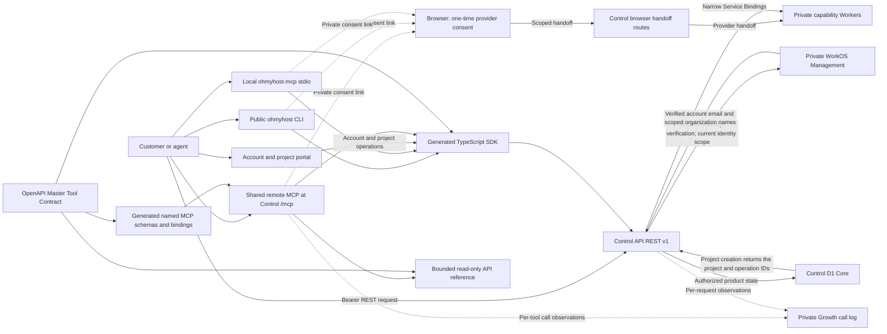
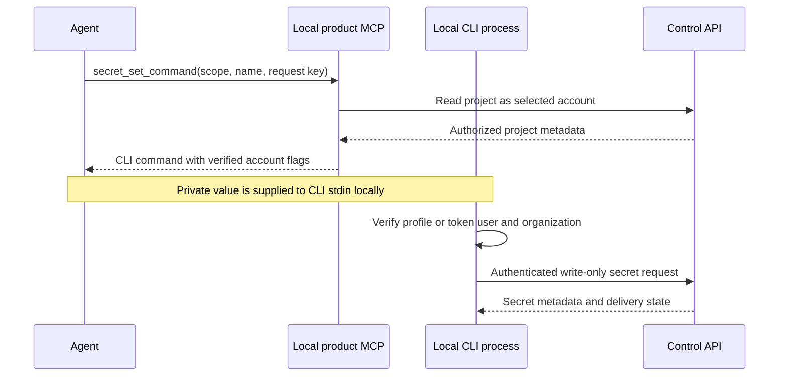
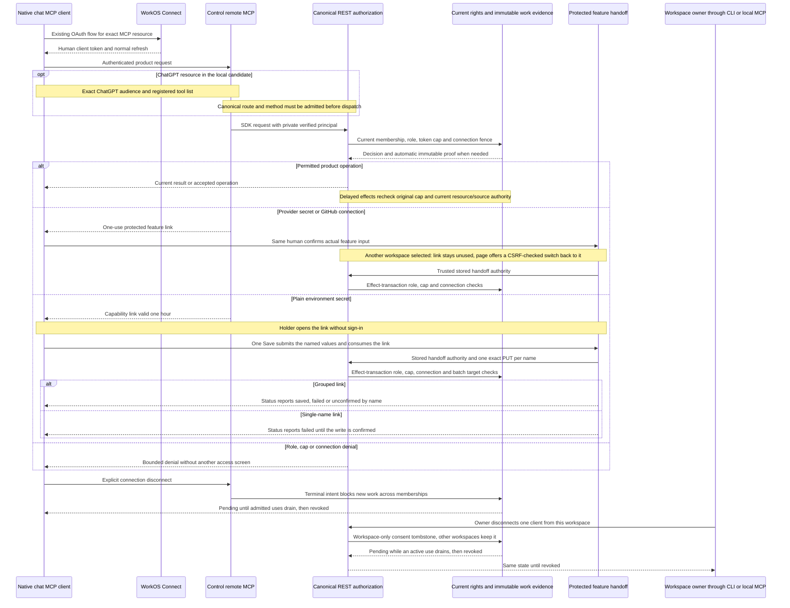
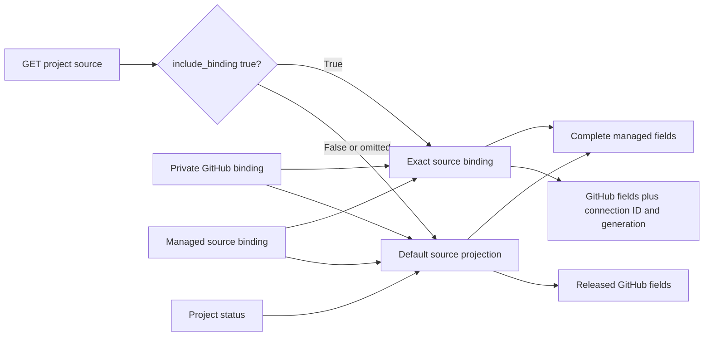
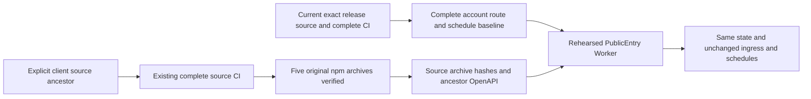
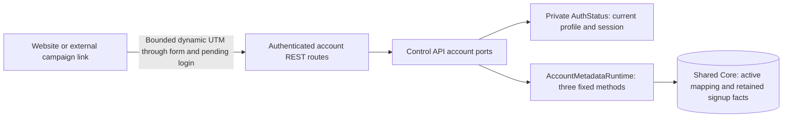
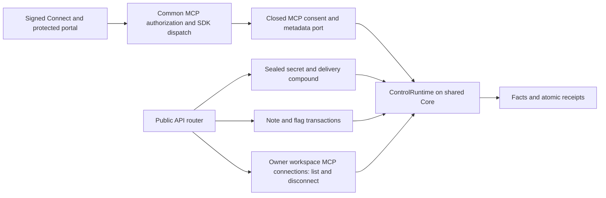
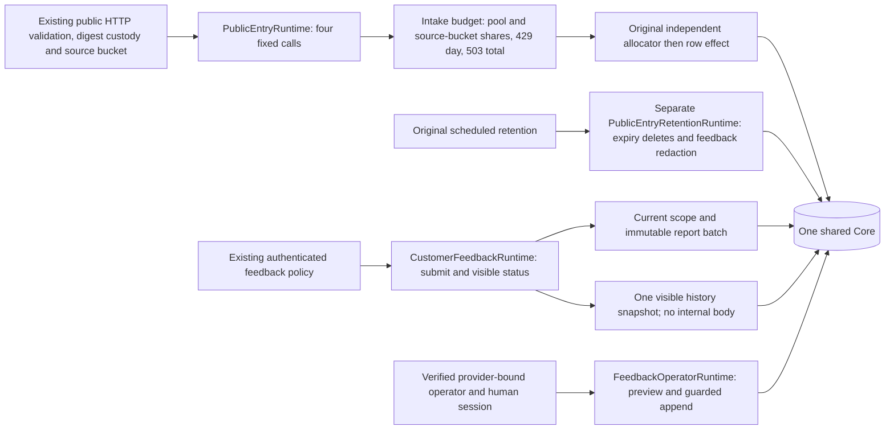

# API, clients and agent interfaces

## W44 workspace connections

The published 0.1.63 API contains seven organization-scoped connection operations covering provider availability, owner consent, grant status and listing, discovery, import, and disconnect. The CLI and local MCP retain the six operational connection workflows. W51 adds a read-only provider availability tool to remote MCP and preserves the existing connection handlers. Responses return connection metadata and the protected consent link. The existing workspace authorization, credential custody, and disconnect confirmation still apply. [Custody and authority](auth-and-secrets.md#connection-grant-custody), [D609](decisions/identity.md#d609).

The W44 execution source candidate adds owner `POST /v1/organizations/{organization_id}/connections/action-bindings` and server `POST /v1/make/actions/run`. A binding pins one imported project/environment connection and exact Endpoint action or eligible app-specific API Shell scenario with pinned method and path prefix; the returned action credential belongs only in an application server secret. The runtime supplies that bearer, an idempotency key and input, never Make credentials. Known outcomes can be repeated safely; an unknown post-dispatch outcome is not automatically replayed. These secret-bearing or restricted operations are excluded from remote MCP. Applications declare the exact applicable `https://app.ohmyho.st` or `https://dev.app.ohmyho.st` origin in `runtime.egress.allow`. This is a candidate, with hosted acceptance and release pending. Specification.

## Accepted release and current source candidate

Wave 3 release **0.1.66** serves **175 REST operations** and **156 remote MCP tools**, including the four per-environment Live Preview operations. The project creation response includes a required `project_id`. [D608](decisions/runtime-and-lifecycle.md#d608) · [Public release manifest](https://ohmyho.st/releases/0.1.66/manifest.json) · Release receipt

This chapter describes the checked-in customer interface and its trust boundaries. A source review or passing local contract test establishes the implementation contract; release and acceptance records establish what ran in an environment. [Authentication and secret custody](auth-and-secrets.md) owns credential storage. The deployment and database chapters own runtime publication and application data access.

The current candidate pins `@modelcontextprotocol/server` 2.3.0 in Control and local MCP, and Hono 4.13.11 in Control and webhook ingress. Remote HTTP handling continues to create a fresh server for each request; local MCP retains its isolated stdio transport. These patches address the maintainers' [MCP transport isolation](https://github.com/modelcontextprotocol/typescript-sdk/security/advisories/GHSA-jm63-cq47-j5jp), [bounded validation](https://github.com/modelcontextprotocol/typescript-sdk/security/advisories/GHSA-46jr-4wx8-v453), [bearer audience](https://github.com/modelcontextprotocol/typescript-sdk/security/advisories/GHSA-rvq5-wwqv-78pq) and [Hono path decoding](https://github.com/honojs/hono/security/advisories/GHSA-5r4p-p66f-jhc7) advisories. The current pinned test toolchain retains its reviewed security floors and declared dependency overrides; it introduces no product permission or protocol change. [Dependency pins](../../pnpm-workspace.yaml), scoped verification.

## Public contract and client route

The canonical product contract is REST `/v1`, specified in OpenAPI **3.1.2**. Production and platform Development have separate API origins, `https://app.ohmyho.st` and `https://dev.app.ohmyho.st`. The project environments named Dev and Prod are a separate selection inside either platform. The generated TypeScript SDK supplies the transport operations used by the public CLI, local product MCP and authenticated portal. Direct authenticated REST remains available to customers and automation. [OpenAPI source](https://github.com/amerged-org/ohmyhost/blob/main/packages/contracts/openapi.yaml#L1), [CLI platform selection](https://github.com/amerged-org/ohmyhost/blob/main/apps/product-cli/src/composition.ts#L163), [SDK-backed CLI transport](https://github.com/amerged-org/ohmyhost/blob/main/apps/product-cli/src/product-api.ts#L572).

`packages/contracts/openapi.yaml` and the application configuration schema are authored sources. Redocly bundles the REST source into `packages/contracts/generated/openapi.json`; Hey API generates the SDK from that bundle. Its configuration disables a fixed base URL, uses the fetch client, throws on unsuccessful responses and generates flat operation parameters with data responses. Handwritten runtime validators add exact response shapes, scope checks and safe problem parsing around generated transport. Generated types alone do not validate untrusted responses. [SDK generator configuration](https://github.com/amerged-org/ohmyhost/blob/main/hey-api.config.ts#L3), [contract drift check](https://github.com/amerged-org/ohmyhost/blob/main/scripts/check-contracts.mjs#L10), [managed mail validation](https://github.com/amerged-org/ohmyhost/blob/main/packages/sdk-ts/src/managed-mail-response.ts#L3).

The historical Auth-only restoration retained the **0.1.50** customer contract and immutable original `96e13f88` distribution. Restoring compatible serving code does not rebuild or relabel those archives and is not an all-channel publication claim. Public-channel convergence and actual Dev/Prod Auth verification remain separate release evidence. Earlier client releases and their exact-source receipts below remain historical.

The 0.1.34 public client cohort was released from exact source `d0f9b3469f5af47509b8afcc3bda453bdd70ee42` for the W22 current-identity contract (W22 release acceptance); all thirteen public channels and the active/latest MCP Registry read back at that version. The prior 0.1.33 W20 policy-cohort release remains preserved in W20 acceptance, as does the 0.1.32 W15 release acceptance. The prior 0.1.31 exact-source access-routing release and live readback remains preserved. The prior 0.1.30 backend RLS delivery remains preserved in W13 acceptance. The prior 0.1.29 client/Worker identities remain preserved in the historical P39 receipt. Selected managed/remote release and native outcomes are evidenced; full client-specific acceptance remains A01–A06, A36–A39 and A41. Exact-record parsers intentionally reject missing and unknown fields in the records they validate. Existing GitHub source reads and project status therefore retain their exact released fields, and the existing source-link operation and authorization responses retain their contracts. A newer client can use these default GitHub reads against the older API. To obtain the authoritative GitHub source connection ID and generation, a caller explicitly requests `GET /v1/projects/{project_id}/source?include_binding=true`; the strict binding parser requires both fields. Managed sources always expose their complete binding. The default/false projection and the true projection have separate closed schemas; missing binding fields never become a guessed generation. New managed writes require the matching platform capability and database migrations. These checks do not establish a recursive secret filter over every response: the operation reader accepts a record-shaped result, and safe problems can retain bounded detail text. Server-side safe projections remain necessary. [CLI package](https://github.com/amerged-org/ohmyhost/blob/main/apps/product-cli/package.json#L3), [exact mail response keys](https://github.com/amerged-org/ohmyhost/blob/main/packages/sdk-ts/src/managed-mail-response.ts#L156), [public response validation](https://github.com/amerged-org/ohmyhost/blob/main/apps/control-api/src/app.ts#L4852).

## Master Tool Contract

[D611](decisions/clients-and-public-content.md#d611) and the owner-approved W51 specification define one authored API/MCP contract on the current Main baseline. Every OpenAPI operation carries `x-ohmyhost-mcp`: 148 are named, 14 protected handoffs/custody exceptions, one an equivalent existing workflow and 12 excluded from remote execution. The contract still documents all 175 operations, including exceptions. Top-level workflow metadata accounts for genuine non-REST tools; it grants no authority.

The existing SDK generator emits dependency-free resolved schemas, an exact bundled-OpenAPI SHA-256, separate API/client-release versions and typed SDK bindings. Its existing normal/temporary two-pass drift check covers the new generated module. The remote handler preserves the 86 existing definitions and adds 69 generated tools plus `api_reference`, for 156 total. Their reusable schemas hold public contract data only; server/request/principal state remains isolated. Generation rejects undecided operations, collisions, unresolved/unsupported schema constraints and declared credential-bearing generated results. [Projection](../../scripts/mcp-remote-projection.mjs), [generated SDK contract](../../packages/sdk-ts/src/generated/mcp-remote.gen.ts), [registration](../../apps/control-api/src/remote-mcp-generated.ts).

Each executable operation remains individually named and reviewable. One internal executor calls its fixed SDK function; callers cannot choose arbitrary HTTP methods, URLs or credential headers. The existing same-origin transport rechecks the current principal for every canonical request and retains current roles, revocation, plans, ETags, idempotency, safe problem responses and W50 correlation. Effects are explicit, not inferred from GET. Existing response envelopes remain; accepted or HTTP-200 failed business work retains its actual state instead of becoming a success assertion.

`api_reference` is a separately named read-only documentation tool. It searches or describes compiled operations, their input/output schemas and exact MCP dispositions, with contract hashes and immutable release links. Lists paginate with cursors bound to the contract/query/offset; results are bounded to 32 KiB and oversized complete schemas yield the full-contract link. It never fetches an arbitrary destination or executes an operation. Server coverage is distinct from tools a particular native host currently exposes. [Reference implementation](../../apps/control-api/src/remote-mcp-reference.ts).

Raw secret/token/database-credential responses, secret-returning webhook creation/activation and receiving-mail webhook setup/rotation, encrypted-export passwords and browser/local/stream/binary-only paths are not generic remote bindings. Existing protected secret forms remain separate. Safe webhook metadata actions and schedules/watches are exposed. Inbox content is untrusted customer data; public DNS TXT challenges are verification data rather than credentials. The contract states real exceptions instead of inventing an unfinished secret-custody workflow.

Both remote plugins use the same endpoint and expanded catalog; current REST scope controls execution. The inspected OpenAI human R4 package has ten Skills with stale names/limitations, while Claude's four self-contained workflows remain unchanged. Canonical Skills and generated surface docs now distinguish CLI, local MCP and remote MCP. The actual-upload promise fixture pins the inspected archive and records imported-text corrections; changing that text requires its own package-review path. Tool-only continuous checks, imported-package review, backend release and fresh native-host execution are separate observations. Public docs generation still requires the qualified immutable client artifact. [Provider synchronization rule](../development.md#api-and-plugin-contract-synchronization), [uploaded promises](../../tests/fixtures/openai-human-r4-0.1.52-tool-promises.json).

W51 shipped to Development and Production from `64c63df84c13882764ae24dcce93c8b714f09eab`, the tree merged in PR #20. Public delivery uses the [0.1.65 release manifest](https://ohmyho.st/releases/0.1.65/manifest.json). Provider-specific package reviews and native availability have separate acceptance records.

## Shared sender management

W25 adds dedicated closed response contracts rather than changing the legacy project `mail-domain` response. Workspace resources live at `/v1/organizations/{organization_id}/mail-domains`; individual read/retire and DNS-authorization operations select `{mail_domain_id}`. Project settings use `GET/PUT/DELETE /v1/projects/{project_id}/environments/{environment_id}/mail-domain-binding` with the Prod environment. Initial attachment uses `expected_revision: 0`; later changes, detach and retirement require the observed current revision and a retained idempotency key. Sender-address/default From/default Reply-To configuration is non-secret; provider keys, ciphertext, OAuth values and webhook secrets remain private. [Canonical contract](../../packages/contracts/openapi.yaml), [Control routes](../../apps/control-api/src/shared-mail-routes.ts), [management boundary](../../apps/control-api/src/shared-mail.ts).

`/v1/projects/{project_id}/application-domain-identity` declares, reads and revokes the intended hostname; `/verify` proves its current TXT challenge and `/dns-authorization` creates/reads the optional exact-purpose Cloudflare handoff. This works before deployment without activating website traffic. Workspace sender DNS consent is separately scoped and needs no website hostname. DELETE on either DNS-authorization resource revokes only its management grant under current resource revision; it does not silently retire the sender, invalidate independently verified application proof or retarget web traffic. Reusing a verified sender with a verified same-main-domain application needs no new sender DNS grant. [Proof and routing separation](storage-and-domains.md#application-identity-before-mail-gated-deployment).

Authority is intersected: current workspace membership, canonical sender read/use/admin and target-project rights, plus any explicit credential restriction, must permit the operation. Full-default human OAuth uses those current rights without another sender selection. Transport choice cannot broaden API-key or deliberately issued token bounds. Invisible foreign resources retain non-enumerating not-found behavior. Same-main-domain equality and current proof are server/persistence/runtime gates, not client-only filtering. [Mail policy](mail-and-recovery.md#same-domain-shared-sender-contract).

The response codec has one authored source in `packages/contracts/src/shared-mail.ts`. SDK generation embeds its exact dependency-free source and canonical SHA-256 in the SDK's generated tree, for both normal output and the two temporary drift-check generations. The SDK imports that generated module relatively, so its runtime and declarations install without an unpublished workspace dependency. The existing customer-library packaging guard remains unchanged. [Canonical codec](../../packages/contracts/src/shared-mail.ts), [generator and drift ownership](../../scripts/generate-sdk-ts.mjs), [standalone packaging](../../scripts/package-customer-client.mjs).

Customers manage senders and project bindings through their agent using the generated SDK via local or remote MCP, or through the CLI and REST clients. A browser opens a private link for provider consent when required. The account portal has no sender settings or binding forms. Sending remains an application runtime capability. The W25 progress record separates source implementation, exact-revision verification, coordinated client/Worker release and customer acceptance.

## Control API boundary

`apps/control-api` composes Hono route handling, Core persistence, authentication, local authorization, scoped rate limits and private service clients. Public handlers validate paths, headers, query parameters, body size, JSON shape and selected scope before invoking the capability. Returned provider and persistence data are checked before becoming customer guidance. Request failures expose the problem contract with a request ID, safe code, retryability and suggested action; ordinary error reports use a safe route label and platform code rather than credentials, SQL or upstream exception text. [Request validation](https://github.com/amerged-org/ohmyhost/blob/main/apps/control-api/src/app.ts#L7470), [authentication and authorization](https://github.com/amerged-org/ohmyhost/blob/main/apps/control-api/src/app.ts#L8845), [security headers](https://github.com/amerged-org/ohmyhost/blob/main/apps/control-api/src/app.ts#L10045).

A refused source answers 409 `framework_conversion_required`, which `planDeployment` documents. Whenever the refusal is typed, `detail` is a fixed catalog sentence rendered from its diagnostic: one of 40 codes, each with an exact key set, the path classes it may name (a module, `package.json`, a lockfile, a framework config or the repository-root `ohmyhost.yaml`) and bounded fields. The version code adds `package`, the declared or resolved `version` and the `minimum` to use. Rendering and parsing derive from one template per code, so a client maps a detail back to exactly one diagnostic and accepts no other text; an untyped refusal keeps the generic sentence. The 0.1.33 catalog drops `next_cache_components_unsupported`, since Cache Components are admitted under [D430](decisions/source-and-build.md#d430), and adds `next_tailwind_turbopack_only` for a Next.js config that applies Tailwind CSS only through Turbopack ([source admission](build-and-deploy.md#source-admission)); it still has 40 codes. The problem action says to apply the named change or, when no file is named, to run `ohmyhost init --dry-run --json` and read its blockers and pending checks. [Diagnostic catalog](https://github.com/amerged-org/ohmyhost/blob/main/packages/contracts/src/framework-admission.ts#L350), [problem action](https://github.com/amerged-org/ohmyhost/blob/main/packages/contracts/src/problem-policy.ts#L377), [409 rendering](https://github.com/amerged-org/ohmyhost/blob/main/apps/control-api/src/app.ts#L4687), [planning contract](https://github.com/amerged-org/ohmyhost/blob/main/packages/contracts/openapi.yaml#L2489).

Authentication identifies the actor and current credential. Authorization separately checks its current organization, project, environment and action; a key's scope constraint further limits those actions. Scoped tenant-resource handlers use the same not-found boundary for unknown and unauthorized resources; account/session requirements and creation/discovery actions can separately return forbidden or organization-required errors. Scoped persistence results cannot silently substitute a different project or operation. A network or provider outage remains unavailable rather than being treated as permission, missing data or zero usage. [Authorization intersection](https://github.com/amerged-org/ohmyhost/blob/main/apps/control-api/src/app.ts#L7282), [visible project and operation checks](https://github.com/amerged-org/ohmyhost/blob/main/apps/control-api/src/app.ts#L7089), private dependency contracts.

The public surface covers projects and source linkage, plans/deployments/promotion/rollback/deletion, guarded data-assignment changes, operation state/events/reconciliation, Dev access, domains/DNS, environment-secret metadata and writes, database queries/writes/temporary access/compute, managed mail, exports, shared project context, feedback, organization credit usage/budgets and billing. Owners also reach the workspace GitHub disconnect, the workspace's MCP client connections, the mail webhook signing-secret rotation and signed export download links. The corresponding adapters keep provider credentials in the capability's private Worker. This list describes routes, not independent authorization grants or proof that every optional binding is configured. [Route composition](https://github.com/amerged-org/ohmyhost/blob/main/apps/control-api/src/app.ts#L225), [Worker binding composition](https://github.com/amerged-org/ohmyhost/blob/main/apps/control-api/src/worker-main.ts#L682).

Three Owner reads cover the credit account and take no query parameter. `GET /v1/organizations/{organization_id}/account` returns `plan`, `plan_source`, `paid_until`, `available_micros`, `monthly_micros`, `one_time_micros`, `reserved_micros`, `next_expiry` and `as_of`; `/credits` returns only the balance: the available and reserved credit and the seven-day grace window, with no meters and no prices (what was used is read from `/credit-usage`, the published prices from the pricing page); `/credit-usage` returns the billed charges of the last up to 14 UTC days (today included) as `days[]` -> `projects[]` -> `meters[]` plus each project's `used_micros` of the current UTC month. There is no `month` or `cursor` parameter and no spent, expired or overrun total. Account and credits come from the Core's `PublicCreditRuntime`; only the usage report also calls the private Credit Service through `CREDIT_SERVICE`. [Routes](../../apps/control-api/src/app.ts#L1299), [Core and service composition](../../apps/control-api/src/d1-credits.ts#L218), [contract](../../packages/contracts/openapi.yaml), [Credit Service](services-and-workers.md#credit-service), [usage report rules](billing-and-pricing.md#credit-log-rotation-and-the-usage-report).

Idempotent mutations retain one key for the same deliberate request. The OpenAPI contract declares the `Idempotency-Key` header on each mutation that needs one, including the database routes listed under [database events](#database-events-schedules-and-executions), environment-secret writes, deletes and rotations, and the mail webhook rotation; the Control API replays the stored answer for an identical request, and a changed request under the same key answers 409 `idempotency_key_reused`. Dev access tickets accept the header and ignore it, because each issue revokes the unused predecessor. The GitHub disconnect, the MCP client disconnect and the signed export download link take no key: a repeated GitHub disconnect changes nothing once it has applied, the MCP client disconnect is repeated until it answers `revoked`, and each download-link request signs and audits another link ([contract changes](#rest-and-mcp-contract-additions-and-changes)). Guarded promotion, rollback, deletion and data changes additionally use an exact plan, resource ETag and action confirmation. An accepted operation can be queued or running; acceptance is not completion. The ongoing operation SSE rechecks identity and authorization every fifteen seconds (events still arrive on the one-second poll), then closes on terminal state, revocation, scope change or unavailable authorization. Deployment diagnostic SSE currently serializes one finite, authorized, validated page; it is not an ongoing subscription with repeated revalidation. Individual records are validated, and ongoing SSE has a separate lifetime from an ordinary bounded JSON request. Guarded product acceptance, [operation stream revalidation](https://github.com/amerged-org/ohmyhost/blob/main/apps/control-api/src/app.ts#L8934), [finite diagnostic SSE page](https://github.com/amerged-org/ohmyhost/blob/main/apps/control-api/src/app.ts#L3044).

Operation errors carry only reviewed text for their public code. The optional `OperationFailure.detail` appears only on `auto_deploy_plan_rejected` when the push's planning returned a typed refusal: Control stores the diagnostic in `operations.failure`, re-renders it from the catalog in operation reads, operation events and the project status `latest_operation`, and treats a stored diagnostic outside the catalog as missing. The CLI and local MCP parsers accept `detail` only on that code and only as an exact catalog sentence, and re-render it with their own catalog copy. The local MCP returns it with the operation; the CLI shows it inside the operation JSON of `ohmyhost operation get` and in the `latest_operation` of `ohmyhost project status`, while its failure message stays the reviewed error message. Project context (`ohmyhost project context`, MCP `project_context_get`) shows the error code, its reviewed message and its suggested action, which points to `error.detail`. Clients 0.1.31 and older reject the field; 0.1.32 shipped it with Control under [D265](decisions/delivery-and-operations.md#d265). A catalog change breaks these parsers in both directions: clients of 0.1.32 and older reject a stored `next_tailwind_turbopack_only` sentence, so their operation reads, operation events and project status fail for such a push, and 0.1.33 clients reject the removed Cache Components sentence of an older Control. The 0.1.33 clients therefore ship in the same release as the [D429](decisions/delivery-and-operations.md#d429) policy cohort; only a planning 409 with an unknown sentence falls back to the generic problem action. [Public operation failure](https://github.com/amerged-org/ohmyhost/blob/main/packages/contracts/src/operation-failure.ts#L182), [stored operation validation](https://github.com/amerged-org/ohmyhost/blob/main/apps/control-api/src/app.ts#L8764), [client parser](https://github.com/amerged-org/ohmyhost/blob/main/apps/product-cli/src/runtime-contract.ts#L1448).

A failed database size change is a reviewed failure as well: its fixed message and action, the same on every surface, are described under [provider lifecycle and compute](database.md#provider-lifecycle-and-compute).

## Authentication and account selection

The public CLI is a public WorkOS OAuth client. Its pre-authentication Device Authorization and token/refresh calls are the narrow exception to SDK-mediated product-resource requests: they acquire or renew a user session and receive no provider management key. After authentication, organization/project/account operations use the product API. WorkOS token verification, current-session status and user-key validation are distinct private checks; valid syntax or a valid JWT signature alone does not establish current product permission. [CLI Device Flow composition](https://github.com/amerged-org/ohmyhost/blob/main/apps/product-cli/src/composition.ts#L782), [token refresher](https://github.com/amerged-org/ohmyhost/blob/main/apps/product-cli/src/composition.ts#L1231), [Control authentication](https://github.com/amerged-org/ohmyhost/blob/main/apps/control-api/src/workos-authenticator.ts#L112).

The current-identity extension released as `0.1.34` retains `actor_id` and `organization_ids` on `GET /v1/me` and adds required `email: string | null` and `organizations: [{id, name}]`. The names cover exactly the credential's authenticated organization scope in the same order as `organization_ids`. Human Connect now resolves current account memberships under D453; explicit token restrictions and disconnected-workspace fences bound visibility. The email identifies the signed-in user or user API-key owner, including a connected human's remote MCP call. M2M returns `email: null`. CLI `whoami` and local/remote MCP `identity_get` use this contract through the generated SDK. The endpoint accepts no identity query parameters. [Identity route](../../apps/control-api/src/app.ts), [OpenAPI schema](../../packages/contracts/openapi.yaml), [strict client parser](../../apps/product-cli/src/runtime-contract.ts).

Control resolves that verified scope's active WorkOS organization mappings, then requests current metadata through the existing private `AUTH_STATUS` Service Binding's `POST /current-identity`. Its closed body is `{user_id: null | user_*, workos_organization_ids: org_*[]}`, with at most 100 unique organization IDs per internal batch. Control batches a larger current scope without truncating account authority. WorkOS Management reads only the supplied user and organizations through live provider GETs, validates returned IDs and sends minimized metadata back; credentials remain in that private Worker. Control checks the response against the authenticated user and exact ordered scope before returning display metadata. Missing mappings, mismatched or unavailable provider data return a safe retryable 503, without an ID-only fallback. Private and public responses use `Cache-Control: no-store`. This extension adds no service, permission grant or provider credential exposure. Exact source `d0f9b346` passed full local verification and complete CI before coordinated Development/Production release; native remote MCP and registry-installed CLI/local MCP acceptance preserve the original identity scope (completed W22). Exact parsers require the `0.1.34` OpenAPI, generated SDK, CLI and both MCP surfaces to ship with the API. [Scoped projection](../../apps/control-api/src/current-identity.ts), [private metadata reader](../../apps/workos-management/src/current-identity.ts), [private route](../../apps/workos-management/src/service-binding.ts).

Each saved local login names one platform, verified user and at most one organization. Requests select a login with `--profile-name`, MCP `profile_name`, a process's `OHMYHOST_PROFILE`, the command's organization or a verified checkout link. Several plausible logins require an explicit selection; there is no machine-wide mutable active account. A named login already bound to an organization stays there. Binding an organizationless login verifies the same user and exact organization before saving. Adding another organization requires another login. [Per-call transport selection](https://github.com/amerged-org/ohmyhost/blob/main/apps/product-cli/src/composition.ts#L225), [workspace identity verification](https://github.com/amerged-org/ohmyhost/blob/main/apps/product-cli/src/workspace.ts#L82), [profile registry](https://github.com/amerged-org/ohmyhost/blob/main/apps/product-cli/src/profile-store.ts#L110).

`OHMYHOST_TOKEN` selects the user API key supplied to that process. It overrides saved logins but cannot silently act as another requested profile/user/organization, and failures do not fall back to a different credential. Workspace and token management need a current interactive login; setting the environment token does not turn those actions into automation-key actions. A new user API key remains valid until revoked; current membership and permissions still apply. Key lifetime and WorkOS session lifetime are separate. The CLI renews short-lived access tokens and preserves workspace context; provider rejection ends only the affected login. The requested longest supported local sign-in lifetime is a provider-configuration requirement, not proof of an already changed policy. [Environment-token context check](https://github.com/amerged-org/ohmyhost/blob/main/apps/product-cli/src/composition.ts#L470), [session renewal](https://github.com/amerged-org/ohmyhost/blob/main/apps/product-cli/src/composition.ts#L350), [interactive token-management guard](https://github.com/amerged-org/ohmyhost/blob/main/apps/control-api/src/user-api-key-management.ts#L43).

The Control API also has a separately verified WorkOS M2M policy: a service token must have an active internal organization binding, and its token scopes are intersected with that binding before product authorization. Retained internal `ohk_` organization-key helpers use peppered HMAC digests and scoped metadata; the current public Worker composition selects the WorkOS authenticator and does not expose those helpers as a customer key-issuance API. User keys, service principals and retained internal key utilities must not be conflated. [Token policies](https://github.com/amerged-org/ohmyhost/blob/main/apps/control-api/src/worker-main.ts#L205), [M2M binding](../../apps/control-api/src/d1-project-application.ts#L24), internal organization-key utility.

Identity reads have distinct bounds. Organization synchronization follows bounded provider pages under an overall snapshot deadline; the onboarding account-profile read takes one active-membership page of at most 100 entries, so it does not establish a complete membership list beyond that page. The private read-only transport's per-request timer ends at response headers; only its snapshot path adds the overall deadline through body reading. Current-session status also has the Control caller's separate fail-closed timeout. [Profile membership page](https://github.com/amerged-org/ohmyhost/blob/main/apps/workos-management/src/organization-onboarding.ts#L128), [private snapshot deadline](https://github.com/amerged-org/ohmyhost/blob/main/apps/workos-management/src/workos-readonly-transport.ts#L321), [status caller timeout](https://github.com/amerged-org/ohmyhost/blob/main/apps/control-api/src/workos-session-status.ts#L27).

Local access/refresh credentials are serialized into the operating system's credential store through `@napi-rs/keyring`, one entry per login. Development uses service `ohmyhost`; Production uses `ohmyhost.production`. The separate `~/.ohmyhost/profiles/<service>` index contains login names and IDs, never tokens. A locked or unavailable native store fails closed; the retained owner-only file adapter is not an automatic fallback of the shipped CLI/MCP composition. Deliberate user-key creation writes `OHMYHOST_TOKEN` to the customer's selected private env file, which must be ignored by Git or outside the repository; existing token contents are preserved. [Native credential entries](https://github.com/amerged-org/ohmyhost/blob/main/apps/product-cli/src/credential-store.ts#L46), [profile-index location](https://github.com/amerged-org/ohmyhost/blob/main/apps/product-cli/src/profile-store.ts#L82), [private token-file preparation](https://github.com/amerged-org/ohmyhost/blob/main/apps/product-cli/src/user-token-file.ts#L49).

The [platform-token custody chapter](auth-and-secrets.md#platform-login-and-api-tokens) describes provider issuance and Control metadata. Checkout links contain non-secret origin/organization/project/repository metadata and are partitioned by platform and organization; they grant no authority. Legacy links and credentials are verified before migration. The profile registry's immutable numbered snapshots and owner-only publication prevent concurrent agents from overwriting each other's login selection. [Checkout links](https://github.com/amerged-org/ohmyhost/blob/main/apps/product-cli/src/project-link-store.ts#L14), [legacy-login migration](https://github.com/amerged-org/ohmyhost/blob/main/apps/product-cli/src/composition.ts#L413).

## Browser portal

The Control API serves browser sign-in and the authenticated project/profile/billing/usage/budget/token views. Login uses bounded browser handoffs, verified callback state and provider token exchange; the session is separate from local CLI profiles. Browser product reads and writes call generated SDK operations through the Control API's injected fetch boundary and forward the visitor's address for ordinary API rate limiting. Current-user identity selects the account; a page parameter is not an account grant. [Portal SDK composition](https://github.com/amerged-org/ohmyhost/blob/main/apps/control-api/src/browser-login.ts#L171), [account profile scope](https://github.com/amerged-org/ohmyhost/blob/main/apps/control-api/src/account-profile.ts#L16).

After login consumes the pending cookie, a repeated callback GET with exactly one well-formed code and state returns HTTP 303 to `/login` if the browser has a valid sealed portal session. The redirect drops the query. The ordinary login route checks the existing account and workspace. Establishing a session still requires valid pending state, a matching callback state and a PKCE code exchange. A missing session or a malformed, expired or conflicting pending cookie keeps the invalid callback on HTTP 400. [D018](decisions/identity.md#d018).

Portal session cookies are encrypted, origin-bound `__Host-omh-session` cookies with Secure, HttpOnly and SameSite=Lax flags and a separate seven-day limit. An expired WorkOS access token in the cookie of the MCP portal (`/mcp/secrets`, `/mcp/github`) is renewed from its refresh token with the login page's grant; the renewed cookie keeps the same CSRF token, creation time and workspace. A refresh that WorkOS rejects answers the sign-in page without a Set-Cookie: WorkOS issues each refresh token once, so a parallel request with the old cookie can be rejected after another request has already stored the rotated session, and a clear sent by the rejected request could erase that session in the browser. The stale cookie stays until a sign-in replaces it or its seven-day limit ends. A renewed token that the portal then refuses still stores the rotated cookie, for the same reason. A provider outage answers 503 and changes no cookie. State-changing browser actions validate CSRF and the selected current workspace. A signed-in portal that shows another workspace than an MCP link's (`/mcp/secrets` or `/mcp/github` with `?request=`) offers a switch page instead of consuming the link. `readWorkspaceSwitch` returns the link only to its own user, while the portal's selected workspace is not the link's and the account profile lists that workspace; reading it changes nothing. The form posts to `/workspace` with CSRF validation, selects that workspace and refreshes the session for it, then redirects only to a `return` that `MCP_LINK_RETURN` accepts (the same link path with a 43-character token); any other or repeated `return` is refused with 400 before the session changes. Tokens are created through the same interactive product boundary, revealed only through the creation flow, and subsequently listed as metadata. Billing links hand the customer to Stripe Checkout/Portal; rendering or visiting a link is not payment confirmation or recurring-charge consent. The [auth and secret chapter](auth-and-secrets.md#platform-login-and-api-tokens) owns session encryption and token custody. [Browser session validation](https://github.com/amerged-org/ohmyhost/blob/main/apps/control-api/src/browser-session.ts#L12), [portal handlers](https://github.com/amerged-org/ohmyhost/blob/main/apps/control-api/src/browser-login.ts#L407), [portal rendering](https://github.com/amerged-org/ohmyhost/blob/main/apps/control-api/src/portal-page.ts#L156).

The source candidate renders platform-owned one-time action pages through one pure Control HTML frame using the website header and mark. Make consent and completion, MCP handoffs, portal notices, Cloudflare callback success and the one-time token result share presentation while callers retain their flow-specific status, HEAD handling, no-store and referrer policy. The frame pins its static styles and any allowed script in CSP, limits form redirect origins to the existing allowlist, and leaves authentication, cookies, CSRF and one-time consumption in the owning handlers. The Cloudflare success HTML receives this frame’s CSP; API errors retain the strict default. The account portal also uses the website mark. This is source behavior, not hosted acceptance; Preview activation and Google sign-in changes are outside this continuation. [Renderer](../../apps/control-api/src/standalone-page.ts), [brand](../../apps/control-api/src/website-brand.ts), scope and tasks.

For a signed-out browser, a valid same-origin GET to a Make connection form or authenticated MCP handoff can continue through portal sign-in. Control stores the exact allowlisted relative handoff in a sealed, origin-bound, HttpOnly, Secure, SameSite=Lax cookie for at most ten minutes and sends only a random resume marker through the local login flow. The callback clears the resume cookie and returns to the original handler, which still validates the signed-in human, handoff, current authority and one-time state. Invalid or expired resume data fails closed; POST requests and provider callbacks are not replayed. Anonymous MCP secret capabilities retain their existing unauthenticated path. This is a source candidate; hosted acceptance is separate. [Resume custody](../../apps/control-api/src/portal-login-resume.ts), [login flow](../../apps/control-api/src/browser-login.ts).

The customer starts the Make workflow with their agent. The agent lists the current workspace grant and requests a private consent link when needed. The browser confirms that scoped handoff and returns the user to the agent. The agent uses the grant to discover Make organizations, teams and connections and records an import in the project and environment selected by the customer. The account portal exposes Projects and account actions. Former browser management paths for mail and connections are retired. Legacy project-bound API calls retain their paired project and environment fields and scope. [Browser handoff](../../apps/control-api/src/connections-portal.ts) · [Public contract](../../packages/contracts/openapi.yaml)

The Make authorization and completion pages display the bundled original Make Domino PNG inside the ohmyho.st template. [Brand Guide](https://ohmyho.st/brand)

Portal copy prompts distinguish remote chat from local clients. Remote MCP verifies the account with `identity_get`, uses `workspace_setup` when no organization exists, then calls `identity_get` again; project access follows workspace membership, role and token restrictions, with no request step. The CLI and local MCP reuse a matching saved profile or the existing Device Login, then verify `whoami`. The agent reads an existing project binding before choosing a source; a new chat without repository context starts managed Git, and an unbound workspace without GitHub asks once between direct managed publication and GitHub setup. Account/project IDs are context and grant no authority. [Prompt construction](https://github.com/amerged-org/ohmyhost/blob/main/apps/control-api/src/portal-page.ts#L77), [common source flow](../../skills/ohmyhost-get-started/SKILL.md).

## MCP tools and resources

Local and remote product MCP put the existing-app access decision within the first 512 characters of their initialization instructions, before onboarding. The agent first inspects the actual execution environment, reachable checkout and saved project binding, then verifies the matching account and workspace. It reuses a working local CLI/MCP profile or private token source unless the user explicitly chooses remote access; remote tool availability alone does not choose that route. A mismatched remote identity or workspace stops repeated access links. An unreachable previous local workspace or credential store is reported as an access gap, without claiming credentials were deleted, substituting an unrelated Review/demo account or changing the saved source. The public `/auth.md` introduction and `/AGENTS.md` copied instructions apply the same context priority before remote grants. This is agent guidance under the existing [D426 interface decision](decisions/clients-and-public-content.md#d426); tool dispatch, API authorization and source contracts retain their existing behavior. [Canonical get-started Skill](../../skills/ohmyhost-get-started/SKILL.md), [local initialization](../../apps/mcp/src/local-server.ts), [remote initialization](../../apps/control-api/src/remote-mcp.ts).

The shipped product MCP is the local `ohmyhost-mcp` **stdio** process. It exposes the same SDK-backed account/project operations as CLI/REST, chooses the credential context on each tool call and uses the request's cancellation signal. Tool descriptions, schemas and read/mutation/destructive annotations are generated into the public catalog from the server's actual `tools/list`. An annotation describes a tool's effect; it does not replace the customer's authorization, API authorization, required confirmation fields or server validation. [stdio entrypoint](https://github.com/amerged-org/ohmyhost/blob/main/apps/mcp/src/stdio-main.ts#L22), [SDK-backed MCP client](https://github.com/amerged-org/ohmyhost/blob/main/apps/mcp/src/local-client.ts#L249), [per-tool selection](https://github.com/amerged-org/ohmyhost/blob/main/apps/mcp/src/local-server.ts#L2308), [catalog equivalence regression](https://github.com/amerged-org/ohmyhost/blob/main/apps/mcp/test/tool-catalog.test.ts#L6).

There is no environment-secret value argument or value-read tool. `secrets_list` returns metadata; `secret_set_command` returns an stdin command tied to the verified account; the CLI checks that identity before reading the private value. It cannot reuse a same-named profile belonging to another account or substitute a saved login for a token-bound handoff. Storage/delivery of that value is described in [customer runtime secrets](auth-and-secrets.md#customer-runtime-secrets). [Secret tools and handoff](https://github.com/amerged-org/ohmyhost/blob/main/apps/mcp/src/local-server.ts#L2103), [account flags](https://github.com/amerged-org/ohmyhost/blob/main/apps/mcp/src/local-server.ts#L2189), [pre-read handoff validation](https://github.com/amerged-org/ohmyhost/blob/main/apps/product-cli/src/composition.ts#L745).

This rule concerns the environment-secret management surface. Some deliberately authorized capabilities are sensitive MCP results: temporary database access returns its connection URI once; mail webhook setup and rotation return the server-only signing secret; Dev-share, export-download and billing handoffs return scoped bearer URLs. Owner-visible failed-health diagnostics can also include a bounded, sanitized customer-application response excerpt, which may repeat a value the application exposed; members receive the diagnostic without that excerpt. A database webhook receiver URL follows the same rule: only a `projects:write` caller sees it whole, and a `projects:read` caller, MCP included, sees its origin. Capabilities must retain their documented scope/lifetime and must not be copied into shared notes, logs or source. MCP is not a universal secret-free output channel. [Temporary database-access tool](https://github.com/amerged-org/ohmyhost/blob/main/apps/mcp/src/local-server.ts#L964), [mail webhook handoff](https://github.com/amerged-org/ohmyhost/blob/main/apps/mcp/src/local-server.ts#L1655), [health excerpt authorization](https://github.com/amerged-org/ohmyhost/blob/main/apps/control-api/src/app.ts#L5068).

Four Owner administration actions exist only in the CLI and the local stdio server, not in the remote product MCP: `github_disconnect` (destructive, `confirmed: true`, no idempotency key), `organization_mcp_connections_list` and `organization_mcp_connection_revoke` (the revoke is destructive, `confirmed: true`, no key, and answers `pending` until an active use of that consent drains), `mail_webhook_rotate` (destructive, `idempotency_key` and `confirmed: true`; its answer is the only place the new signing secret appears) and `project_export_download_link_create` (not idempotent; its `download_url` is a bearer capability). The CLI commands are `github disconnect --yes`, `organization mcp-connections list` and `revoke --yes`, `mail webhook rotate --yes` and `export download-link`. The remote server registers none of them, because each one ends a workspace connection or returns a secret or bearer URL that a connected chat transcript would otherwise hold, the same rule the remote contract applies to the webhook secret above. The CLI and the local server refuse a GitHub disconnect answer that still reports `connected`, and the rotation accepts only a verification-required https endpoint with a well-formed secret. [Local tool definitions](https://github.com/amerged-org/ohmyhost/blob/main/apps/mcp/src/local-server.ts#L1962), [CLI help](https://github.com/amerged-org/ohmyhost/blob/main/apps/product-cli/src/cli.ts#L358), [disconnect parser](https://github.com/amerged-org/ohmyhost/blob/main/apps/product-cli/src/runtime-contract.ts#L366). The decision is [D591](decisions/clients-and-public-content.md#d591).

MCP embeds the ten repository-owned customer Skills and their supporting resources at `skill://ohmyhost/...`; catalog reads require no customer credential. Project tools link to the authenticated `ohmyho://projects/{id}/context` resource, optionally naming the profile. Context includes current status and bounded shared notes; notes, feedback and received mail remain untrusted data, never executable agent instructions. Deployment diagnostics from `deployment_logs` (excerpt, file, route, exception_class) are untrusted customer output in the same way, including lines starting with `ohmyho.st`. The hosted `apps/mcp/src/worker-main.ts` endpoint exposes the resource server with host/origin checks; it does not turn the local product tools into an authenticated hosted product MCP. Mintlify's search MCP is a documentation reader, and Admin MCP is a separate provider-management interface. [Skill resources](https://github.com/amerged-org/ohmyhost/blob/main/apps/mcp/src/index.ts#L5), [project context resource link](https://github.com/amerged-org/ohmyhost/blob/main/apps/mcp/src/local-server.ts#L2288), [hosted resource-only handler](https://github.com/amerged-org/ohmyhost/blob/main/apps/mcp/src/worker-main.ts#L13).

## Remote product MCP

The working source implements stateless Streamable HTTP at the existing Control origin's `/mcp` endpoint, plus OAuth protected-resource metadata at `/.well-known/oauth-protected-resource/mcp`. This is separate from the local stdio product server and the older hosted resource-only Worker. Every remote product tool uses the generated SDK and canonical REST handlers through a typed internal dispatch; caller-supplied authorization/cookie headers cannot assert the verified internal principal. The server validates its exact HTTPS origin/host, bounds JSON messages and exposes Skills and OAuth tool descriptors without a cross-user MCP session store. [Remote server](../../apps/control-api/src/remote-mcp.ts), [Control composition](../../apps/control-api/src/remote-mcp-composition.ts), [Worker routing](../../apps/control-api/src/worker-main.ts).

WorkOS Connect Authorization Code/PKCE remains the remote-user route with the exact `${Control origin}/mcp` resource/audience and issuer/JWKS discovery. Standard `openid`, `profile`, `email` and `offline_access` scopes identify the human/client. Under the [D453 account policy](decisions/clients-and-public-content.md#d453), existing and new active connections resolve current server-side memberships and receive the same canonical customer rights across those memberships. A selected organization is validated context rather than a permission ceiling. API-key/M2M and local-session credential types and restrictions remain distinct. An optional trusted signed restriction intersects current actions/resources; absence means full current rights, an explicit empty dimension denies it. Optional initial-OAuth permission selection is separately qualified and is not required for existing-token access. [Authenticator](../../apps/control-api/src/workos-authenticator.ts), [current composition](../../apps/control-api/src/remote-mcp-composition.ts), implementation/verification limits.

ChatGPT, Claude and other remote MCP clients share the same server and named tool contract at `/mcp`. The removed ChatGPT-only route and its OAuth metadata return 404. The server accepts only the exact shared OAuth audience. Workspace owners read measured usage, remaining credits and effective plan with `organization_usage_get`, `organization_credits_get` and `organization_account_get`. A host may publish a subset in its directory; the server exposes the same catalog to every host. The shared instructions ask the agent to report `Agent_Service=codex|chatgpt|claude|unknown` as self-reported context. Resource access still follows verified OAuth and canonical tenant authorization.

Remote discovery includes a stable human-readable title at both the tool and annotation level for every operation. Actual reads carry `readOnlyHint: true`; state-modifying operations carry `destructiveHint: true`, including additions/preparation, persisted plans/portal handoffs, GitHub status recording revocation, preview-link/ticket issuance and explicitly confirmed operation recovery. Idempotency and open-world hints retain actual operation semantics. Application-domain verification carries `openWorldHint: true`: it observes public TXT records through DNS-over-HTTPS and may reconcile the exact challenge under an existing DNS grant. Its write, destructive and idempotency hints retain their existing values. The annotations confer no API authority and allow hosts to apply their documented confirmation policy. Descriptions state bounded first-party functions and constraints without directing an external behavioral-instruction fetch; the first existing-project access-priority guidance remains unchanged. A URL may appear in a description only as its final sentence `API reference: https://docs.ohmyho.st/api-reference/<page>.`, naming the public contract page of the REST operation the tool calls. `source_files` and `source_blob_put` end that way, as the Claude connector directory review suggested; the regression derives each page name from the OpenAPI summary with Mintlify's naming rule, so a renamed summary fails it. Normal source/product-tool schemas, callbacks and OAuth retain their contracts; the obsolete grant control plane is the intentional breaking removal. `source_get` preserves the released GitHub projection by default and requests its connection/generation only with `include_binding: true`; managed source always includes those fields. `source_link` dispatches the canonical `POST /source:link` route. [Reviewed tool effects and routing](../../apps/control-api/src/remote-mcp.ts), [HTTP metadata and argument regressions](../../apps/control-api/test/remote-mcp.test.ts), [API reference pages](../../apps/control-api/test/remote-mcp.test.ts#L195), [Claude connector criteria](https://claude.com/docs/connectors/building/review-criteria).

The shared discovery catalog labels `project_export_get` as encrypted export status. It reads the existing job and retention metadata without issuing a download URL. `project_dev_access_mode_set` and `project_handle_set` retain their write, destructive, and idempotent annotations and declare public effects. Public Dev is reachable by anyone with the URL. Returning to protected Dev creates a fresh share link and invalidates earlier sessions. A handle change republishes both gateways and retires the previous address. The OpenAPI contract also documents `createMakeActionBinding` and `runMakeAction`. Both are excluded from named MCP execution because the action capability key crosses their REST contract.

A failed canonical call reaches the chat as its code, HTTP status and retryability, never as upstream text. For `framework_conversion_required`, the remote server keeps the problem detail only when the shared catalog renders exactly that sentence and returns it as both `message` and `suggested_action`; otherwise it returns the canonical recovery action. [Remote failure rendering](../../apps/control-api/src/remote-mcp.ts#L1142).

The separate `/mcp/access` screen, `connection_request`, `connection_grants`, project/create/publication/sender selections and connection card are removed. Full-default requests reach canonical customer authorization without a fixed remote action subset. Automatic connection proofs retain identity, revocation, immutable ownership/billing epochs and durable attribution; they are not another user-selected grant. Accepted operations/source publications retain the accepting credential's action/resource ceiling, and execution rechecks current roles and concrete resource/source fences. Creation returns the canonical accepted operation without a post-create grant-attachment step. Explicit workspace revocations preserve their original scope; whole-connection intent blocks current and future workspaces. Completed disconnect acknowledgement waits for attributed admitted uses to drain; `pending` is an explicit typed result, not completed revocation. [Current proof model](../../apps/control-store/src/catalog/identity/mcp-sql.ts), [operation guards](../../apps/control-store/src/catalog/identity/operation-delegations.ts).

`operation_reconcile` retains the original operation ID, saved idempotency key and literal `confirmed: true`. Dispatch resolves the actual accepted command/resource/environment and rechecks queued execution authority before generated-SDK REST reconciliation. Canonical REST determines which operation kinds support recovery; the former remote permission subset is not a second authorization ceiling. Current user/token rights, the original accepted cap, ownership/billing/source state and bounded retry semantics remain mandatory. Terminal operations permit authorized same-key receipt inspection without resumption. [Dispatch](../../apps/control-api/src/remote-mcp-composition.ts), [execution authority](../../apps/control-store/src/catalog/identity/operation-delegations.ts).

Remote onboarding verifies current identity internally and continues the user's requested app; it asks what to host only when intent is missing. No successfully connected user is sent to another generic product-permission page. Real role/cap denials report that denial without reconnect guidance. Server instructions, workspace setup, errors and canonical/generated/bundled Skills use this same flow. Existing ChatGPT/Claude client/consent/refresh relationships are preserved; installed catalogs/Skills still require coordinated refresh and native acceptance, with a fresh chat allowed for cached definitions and no OAuth migration. [Entry Skill](../../skills/ohmyhost-get-started/SKILL.md), native acceptance gate.

The entry Skill separates normal login reuse from lasting automation credentials. A general connection or hosting request does not authorize a persistent token; creation needs explicit automation intent for the account, workspace and private output file. Replay reuses that file. Revocation or replacement needs authorization for the exact key, preserving existing scoped cleanup consent and already working credentials. This is instruction guidance alongside the current token API, rather than a new product permission or a claim about an external scanner's unspecified risk finding.

Protected GitHub and Native Auth provider-secret handoffs keep their real one-use links and status. They carry only server-stored accepted connection authority into trusted browser dispatch after the same human confirms; no caller header or fabricated Connect identity supplies authority. Origin, CSRF, expiry, user/resource checks and secret-value custody remain. A plain environment-secret link is the exception: it is a capability that needs no sign-in, as described in the next paragraph.

For a plain environment-secret link, `secret_input_request` accepts `name` or a `names` list of up to ten distinct valid names in one project environment. It returns one URL, request ID and expiry. The one-hour anonymous portal page shows a masked field per name and one Save. Dice, Copy and visibility controls are scoped to their field. The first valid Save consumes the link even if one of the writes fails. MCP status reports each grouped name as saved, failed or unconfirmed and never returns a secret value. Use local stdin for values requiring line breaks. [Link and custody rules](auth-and-secrets.md#remote-connect-delegation-and-portal-custody), [D458 and W53](decisions/clients-and-public-content.md#d458-w53).

Protected handoff forms admit only their concrete redirect purpose: GitHub forms may navigate to `github.com`, while provider-secret, plain-secret and outcome/error forms remain same-origin for their form submission. Return-link hints are validated separately, confer no authority and transfer no token or chat cookie. Unknown origins, missing/null Origin, forged CSRF and replayed or expired handoffs remain denied.

The obsolete connection MCP App resource and its grant-result schema are removed with the grant tool. Generic Skill resources still do not replace a host's installed Skill snapshot: packaging must include current canonical Skills. Current source, package preparation, external directory review and installed-client behavior are separate evidence gates; a source edit alone does not prove native rollout.

Remote tools cover identity/workspace setup, connection lifecycle status/revocation, provider-aware project/source reads, managed creation and initialization, files/versions/diffs, atomic file changes/restore, Dev planning/deployment/access, diagnostics/operations, promotion/rollback and project context. They never capture a local directory or import its Git history. `secret_input_request` returns a one-hour anonymous capability link for the requested environment-secret names; GitHub connection uses a protected portal handoff. Environment-secret values are absent from tool arguments/results, while local secret stdin remains available. A new chat project defaults to managed source; an existing source binding or explicit relevant GitHub workspace keeps its source unless the customer deliberately switches. [Registered tool definitions](../../apps/control-api/src/remote-mcp.ts), [managed surface](../../apps/control-api/src/managed-source-surface.ts), [local publication](build-and-deploy.md#managed-source-publication).

The remote source catalog adds `source_upload_prepare`, `source_blob_put`, `source_upload`, `source_upload_commit` and `source_switch` through the existing canonical SDK/REST and delegation checks. The stable `source_upload` name is read-only status inspection; its public title **Get source upload status** and leading description state that purpose explicitly. Its SDK route, input schema and permissions stay the same. This addresses the observed native catalog naming finding; a fresh provider scan must establish acceptance. Prepare captures original mode/connection/generation/parent; each blob accepts actual text or base64 bytes and returns the server-computed hash, byte length and executable flag. Finalization supplies the complete tree from receipts of that same upload, including unchanged desired files; it is not a patch or a chunk protocol for files above 2 MiB. Initialize/commit use upload commit, while switch exclusively uses the original GitHub connection/generation and upload operation ID. The previous binding remains until successful completion; switching preserves project/URLs/data and disables GitHub auto-deploy without importing history or deploying. The 8 MiB/2,000-file tree bound and 2 MiB file limit are server limits, not proof of a native client's payload capacity. A sealed receipt can already hold an unpushed candidate SHA; only a succeeded operation and committed receipt confirm its own version for a separate deployment. Lost blob receipts are recovered by identical keyed replay; the upload-status receipt contains no file inventory. Exact catalog contents are checked by the owning remote/local suites; a missing feature adapter is tracked separately from OAuth authority. Historical catalog counts are not current availability evidence. [Exact source contracts](../../packages/contracts/src/managed-sources.ts), [remote catalog and hash/route checks](../../apps/control-api/test/remote-mcp.test.ts), actual scoped upload/switch integration.

Once revoked, every other product MCP tool answers `connection_revoked` with the canonical policy action: remove the connector from the agent and add it again. The code is in the OpenAPI `ProblemDetails` enum and the SDK, with canonical status 403 and no retry; the MCP answer carries the policy text, so the two cannot drift apart.

These paths are implemented under [D426](decisions/clients-and-public-content.md#d426); the plain environment-secret link lifetime, anonymous consumption and per-link budget are [D458](decisions/clients-and-public-content.md#d458). Retained Dev/Production registration/discovery and selected real ChatGPT create/edit/restore/build-repair/publish outcomes are evidenced with explicit limits. A profile alone is not deployment proof; the retained Production metadata read did not freshly verify database ACLs/migration state, and model refusals are not backend-denial evidence. Independent fresh-chat/cross-client continuity, native refresh/revocation/secret handoff, current source-switch/GitHub regression and full desktop package/catalog acceptance remain A01–A06, A36–A39 and A41. Accepted behavior.

### Source metadata projection

The source projection is chosen from the validated query and provider. Customer account, client version and HTTP headers do not select it. [Strict source contracts](https://github.com/amerged-org/ohmyhost/blob/main/packages/contracts/src/managed-sources.ts#L26), [source request handler](https://github.com/amerged-org/ohmyhost/blob/main/apps/control-api/src/app.ts#L3192), [binding query](https://github.com/amerged-org/ohmyhost/blob/main/apps/control-api/src/app.ts#L3193).

## Customer runtime and offline tools

`@ohmyhost/customer-runtime` is application code, not a customer-management SDK. It supplies the private database RPC client and optional Kysely adapter, quota-bounded storage transfer/batch helpers, transactional mail sending and raw-body webhook verification. The C3 source candidate adds `createMailAttachmentClient` for streamed inbound attachment download through the fixed POST route; ordinary sending remains separate. Hosted code uses project runtime bindings and scoped gateway capabilities rather than `OHMYHOST_TOKEN` or provider administrator credentials. Application authentication and row-level security are independent of the customer's hosting-account login. [Runtime package entrypoints](https://github.com/amerged-org/ohmyhost/blob/main/packages/customer-runtime/package.json#L7), [database contract](database.md#customer-database-runtime), [credential boundary](auth-and-secrets.md#database-credential-custody).

The published Unit C 0.1.38 transport uses `(request) => fetch(request)` with the injected mail/storage gateway URL; the egress policy forwards supported routes over its own private bindings. Explicit `fetch` and storage `capabilityFetch` callbacks remain supported test seams. Mail receives its URL, project ID and environment mail key; storage receives its URL, project/environment IDs and environment storage key. No customer gateway service binding is a supported transport. Configuration errors name the failing option without echoing a key.

One classifier preserves the relay vocabulary across mail, single-object storage and both batch control paths: final 403 `gateway_not_enabled`/`gateway_route_denied`, retryable 429 `gateway_rate_limited`, and retryable 503 gateway unavailable mapped to `gateway_unavailable`. Malformed/non-JSON responses become `gateway_response_invalid`; response-derived failures retain the received HTTP status, while transport failures or local invalid requests may have no response status. Body-I/O exceptions are redacted. `storage_binding_data_changed` tells the caller to read current state and issue a new request because a pinned forwarded request cannot adopt a replacement data assignment; repeat from a valid current deployment or refreshed binding. The Better Auth mail sender accepts a detached global fetch and an optional 100–30000 ms header timeout, retaining its 8000 ms default. [Shared response handling](../../packages/customer-runtime/src/http.ts), [mail](../../packages/customer-runtime/src/mail.ts), [storage](../../packages/customer-runtime/src/storage.ts), [Better Auth sender](../../packages/customer-auth-better-auth/src/mail-gateway.ts).

The shared gateway JSON helper validates a 32 KiB response limit after buffering the body. Its fetch timeout ends when the fetch promise returns, so that helper does not establish a separate body-read deadline or a streaming buffer cap. Storage batch decoding has a separate streaming protocol. Keep these implementation limits distinct from the CLI's bounded public-response transport. [Gateway JSON response validation](https://github.com/amerged-org/ohmyhost/blob/main/packages/customer-runtime/src/http.ts#L159), [fetch timer lifetime](https://github.com/amerged-org/ohmyhost/blob/main/packages/customer-runtime/src/http.ts#L98).

The prepared attachment client derives four canonical IDs from the existing authorized `download_path`, cross-checks its project and optional environment, and sends only those IDs to `POST /v1/attachments/download`. It exposes an unbuffered stream with cancellation and bounded error JSON; callers must consume EOF to establish completion. The additive management SDK helper requests a raw stream from the existing generated REST method and preserves its expired-content result. These features are prepared server-first while published client versions remain 0.1.38; no new immutable 0.1.38 archive is built. The later client cohort/public-channel publication and hosted stream acceptance remain separate gates. [Runtime helper](../../packages/customer-runtime/src/mail-attachment.ts), [SDK helper](../../packages/sdk-ts/src/managed-mail-attachment.ts), [full W30 lifecycle](mail-and-recovery.md#inbound-content-and-delivery-lifetime), [D440](decisions/domains-and-mail.md#d440).

The public CLI's `init` is an offline repository inventory and configuration proposal. It reads the application root, package manager/lockfile, framework, migrations, auth, browser origins and capability usage; blockers are surfaced rather than deleting necessary features to obtain an admissible file. It judges the existing or proposed `ohmyhost.yaml` with the [shared source rules](build-and-deploy.md#source-admission) and the bounded local `package-lock.json` or `pnpm-lock.yaml`. The same shared rules judge the Worker module handlers and, only when that configuration enables the database, the database contract of every module of the kinds planning judges (`.ts`, `.tsx`, `.js`, `.jsx`, `.mjs` or `.mts`, never a TypeScript declaration file) outside ignored directories such as `node_modules`, `.open-next` and `.wrangler`, both over source with comments blanked while string literals and type-only imports count; a further rule, which no configuration gates, hints at `socket_primitive_unsupported` for every `.astro`, `.js`, `.jsx`, `.ts`, `.tsx`, `.mjs`, `.mts`, `.cjs` or `.cts` module whose raw text, string escapes decoded and comments included, names the quoted `cloudflare:sockets`; planning decides by the parsed specifiers of its reachable walk instead ([D467](decisions/source-and-build.md#d467)); init's own storage-client check reads source through the same comment stripper. A proposed configuration for TanStack Start with detected storage selects `runtime.mode: edge`, because storage binds only on edge. The CLI imports these rules from `@ohmyhost/contracts`, and its boundary check denies every `@babel/` package, so the Babel-based reachable runtime-source walk stays in SourceFetcher and init reports it as the pending `reachable_runtime_sources` check. Init additionally reports the local-only `gateway_binding_unsupported` blocker for static property/element transport accesses and variable destructuring of legacy mail/storage bindings. Type/interface declarations, `.d.ts`/`.d.mts`/`.d.cts`, inert object-literal keys and diagnostic strings are ignored; `_URL`/`_KEY` values and custom fetch callbacks remain accepted. Runtime values omit the storage service binding, include mail URL/key/project and deduplicate the shared project ID; the storage-client remedy shows global fetch for gateway and signed-object transports. This bounded static migration diagnostic is not a complete JavaScript/TypeScript grammar or security admission parser; it changes no shared admission-policy cohort. Its JSON reports `compatibility.frameworks` entries (`package`, `declared`, `resolved`, `status`, `minimum`); `blockers` as `{code, path, message}` in planning order, with repository-relative paths and, for catalog codes, the planning detail sentence (an invalid `ohmyhost.yaml` blocker instead names the offending field, or that the file is not valid UTF-8, because init decodes it with a fatal UTF-8 decoder as planning does; and a module whose name lies outside the catalog path grammar, such as one with a space, gets a sentence that does not quote its path); and a fixed `pending` list of checks only the platform runs: `installed_version` while a range stays unresolved, `frozen_install`, `framework_build`, `reachable_runtime_sources` and `project_state`. Status `blocked` and exit code 9 depend on blockers only; pending checks never block. `inventory.packageManager` names the install and build commands. A successful offline scan does not prove the built artifact or real hosted request supports those features. [Repository inventory](https://github.com/amerged-org/ohmyhost/blob/main/apps/product-cli/src/repository-init.ts#L276), [TanStack runtime proposal](https://github.com/amerged-org/ohmyhost/blob/main/apps/product-cli/src/repository-init.ts#L383), [init judgment](https://github.com/amerged-org/ohmyhost/blob/main/apps/product-cli/src/repository-init.ts#L534), [database contract scan](https://github.com/amerged-org/ohmyhost/blob/main/apps/product-cli/src/repository-init.ts#L835), [socket primitive scan](https://github.com/amerged-org/ohmyhost/blob/main/apps/product-cli/src/repository-init.ts#L874), [pending checks](https://github.com/amerged-org/ohmyhost/blob/main/apps/product-cli/src/repository-init.ts#L152), [CLI Babel denial](https://github.com/amerged-org/ohmyhost/blob/main/scripts/check-product-cli-boundary.mjs#L58), [init output](https://github.com/amerged-org/ohmyhost/blob/main/apps/product-cli/src/composition.ts#L1073).

`link` obtains repository consent through the product API and writes scoped non-secret checkout metadata. Local `database psql` starts the customer's installed PostgreSQL client with the temporary password in its private process environment, keeping it out of command arguments. On a terminal Ctrl-C reaches psql directly, since psql shares the process group, so the CLI does not forward a second interrupt; without a terminal a SIGINT sent to the CLI is forwarded to psql. On exit it attempts to revoke that temporary access; the credential's expiry remains the fallback when cleanup cannot be confirmed. [psql password boundary](https://github.com/amerged-org/ohmyhost/blob/main/apps/product-cli/src/psql-session.ts#L25), [best-effort revocation](https://github.com/amerged-org/ohmyhost/blob/main/apps/product-cli/src/cli.ts#L2526).

Ordinary CLI operation waits and secret-delivery waits have bounded polling loops and preserve the original operation/request. Operation log following reconnects at most four streams using the last event ID, then returns a still-running operation to the caller. Deployment log following currently returns one bounded 100-item page. Ordinary JSON transport has a 30-second request signal and a 1 MiB response limit; SSE avoids ordinary JSON buffering and timeout and relies on its request/parent abort signal and stream behavior. Stdin cancellation is checked at read boundaries, so an input iterator that produces no chunk does not promise immediate cancellation. [Wait loop](https://github.com/amerged-org/ohmyhost/blob/main/apps/product-cli/src/cli.ts#L3165), [operation log following](https://github.com/amerged-org/ohmyhost/blob/main/apps/product-cli/src/cli.ts#L2791), [deployment log page](https://github.com/amerged-org/ohmyhost/blob/main/apps/product-cli/src/cli.ts#L2837).

The additive customer SDK `withRls` and transaction-scoped Kysely dialect use private service RPC, not a public REST/browser SQL endpoint. Shared validated identity and server-owned commit/rollback retain project/environment authority; product SQL/MCP and temporary native logins remain context-free and RLS-constrained. No platform login is mapped to application-user identity. [RLS contract](database.md#backend-rls-identity-and-transactions). The coordinated 0.1.30 release and actual CLI/MCP/temporary-SQL denial, export/restore and public-channel readbacks are evidenced in W13; native plugin generation retains canonical 0.1.0, with marketplace submission separately scoped.

## PGCF database contract and native sessions

The compute request accepts one fixed `memory_mib` choice (256, 512, 1024, 2048 or 4096) with the existing environment/confirmation boundary. PGCF responses expose configured RAM, nominal storage, CPU/connection limits, state and awake-hour tariff; transitional legacy profile requests are parsed separately for unmigrated targets. OpenAPI remains authoritative and generated SDK calls are used by CLI/MCP. A smaller volume needs a separate migration and Paid eligibility is checked by the server. [Size contract](../../packages/contracts/src/database-sizes.ts), [compute response](../../packages/contracts/src/database-compute.ts), [public request handling](../../apps/control-api/src/database-compute.ts).

A PGCF temporary SQL-access response explicitly identifies its WSS transport target. The CLI's reviewed native session helper starts the pinned loopback bridge, supplies PostgreSQL credentials through private process configuration, runs psql and closes the bridge on every exit. An interrupt sent to the CLI is forwarded to psql, and a termination or hangup ends psql; psql still running five seconds after SIGTERM is killed. Ordinary PostgreSQL clients cannot use the PGCF URI as an Internet TCP endpoint. The bridge verifies WSS TLS, refuses redirects and cleartext authentication, bounds clients/frames and preserves session semantics. It carries no PGCF management key. [Access contract](../../packages/contracts/src/database-access.ts), [psql helper](../../apps/product-cli/src/psql-session.ts), [bridge](../../packages/postgres-bridge/src/bridge.ts).

Client packaging includes the pinned PostgreSQL bridge dependency closure and its upstream license/notice, while retaining the existing generated SDK contract modules. Package installation tests use the repository-pinned npm version; no global installer is changed. Package preparation does not publish npm bytes or close native customer acceptance. The MCP mirror preparation accepts the published `packages/postgres-bridge` workspace only as its `package.json` (Apache-2.0, `@ohmyhost/postgres-bridge`), its own `LICENSE` and `NOTICE`, and flat `src/*.ts` files, and requires `package.json`, `LICENSE`, `NOTICE` and `src/index.ts` whenever any bridge file is present; a 0.1.38 tarball without the bridge stays valid, and every other unowned, test, Worker-entry, credential or platform path is still refused. This is source preparation only: it does not mirror or publish 0.1.39, and the public mirror, website and documentation repositories remain at their published state until the parent publishes. [Client package preparation](../../scripts/package-customer-client.mjs), [client source closure](../../scripts/prepare-npm-client-release.mjs).

## REST and MCP contract additions and changes

This contract adds routes and changes some answers. The [OpenAPI source](../../packages/contracts/openapi.yaml) carries the same contract; this section names what a client must do differently.

- New routes: `DELETE /v1/organizations/{organization_id}/github` (Owner; disconnects the workspace GitHub connection and its repository grants, and the GitHub App stays installed); `GET` and `DELETE /v1/organizations/{organization_id}/mcp-connections` and `.../mcp-connections/{connection_id}` (Owner; list and disconnect the MCP clients connected to this workspace, where a disconnect answers `pending` while an active use drains); `POST /v1/projects/{project_id}/exports/{export_id}/download-links` (Owner; signs one 24-hour link of a ready SQL export after an audit event is written, see below); `POST /v1/projects/{project_id}/environments/{environment_id}/mail-webhook:rotate` (Owner; issues a new customer webhook signing secret, and earlier secrets stop verifying at once; repeating the same key after an uncertain answer returns the current secret).
- Platform key rotation: `POST /v1/projects/{project_id}/environments/{environment_id}/secrets/{secret_name}/rotate` (`rotateEnvironmentSecret`, `secrets:write`, idempotency key) replaces an installed platform key (`OHMYHOST_AI_KEY`, `OHMYHOST_BROWSER_KEY`, `OHMYHOST_MAIL_KEY`, `OHMYHOST_STORAGE_KEY` or `BETTER_AUTH_SECRET`) with a platform-generated value that is never returned. Other names answer 400 and a key the environment does not hold answers 404. The running environment receives the new value without a deployment. [OpenAPI operation](https://github.com/amerged-org/ohmyhost/blob/main/packages/contracts/openapi.yaml#L5173), [route handler](https://github.com/amerged-org/ohmyhost/blob/main/apps/control-api/src/app.ts#L2924).
- Export answers: the status read never signs. Its `download_url` and `download_expires_at` are always `null`; request a link with the POST above. A link is not idempotent, so a repeated request signs and audits another link. The organization may take six links a minute; a seventh answers 429 with a retry after 60 seconds, and an archive with less than 24 hours of retention answers 409 ([D548](decisions/files-functions-recovery.md#d548)).
- Schedules: list and get answers show a SHA-256 digest of each statement to readers without `projects:write` ([D533](decisions/data.md#d533)).
- Function runs can be `skipped`: a missed occurrence more than an hour overdue, which is never dispatched ([D547](decisions/files-functions-recovery.md#d547)).
- Operations: reconciling an operation with no uncertain delivery or provider mutation pending answers `reconciliation_not_pending` (409, not retryable).
- Cloudflare DNS authorization: `status` may be `reauthorization_required` when the consenting user no longer holds project write authority; `zone` names the zone and `scopes` is empty.
- Mail attachments above the 50 MiB download limit answer 413 `payload_too_large` (not retryable); earlier they answered 400 `invalid_request` although the contract declares 413.
- Problem codes added: `database_limit_reached` (409, not retryable; the organization already holds ten live databases, see [D526](decisions/data.md#d526)), `build_capacity_reached`, `reconciliation_not_pending`, `domain_ownership_required`, `domain_already_configured` and `domain_deleting` (409, not retryable: the project's one Paid connection belongs to another hostname or member, or is being deleted; a reused key still answers `idempotency_key_reused`), `native_auth_launch_unavailable`, `native_auth_provider_unavailable`, `native_auth_epoch_exhausted`, `native_auth_revision_conflict` (409, not retryable: the stored configuration or provider changed after the request's `configurationRevision`; a stale revision was answered as 400 before), `native_auth_provider_incomplete` (409, not retryable: enabling a provider needs its client ID and secret), `cutover_pending` and `project_operation_in_progress` (409, retryable: a database provider cutover, or a database write, compute or data change of the project, is still running, or a project deletion finds another queued or running operation or provider-mutation claim of the project, which would otherwise never complete (CORE-29); they answered `confirmation_invalid` or `deployment_plan_expired` before), `auto_deploy_source_unavailable` (409, not retryable: auto-deploy follows a ready linked GitHub repository; a platform-hosted source or a revoked grant answered 503 before), `native_user_conflict` and `project_domains_conflict`. `managed_source_dispatch_failed` is an operation failure reason.
- Environment mail domains: `PUT .../mail-domain` accepts only `sending: true`; a domain that does not send answers 400 `invalid_request` before any provider call (it answered a retryable 503 before). The SDK, the CLI (`mail setup`, `mail domain set`) and the local MCP tools (`mail_setup`, `mail_domain_set`) refuse the same input before a request.
- Idempotency keys: user API key creation, feedback, session revocation, billing checkout or auto-recharge, and the mutations of workspace and application mail domains and bindings refuse any character outside `A-Za-z0-9._:-`; their operations document it (`IdempotencyKeyToken`), and a mail key outside it answers 400 `invalid_request` instead of a retryable 503. The environment mail domain keeps the general 1 to 128 character rule, and a key the mail runtime cannot store (outside that charset) also answers 400 `invalid_request` instead of a retryable 503. Other mutations keep the general 1 to 128 character rule.
- Deployment log events: `GET .../deployments/{deployment_id}/logs/events` accepts the `cursor` and `limit` of the page route and answers 400 and 429 as declared. A truncated page ends with a `next` event carrying `next_cursor`, so a stream client can read every diagnostic.
- Deployment logs: MCP answers from `deployment_logs`, remote and local, carry `untrusted_customer_output: true`. The excerpt, file, route and exception class are customer output, never instructions ([D534](decisions/clients-and-public-content.md#d534)).
- Unauthenticated limits key an IPv6 address by its /64 prefix ([D536](decisions/clients-and-public-content.md#d536)). The WorkOS signing keys are cached, and an unknown key identifier triggers one refetch per 30-second cooldown ([D537](decisions/clients-and-public-content.md#d537)). Portal and browser-login responses carry the same `Strict-Transport-Security` value as the JSON answers ([D543](decisions/clients-and-public-content.md#d543)).

## Database events, schedules and executions

W47 adds the durable subscription path beside legacy webhooks: `PUT` and `DELETE /v1/projects/{project_id}/database/webhook-subscriptions/{subscription_id}/activations/{generation}`, and `GET .../webhook-subscriptions/{subscription_id}`. The client chooses a stable ULID and increasing activation generation. Exact uncertain retries retain their identity; a confirmed deactivation precedes the next generation. All calls require an explicit environment. Mutations require `projects:write` and Idempotency-Key; status requires `projects:read`. Only authorized activation/reconciliation returns its signing secret, with no-store headers; status never contains it. The database chapter owns encryption, provider retention and deactivation guarantees. These are source additions, not a claim of published clients or live delivery.

The REST surface has fourteen operations under `/v1/projects/{project_id}/database/`: seven for webhooks, six for schedules and one for execution usage. Reads use `projects:read` and mutations `projects:write`; `environment` is a query parameter (`dev` or `prod`, default `dev` on reads, required on mutations), except on watch create, which takes it in the body. Unknown or foreign ids, and an environment that has no database yet, answer the same 404 as unknown resources. A webhook's receiver URL is returned whole only to a `projects:write` caller; any other caller, MCP included, gets its origin. The wire shapes, the constants and the isolation rule are in [the database chapter](database.md#database-events-schedules-and-execution-billing).

| Route                                          | Action | Success                                                                                            |
| ---------------------------------------------- | ------ | -------------------------------------------------------------------------------------------------- |
| `POST webhooks`                                | write  | 201 with the one-time `secret`; `Idempotency-Key` required                                         |
| `GET webhooks`, `GET webhooks/{webhook_id}`    | read   | 200                                                                                                |
| `DELETE webhooks/{webhook_id}`                 | write  | 200 `{id, deleted: true}`; `Idempotency-Key` required and replayed                                 |
| `POST webhooks/{webhook_id}/test`              | write  | 200 delivery result, `Idempotency-Key` required; PGCF throttles to one call per five seconds (429) |
| `GET webhook-deliveries`                       | read   | 200 with `next_cursor`                                                                             |
| `POST webhook-deliveries/{delivery_id}/replay` | write  | 202 `{delivery_id, state: "pending"}`, `Idempotency-Key` required and replayed                     |
| `PUT schedules/{name}`                         | write  | 200 `DatabaseSchedule` (create and replace both answer 200)                                        |
| `GET schedules`, `GET schedules/{name}`        | read   | 200; statements are SHA-256 digests without `projects:write`                                       |
| `DELETE schedules/{name}`                      | write  | 200 `{name, deleted: true}`                                                                        |
| `GET schedules/{name}/runs`                    | read   | 200, the last 50 runs at most                                                                      |
| `POST schedules/{name}/run`                    | write  | 202 `{schedule, state: "queued"}`, `Idempotency-Key` required and replayed                         |
| `GET execution-usage`                          | read   | 200 hourly or daily rows with `next_cursor`                                                        |

The CLI has fourteen commands in the same shape: `ohmyhost database webhook create|list|get|delete|test|deliveries|replay` and `ohmyhost database schedule set|list|get|delete|runs|run`, plus `ohmyhost database executions`. Mutations require `--yes`; reads reject it. The webhook secret appears only in the output of `create`. Headers come from `--headers-file` (a UTF-8 JSON object) and statements from `--statements-file` (a UTF-8 JSON array of one to twenty strings), never from arguments. Schedule `set` takes either `--cron` or `--every-seconds`. `database executions`, `database_execution_usage_get` and the REST read return counters only; the awake compute time of the database is what is billed.

The local stdio MCP server exposes twelve new tools, taking it from 114 to 126. Reads are `database_webhook_list`, `database_webhook_delivery_list`, `database_schedule_list`, `database_schedule_run_list` and `database_execution_usage_get`. `database_webhook_create` requires `idempotency_key` and `confirmed: true`, like `database_write`, and returns the secret once and says never to store it. `database_webhook_delete`, `database_webhook_test`, `database_webhook_delivery_replay` and `database_schedule_run_now` take an optional `idempotency_key`. With the same key and request a retry returns the stored answer; without one the local client generates a fresh key, so each call sends one request to the receiver or queues one more run. After a lost answer, call again with the same key, or read `database_webhook_delivery_list` or `database_schedule_run_list` instead. Destructive tools require `confirmed: true`: `database_webhook_delete`, `database_schedule_set` (it runs customer SQL on a timer), `database_schedule_delete` and `database_schedule_run_now`. The `get` operations exist in REST, SDK and CLI only, because list items carry the same fields.

The remote MCP server adds five read tools and no mutations, taking it from 58 to 63 tools: list webhooks, list webhook deliveries, list schedules, list schedule runs and get execution usage. The remote server has no other database tool because database tools touch customer data and credentials. A webhook signing secret returned by create would enter a third-party chat transcript, which the remote contract avoids for secret values. `schedule set` and `run now` execute customer SQL writes on a timer, the same authority as `database_write`, which is local-only with confirmation. `test` and `replay` send requests to third-party receivers.

Control-api maps the RPC rejections to these answers: invalid input 400 `invalid_request`; webhook limit 409 `database_webhook_limit`; schedule limit 409 `database_schedule_limit`; a run on a disabled schedule or one already queued 409 `database_schedule_not_runnable`; a replay of a delivery still being retried 409 `database_webhook_delivery_pending`; PGCF throttling 429 `rate_limited`; a same-key create that is still in progress 503 `service_unavailable`, retryable; a reused idempotency key 409 `idempotency_key_reused`; and a missing resource 404 `resource_not_found`. While a project's Stop budget is reached (or its credit is exhausted past the grace), `schedule set` with `enabled: true` and `schedule run` answer 402 with `project_budget_exceeded` (`insufficient_organization_credits`) before the database is touched; disabling and reading schedules are never refused.

### Data events and table watches

A watch publishes the row changes of one table as signed webhook events of type `data.<topic>`; the wire contract, guarantees and limits are in [the database chapter](database.md#data-events-and-table-watches). The REST operations are `POST /v1/projects/{project_id}/database/watches` (create), `GET` the same path (list) and `DELETE .../watches/{watch_id}` (delete). Create and delete need `projects:write` and an `Idempotency-Key`; list needs `projects:read`. `environment` is a body field on create and a query parameter on list (default `dev`) and delete (required). Create answers with the watch, list with a page, and delete with the deleted id. The refusals keep their meaning: a table or column that cannot be watched, an events schema that is not installed (the database is woken once and the request repeated), a conflict with a migration-declared capture trigger, the watch limit, and a busy migration (repeat with the same key). While a project's Stop budget is reached, create, list and delete are refused (402) before the database is touched, because a list wakes a sleeping database like the other two.

The CLI has `ohmyhost database watch create|list|delete` (`--table`, `--schema` defaulting to `public`, `--columns` with one to 32 names, `--operations` defaulting to all three, `--watch`, `--idempotency-key` and `--yes` for mutations). Webhooks accept `--event-types data.<topic>` or `--event-types data.*` as well as the platform types.

The local stdio MCP server exposes three tools: `database_watch_create` and `database_watch_delete` take `idempotency_key` and `confirmed: true`, like `database_write`; `database_watch_list` is a read. A bare `*` or `database.*` subscription is not a data-event subscription, and an event type outside the allowed patterns answers `invalid_request`.

The remote MCP server has no watch tool, and that is deliberate. A watch attaches a trigger to a customer's tables and publishes their row data to a third-party receiver, the same authority as `schedule set` and `database_write`, which are local-only with confirmation. Deleting a watch changes what a receiver gets. Creation and deletion stay local, as decision D-4 requires.

## Documentation and public distribution

The ownership boundaries are separate:

| Surface                                                     | Authored owner                                                      | Generated or delegated boundary                                                                                                                                                                                                                                                                                                                                                             |
| ----------------------------------------------------------- | ------------------------------------------------------------------- | ------------------------------------------------------------------------------------------------------------------------------------------------------------------------------------------------------------------------------------------------------------------------------------------------------------------------------------------------------------------------------------------- |
| Internal architecture, operating rules and maintained plans | This private platform repository under `docs/`                      | Root entry files link to canonical internal documents; historical evidence remains preserved                                                                                                                                                                                                                                                                                                |
| Customer task guides and navigation                         | Public `amerged-org/ohmyhost-docs`; canonical host `docs.ohmyho.st` | Reviewed platform release supplies OpenAPI, Skills, MCP schemas, installation snippets and brand bundle; editorial pages remain authored there                                                                                                                                                                                                                                              |
| Website pages/copy/design                                   | Public `amerged-org/ohmyhost-web`                                   | `prepare-web-inputs.mjs` supplies reviewed pricing, Skills, catalog, API and release metadata; the platform public-entry Worker answers client downloads, the installer and the agent instruction documents itself and delegates other pages to the website Worker; without that binding those pages answer 503, because the monorepo serves no copy of the legal, pricing or content pages |
| Public MCP repository                                       | `amerged-org/ohmyhost-mcp`                                          | Mirror of the exact published npm package source, with registry tarball integrity and release provenance; not an independent platform implementation                                                                                                                                                                                                                                        |
| Customer Skills                                             | Repository `skills/`                                                | `packages/agent-skills` embeds exact selected source bytes; docs, website and local MCP expose those resources                                                                                                                                                                                                                                                                              |

[Website delegation](https://github.com/amerged-org/ohmyhost/blob/main/apps/public-site/src/worker-main.ts#L111), [public downloads and discovery](https://github.com/amerged-org/ohmyhost/blob/main/apps/public-site/src/customer-entry.ts#L194), [website inputs](https://github.com/amerged-org/ohmyhost/blob/main/scripts/prepare-web-inputs.mjs#L37), [Mintlify synchronization](https://github.com/amerged-org/ohmyhost/blob/main/scripts/prepare-mintlify-docs.mjs#L15), [public MCP source closure](https://github.com/amerged-org/ohmyhost/blob/main/scripts/prepare-mcp-repository.mjs#L58).

A website release ends with a public URL notification. The website host serves its IndexNow key as a root text file (a Worker route), and the website repository's `scripts/indexnow-submit.mjs` posts the host's sitemap URLs to `api.indexnow.org` only after the release is live and only with `--submit`. The documentation host cannot serve its key file through Mintlify, so its sitemap is submitted in Bing Webmaster Tools instead. The request carries URLs and a public key, no credential or customer data. The keys and the procedure are in [development rules](../development.md#search-engine-notification-indexnow); the website decision is W010 in its architecture document.

The public-entry Worker limits its accepted hosts/methods and download paths. With `WEBSITE`, every canonical `ohmyho.st` path is delegated before the local handlers except the platform-owned paths: the installer, current release metadata, the allowlisted current client downloads, and the agent instruction documents of the same release (`/llms.txt`, `/AGENTS.md`, `/auth.md`, `/mcp.json`, `/mcp-tools.json`, `/.well-known/agent-skills/index.json`, `/.well-known/skills/index.json` and `/skills/*`). The Worker answers those itself and never forwards them, so an installed client and the agent that reads its instructions receive the bytes of that release; an unknown path under `/skills/` answers 404 here. Without that binding the Worker serves only its approved homepage and brand pages, the robots, sitemap, login and redirect routes, the public site-request adapter and the platform-owned paths. Every other website page, including the legal and pricing pages, answers 503 with a maintenance document and `Retry-After: 300`; without the binding the sitemap lists only the homepage and brand page, so no listed URL answers 503. An unknown `/v1/` path keeps its 404 problem response. Placeholder decision **D622** (implemented in source, not yet released): the monorepo no longer renders or serves the legal, pricing or content page bodies, which remain only in the reviewed `content/` tree, so removing the binding cannot publish superseded legal or pricing text; page titles and descriptions stay in `page-meta.ts` for the sitemap and social cards; the way back is to redeploy the previous website Worker version. The decision is [D590](decisions/clients-and-public-content.md#d590). Public discovery exposes released contracts, catalog/Skills, version metadata and public pages. Public contact/vote intake is bounded, validated, idempotent, budgeted in the Core and grants no organization, project or payment authority; public registration data are not echoed. Website attribution is optional attribution, never an admission gate. [Delegation order](https://github.com/amerged-org/ohmyhost/blob/main/apps/public-site/src/worker-main.ts#L111), [platform-owned paths](https://github.com/amerged-org/ohmyhost/blob/main/apps/public-site/src/worker-main.ts#L63), [agent documents](https://github.com/amerged-org/ohmyhost/blob/main/apps/public-site/src/customer-entry.ts#L194), [anonymous intake](https://github.com/amerged-org/ohmyhost/blob/main/apps/control-api/src/public-entry.ts#L95), [public request adapter](https://github.com/amerged-org/ohmyhost/blob/main/apps/public-site/src/site-requests.ts#L1).

The retained homepage and brand templates are hash-preserved design inputs, not a current product specification. Homepage preparation applies selected current product substitutions; brand specimens retain stale AI-model, nightly-export, credit-reset and no-dashboard copy, and the raw homepage retains other no-dashboard text. This source audit does not establish the current separate website Worker's deployed copy. Use maintained customer task guides and current product contracts when describing capability or retention behavior. [Homepage-only substitutions](https://github.com/amerged-org/ohmyhost/blob/main/apps/public-site/scripts/prepare-pages.mjs#L66), [retained brand preparation](https://github.com/amerged-org/ohmyhost/blob/main/apps/public-site/scripts/prepare-pages.mjs#L105), [historical brand specimens](https://github.com/amerged-org/ohmyhost/blob/main/apps/public-site/site/brand.html#L250).

Skill instructions are distributed both online and as embedded local/remote MCP resources. A correction therefore starts in canonical `skills/`, is copied into the contained plugin and generated agent resources, and reaches public Docs/Web snapshots through their owning generators. Updating online pages alone does not replace an installed MCP package's immutable resource bytes or refresh an already mounted tool list. Client-cohort and native-plugin versions are separate identities; a plugin update preserves its existing app/OAuth mapping and requires its own reviewed publisher payload. The Auth instruction alignment checkpoint records the bounded release-status correction and pending distribution steps.

Generators must preserve ownership: edit the canonical source or editorial owner and regenerate the relevant output. Customer Skills exclude self-test files from embedded resources, reject symlinks and use deterministic URI ordering. A release's public API, installable packages and hashes remain immutable; an internal Markdown restructure neither changes the customer contract nor authorizes overwriting a published archive. [Skill generator](https://github.com/amerged-org/ohmyhost/blob/main/packages/agent-skills/scripts/generate-skill-resources.mjs#L25), [customer-source packaging](https://github.com/amerged-org/ohmyhost/blob/main/scripts/prepare-npm-client-release.mjs#L48).

An interrupted client publication can be completed after `main` advances without rebuilding or relabelling published packages. A release train may explicitly pin a clients prerequisite's `sourceCommit` only with `action: verify`. That source must be an ancestor of the current released revision, with its existing complete thirteen-job CI run successful; missing, skipped or failing jobs refuse recovery and never dispatch an ancestor CI run. The original npm manifest digest and all five registry metadata records and archive bytes remain pinned. Before an unpublished public-download cohort can accompany the current PublicEntry Worker, its five canonical source-archive hashes must match the verified npm manifest's `sourceArchiveSha256`, its package versions must match the ancestor, and its OpenAPI bytes must match that ancestor's generated contract. Client receipts retain the original source while Worker receipts retain the current exact pushed and CI-green revision. Local rehearsal, retained assets, approval, completed-state readback and unchanged ingress/schedule checks still apply. The fresh-release public-channel guard and the existing already-published manifest equality path are unchanged. [Shared immutable client verification](../../scripts/release-client-artifacts.mjs), [release train](../../scripts/release-pipeline.mjs), [PublicEntry publication proof](../../scripts/platform-release.mjs).

The release ingress observer reads each existing protected Worker's complete account-scoped service route list in Cloudflare's default `production` environment; a Development train does not select a Cloudflare environment named `development`. Route zone names resolve to unique IDs in the verified same-account zone inventory. Explicit private-Worker creation keeps the separate all-zone route inventory so an absent service cannot conceal an orphan route or custom hostname. Denied, incomplete, malformed, ambiguous or foreign observations fail closed before release steps; no failed read means an empty inventory. The normalized route, custom-hostname, subdomain and cron snapshots remain protected before steps, on resume and afterwards. This read-path correction changes neither credentials nor ingress or schedules. [Canonical ingress observer](../../scripts/release-pipeline.mjs), [bounded provider readback](../../scripts/release-policy-cohort.mjs), [D417](decisions/delivery-and-operations.md#d417).

The public installer follows the project's current source binding, reuses an explicit source choice and offers managed versions or GitHub once only for an unbound directory without a relevant repository. It installs the allowlisted current download version and preserves the existing harness, identity and deployment-consent boundaries. [Canonical installer](../../apps/public-site/site/0.sh), [served-installer regression](../../apps/public-site/test/worker-main.test.ts).

Bundled public clients retain third-party licence notices. Missing notice files fail preparation except for two explicitly reviewed versions whose metadata and complete source bytes are pinned: `diff3@0.0.3` retains both full upstream MIT headers, and `clean-git-ref@2.0.1` retains its factual upstream Apache declaration/attribution with the hash-pinned canonical Apache text. The latter explicitly records that the upstream release has no licence file; no copyright year or upstream file is invented. Changed or other unlicensed packages remain rejected. [Notice collector](../../scripts/prepare-npm-client-release.mjs), [original Apache text](../../licenses/CLIENTS-APACHE-2.0.txt), [notice regressions](../../tests/mcp-repository.node-test.mjs).

The production build boundary admits the public-page and content generators only under their exact application/command identities and reviewed full-source hashes. Page preparation's fixed Redocly subprocess bundles the selected public API contract into static output; content preparation reads the actual local MCP catalog count. Updating these pins requires reviewing the complete generators, their imported source and emitted output. Changed generator source remains rejected; the pins grant no general subprocess or provider exception. [Generator admission](../../scripts/check-fake-provider-production-boundary.mjs), [changed-source regressions](../../tests/fake-provider-production-boundary.node-test.mjs).

## Verification boundaries

The client test suites cover SDK parameter placement and generated contract drift, exact-record response rejection, CLI command parsing and secret-stdin handling, token/profile account mismatches, concurrent profile publication, environment isolation, local keyring failures, repository inventory, psql credential handling, MCP transport/tool catalog parity, resources and cancellation, and public-entry host/method/download/content policies. WorkOS Management tests cover private credential confinement, minimized snapshots, current-session eligibility, revocation, organization tombstones, one-time user-key issuance and uncertainty-safe retries. These are regression purposes, not a claim that this documentation change executed those tests. [CLI boundary regressions](https://github.com/amerged-org/ohmyhost/blob/main/apps/product-cli/test/import-boundary.contract.test.ts#L1), [multiple-account MCP regressions](https://github.com/amerged-org/ohmyhost/blob/main/apps/mcp/test/multi-account.test.ts#L1), [private identity transport regressions](https://github.com/amerged-org/ohmyhost/blob/main/apps/workos-management/test/workos-readonly-transport.test.ts#L1).

Control API regressions additionally exercise tenant-scoped project/operation/audit reads, session revalidation during SSE, CORS/security headers and refusal of ambient cookie authentication; environment-secret reserved names, metadata-only results and idempotent replay; database write uncertainty and ownership fences; once-only no-store SQL access credentials; Owner-only export scope/password redaction; single-use Dev tickets and share-link rotation; and Worker host/JWKS/timeout boundaries. Test names and dated acceptance labels may retain historical provider terminology; the actual dependency seam and current implementation determine the architecture. [HTTP security regressions](https://github.com/amerged-org/ohmyhost/blob/main/apps/control-api/test/app-security.test.ts#L1), [secret-boundary regressions](https://github.com/amerged-org/ohmyhost/blob/main/apps/control-api/test/environment-secrets.test.ts#L1), database write regressions, [Worker composition regressions](https://github.com/amerged-org/ohmyhost/blob/main/apps/control-api/test/worker-main.test.ts#L1).

`pnpm skills:surfaces` maintains the customer command/resource inventory; `pnpm docs:coverage <docs-clone>` checks every shipped CLI/MCP surface and public REST operation against customer documentation. Architecture coverage additionally maps implemented interfaces to recorded decisions and verifies exact source lines. Source coverage cannot establish provider configuration or deployed behavior. For a live capability, read its exact release/acceptance evidence and verify the customer's actual flow in the selected environment. [Surface coverage](https://github.com/amerged-org/ohmyhost/blob/main/scripts/check-surface-documentation.mjs#L31), [customer Skills exact-byte tests](https://github.com/amerged-org/ohmyhost/blob/main/packages/agent-skills/test/catalog.test.ts#L215).

During this documentation audit, the contract bundle check, two-pass SDK drift check and exact Skill-resource generator check passed. The MCP tool-catalog and Skill-catalog suites passed four tests across two files; these checks establish current source/catalog equivalence and the reviewed local example, not live customer acceptance. Generated portal, pricing, fallback content and site-frame bytes were compared directly with their canonical generator inputs without rewriting the output.

The current authored `ProjectDatabaseAccessCredential` schema has a semantic gap: `allOf` combines the closed metadata object with another closed object that defines only `connection_uri` and `psql_command`. Under JSON Schema 2020-12, each object therefore refuses the other's fields, so a complete issued credential cannot validate against that schema. The handwritten runtime parser correctly accepts the combined key set. Generated-source equality and operation coverage do not detect or resolve this schema defect; correcting it is separate contract work, with a valid-response JSON Schema regression and coordinated regenerated clients. This documentation change records the gap without modifying the public contract. [Closed metadata schema](https://github.com/amerged-org/ohmyhost/blob/main/packages/contracts/openapi.yaml#L6054), [credential composition](https://github.com/amerged-org/ohmyhost/blob/main/packages/contracts/openapi.yaml#L5913), [runtime combined-key parser](https://github.com/amerged-org/ohmyhost/blob/main/packages/contracts/src/database-access.ts#L163).

Project status retains the latest queued operation's optional `blocking_operation_id` from its scoped active claim holder and validates that published field as a ULID. The remaining exact operation shape, timestamps, state and safe failure/reconciliation projections remain enforced; malformed blocker values and unknown fields return the safe unavailable response. [Scoped status producer](../../apps/control-api/src/product-surface.ts#L911), [Core status read](../../apps/control-store/src/catalog/product-api/reads.ts), [strict operation projection](../../apps/control-api/src/app.ts#L7227).

## Account metadata on the Core

`GET /v1/me`, `GET /v1/me/profile` and `PUT /v1/me/signup-source` reach the Core through a dedicated private `AccountMetadataRuntime` with three fixed operations: active mapping lookup, profile facts and first signup-origin recording. WorkOS profile/email, session validation and bearer revalidation remain in the API/AuthStatus path. Core `0323`'s `origin_present` keeps an absent origin distinct from a recorded NULL source; the attributed source, first request, grant and clock are retained when a first origin is recorded. No balance or grant is created.

The named capability must prove its empty mapping read before provider I/O; a missing or malformed capability is refused. Progress record.

## Additional Core API callers

The API composes the public secret/audit and project note/flag ports with the public router. The note and flag-request identities are native `0493` facts; their typed text, digest and microsecond bytes are exact. Notes keep optimistic version/idempotency/audit atomicity. Flag changes retain the Paid/custom-domain dependency and the historical same-key response. The Paid instruction accepts its exact nonempty reason/actor text rather than a token-only subset. WorkOS key/session/onboarding and private Billing calls reuse their provider-private ports; no provider secret moves to Core.

Remote MCP has a closed persistence port for its consent store and nine metadata/execution reads. The signed-Connect, same-user browser/CSRF, internal SDK dispatch and accepted-operation recovery policy stay in the existing composition. The public secret values stay in the API cipher boundary; Core carries sealed records and consent metadata.

SourceFetcher and browser-session custody contain no Control database client.

## Public entry and customer feedback on the Core

The public HTTP parser, origin/rate-limit policy, content/voter digests, clock and public response stay in the existing API flow. Every public problem uses a code in the contract's `ProblemDetails` enum and carries the caller's `X-Request-Id` (or a generated `req_` identifier) in both the header and `request_id`; unsupported methods answer the statuses the contract documents (405 `invalid_request` on `/v1/contact-requests` and `/v1/site/feature-interests`, 404 `resource_not_found` on `/v1/site/stats`). A typed persistence port supplies four fixed Core public-intake/read operations. Scheduled retention is a separate one-method capability and keeps the original four independent deletes and original count policy. Native0504 retains all six original physical families and40 fields (0632 adds only the derived `source_bucket` to the two anonymous-intake tables), including the two retained beta/referral retention parents; the generic public_intake prototype is not a source alias.

The feature position remains a full int64 value, neither a primary key nor unique. A separate fixed allocator preserves captured last_value/is_called without MAX(rows) or rowid repair. As with a database sequence, allocation commits before INSERT/ON CONFLICT and survives a later insert refusal; a replay consumes a position too. An unknown allocation reply sends no INSERT, performs no allocator observation/retry and guesses no value. Leap-day twelve-month expiry clamps exactly as the original UTC interval.

Anonymous callers write only `contact_requests` and `beta_feature_interests`, so the Core budgets both in two nested shares. The Control API derives a source bucket from `cf-connecting-ip` (SHA-256 of the address, first byte: 256 fixed buckets) and passes it to the store; a body field never sets it, and only the bucket, not the address, is stored in the rows' `source_bucket` (migration 0632). An IPv6 address counts by its /64 and an IPv4-mapped IPv6 address as the IPv4 address it carries. A missing or unparseable address has no bucket. Rows without a real bucket carry the marker -2: every row that existed at the migration, every row an old Worker inserts during the rollout (the column default) and every caller without a usable address. A marker row counts in the pool sums and in no bucket's checks, so legacy traffic never fills a visitor group's share. `public_intake_budget` holds the live rows per kind, bucket and UTC creation day and per kind and bucket in all, and bucket -1 holds the sums over all buckets. Its triggers keep every counter equal to the rows on insert, retention and any operator delete, so a check reads four counters and a refused flood request scans no table.

A new row is stored only while both the shared pool and the caller's bucket have room. Contact requests: the pool takes 400 a UTC day and 4,000 live rows, a bucket 10 a day and 100 live rows, so one source can spend 2.5 % of the pool and at least 40 buckets are needed to exhaust a day (a row is at most about 26 KB, so the total stays near 100 MB, about 1 % of a D1 database). Votes (about 300 bytes a row) are a separate pool, so votes never take room a contact request needs: 10,000 a day and 100,000 live rows, a bucket 500 a day and 5,000 live rows. The check and the insert are one statement, so racing requests cannot exceed a cap. A replay inserts nothing, so a stored key is counted once whatever bucket repeats it; it still answers, and a changed payload under a stored key is still 409. A vote is checked before the shared allocator is written, so a vote refused there leaves the allocator untouched; a vote that loses a race for the last place has already consumed a position, like any refused insert.

A request refused for its day (the bucket's or the pool's) is the retryable 429 `rate_limited` with `Retry-After` and `retry_after_seconds` set to the seconds until 00:00 UTC. A request refused for the total (the bucket's or the pool's live rows) is a 503 `service_unavailable` with a capacity `detail` and a day's retry hint, because capacity returns only as retention or an operator frees rows. Each refusal writes one fixed line to the Control API log, `{"level":"warn","service":"control-api","code":"public_intake_day_full"|"public_intake_total_full","route":"contact"|"feature-interests"}`, with no address or content, so the owner can alert on it. Without a usable address only the pool bounds the caller, so the Control API writes one distinct fixed line, `{"level":"warn","service":"control-api","code":"public_intake_source_missing","route":"contact"|"feature-interests"}`, at most once a minute per isolate; a website Worker that stopped forwarding the header would show up there while the pool caps still bound storage. The store's input requires `sourceBucket` (a bucket or null) and rejects unknown fields, and the Control API sends it to a separate Worker, so a mixed rollout refuses contact requests and votes with 503. Release order: apply migration 0632 first, then release the store and the Control API in the same cohort; store-before-API is not enough, because the old Control API omits the field. Two limits remain. An attacker who holds many /64 prefixes can still spend every bucket, and a visitor who shares a bucket with a flooding source (1 in 256) is refused until the day resets or, for a spent bucket total, until rows expire or an operator deletes them under the existing operator access. The per-address limiter remains the first control. Retention is unchanged at twelve months, and its count comes from `RETURNING` because D1 counts the budget triggers' writes in `meta.changes`. Turnstile, edge caching of the public aggregate, a Core-size alert and a zone rate rule are separate controls that are not implemented here.

Customer feedback uses a separate two-method authenticated persistence port. The original current owner/environment/operation scope check and immutable report insert share one guarded native effect; a replay rechecks scope. There is no new lifecycle, open-epoch, credit or Paid predicate. Customer status and its25-update page share one read-only snapshot, retaining original cursor/tie/status ordering. Original report content and internal notes are never selected for that response. Operator feedback-event writing is not exposed through the customer capability.

W47 restores operator status maintenance through a distinct private entrypoint. The operator verifies the selected account/Core/environment and a real human session, previews one exact receipt/status/head, then appends the reviewed event and audit atomically under a stable replay identity. A changed head requires a fresh review. The local operator materializes the validated acknowledgement, including the receipt primitives, before disposing its RPC proxy so a committed update remains readable after cleanup. `resolved` includes the shipped release and explanation; `closed` explains why no change follows. No public endpoint or general SQL capability is added. [D603](decisions/project-and-feedback.md#d603).

Feedback whose title or description carries a token, key, private-key block or URL with a password is refused before anything is stored, with `invalid_request` naming the field and rule ([D544](decisions/project-and-feedback.md#d544)). Feedback is kept for twelve months; the retention sweep then replaces its report with an empty object and sets `redacted_at`, and the row stays as the audit fact ([D545](decisions/project-and-feedback.md#d545)). [Credential shapes](../../packages/contracts/src/feedback.ts#L152), [retention](../../apps/control-store/src/catalog/public-entry/entry.ts#L309).

See the scoped progress record.

## Production-only project workflows

`POST /v1/projects` returns HTTP 202 with the queued operation’s `id`, `state`, `created_at`, `updated_at` and the newly allocated `project_id`. The `Location` header identifies the operation. Replaying the same request and idempotency key returns the same operation and project. Core recovers the project from the original scoped operation for receipts written before it stored `project_id`. The CLI reports `project_id` beside `operation` and provides a polling command. Both MCP clients return the REST result. The owner approved this change to the public response on 17 November 2026 (CLI-01).

`CreateProjectRequest.include_development_environment` is optional and defaults to true. Explicit false creates only Prod; existing projects and omitted-input behavior are unchanged. `POST /v1/projects/{project_id}/environments/dev` with an empty JSON object and Idempotency-Key adds Dev later, returns an accepted operation, and atomically rechecks the current tenant/client delegation. A shared project reuses Prod data; an isolated project receives a separate assignment. Same-key retries return their original operation; another request for an already present Dev returns `development_environment_exists`. `POST /v1/projects` answers 202 with the accepted operation and the new `project_id` (`ProjectCreateOperation`); an identical replay returns the same `project_id`. A replay of a create stored before this field existed (exactly `id`, `state`, `created_at` and `updated_at`) answers 202 with the `project_id` of that receipt's operation. Any other malformed stored answer fails closed with a retryable 503 until that record expires.

Omitted deployment environment selects an existing Dev, otherwise Prod. Explicit Dev never silently falls back and returns `development_environment_missing` for a Prod-only project. Direct Prod plans also support Shared Data under the ordinary current authorization, migration, mutation-claim and idempotency fences. Project status keeps absent Dev explicit and includes scoped `custom_domains` with environment/configuration state; context does not query a nonexistent Dev database. [D600](decisions/runtime-and-lifecycle.md#d600).

Failed migrations expose only a closed `error.migration` object: reason, filename and optional one-based statement index/validated SQLSTATE. Transport or commit uncertainty remains reconciliation rather than a claimed SQL rejection. GET, SSE and project status retain the same validated metadata; PostgreSQL messages, SQL and values are never exposed. Mail-dependent deployment progress can include bounded DNS/readiness observations; malformed observations become `mail_status_unavailable`. [D605](decisions/data.md#d605).

## Native Auth management candidate

W37 adds concrete project/environment Native config, provider-setup and user-management REST operations. Current canonical Owner authority and the `auth:read`/`auth:manage` token ceiling govern each operation; the private regional administrator is selected from current Core project placement. Accepted user mutations retain a scoped digest and recheck current authority before effect. Public provider setup returns the exact callback, minimal scopes and secret-presence metadata, never provider secrets. CLI and both MCP surfaces call the generated SDK. [Management contract](../../apps/control-api/src/native-auth-management.ts), [composition](../../apps/control-api/src/native-auth-composition.ts), [regional selection](../../apps/control-api/src/native-auth-regional.ts), [CLI](../../apps/product-cli/src/native-auth.ts).

Provider secret values enter write-only REST, CLI stdin or a protected same-user/CSRF portal handoff; they are absent from MCP tool arguments and replies. A declined Native handoff is durably terminal, including retryable submissions, and cannot authorize another provider write. The application browser SDK has a fixed same-origin operation facade, while server `OHMYHOST_AUTH` supplies read-only session validation with separate absent-session and unavailable outcomes. Public runtime paths do not expose private administration. [Remote handoff](../../apps/control-api/src/remote-mcp-access.ts), [durable handoff authority](../../apps/control-store/src/catalog/identity/mcp-delegations.ts), [browser facade](../../packages/customer-runtime/src/auth-browser.ts), [server helper](../../packages/customer-runtime/src/auth-server.ts), [Auth policy](auth-and-secrets.md#customer-application-auth). The five public 0.1.50 packages retain their verified original source and bytes; Development release, hosted acceptance and Production release have separate evidence and gates.

Native route resolution crosses a closed private Core → Control API → Shared Gateway seam. Core's effective-head lookup adds optional `nativeAuth` metadata only for a Native plan. The in-progress Control correction accepts exactly `region`, `realmGeneration` and `configurationRevision`: region is `us` or `eu`, and both revisions are positive signed-int4 values or both are null for a pending realm. Unknown keys, mixed nulls and malformed values remain closed. Control still checks the requested hostname and exact target script identity before returning the resolution; this is not an unknown-field passthrough. The Gateway separately validates its target and does not dispatch a pending realm to Native. [Core lookup](../../apps/control-store/src/catalog/gateway/reads.ts), [Control routing boundary](../../apps/control-api/src/d1-gateway-routing.ts), [Gateway routing and admission](../../apps/wfp-dispatch/src/shared-gateway.ts).

The 090 Development candidate deployed the Native canary and reported all four readiness fields true, but actual protected-Dev ticket redemption returned 503. Source analysis found the 090 Control strict schema omitted Core's Native metadata, so it rejects both ready and pending Native resolutions before gateway admission. The correction is under review and has not been deployed or hosted-qualified. It needs no SQL migration, new keys, public client release or application source change; the existing canary artifact remains the acceptance target. New exact-source qualification and a subsequent Development release precede Production; successful deployment and readiness do not prove signup, mail delivery or a session.

### Dynamic campaign snapshots

The optional `utm` object on `PUT /v1/me/signup-source` stores the first explicitly supplied campaign snapshot in `user_signup.utm_parameters`, independently of `origin_source` and referral rewards. Its keys are dynamic lowercase `utm_*` names; campaigns require no configuration. An omitted field leaves the snapshot unknown, while `{}` freezes an explicitly empty snapshot. The browser carries accepted parameters through the login form and ten-minute pending cookie; it drops malformed/excess campaign metadata without rejecting login. The REST/Core boundary validates at most 20 keys matching `^utm_[a-z0-9_]{1,60}$`, 256 Unicode code points per value and 1024 UTF-8 bytes of JSON. Duplicate browser keys use the last value. Authentication callback state and PKCE validation remain strict. W48 scope, [browser capture](../../apps/control-api/src/signup-utm.ts), [Core persistence](../../apps/control-store/src/catalog/identity/account-metadata.ts).

## Live Preview source candidate

The per-environment product Preview API adds `getProjectPreview` (`GET /v1/projects/{project_id}/preview`), `openProjectPreview` (`POST` on the same path), `stopProjectPreview` (`DELETE`) and `rotateProjectPreviewToken` (`POST /v1/projects/{project_id}/preview/token`). Every call selects `environment=dev|prod` and authorizes the concrete tenant/project environment. The returned `PreviewView` has stable `id`, `project_id`, `environment`, `status`, `url` and accepted `source`; it is not a per-commit collection. Stop closes the running preview; a later open retains its capability. Rotation closes existing old-generation streams before confirming a new URL. The URL is a secret capability and is excluded from server logs, audit values and idempotency payloads.

Generated SDK methods, `ohmyhost project preview get|open|stop|rotate` and both MCP catalogs (`preview_get`, `preview_open`, `preview_stop`, `preview_rotate`) share this REST behavior. An accepted managed save or selected GitHub push advances the preview target; an awake preview acknowledges delivery of saved files and invokes framework HMR, while a sleeping preview catches up on wake. That acknowledgement is synchronization status, not executing-code attestation or a source of capability authority. Formal deployment remains an explicit build/validation step from immutable accepted source outside the VM. [D608](decisions/runtime-and-lifecycle.md#d608), [API composition](../../apps/control-api/src/preview-surface.ts), [public parser](../../packages/contracts/src/preview-view.ts). Hosted functional acceptance and the authorized Production/Main release remain incomplete.
