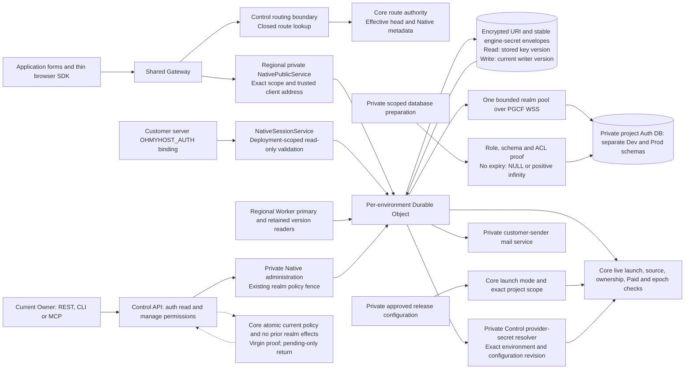
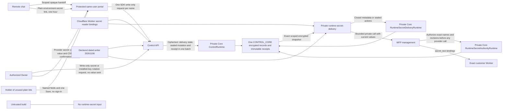
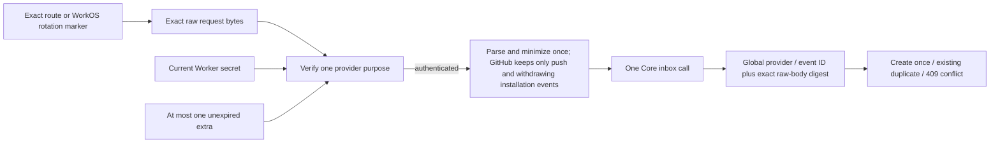

# Authentication and secret custody

This chapter records storage and trust boundaries in the checked-in implementation. It does not claim a fresh production secret inventory, key rotation or recovery test. Credential values are never documentation inputs.

## Platform login and API tokens

WorkOS authenticates access to ohmyho.st. Its private management Worker verifies session/user-key status and supplies organization membership information; local Owner/Member grants are the product authorization backend. Every protected resource action checks its concrete organization/project/environment and active ownership. Frozen projects and missing, malformed or unavailable authorization decisions deny access. Members have the fixed read/feedback set and may manage their own keys through an interactive session; environment-secret mutations require Owner authority. [Authorization](https://github.com/amerged-org/ohmyhost/blob/main/packages/platform/src/modules/authorization/authorization.ts#L55).

Current-account display metadata follows the already authenticated principal through the same private WorkOS Management boundary. The current-identity extension exposes only that human's email and names for the credential's exact organization scope; a user API key identifies its own user, and a service principal has no human email. These display values confer no authorization. Provider credentials stay private, metadata responses are not cached, and an unavailable or mismatched read fails closed. [Current-identity contract and bounds](api-and-mcp.md#authentication-and-account-selection), [scoped Control reader](../../apps/control-api/src/current-identity.ts), [private provider reader](../../apps/workos-management/src/current-identity.ts).

Local eligibility also honors irreversible terminal session/user/organization revocations. The organization-action authorization (Connect tokens, user API keys, dev-access, managed-source and data-change guards) applies the same membership barrier and terminal user/organization revocations, so a removed or revoked user is refused there before the next snapshot. Membership change events open a fail-closed synchronization barrier; an older event cannot reopen a reconciled newer barrier, and only an equally new or newer successful snapshot closes it. A stale membership snapshot is not fallback authority. Because only a snapshot closes a barrier, the removal events themselves are never queued behind creation traffic: the poller claims organization deletion and membership update/removal events before every other due event, a scheduled run drains a bounded batch instead of one event, and one user can start at most five new workspaces per hour ([D461](decisions/identity.md#d461)). The configured product authorization backend remains local human Owner/Member authority. The D453 Connect-user policy identifies a delegated human/client and intersects its active connection and explicit token restriction with that authority; it does not make FGA or M2M identity a human grant backend. The provider session check after local eligibility reuses a provider `active: true` answer for twenty seconds per exact session, user, organization and token expiry, within one Worker isolate (at most 10,000 entries; concurrent misses share one provider call; a false answer or an error is never kept and nothing is served stale). Local eligibility is still read on every check, so a sign-out made only at WorkOS can take up to twenty seconds to end a session, while a local terminal revocation takes effect at once. [Eligibility and barriers](../../apps/control-store/src/catalog/identity/membership-state.ts). Customer database access ends in the same batch as those membership events: an opened barrier, a removed or suspended member, a member who is no longer an owner at a snapshot, a user revocation, or an organization deletion. Each open access is revoked with its own audit event, and the access sweep then drops its login role ([D482](decisions/identity.md#d482)). Dev-access and managed-source authority use the same barrier-free membership predicate, so a removed member loses those paths at once ([D483](decisions/identity.md#d483)).

Snapshot application, acknowledgement, barrier closure and grant replacement are transactional. Deleted organization mappings are tombstoned and are not reseeded by another onboarding request. An unsupported/ambiguous role snapshot revokes uncertain authority; a generic provider transport failure preserves the prior mapping while its synchronization barrier remains open, rather than inventing a new membership decision. [Snapshot projection](../../apps/control-store/src/catalog/identity/workos-poller.ts), [onboarding denial](../../apps/control-store/src/catalog/identity/workos-onboarding.ts).

Platform login is separate from an application's end-user authentication. Customers choose their application authentication. Better Auth is an optional supported integration, and a customer-owned WorkOS AuthKit integration uses that customer's own configuration. Detecting an auth library does not authorize replacing the application's provider or enabling a managed capability. See [public API and clients](api-and-mcp.md). Application-row permissions use the explicit [backend RLS transaction](database.md#backend-rls-identity-and-transactions) after that server session has been verified. Its identity/claims are assertions by trusted application code; user-editable profile metadata, platform identity or a decoded unverified token do not grant row authority. No new service-role bypass or automatic RLS on auth/session tables is introduced.

WorkOS issues platform user API keys. Their full value is returned once, then never recovered from Control. The Control issuance record contains request hashes, scope, name, permissions and provider key ID; replay returns metadata with `value: null`. A creation refused before its request reached WorkOS (its permission read or its authorization failed) finishes as rejected with `KEY_CREATION_NOT_SENT` and answers `service_unavailable` or the authorization error, so a retry under the same Idempotency-Key creates again; only a failure after the request may have reached WorkOS stays `api_key_creation_uncertain` (CORE-46, Core migration 0921). Newly issued keys are non-expiring until revoked, subject to current membership and permissions. Revocation deletes the key by its provider ID, with no scan of the provider's listing: the user's own recorded creation proves ownership, a key that this user never recorded is not found (`resource_not_found`), and a key already gone answers absent so a retry still records the revoked stage. Interactive login sessions retain their independent expiry/refresh/revocation behavior; a non-expiring key is not proof of an indefinitely valid login session. CLI profile credentials and deliberate owner-only `.env.local` exports have local custody, described in the client chapter. [Provider issuance](https://github.com/amerged-org/ohmyhost/blob/main/apps/workos-management/src/user-api-keys.ts#L151), [once-only return and replay](https://github.com/amerged-org/ohmyhost/blob/main/apps/workos-management/src/user-key-lifecycle.ts#L156), [issuance records](../../apps/control-store/src/catalog/identity/user-api-key-requests.ts).

## Remote Connect delegation and portal custody

The remote product MCP verifies WorkOS Connect user tokens for the exact Control `/mcp` audience and configured issuer. AuthKit login, Device Login, user API keys and M2M tokens retain their separate credential policies. Existing client IDs, consent identities and refresh relationships continue to work without re-registration or grant-upgrade login. Current server-side membership supplies account/workspace authority; a selected OAuth organization is context, not an account-wide permission ceiling. [D453](decisions/clients-and-public-content.md#d453), [verifier](../../packages/workos-token-verifier/src/index.ts), [authenticator](../../apps/control-api/src/workos-authenticator.ts), [composition](../../apps/control-api/src/remote-mcp-composition.ts).

Absent product restrictions mean all current canonical customer rights. A trusted signed restriction can narrow actions/workspaces/projects/senders and remains attached to accepted work; an explicit empty dimension cannot become full access. The canonical role evaluator remains the source of Owner/Member outcomes, including resource/environment, membership, eligibility and ownership/billing checks. A role change takes effect on subsequent decisions and guarded effects. Open WorkOS synchronization barriers and not-yet-adopted pending barriers suspend only the affected user/workspace. One shared membership predicate protects enumeration, canonical decisions, automatic proof issuance and delayed effects in the same Core; neither elapsed time nor token refresh clears a barrier. It also checks terminal organization revocation against the stored WorkOS mapping before an organization-deletion projection is reconciled. That workspace is denied immediately while other current memberships and account identity remain usable. Older snapshots cannot reopen access, and a covering snapshot restores only its actual current roles. [Shared eligibility predicate](../../apps/control-store/src/catalog/identity/membership-barrier-sql.ts). API-key/M2M ceilings remain unchanged. Optional initial-flow scope/claim issuance is separately qualified; parsing signed fixtures is not proof of a working provider permissions UI.

There is no generic post-OAuth `/mcp/access` route, selected-project grant or separate creation/publication/sender entitlement. Current private secret/GitHub handoff inputs also reject the retired mail-picker fields; the historical database columns remain immutable evidence and new rows store empty scopes and a false creation flag. Explicit token `mailDomainIds` restrictions remain enforced independently. Automatic connection proof rows preserve identity, revocation and immutable project ownership/billing epochs for existing and new active connections. Referenced historical IDs remain evidence; a new epoch creates another proof instead of repinning old accepted work. Explicit historical workspace revocations keep their exact scope. Whole-connection terminal intent is independent of workspace membership and blocks later acquired workspaces; normal refresh or a reused session ID cannot revive it. The completed-disconnect response follows admitted-use drain, with typed pending status while work is still being fenced. Full combined race/native/release qualification remains tracked in implementation progress.

An Owner lists the MCP clients connected to a workspace and disconnects one from that workspace only (`mcp-connections`). The member's other workspaces are unchanged, and the disconnect answers `pending` while a recovery that uses the consent is active ([D480](decisions/identity.md#d480)).

Provider-secret and GitHub links remain actual signed-in feature handoffs. They store opaque-link hashes, exact user/client/consent/resource identity, accepted action/restriction, expiry and outcome without a provider token or secret value. The same signed-in human submits through strict Origin and CSRF checks. Successful one-use consumption supplies only server-stored handoff authority to trusted internal browser dispatch; token revalidation retains its private credential mapping. Core secret mutation and GitHub authorization/activation check that authority and current canonical rights in their effect batch. GitHub provider use is leased with an enforced absolute SourceFetcher request deadline; uncertainty about an already admitted external code exchange is not success, automatic retry or provider-side cancellation. A manual GitHub connection without delegated handoff remains the user's ordinary browser action. [Handoff](../../apps/control-api/src/remote-mcp-access.ts), [effect guard](../../apps/control-store/src/catalog/identity/handoff-effect.ts), [GitHub custody](../../apps/control-store/src/catalog/github/authorizations.ts).

Anonymous provider-secret and GitHub handoffs open canonical `/login` and remain unconsumed; plain environment-secret links are the anonymous exception described next. Login initiation remains protected POST `/login/start`. Signed-in provider-secret and GitHub pages retain the approved script-free portal and exact generated stylesheet CSP hash; same-origin form submission and explicit GitHub navigation are separately constrained. Missing/null/foreign Origin, forged CSRF, a changed user, expiry and replay deny. A link of the same user for a workspace the portal did not select is not consumed; its page offers a CSRF-checked switch (`/workspace`) that returns only to that same `/mcp/secrets` or `/mcp/github` link. Validated chat-return hints are navigation only, never identity or token authority. Web-chat secret input calls the write-only canonical SDK operation; neither tool arguments/results nor handoff persistence receives the private value. Existing local secret stdin stays available. [Portal implementation](../../apps/control-api/src/remote-mcp-access.ts), [browser login](../../apps/control-api/src/browser-login.ts), [secret custody](#customer-runtime-secrets).

Plain environment-secret links are one-hour capability links. `secret_input_request` stores the opaque hash, exact user/client/organization/project/environment, the requested names and accepted authority. The holder opens the page without signing in. One valid submission consumes the link and writes its bound names only. The portal validates every value before consumption and dispatches canonical PUTs under the stored authority. For grouped links, an independent submission ID distinguishes racing Saves and identifies the consumed handoff at each Core effect. Status stores only outcomes by name. A single-name link keeps its form contract and scalar status. Consumption records `secret_failed`. Only a confirmed write can change the result to `secret_submitted`, including when a write completes after the first status read. See [D618](decisions/identity.md#d618).

The page uses no-store, noindex and `Referrer-Policy: strict-origin` so browser POSTs retain their same-origin check without sending the query token in the Referer. Anyone with a still-valid URL can save, including someone with access to a transcript or request log that contains the URL. Per-visitor and per-link request budgets share `CONTROL_API_RATE_LIMITER` (1200 requests per 60 seconds per key). Its only script is hash-pinned by CSP. On grouped links, Dice generates values locally and Copy writes only the selected field's current value after a click. The single-name form focuses the input on open. Its **Generate token** action explicitly generates and copies a random value locally. If clipboard access is denied, the visitor can still save or manually copy the generated value. [D458 and W53](decisions/clients-and-public-content.md#d458-w53), [portal](../../apps/control-api/src/remote-mcp-access.ts), [Core effect guard](../../apps/control-store/src/catalog/identity/handoff-effect.ts).

## Customer application auth

Explicit managed Better Auth pins version 1.7.7 and requires the project's managed database. Its installation contract owns the `auth` schema's five tables (`user`, `session`, `account`, `verification`, `rateLimit`), UUID identities, `/api/auth`, `BETTER_AUTH_SECRET` and `OHMYHOST_DATABASE`. Next uses the official method handler; TanStack and the Vite companion share a fixed same-origin Request/Response handler. Unrelated paths return a no-store 404. Library detection alone enables none of this. Better Auth 1.7.3 and later recognise accounts by `providerId` and `accountId` and check the schema before serving: a required column it never writes makes every request fail closed. Schemas created for 1.7.0-1.7.2 carry a required `account.issuer` column and a unique `(issuer, accountId)` index, so the 1.7.7 contract installs neither and the privileged, idempotent account-issuer upgrade relaxes both for existing project databases before any 1.7.7 Worker serves them; it is not an expand-only customer migration and the column stays, nullable, for Workers still built with 1.7.1. Control's plan constraint admits both pins (migration 229), so persisted 1.7.1 plans stay valid unrewritten while new plans carry 1.7.7. The package no longer declares `@better-fetch/fetch` or `@cloudflare/workers-types`: Better Fetch 1.3.2 and Better Auth 1.7.7 ship the declarations they needed. [Requirement](https://github.com/amerged-org/ohmyhost/blob/main/packages/platform/src/modules/customer-auth/customer-auth.ts#L32), [installation](https://github.com/amerged-org/ohmyhost/blob/main/packages/customer-auth-better-auth/src/installation-contract.ts#L1), [route handler](https://github.com/amerged-org/ohmyhost/blob/main/packages/customer-auth-better-auth/src/web-handler.ts#L4).

The template enables secure cookies, CSRF and origin checks, email verification, bounded passwords and database-backed rate limiting. Its default application sessions expire after seven days and refresh at one day; verification/reset tokens expire after one hour. A mail-dependent registration/verification/reset request fails with `AUTH_EMAIL_SENDER_NOT_CONFIGURED` if the customer has no configured sender. Mail is an independent capability, so admitting auth does not fabricate a working sender. Existing verified users can still sign in and use sessions without Mail; an unverified user cannot sign in, and a new email-dependent signup is refused before creating records. A customer-owned sender is equally explicit. Auth email links are checked against the exact application origin/path, and mail requests use scoped bearer authority plus opaque idempotency hashes. [Runtime policy](https://github.com/amerged-org/ohmyhost/blob/main/packages/customer-auth-better-auth/src/runtime.ts#L34), [mail sender](https://github.com/amerged-org/ohmyhost/blob/main/packages/customer-auth-better-auth/src/mail-gateway.ts#L13), [integration contract](https://github.com/amerged-org/ohmyhost/blob/main/apps/project-database-runtime/test/auth-building-blocks.integration.test.ts#L78).

Application session/account/verification data belongs in the application's PostgreSQL schema, including library-managed account token/password fields. It is separate from the platform's encrypted environment-secret table and platform WorkOS user tokens. This chapter does not claim that every application's OAuth/token column is automatically encrypted by the environment cipher. Customer-owned application authentication and policies retain their own lifecycle and access controls. [Application schema](https://github.com/amerged-org/ohmyhost/blob/main/packages/customer-auth-better-auth/schema.sql#L1).

## Omh Native Auth source candidate

W37 is the active Auth-only release lane. It retains explicit `auth.provider: omh-native` alongside customer-owned providers and managed Better Auth, with the existing private launch allowlist and disabled Google/GitHub policy. The Auth-only runtime is delivered at exact source `b1c754a8bcc9ed7370d794e5c12ba566dad28c03`; the 8 November acceptance receipt records complete Development six-Worker and Production seven-Worker trains after all 13 exact-source CI checks and stock canonical verification passed. The selected public contract remains `.50` (136 CLI commands, 143 local MCP tools, 154 REST operations).

Fresh C5 Development, Login Lab Development and Login Lab Production password flows passed signup, delivered verification mail, login, protected access, reload, logout and original-cookie rejection; all three runs acknowledged cleanup and their drivers closed with exit 0. Public distribution converged on original-source `96e13f88` client `.50`. The current Auth-only progress and dated acceptance receipt retain the exact scope and samples. Earlier observations below remain historical; the two `69744f7ec` failures are not requalified by B1. The 500 ms/p95 performance, recovery, social and GA gates remain open, with the private launch allowlist unchanged. The specification, Native progress and [D454](decisions/identity.md#d454) keep those obligations distinct.

The 5 November password-first candidate adds private Core launch admission through `CONTROL_NATIVE_AUTH_LAUNCH_POLICY`. Missing or malformed configuration denies Native activation. The closed modes are `disabled`, `allowlist` with exact organization/project pairs, and `password-general-availability`; customer source, owner configuration and arbitrary HTTP input cannot select the mode. Core checks new resource/registration effects, target-Native publication and live runtime authority. Reconciliation, revocation, pause, export/deletion and source-off cleanup retain their narrower existing authority. The released password-first baseline refuses Google/GitHub activation. The 18 November source candidate allows project Owners on the exact existing launch allowlist to enable each provider separately with that environment's client ID and encrypted secret. Core uses the same exact pair check when writing an enabled provider, resolving effective provider policy and reading its private encrypted envelope. Disabled and password-general-availability modes deny social activation and secret reads. Provider disable remains available even when launch admission is withdrawn. Hosted provider qualification remains pending. [Launch policy](../../apps/control-store/src/catalog/identity/native-auth-launch-policy.ts), release execution.

The Native public service runs the pinned Better Auth 1.7.7 engine behind the exact `/api/auth/v1` method/path allowlist. Regional Workers and per-environment Durable Objects host the engine; the PGCF and customer application images do not embed it. The Shared Gateway resolves the project, logical environment, active deployment, approved origin and region from Core through Control's closed routing boundary, then supplies scope and the trusted edge client address through a private RPC. The normal Core authority request contains exactly the project, environment and deployment IDs; expanded public realm metadata stays within the runtime. HTTP identity headers confer no scope. Static assets stay public; a Native declaration alone does not create an application database or turn a static app into a server app. A server runtime receives only the deployment-scoped read-only session entrypoint. [Public contract](../../packages/contracts/src/native-auth.ts), [gateway](../../apps/wfp-dispatch/src/shared-gateway.ts), [runtime entrypoints](../../apps/native-auth-runtime/src/realm-worker.ts), [server helper](../../packages/customer-runtime/src/auth-server.ts).

**Historical routing checkpoint — 6 November 2026, source `090bb1f0`:**

The 090 Development Native canary deployed and reported Paid, sender, origin and storage ready, but protected-Dev ticket redemption returned 503. Core's Native effective-head response includes a closed Native metadata object that the 090 Control routing schema does not accept. A source correction under review admits the exact ready or pending object while preserving hostname, target and unknown-field checks. The changed source has not been deployed; no hosted signup, delivered mail or session is established, and Production and social-provider qualification remain open. [Routing contract and release limits](api-and-mcp.md#native-auth-management-candidate), execution progress.

One private Auth database belongs to the project, independently of its business-data assignment. Each logical Dev/Prod realm has its own schema, SQL role, private encrypted registry and engine secret. The realm Durable Object owns the shared bounded connection pool. Core stores placement, preparation, registration and policy metadata, while the registry holds runtime credentials. Production uses the private PGCF WebSocket transport. Ordinary application database bindings receive no Auth database credentials. [Placement](../../apps/neon-management/src/native-auth-placement.ts), [restricted roles](../../apps/neon-management/src/native-auth-roles.ts), [registry](../../apps/native-auth-runtime/src/registry.ts), [pool](../../apps/native-auth-runtime/src/realm-pool.ts).

Native preparation and restore require roles whose password validity is unbounded. PostgreSQL represents this as either SQL `NULL` or positive `infinity`; all three SQL role-purity checks accept exactly those representations. Finite future or past timestamps and negative infinity are refused. Provider role metadata must independently report no expiry, and login, ownership, membership, privilege and connection-limit checks remain mandatory. The hosted Development observation identified this representation mismatch before schema creation; it does not prove a completed deployment or login. [PostgreSQL semantics](https://www.postgresql.org/docs/18/sql-alterrole.html).

Native sessions use opaque `__Host-omh_native` cookies (host-bound, no `Domain`, `Path=/`, `Secure`) and no positive cookie cache. Each operation checks the current realm policy and user status/epoch; mutation paths recheck authority before committing. Owner pause survives redeployment. Configuration revisions fence pending flows, while realm/user revocation epochs invalidate existing sessions. Provider disable prevents provider use without independently ending an existing Native session. The fixed public deadline returns a retryable 503 on uncertainty. Request-size limits and the edge limiter run before realm/database acquisition, with separate durable SQL attempt limits. Reauthentication and password change share one per-account budget of five checks a minute, whichever client address or session sends them. A password change that Better Auth answers with a 500 rolls back its own writes (the new password and the session replacement) to a savepoint taken after the attempt is counted, so a failed answer never leaves the new password in place; its 4xx refusals come before the write and commit with their rate-limit row. Sign-in, sign-up and password-reset requests each have a per-client budget (five a minute for sign-in, three for sign-up and reset), keyed by the source address as [D536](decisions/clients-and-public-content.md#d536) defines it, so an IPv6 client is counted per /64 prefix. When the request includes a nonempty normalized e-mail string, SQL also enforces the existing route-specific limit for that normalized address across sources and sessions in the same realm. The integrated Wave candidate retains the active counter keys and thresholds. [D617](decisions/identity.md#d617). [Engine options](../../apps/native-auth-runtime/src/engine.ts), [transactional policy](../../apps/native-auth-runtime/src/policy.ts), [request limits](../../apps/native-auth-runtime/src/request-limits.ts), [edge limiter](../../apps/native-auth-runtime/src/edge-rate-limit.ts), [client key](../../apps/native-auth-runtime/src/client-rate-key.ts).

Private server-bound session validation reuses its initial Core snapshot only within that request and obtains one no-refresh session response through the Better Auth HTTP handler, retaining the engine's database rate limiter. It still checks the current registry and Core authority at the SQL decision and before commit, under the existing realm/user policy locks. If the sampled session expires while waiting for the user lock or final authority read, the result is null after the guarded commit, retaining rate-limit bookkeeping; malformed expiry remains unavailable. The public handler, cookie/refresh behavior, deadlines, custody readers and positive-cache prohibition remain unchanged. Removing duplicate work is not evidence that the hosted latency target has been met. [Private realm composition](../../apps/native-auth-runtime/src/realm-worker.ts), [session transaction](../../apps/native-auth-runtime/src/password-handler.ts).

The v2 Development diagnostic transport requires the platform-owned `c5-development-v1` flag and exact C5 project/logical Development realm at both the outer `NativeSessionService` and the Durable Object. The outer Worker makes the existing `validateSession` RPC once with an optional closed fourth argument. An older DO ignores it and returns the original session/null or error; there is no capability probe or authentication retry. Three-argument callers retain their original contract. The gated new DO captures sixteen numeric-or-null timing fields in request-local memory and returns only a closed internal session/status/profile envelope. The outer Worker validates the authentication envelope independently, reconstructs the diagnostic fields and emits one `native_private_latency_v2` record; the diagnostic branch does not log inside the DO. Missing/malformed profile data or a throwing logger drops telemetry only, while unavailable authentication remains an error. The customer binding still returns the same minimal session/null result. No request, URL, scope/user/session identity, cookie, SQL or error content enters the diagnostic record. Authorization checkpoints, SQL locks, rate limiters, KDF and deadline origin remain; Production diagnostics stay off and public APIs are unchanged. Await timings include transport/backend wait and overlap; the total covers the DO validation body, not end-to-end HTTP. The v2 transport reached Development at `d44ae1fb` and produced one qualified controlled record; a later partial a4 v3 supporting sample is not full-cohort/p95 qualification or DO-version attestation. [Profiler and decoder](../../apps/native-auth-runtime/src/latency-profile.ts), [outer entrypoint](../../apps/native-auth-runtime/src/worker-main.ts), observed delivery gap.

The atomic v1 private session path is deployment-bound. Each initial, post-lock and pre-commit checkpoint independently combines complete authority and active registration facts in one primary D1 batch through the returned routed `FencedDatabase`; owner discovery is only a hint, rechecked in that transaction. Existing source/origin, owner, billing, preparation/migration/restore and full-receipt predicates remain. The initial receipt is authorized before serialized credential decryption, and the independent fresh post-decryption registration read remains; no serialized registry call occurs while holding the SQL client. Original billing statements and pure policy functions are reused. Four ordered Worker clock samples bracket discovery, routing and batch completion; exact UTC6 comparison refuses the inclusive bracket widened by 1 ms per side when it touches Paid, renewal, unchanged millisecond-derived grace or UTC-month boundaries, or an observed clock moves backwards. The returned decision uses the final sample. This is a conservative rule within the inherited Worker event-clock domain, not a physical-clock/skew guarantee or cached lease. Old Core methods and flag-absent behavior remain; a present failing capability refuses without fallback. All four profiles declare v1: the genuine full train must establish matching current Core first, standalone CLI activation is refused and upload/replay verify the mode binding. Existing locks, epochs, rates, KDF and 15-second limits remain. The new outer v3 event adds finite nonnegative nullable `outerServiceMs` through the single RPC and auth-envelope validation, retaining the unchanged DO total and non-additive marker. In atomic mode, `initialAuthorityMs` also encloses the serialized initial registry/decryption work, so it is not directly comparable to the older narrow span. A v3 event proves the outer wire format only: rolling compatibility still accepts older sixteen-field DO envelopes, and neither the event kind nor a passive wait attests the DO execution version. Provider source/version readbacks and real endpoint latency keep their separate scope. [Core checkpoint](../../apps/control-store/src/catalog/identity/native-auth-authority.ts), [billing decoder](../../apps/control-store/src/catalog/credit/decision.ts), [release guard](../../scripts/platform-release.mjs), accepted refinement.

The password engine requires its real mail capability; the social engine disables password routes and automatic engine verification mail while retaining Native's own mandatory mailbox challenge and delivery flow. Both share the same origin, cookie, CSRF, session and provider-token stripping rules. Unexpected engine errors propagate to Native's rollback and redacted 503 boundary. The source correction returns the same fixed `{ error: "auth_unavailable" }` JSON after a successful password-handler rollback as when rollback rejects into the outer boundary; it returns no partial response, cookie or diagnostic. Absolute deadlines, commit fences and committed-only mail delivery are unchanged; exact-source release remains separate. The borrowed SQL adapter replaces database errors before library code can log them, retaining only a validated SQLSTATE and no original message, detail, query, cause or stack. A missing session remains distinct from an unavailable store. [Separate engine capabilities](../../apps/native-auth-runtime/src/engine.ts), [borrowed transaction and error boundary](../../apps/native-auth-runtime/src/password-handler.ts), [Native social proof](../../apps/native-auth-runtime/src/social-handler.ts).

Private policy synchronization projects already-published Core state monotonically under the PostgreSQL realm lock. Its callers retain exact Core and registration checks before and after SQL before acknowledging; credential/session mutations separately retain mandatory live authority under their transaction locks. A stale projection cannot authorize a session against a newer Core generation. [Projection primitive and guarded mutations](../../apps/native-auth-runtime/src/policy.ts), [synchronization callers](../../apps/native-auth-runtime/src/worker-main.ts).

The first hosted Development configuration exposed a missing virgin-realm path: the desired Core configuration persisted, but the absent runtime registry prevented acknowledgement. The source correction asks private Core for one atomic logical-realm snapshot of current Owner and any delegated handoff authority, active project/environment, the exact current policy revision and epoch, enabled state and effective approved origin, together with absence of every state of that realm's database/role operations, preparation, registration and revocation, restore and deletion history. History is checked across retained ownership scopes for the globally stable project/environment. The configuration mutation advances the revision when writing the full desired policy, including redirect and signup settings; the effective approved origin is independently checked because it may change outside that mutation. A sibling Dev realm may already use the shared project Auth database while Prod remains virgin. Private true establishes a pending configuration, not activation or a usable realm; the public response remains configuration and readiness, without a new pending field. An authorized false result requires the actual PostgreSQL lock/fence. An unavailable or malformed proof, or an authority/policy mismatch, fails before calling Native administration. In particular, an active pause always takes the SQL fence. [Private proof](../../apps/control-store/src/catalog/identity/native-auth-unprovisioned-policy.ts), [configuration mutation](../../apps/control-store/src/catalog/identity/native-auth-config.ts), [management orchestration](../../apps/control-api/src/d1-native-auth-management.ts).

The proof linearizes before a later namespace reservation, rather than locking out future provisioning. Every namespace-creating effect must journal its realm operation before provider or SQL effects; Neon checks fresh policy before and after those effects, and guarded activation rechecks authority. The closed Core command surface retains lifetime realm operation history: production commands must not delete, rekey or cascade away the evidence used by this absence proof. Regression coverage pins retained identity and history through reservation, dispatch and observation. Database/role operation tables do not independently prohibit arbitrary privileged raw deletes. This correction is included in the released platform source; it introduced no new migration or separate lease.

Native request deadlines come only from trusted private entrypoints. Each receiver samples its clock once and uses the earlier of the supplied absolute deadline and its own 15-second cap; only an omitted value receives that default cap. Non-integer, unsafe, negative and nonnumeric values are refused before normalization. Shorter and expired budgets are never extended; an expired budget refuses execution in `run` before calling the operation. The effective absolute deadline follows private authority waits and SQL leases, so returning 503 also rolls back and releases or destroys the request's database lease. This avoids a false early refusal when a trusted caller's deadline lies beyond the receiver's local cap without adding tolerance, a renewed budget, retry or public deadline input. The existing outer timer, SQL cleanup, authority checkpoints and separate atomic Core clock-bracket rules remain unchanged. Provider response bodies are streamed under a cap and cancelled on excess or timeout. Custom password POST routes independently require the exact canonical Origin. With no explicit callback, application navigation uses `/login` when the Owner approves it, otherwise the first approved application path. [Deadline enforcement](../../apps/native-auth-runtime/src/deadline.ts), [password handler](../../apps/native-auth-runtime/src/password-handler.ts), [social handler](../../apps/native-auth-runtime/src/social-handler.ts), [form fallback](../../apps/native-auth-runtime/src/application-redirect.ts).

Social provider calls arm cancellation before invoking `fetch`, so synchronous transport work consumes the same absolute provider budget. Body reads recheck that deadline. The parallel GitHub profile and email calls settle under that shared budget before failure returns; body cleanup requests cancellation and releases each reader without waiting for a provider acknowledgement.

Google/GitHub configuration belongs to the customer's own OAuth application for the selected environment. Provider client secrets use Control's existing versioned environment cipher and a dedicated private resolver; the Native runtime does not receive its master key. Private mail uses the currently authorized customer sender and fixed same-origin links. End-user login confers no platform management or business-row permission. Native management requires current Owner authority and the explicit `auth:read`/`auth:manage` token ceiling; existing secret-only credentials gain no Native permission. New key issuance verifies the required provider permission definitions before creating a key. Provider configuration, real logins, hosted performance and Production release remain separate acceptance gates. [Provider-secret resolver](../../apps/control-api/src/native-auth-provider-secrets.ts), [management composition](../../apps/control-api/src/native-auth-composition.ts), [private mail](../../apps/mail-gateway/src/native-auth-mail.ts), [platform key issuance](../../apps/workos-management/src/user-api-keys.ts).

The four regional source profiles bind `NATIVE_AUTH_PROVIDER_SECRETS` to the already deployed same-platform-environment Control `NativeAuthProviderSecretService`. The resolver checks live deployment and configuration authority before and after decryption, under the existing Control custody key. The Native Worker receives only the exact provider credentials for the initiating realm revision. An absent resolver refuses the OAuth flow. Password and session flows need no provider credential. Live Preview continues to use password sign-in. The release train retains Core and Mail Gateway before Native and Native before its management consumers. This rollout requires the existing Control resolver to be live in the target environment because Control also consumes Native entrypoints.

New-project mail readiness uses the current verified application-domain identity and matching workspace sender binding, not a legacy sender row. Sender custody binds through the project's logical Prod environment and authorizes the private Native mail capability for both logical realms; links and tokens retain their actual realm/origin. Platform Development requires its own Paid project and verified sender. The first Native-capable deployment creates storage and initializes the realm, so storage readiness is not a prerequisite for that same first deployment. A verified modern shared-sender bootstrap is exercised by the joined [first-deployment integration test](../../apps/native-auth-runtime/test/full-stack.integration.test.ts); its provider/DNS responses remain explicit local seams and do not establish delivered hosted mail.

**Historical release checkpoint — 6 November 2026, source `090bb1f0`:**

At that checkpoint, the first-configuration, packaging and unbounded-role-validity corrections had reached Development at exact source `090bb1f0`, with complete CI and the coordinated Worker/Container cohort. The unchanged Native canary app had deployed and all four readiness fields were true. Protected-Dev admission still returned 503; the strict Control routing correction had not yet been released. The affected disposable realm was paused through the Owner API while retaining its database and directory. Hosted signup, delivered mail, password sessions, Production Native release and general launch were not yet qualified at that historical source. The later delivery checkpoint below supersedes these earlier delivery limits while retaining its own latency and general-availability restrictions. Dated 090 execution evidence.

**Historical delivery and profiler checkpoint — 7 November 2026:** both full `d0bff935` platform trains completed 28/28 steps after all 13 exact-source CI jobs passed. Lab Development deployment and Production promotion use the same artifact; both Gmail-backed signup/verification/password/protected/reload/logout flows passed, and replay of the original cookie after logout returned 401 in each environment. Both private controllers closed with exit 0. Earlier C5 success on `e86fd2ac` and the later Owner read of the same active, recovery-enabled user after US custody rotation remain separately attributed; the Owner read is not a new password-session proof. Password general availability remains **held** pending qualified latency proof. The later `68a7b447` Development-only regional release preserved the real C5 password flow, but protected/reload samples remained 3,275 / 3,436.6 ms. The subsequent `082a254a` v1 profiler release reached both Development regions; neither controlled attempt produced phase data, and the second protected read took 5,744.8 ms. Neither bounded release updates the earlier Production Native checkpoint or qualifies performance. The subsequent `d44ae1fb` v2 release produced one qualified phase record, with HTTP 4,839.9 ms and DO total 3,254 ms. A subsequent partial a4 v3 sample returned HTTP 3,308.5 ms / DO 1,488 ms; it does not qualify pool reuse, executing DO version, p95 or 500 ms. The wave2 correction remains local/uncommitted. Development functional/latency observation, missing phase delivery and v2 source stage. Dated delivery record, bounded evidence.

### Native custody version readers — source candidate, 7 November 2026

The regional Native Worker has one primary master labelled by numeric
`NATIVE_AUTH_CUSTODY_KEY_VERSION` and an optional Worker secret
`NATIVE_AUTH_CUSTODY_ADDITIONAL_KEYS_JSON` containing at most eight historical version-to-base64
readers. The Native-local adapter uses the existing AES primitive; it does not adopt the separate
environment keyring's fixed-version-1 primary convention. URI, engine-secret, mail and invitation
envelopes select the exact stored `keyVersion`, preserving nonce, digest and tenant/name/version
AAD. An invitation's outer `version: 1` is its format, not the custody key version.

Registry reads do not rewrite either envelope. A later authorized registration can encrypt its URI
with the current writer while retaining its existing engine-secret envelope byte for byte. The
resolved engine secret therefore remains the same Better Auth/session, password, rate-limit and
invitation-accept HMAC key. Re-registration alone is not a historical-key migration. Wrong version,
key, scope or authenticated bytes fail closed.

Restore sanitation has a separate master-derived idempotency receipt. Its historical HMAC input
is the exact base64 text, not decoded key bytes. Under the original advisory/policy-row locks and
live Core checks, lookup covers the bounded current and retained historical ID/fingerprint pairs
before any sanitation. One matching old receipt returns its unchanged response; conflicting,
ambiguous or foreign receipts fail closed. New receipts use only the current key. No table,
public RPC, realm policy or data-retention rule changes.

The two Development profiles declare numeric writer `20261106` and require primary plus reader-map
secrets. Activation uses one qualified `platform-release --secrets-file` version upload containing
new code, saved primary, historical map and dated JSON variable together, followed by exact-version
activation. Keep external payloads as real 0600 files in 0700 directories; no key values enter Git or
command arguments. Do not split the change into live binding-only updates on the old code. Preserve
namespace/class/migration and service identities. Production profiles are unchanged. An earlier
paused-realm observation is no proof of current quiescence; existing active realms and late old
writes retain their readers. No registry rewrite, reset, backup loss or live key operation is
performed by this source candidate. Writer rollback also retains every reader for successor data.
[Decision](decisions/identity.md#native-custody-version-readers), source checks and remaining gates.

## Connection grant custody

The signed-in user's **Connect Make** form submits once with the workspace, Origin and CSRF proof. Control uses that action to consume the protected handoff. Opening an agent-issued link still requires one deliberate browser POST by the initiating user. A branded redirect page carries the browser to the validated Broker origin, with a fallback link if automatic navigation is paused. The form pages use a `strict-origin` referrer policy and the redirect uses `no-referrer`.

Control binds the initiating browser to the Broker handoff with a short-lived, Secure, HttpOnly host cookie containing a handoff digest. After Make consent the portal checks the returned result against the stored handoff and current human and session through the private Broker. A match enables a static CSP-pinned script that submits the completion form automatically. The POST still requires the current CSRF value and same Origin, and activation rechecks authority and consumes the result once. A manual completion button supports interrupted browser flows or disabled JavaScript. The result GET only renders the form.

The W44 source candidate keeps Make grants in a private Broker ([D609](decisions/identity.md#d609)). A one-use workspace handoff is bound to the original user, credential and workspace. Legacy handoffs additionally retain their original project and environment. The portal requires the signed-in browser and a same-origin CSRF-confirmed POST. Broker start creates a state and S256 PKCE verifier; Core stores their digests and the sealed verifier. Make's code flow does not request an OIDC nonce and instead binds the exchange to state, S256 and the confidential client; other adapters require a nonce. The internal v2 Make registration fences earlier nonce-requesting v1 attempts. The callback claims the attempt before its single code exchange and validates the ID token's signature, issuer, audience, expiry and subject. Only opaque handoff and confirmation handles enter URLs. The original browser session and original API key or Connect delegation are reobserved during authorization. Core enforces current owner authority for an established grant and checks current mutation authority and destination when recording a project import. Session-selected workspace is context; current authorized memberships and restrictions decide access.

The additive workspace tables preserve the project-bound 0759 rows and their existing call shape. A workspace grant can be used by its human owner for explicit imports into multiple authorized destinations in the same workspace. An import records provider identifiers and the grant reference and contains no token. Removing grant authority prevents further import and use. [Workspace schema](../../apps/control-store/migrations/core/0760_workspace_connections.sql).

The Broker emits only a fixed event and bounded phase/reason enums when callback identity validation or revocation fails; it never includes token, code, nonce, subject, secret, URL, provider body or raw error. Browser failures remain generic and all identity and custody checks remain fail-closed.

The execution candidate records effective scope metadata under the v3 Make registration for the nineteen registered scopes. Older grants remain usable for discovery; execution requires explicit renewed OAuth consent. Direct Endpoints use a selected team connection compatible with the pinned action and confidential execution. The sole scenario fallback is an active on-demand, three-module app-specific API Shell configured with the exact imported connection. Its binding pins an HTTP method and origin-relative path prefix, and its runtime input has the shell shape `path`, `method`, `header`, `qs` and `body`. A fallback is permitted only when the direct Endpoint definitely did not dispatch, never after an uncertain write. A project-bound action credential authorizes one pinned action, while provider tokens remain in Broker custody. Execution specification.

Previously accepted Make v1 grants and orphans remain usable only within their original platform environment: discovery, refresh, disconnect and orphan cleanup retain the original registration in authenticated encryption data. New attempts use v2; the v1 callback is not adopted as a v2 attempt.

The Broker encrypts access and refresh tokens with AES-GCM under its environment-specific `GRANT_KEY`, bound to workspace, human, registration, grant and generation. Core stores ciphertext and never the key. A 429 refresh response releases the matching dispatched generation fence for a later retry; an uncertain response does not. Issued but unretained tokens are revoked only after a Core fence proves no grant was committed. Revocation failures retain their explicit unknown state. Live provider, callback and hosted acceptance remain unproved until their release evidence exists. Production bootstrap accepts a fully activated Development Broker at the current Production source only after reobserving immutable bootstrap provenance, the current closed credential-binding inventory and its exact reviewed callback hostname; a Broker-only bootstrap may originate at a verified ancestor ([D610](decisions/delivery-and-operations.md#d610)). Make token, revocation, discovery and JWKS requests use manual redirect handling and refuse non-success responses without following redirects. Broker start and callback failures navigate to the fixed same-environment branded Control error page without carrying provider parameters.

## Development-only preview Auth QA source candidate

For the W41 spike, a separate private Development Worker owns `QaStablePreviewState` and the management and read-only authority entrypoints. The trusted lifecycle creates a preview identity and independently managed Auth generation; a retirement tombstone also prevents a delayed create from reviving a retired identity. Each resolution checks the exact QA scope against current Dev access and Native realm authority. The private Development-only `NativePreviewService` derives its signer from the retained realm secret and that preview ID and Auth generation, not the source commit or container lifetime; host-only Secure cookies and the current realm/user epochs remain in force. Its private preview-mail binding independently checks the allowed recipients and sender. [QA authority](../../scripts/preview-spike/auth/authority.mjs), [Native preview identity](../../apps/native-auth-runtime/src/preview-identity.ts), [Native entrypoint](../../apps/native-auth-runtime/src/realm-worker.ts).

The bridge checks the exact origin, grant and credit and rechecks current authority around the Native RPC. A lost reply or later authority change is an unknown outcome; separate service checks cannot undo a mutation already committed. This is isolated test authority, not a new product Core preview schema. Local tests and temporary deployment configuration do not establish live scope, mail delivery, sleep/wake login continuity, or G1/G2 acceptance. [Auth QA contract and test limits](../../scripts/preview-spike/auth/README.md), [service topology](services-and-workers.md#development-only-live-preview-qa-source-candidate).

The separate application-mail fixture uses `QaPreviewMailKey`, a no-argument private Runtime Secret Delivery entrypoint fixed to one QA project, Development environment and existing `OHMYHOST_MAIL_KEY`. Its narrow Core authority reads only the encrypted envelope after current Dev grant, credit, key and sender checks; Runtime Secret Delivery decrypts it under existing custody and rechecks the exact envelope before returning the key to the trusted QA mail Worker. The relay rereads and reauthorizes it for each operation, including just before dispatch. Neither operator nor guest receives the real key, and no separate static key secret or new Core schema is created. These source checks are not an atomic lock across services and do not establish hosted custody or delivery. [Fixed Core authority](../../apps/control-store/src/catalog/runtime-secrets/qa-preview-mail.ts), [private custody](../../apps/runtime-secret-delivery/src/qa-preview-mail-key.ts), [QA mail relay](../../scripts/preview-spike/mail/adapter.mjs).

## Customer runtime secrets

The public Control API accepts an authenticated Owner's write-only value for one active organization/project/environment/name. A plain environment-secret link (above) uses the same canonical write for each bound name under its stored handoff authority. Listing returns metadata, revision and delivery state, not the value. The current limit is 5 KiB UTF-8; the Product CLI accepts values from standard input rather than command arguments. Values do not belong in source archives, build plans, client bundles or link files. [Write/list/delete port](https://github.com/amerged-org/ohmyhost/blob/main/apps/control-api/src/environment-secrets.ts#L45), [metadata query](../../apps/control-store/src/catalog/secrets/environment-secrets.ts).

An active project provider-mutation claim blocks a new customer secret mutation, so a deployment's frozen generation cannot race an Owner's write. Exact request replay returns the recorded metadata result; setting the same value/key version changes no revision or desired generation, and ensuring a platform-generated secret preserves its first stored ciphertext. A real set/delete advances the desired generation atomically with the record change. An active environment without delivery state initializes its empty state inside the same guarded first-write transaction, for both customer values and platform-generated keys. Concurrent first writes retain separate secrets and advance generations relatively; delivery observation time never decreases when requests arrive out of timestamp order. Initialization rolls back with a failed ownership, claim, version or receipt guard. The 3 November first-write correction is implemented in source and awaits its Core release and hosted retry ([D149](decisions/delivery-and-operations.md#d149-first-write-initialization-correction)). [Mutation fencing and persistence](../../apps/control-store/src/catalog/secrets/environment-secrets.ts).

The Core stores AES-256-GCM ciphertext, a fresh 12-byte nonce, value digest (keyed for user values), key version, revision and timestamps in `environment_secrets`. For user values the digest is an HMAC under a subkey of the key version and purpose, so it supports replay and change detection without being a guessing oracle for a low-entropy value. Platform keys keep a plain SHA-256 for gateway SQL joins, and legacy unsalted user digests were cleared ([D481](decisions/identity.md#d481)). Neither digest is the decryption key. Authenticated additional data binds organization, project, environment, name and key version; copying a ciphertext to another tenant/name fails decryption. The implementation validates a canonical 32-byte key and zeroes owned temporary plaintext byte arrays. JavaScript strings are not promised to be securely erased. [Schema](../../apps/control-store/migrations/core/0201_shard.sql), [cipher](https://github.com/amerged-org/ohmyhost/blob/main/packages/platform/src/modules/runtime-secrets/environment-secret-cipher.ts#L47), [authenticated scope](https://github.com/amerged-org/ohmyhost/blob/main/packages/platform/src/modules/runtime-secrets/environment-secret-cipher.ts#L235).

The shared environment cipher key arrives as the Cloudflare Worker secret `ENVIRONMENT_SECRET_KEY_BASE64` in Control API and runtime-secret-delivery. The primary key always remains reader version 1; `ENVIRONMENT_SECRET_ADDITIONAL_KEYS_JSON` supplies the additional versioned readers and `ENVIRONMENT_SECRET_KEY_VERSION` selects the writer. The active environment-specific release declarations select the allocated dated writer version `20261106` and require both key-bearing bindings as secrets. They contain no key material and no empty additional-ring variable that could shadow an uploaded reader secret on the next release. Production retains its independent version-1 reader and independent additional ring rather than copied Dev history. Both consumers must receive the saved dated reader before that writer is activated. The allocation must first be checked against protected state, historical provider versions and configuration history; a date is not proof that a version is unused. After any dated-version write, rollback retains that reader even if the writer is returned to version 1. The source declaration is not live rotation or historical decryption acceptance. [Keyring](https://github.com/amerged-org/ohmyhost/blob/main/packages/platform/src/modules/runtime-secrets/environment-secret-cipher.ts#L205), [bindings](https://github.com/amerged-org/ohmyhost/blob/main/apps/runtime-secret-delivery/src/bindings.ts#L18), [Production release declaration](../../apps/runtime-secret-delivery/wrangler.production.jsonc), rotation persistence scope.

This is symmetric platform-held encryption: the trusted platform custodians can decrypt values. It is not end-to-end customer-only encryption, an Infisical reference store or an independently evidenced external KMS. Operator private copies and recoverability need their own access/recovery evidence.

Runtime-secret-delivery is private and independently configured with Control access, the cipher keyring and WFP management binding. It validates exact claims, decrypts the current snapshot and passes values directly to a bounded WFP call. Deploy/promotion publication attaches current `secret_text` bindings; rollback prepares the retained immutable candidate with current values without uploading its code again. Later mutations advance desired generation and private reconciliation updates/deletes the exact runtime set. Durable generation/lease/name/digest/count receipts contain no plaintext. Cloudflare bindings are a second runtime custody location. WFP management attaches a manifest to a provider only after Core authorizes it: the active environment must store exactly the manifest's names and revisions. The WFP Worker reaches that check through its `RUNTIME_SECRET_AUTHORITY` binding, and a refusal or an unreachable authority stops the provider call before any action ([D484](decisions/identity.md#d484)). [Decrypt](https://github.com/amerged-org/ohmyhost/blob/main/apps/runtime-secret-delivery/src/runtime.ts#L1441), [rollback preparation](https://github.com/amerged-org/ohmyhost/blob/main/apps/runtime-secret-delivery/src/runtime.ts#L239), [publication](https://github.com/amerged-org/ohmyhost/blob/main/apps/wfp-management/src/management.ts#L2905), [bulk update/removal](https://github.com/amerged-org/ohmyhost/blob/main/packages/provider-cloudflare/src/wfp-provider.ts#L431).

The delivery lease lasts two minutes, and scheduled reconciliation considers at most ten scopes per batch. A reconciliation treats a lapsed lease as busy while the operation that staged it is still queued or running, so a slow deployment keeps its lease until operation lease recovery ends it. Staging returns a metadata receipt and does not mark the generation applied: persistence records the stage and then the exact candidate/gateway activation. A provider rejection releases the lease without blaming the secret values; uncertainty records a fixed failure code and leaves reconciliation pending. Exact already-applied state can confirm a lost receipt response without repeating a provider update. Compensation distinguishes the route mutation claim from the candidate cleanup claim. [Lease and batches](https://github.com/amerged-org/ohmyhost/blob/main/apps/runtime-secret-delivery/src/runtime.ts#L24), [activation recording](https://github.com/amerged-org/ohmyhost/blob/main/apps/runtime-secret-delivery/src/runtime.ts#L659), [completion replay](https://github.com/amerged-org/ohmyhost/blob/main/apps/runtime-secret-delivery/src/runtime.ts#L1309).

Platform-generated `BETTER_AUTH_SECRET`, `OHMYHOST_MAIL_KEY` and `OHMYHOST_STORAGE_KEY` use thirty-two random bytes, encode to forty-three Base64URL characters, clear the owned byte buffer and enter the same scoped encrypted persistence boundary. The ensure operation preserves a first existing target key. Current Mail ensure independently generates the target environment's key; the older promotion-source reuse read is retained history, not the current installer path. The source candidate also refuses a new Mail key whose digest is already held by another environment in the project. It does not change an existing duplicate; the named Production feedback and pending owner-authorized repair are recorded in [Mail authorization](mail-and-recovery.md#mail-services-and-authorization). `OHMYHOST_AI_KEY` is generated the same way and wrapped as `omh_ai_<projectId>_<43 Base64URL characters>`. The whole string is encrypted, so only its SHA-256, which the AI gateway computes over the same string, is authoritative in the Core; each environment has its own key, created once by ensure; only an owner rotation replaces it ([D550](decisions/identity.md#d550)). The value is delivered only while the plan that the delivery resolves declares `ai.enabled` (the deployment's plan, the promoted or rolled-back revision's plan, or the active head on reconcile), so a rollback or promotion of source without AI withholds it. The gateway reads the jurisdiction from the active revision's plan ([D447](decisions/source-and-build.md#d447), [D448](decisions/source-and-build.md#d448)). `OHMYHOST_BROWSER_KEY` independently uses the prefix `omh_browser_<projectId>_<43 Base64URL characters>` and the same encrypted per-environment custody, digest authority, owner rotation and current-generation delivery. It is installed only for `browser.enabled` in the deployment/promotion/rollback/current plan resolved by that delivery. The Browser gateway atomically fences the exact key and active revision again before reserving credit. The retained private `DATABASE_URL` installer is a separate closed interface; the current managed database runtime uses the service/registry path below. [Generated keys](https://github.com/amerged-org/ohmyhost/blob/main/apps/runtime-secret-delivery/src/runtime.ts#L1029), [private installer](https://github.com/amerged-org/ohmyhost/blob/main/apps/runtime-secret-delivery/src/runtime.ts#L1138).

An owner rotates an installed platform key in place with `POST /v1/projects/{project_id}/environments/{environment_id}/secrets/{secret_name}/rotate`, for `OHMYHOST_AI_KEY`, `OHMYHOST_BROWSER_KEY`, `OHMYHOST_MAIL_KEY`, `OHMYHOST_STORAGE_KEY` or `BETTER_AUTH_SECRET`; other names are refused ([D550](decisions/identity.md#d550)). Control generates and seals a new value as above, and Core replaces the envelope, bumps its revision and advances the delivery generation in one batch. The runtime receives the new value at its next delivery reconciliation, so no deployment is needed, and the value is never returned. The earlier value stops authorizing in that same commit: the AI and Mail gateways compare the current `environment_secrets` digest, and Storage authorizes only the newest `storage_gateway_keys` version, which the rotation appends and which keeps older versions as append-only history ([D551](decisions/identity.md#d551)). Installed keys keep the plain SHA-256 digest that the gateways compare ([D552](decisions/identity.md#d552)). A rotated `BETTER_AUTH_SECRET` ends every customer-application session and outstanding email-verification link, but not password-reset links, which are random identifiers stored in the database; no stored data is encrypted under this secret unless a plugin does so ([D553](decisions/identity.md#d553)). A deployment claim on the project refuses the rotation. The rotation is a secret mutation, not a provider operation; the rejected provider-claim alternative is recorded in [D554](decisions/identity.md#d554).

Explicit removal deletes the encrypted Control record and increments desired generation; runtime deletion completes through reconciliation. Removing the whole project Worker removes its bindings, and exact authorized cleanup purges its encrypted environment records. A scope whose new generation is still pending at deletion is purged once its exact WfP script is proven removed and its gateway route retired, so a pending change never blocks the deletion. A delivery lease that its worker left behind blocks the purge only while it is live; once it has expired it no longer does, and a late worker cannot publish after the exact script and gateway route are removed. The minute cron delivers only to active projects, so a deleting project's pending generation is no longer retried. This does not assert instant deletion from every retained provider backup. [Control removal](../../apps/control-store/src/catalog/secrets/environment-secrets.ts), [project purge](../../apps/control-store/src/catalog/provisioning/runtime-secret-deletion.ts).

The source audit found a transfer limitation: pending-delivery enrichment joins the immutable creation organization, while the transfer persistence moves current environment/delivery projections to the new owner. That lookup cannot match a transferred current-owner scope and can fail with `Pending runtime secret scope is invalid`. Full post-transfer secret reconciliation is therefore not claimed ready; a correction and runtime verification remain required. This is a source finding, not a fresh production failure report. Pending scope lookup.

A stage retry uses its unique lease and exact stored fields to return the original stage identity, even if a retry allocates another proposed stage ID. No scope comparison or stored identity is changed.

Core migration 0370 holds the final runtime-secret state columns, defaults and constraints, together with canonical immutable delivery receipts. State retains its organization/environment parent and cascade behavior; historical receipts retain stable project/environment identity and global receipt/lease IDs, without inventing a current-owner foreign key. ULID scope domains, generation monotonicity, release bounds, manifest bytes and 100-name limits are preserved. Populated migration and late-failure rollback keep exact int8 values above 2^53 and historical bytes. The migration changes no key, ciphertext or role. [Schema](../../apps/control-store/migrations/core/0370_runtime_secret_delivery.sql).

Core migration 0371 holds the 16-field stage, 9-field activation and 4-field compensation tables with native identity/lease/target/FK/static/append rules and mutual terminal exclusion. A rollback operation may differ from the candidate's original operation (original migration 069). Only the exact attested unserved `runtime_secret_delivery_stage_activations` family bypasses the live current-route predicate; native static CHECK/FKs and terminal guards always apply. Original migration 144 backfills prior activations by candidate while retaining legacy gateway text, so historical rows can have different stage and route operations; their exact nullable/text/six-digit timestamp bytes survive import and are never normalized to invented current metadata. Migration 0371 exposes no delivery RPC or initializer; the closed consumer is described below. [Schema](../../apps/control-store/migrations/core/0371_runtime_secret_stage_history.sql).

The D1 storage-secret compound uses the canonical bucket authority from provider-schema migration 0337; its stable project/environment history and original historical organization ULID domain do not create a current-owner alias.

The RuntimeSecretDeliveryService and its scheduled Worker require only the cipher, WFP and configuration fields plus `RUNTIME_SECRET_RUNTIME`; SQL aliases and mixed bindings fail closed. The current dedicated Core entrypoint exposes sixteen closed persistence methods, including the bounded scheduler read, with no SQL/provider/key capability. Plaintext, cipher keys, entropy and source/target AAD remain in the delivery Worker.

Claiming returns one frozen generation's encrypted snapshot; a lost claim reply is busy/current, not a reconstructed snapshot from another generation. Stage lease replay compares every original field and returns its stored identity. Activation reobserves the exact CURRENT Gateway before even an existing reply, then activation/delivery receipt/state application commit in one batch. Original expired-but-still-same stage leases remain valid for activation. Compensation atomically clears the matching lease or proves the original newer-release/different-tag supersession; its final-state failure rolls back the immutable compensation. The four platform-key authorization/write compounds retain one batch, including delivery-generation advance and mail key/reputation or exact durable bucket/storage-key authority. Migration 0372 adds only the original immutable storage key; canonical bucket receipts come from 0337.

Tests use the actual Secret/WFP/Gateway/probe/Core Worker classes and real D1, with real encryption and accepted empty/nonempty stage evidence. Only external provider HTTP/private-dispatch transports are substituted. Corrupt foreign-scope AAD fails before a WFP call. The retained original consumer tests cover fifteen delivery actions, including promotion source-envelope scope, current/recorded/pending readers, uncertain commits, strict replay and last-write rollback. The current Auth-only cohort remains subject to consolidated verification.

The Core import mappings retain original sealed-secret rows, pending/completed request bytes and all delivery state/stage/terminal evidence, including int8 counters above 2^53 and historical organization identity. Typed source readback checks their exact original fields after a real pinned local import. Opaque JSON and ciphertext are never decrypted or normalized by the converter. Native timestamps/array bounds that the target cannot represent refuse explicitly. [Secret leaf](../../scripts/control-d1-secret-mappings.mjs), [storage-key leaf](../../scripts/control-d1-storage-mappings.mjs), [native import proof](../../apps/control-store/test/converter/owned-domain-mappers.test.ts).

## Database credential custody

Application database passwords follow a separate path. The trusted PGCF management adapter retrieves a restricted runtime role's scoped URI and sends it only to the regional database admin entrypoint. `ProjectDatabaseEnvironment` encrypts the URI in Durable Object storage under `registration`, with `DATABASE_REGISTRY_KEY`. Its authenticated identity also incorporates registration generation and receipt digest. The runtime decrypts only after scope, authorized environment and generation checks; revocation stores an audit receipt with empty credential fields. Customer code receives the scoped `OHMYHOST_DATABASE` service, never this registry key or stored URI. [Registration](../../apps/neon-management/src/pgcf-runtime.ts), [registry encryption](https://github.com/amerged-org/ohmyhost/blob/main/apps/project-database-runtime/src/registry.ts#L230), [key binding](https://github.com/amerged-org/ohmyhost/blob/main/apps/project-database-runtime/src/worker-service.ts#L73), [revoke](https://github.com/amerged-org/ohmyhost/blob/main/apps/project-database-runtime/src/registry.ts#L305).

The database registry currently uses cipher version 1 directly, without the environment-secret keyring's old-key reader. Replacing `DATABASE_REGISTRY_KEY` therefore needs a controlled registration/re-encryption recovery procedure; automatic master-key rotation is not implemented or evidenced here. Scope/key/target validation fails closed rather than choosing a fallback database. [Fixed registry cipher](https://github.com/amerged-org/ohmyhost/blob/main/apps/project-database-runtime/src/registry.ts#L152).

Migration and read-only role URIs are consumed in private bounded connections through the provider boundary. They are distinct from project-scoped provider-management keys; the PGCF path uses the application-project key. No consumer Worker holds a Control database credential. See [roles and RLS](database.md#roles-migrations-and-application-rls) and [provider boundaries](security/provider-credentials.md#credential-boundaries).

Explicit temporary customer SQL access is a separate credential type: a randomly generated read/write login is returned once to its authorized customer after real login/scope verification. Control stores metadata without that password/URI. The customer owns any returned copy; its login expiry and later session termination/drop follow [the SQL access lifecycle](database.md#customer-sql-access). Removing the issuing member, suspending it or ending its owner role ends the login at once rather than at its TTL ([D482](decisions/identity.md#d482)). This exception does not expose the runtime registry URI or a provider-management key.

## PGCF operator boundary

Control runs on D1; no PGCF Control project, key or always-warm class exists. Development and Production each receive their own application-project integrator key. No Worker holds a Control database credential: consumers reach the Core only through service bindings, and the private `control-store` Worker alone binds the D1 database. [Scope decision](decisions/data.md#d444).

Provider cutover authorization and final release records are owner-only. Worker roles can execute their scoped preparation and record observations but cannot manufacture the operator's release. Secret values never belong in source, receipts or documentation. Application SQL-access credentials retain their existing one-time customer-return exception, with provider-managed restricted membership and metadata-only provenance. [SQL access](../../apps/neon-management/src/pgcf-access.ts).

## Dev access capabilities

Protected Dev access uses scoped one-time tickets and signed access sessions. Control stores a ticket's SHA-256 digest and scope/expiry/consumption metadata, not the raw bearer ticket. Issuing another unused ticket for the same principal/project revokes the earlier unused ticket. Consumption checks exact current project, Dev environment, handle, owned domain and access epoch. Runtime health probes require their exact active deployment/candidate/operation evidence chain. [Ticket persistence](../../apps/control-store/src/catalog/dev-access/access.ts).

Ticket issuance advances the Dev access epoch, so a newly issued ticket can invalidate an earlier signed preview session before its nominal expiry. A new Dev environment starts at epoch 0, meaning that no ticket or share link was ever issued. The same atomic write advances it to 1 when it issues the first ticket, saves the first share link (get, rotate or setting protected mode), renews the link of a protected Dev in a data change, changes the mode in either direction, or accepts a project deletion request (which also deletes the project's tickets); reading, rotating or re-setting the mode of a public Dev and a data change of a public Dev write no epoch and leave it at 0. A link therefore never coexists with epoch 0, and issued tickets and signed sessions exist only at epoch 1 or higher. Project/ownership cleanup deletes the project's tickets and share-link ciphertext. Coordinate simultaneous verification through the same project rather than repeatedly replacing another runner's ticket. Every Dev authority check (issue, scope, redemption and share state) uses one administrator predicate that applies the membership barrier and terminal revocations, so a removed member loses each path at once ([D483](decisions/identity.md#d483)). [Current scope and cleanup](../../apps/control-store/src/catalog/dev-access/access.ts).

The signing contract uses ECDSA P-256: current tickets last one hour, root-bound Dev browser sessions twelve hours and exact GET/HEAD health probes sixty seconds. Cryptographic verification requires the exact owned origin, scope, signing-key digest and bounded time window; the Control/gateway authorization boundary separately checks the signed access epoch or share generation against current state. Gateway public JWKs contain only public coordinates; private/hidden/extra key material is rejected. These are application preview capabilities, separate from WorkOS platform login lifetimes. Control's private Dev access limiter spends one key per project for ticket redemption (`dev-access:redeem:<project>`) and one constant key for runtime-probe issuance (`dev-access:probe`), so unvalidated redemption attempts cannot exhaust a bound that serves other tenants or the platform's own probes; the price is that no ceiling spans all projects. [Capability library](https://github.com/amerged-org/ohmyhost/blob/main/packages/dev-access-tokens/src/tokens.ts#L186), [cryptographic contract tests](https://github.com/amerged-org/ohmyhost/blob/main/packages/dev-access-tokens/test/tokens.test.ts#L43).

A reusable Dev share link has distinct custody: `dev_share_links` retains its encrypted bearer token, digest, cipher version, generation and revocation state. Rotation records an idempotency digest/generation receipt. Redemption/page access requires active current ownership, protected mode, exact Dev environment/owned origin and current generation; public mode follows its own explicit choice. Revocation denies use but does not physically erase that row's ciphertext. Share URLs are intentional bearer capabilities for an authorized user and must be treated as secrets. [Share-link storage and checks](../../apps/control-store/src/catalog/dev-access/share.ts).

The Control adapter seals that token as `DEV_SHARE_LINK` under organization/project/environment/name AAD. Mode/revoke request replay has another encrypted record: `project_dev_access_requests` stores JSON `{mode, shareUrl}` under a `DEV_ACCESS_REQUEST_<digest>` identity derived from actor, key and request. Replay rechecks today's Owner scope under the project transaction before decrypting; it does not retrieve a link for an obsolete owner. Rotation receipts themselves contain only digest/generation metadata. [Control custody adapter](https://github.com/amerged-org/ohmyhost/blob/main/apps/control-api/src/dev-access-management.ts#L44).

## Bounded webhook verifier overlap

GitHub and WorkOS verification stays inside Webhook Ingress, before one parse, minimization and durable inbox call. Each purpose keeps its own current secret and optional `GITHUB_WEBHOOK_ADDITIONAL_SECRETS_JSON` or `WORKOS_WEBHOOK_ADDITIONAL_SECRETS_JSON` secret binding. The optional JSON is `[]` or one object containing exactly `secret` and `expiresAt`; the deadline uses canonical UTC ISO text with milliseconds and `Z`. Invalid policies fail closed. A valid expired entry is ignored while the current verifier remains available. Keys are never pooled across providers, and WorkOS Connect, management, Stripe and Resend credentials gain no verification authority here.

The WorkOS route also accepts exactly one nonsecret `omh_rotation` query parameter containing 32 lowercase hexadecimal characters. This provides a distinct provider endpoint while the original endpoint remains active. No other query is accepted, including on the GitHub, Stripe and Resend routes. This marker is not a credential: WorkOS signature verification still covers the original timestamp and raw body before any inbox call. The marker change is a source candidate until qualified and released.

The additional resolver is synchronous and private to the composition. It filters the extra against the verification clock sampled after the existing asynchronous current-secret lookup, so it adds no remote call or stale-clock window. The pure verifier checks at most two keys over the same authenticated byte snapshot and returns no key value, digest or matched-key indicator. Event parsing and the original inbox path run once after authentication. There is no new RPC, readiness endpoint, auth probe or event-replay facility. [Policy](../../apps/webhook-ingress/src/additional-secrets.ts), [composition](../../apps/webhook-ingress/src/worker-main.ts), [WorkOS verifier](../../packages/workos-auth-contracts/src/webhooks.ts), [GitHub verifier](../../packages/provider-github/src/webhooks.ts).

WorkOS identity is its signed envelope `id`; GitHub uses `X-GitHub-Delivery`, rather than the REST delivery record's numeric ID. The Core deduplicates globally across routed and unrouted inboxes by provider and event ID. Identical raw-body bytes replay as the original duplicate; different bytes remain a 409 conflict even when parsed JSON is equivalent. A different signature, key or endpoint never authorizes a second business effect or weakens that conflict fence. [Ingress identity](../../apps/webhook-ingress/src/app.ts), [global fence](../../apps/control-store/src/catalog/operations/inbox.ts).

Both exact environment profiles require the current provider secrets and additional policies as secrets, with no plaintext or empty policy in `vars`. The first deployment must upload the new code and explicit empty policies atomically through the reviewed secrets-file path; old code must not receive a new binding first. Later releases preserve uploaded policies rather than resetting them from an inline default. Missing policies remain a source-level compatibility path for an existing one-key composition. Local verification does not establish live deployment or issuer rotation. [Development profile](../../apps/webhook-ingress/wrangler.jsonc), [Production profile](../../apps/webhook-ingress/wrangler.production.jsonc), A31 source and operational gates.

## Temporary GitHub authorization state

GitHub OAuth preparation stores encrypted JSON containing `{state, verifier}`, not reusable GitHub OAuth or installation tokens. Project source authorization records in `github_source_authorizations` use exact organization/project/environment scope and a `GITHUB_PKCE_<authorizationId>` name. Organization connection authorization records in `github_connection_authorizations` use the distinct organization-authorization AAD domain, organization/authorization IDs and `GITHUB_CONNECTION`. Both authorization windows are thirty minutes; callback handling rechecks the current session or user-key metadata and concrete local `sources:link` authority before completing consent/connection records, and takes the provider proof only from the initiating user's portal session ([provider callbacks](#provider-authorization-callbacks)). Persistent connections retain installation/account/repository identity metadata. Project state write, organization state write.

The callback paths do not physically erase their ciphertext on terminal completion and implement no physical purge. Expiry denies later use; it must not be described as already deleting retained encrypted state. Any additional retention cleanup requires an explicit implementation/verification change. Selected-repository installation tokens are consumed by the private source boundary, never the customer build.

## Workspace GitHub disconnect and installation withdrawal

An Owner ends a workspace's GitHub connection with `DELETE /v1/organizations/{organization_id}/github`. One batch marks the connection revoked and records a revocation for each repository grant of the organization, so the runtime stops auto-deploy and linked-source use at once. The call makes no GitHub request, and a repeat changes nothing ([D478](decisions/identity.md#d478)).

GitHub installation notifications are not consent. Only the withdrawing events act: an `installation` that is deleted or suspended, and removals reported by `installation_repositories`. The ingress keeps only the action and those ids, never account or sender details. An uninstall or suspension disconnects the installation's workspace connections and revokes every grant of the installation; a repository removal revokes the grants of those repositories. Each grant gets exactly one revocation row ([D479](decisions/identity.md#d479)). Other installation actions grant nothing, and a source link still needs the initiator's own flow.

## Provider authorization callbacks

`GET /v1/github/oauth/callback` and `GET /v1/cloudflare/oauth/callback` are anonymous routes, but their provider proof binds a GitHub installation or a Cloudflare DNS grant (`dns.write` on the customer's zone) to a tenant. The state is signed or random and single use, yet its initiator holds it, so anyone who is handed the link could otherwise complete it with their own provider account. The callbacks therefore take the proof only from the browser of the user who started the flow ([D456](decisions/identity.md#d456)).

Control opens the sealed `__Host-omh-session` cookie with the helper of the consent pages and verifies the access token inside it with the portal session policy. The cookie is `Secure; HttpOnly; SameSite=Lax`, so the browser sends it on the top-level redirect back from github.com or Cloudflare. WorkOS access tokens live for minutes while a customer installs the GitHub App or approves Cloudflare, so the policy accepts the token for the cookie's seven days and the live WorkOS session-status check, not `exp`, decides that the session exists (the [D266](decisions/identity.md#d266) rule for provider flows). The user behind the session is compared with the stored initiating principal of the state:

- GitHub: no session, another user's session and an unknown state get one and the same answer, the `state_unknown` page for a browser and 403 `forbidden` with a single detail for a machine client. The answer is decided before the attempt is read further, failed, claimed or consumed, so it does not say whether a state exists and the initiator can still finish.
- Cloudflare: another user's session and an unknown, spent or expired state get one and the same 409 `confirmation_invalid` ("invalid or already consumed"). A missing session gets the same status and code with a different detail, a sign-in instruction. It is decided before the state is looked at, so that difference reveals nothing about any state.
- GitHub organization connection and project source authorization compare `principal_id` of the stored attempt before the denied, `setup_action=request`, installation and code branches, which keep their behaviour for the initiator.
- The Cloudflare consume is a compare-and-set on `principal_id` in `cloudflare_project_authorization_states` and in `scoped_customer_dns_authorizations` (application identity and workspace mail), so a foreign principal and a replay each match no row and only the initiator's first call consumes it.
- A session that WorkOS reports as ended is no session. A missing `PORTAL_SESSION_PASSWORD` or an unavailable session check is not an answer about the state: it ends in the callback's existing 503 (the `provider_unavailable` page for a browser) and consumes nothing.
- Only a person can start these flows. The three Cloudflare begin routes (project zone, application identity and workspace mail) and the GitHub begin refuse a machine principal: the production authorization adapter denies every non-user principal (404 on the routes), so a state is never started by an identity that no portal session could ever match.

The Cloudflare authorization URL carries no PKCE challenge. PKCE binds a code to the party that began the flow, which here is the initiator who holds the verifier either way, so it would not change who may complete a state. [Session reader](../../apps/control-api/src/portal-session-principal.ts), [callback routes](../../apps/control-api/src/app.ts), [GitHub initiator check](../../apps/control-api/src/d1-github.ts), [Cloudflare consume](../../apps/control-store/src/catalog/cloudflare/authorization.ts), [scoped consume](../../apps/control-store/src/catalog/mail/cf-scoped.ts).

## Recovery passwords

The customer selects and retains the ZIP backup password. The platform temporarily encrypts job input using the separate recovery input cipher; the job's password envelope is execution custody, not a reusable archive-password store. The private Cloudflare recovery Container receives an environment-specific `RECOVERY_CONFIGURATION` Worker secret containing its PGCF application-project authority, R2 object credentials and input key. It reaches Control only through the Worker-mediated `RecoveryRuntime` port with an ephemeral job token, never a database URL. This configuration is restricted operator/workload material, never customer runtime/build input. Signed archive URLs are finite bearer capabilities; logs and durable receipts must not copy them indiscriminately. A ready SQL export's download link is signed only by an audited, rate-limited POST, and the export status read never returns one ([D485](decisions/identity.md#d485)). [Container configuration](https://github.com/amerged-org/ohmyhost/blob/main/apps/project-recovery-worker/src/container-runtime.ts#L35), [input cipher](https://github.com/amerged-org/ohmyhost/blob/main/packages/platform/src/modules/recovery/input-cipher.ts#L1), [recovery execution](database.md#recovery-and-deletion).

The public secret API routes use the closed Core read/mutation methods. Encryption, plaintext and the existing versioned cipher keyring remain in the API. Listing and delivery metadata share one snapshot; mutation, idempotency response, generation advance and the returned delivery metadata share one batch. Same-request replay, active deployment exclusion and original owner-only secret permission remain. The audit feed also uses its closed Core reader, retaining cursor and tenant checks. A focused real-D1 adapter case verifies encrypted storage, replay, late rollback and lost-write readback.

### Request-local hint and Dev admission refinement — local source

The wave2 source extends only the private atomic input with optional `organizationHint`. Initial Native hints come from the fully validated stored registration under serialization; later hints come from that same receipt. Core uses the hint solely to route to the real fenced database, rechecks the globally unique project/environment owner against it in the batch and retains all authority/registration/billing/clock predicates. No hint retains the old discovery path; malformed, stale or mismatched hints deny without fallback. The post-decryption check is a new independent hinted combined snapshot comparing the complete receipt, followed by independent post-lock and pre-commit snapshots. Admin/legacy callers retain their original paths.

Control's opted-in Dev authorizer combines the original public/share or eligible verified-user alternatives through one new private Core method. Raw session tokens stay in Control; signature/scope/expiry verification and the original rate key execute once. Membership/grants remain specific to the user branch; a public page does not require a valid user claim. Core rechecks unique ownership under the routed bucket fence and reuses the exact original handle/origin/epoch/Paid predicates with their SQL clock. Missing/malformed new capability is unavailable and never triggers another authorization request. Old no-hint callers keep the old methods. Separate concurrent credit and stream reauthorization remain unchanged.

Shared Gateway can emit one closed `native_gateway_latency_v1` record only with its trusted flag and exact C5 logical Dev `/protected` GET. Six numeric-or-null durations cover actual routing, local verification, authorization, credit, dispatch and total-to-headers; cache hits/unfinished work remain null and overlapping spans are not summed. No extra HTTP response header, body read, stream wrapper, identity/request/error/financial field or Production diagnostic is added. Clock/logger faults affect diagnostics only. This source is local and uncommitted; the partial a4 supporting sample does not establish its effect or p95. [Core Dev predicates](../../apps/control-store/src/catalog/dev-access/access.ts), [Control](../../apps/control-api/src/d1-dev-access.ts), [Gateway](../../apps/wfp-dispatch/src/shared-gateway.ts), current progress.

## Product Live Preview Auth source candidate

The W41 product path uses `NativeProductPreviewService`, distinct from the retained Development QA entrypoint. Its trusted caller supplies a current runtime fence and exact public origin. The service hashes the canonical capability label, resolves Core's current identity, checks the selected logical/physical assignment and admitted source, and uses the existing regional Native registry. Signatures and host-only cookies are partitioned by preview ID and stable Auth generation; a save or sleep/wake does not reset login. Rotation, source grant withdrawal, project lifecycle changes and funding refusal prevent further authorized requests. Auth mutations recheck authority before effects and suppress replies whose outcome became uncertain.

Preview customer variables use the normal authenticated environment-secret opener, which supports their keyed or legacy empty value digest while retaining AES-GCM scope authentication. A customer-variable request accepts at most 100 names, matching the ordinary runtime-delivery bound; both the Preview reader and Core envelope query enforce it. Fixed platform gateway keys use the separate opener that also checks their plain SHA-256 digest. The trusted entrypoint selects this distinction after validating the permitted secret names; a guest cannot select the opener or request a platform key as a customer variable. Scope-bound decryption and current scope, revision and digest checks remain around delivery and gateway effects. The Next-with-Mail configuration correction follows this existing digest distinction; its hosted qualification remains pending. [Preview delivery](../../apps/runtime-secret-delivery/src/preview-secrets.ts), [cipher](../../packages/platform/src/modules/runtime-secrets/environment-secret-cipher.ts).

When a Preview run reserves its usage hold, Core may initialize missing project-level Mail gateway and reputation metadata from that environment's existing sealed `OHMYHOST_MAIL_KEY` if the normal Mail readiness predicate holds. This occurs in the same source-, generation-, owner- and funding-fenced batch; it never decrypts or rotates the key, changes an existing reputation or authorizes a send. A cross-project digest collision skips initialization. The normal deployment ensure remains unchanged. [Preview reservation](../../apps/control-store/src/catalog/previews/usage.ts), [metadata initialization](../../apps/control-store/src/catalog/runtime-secrets/platform.ts).

`NativeProductPreviewAuthMailService` independently validates the capability origin from the verification/reset URL, the matching current scope/Auth generation and the project's actual approved sender before dispatch. Its idempotency key is stable for the preview/Auth generation and message identity; it never retries an uncertain provider send. Application-mail, storage and AI requests receive scoped keys only in `RuntimeSecretDeliveryPreview` outside the guest. Customer-owned environment values are separately selected under the normal reserved-name policy; database/provider/signing keys are never delivered to the VM. [D608](decisions/runtime-and-lifecycle.md#d608), [provider custody](security/provider-credentials.md#product-preview-credential-custody), [native product mail](../../apps/mail-gateway/src/product-preview-auth-mail.ts). Fresh Native preparation now uses a preview/source/owner/funding/assignment-authorized job, genuine provider and registration receipts and the separate pinned internal Preview-policy migration. The existing deployment policy stays unchanged. Native transactions lock the global revocation row and the specific Preview/Auth-generation row; rotation and deletion drain these locks before Core confirms retirement. Same-plan source saves and VM wakes reuse current receipts without reprovisioning. Local D1/PostgreSQL and real Workerd/DO checks passed; hosted Auth continuity remains a release acceptance gate. A lost role-create reply followed by withdrawn authority remains isolated as an uncertain job because the provider cannot prove its request identity through a read-only lookup; no unauthorized write replay or credential rotation is attempted.
