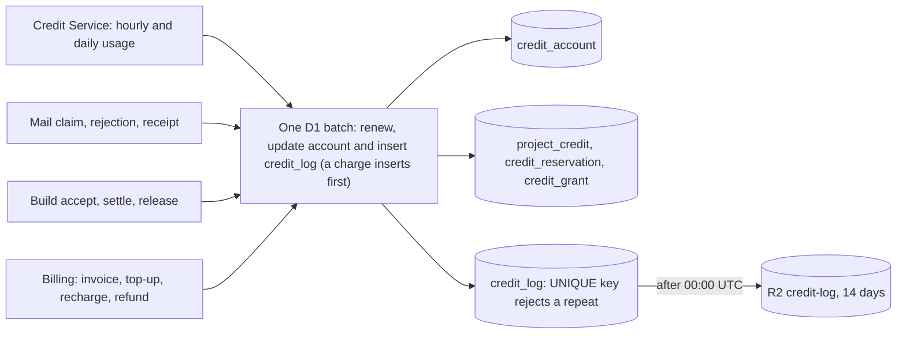
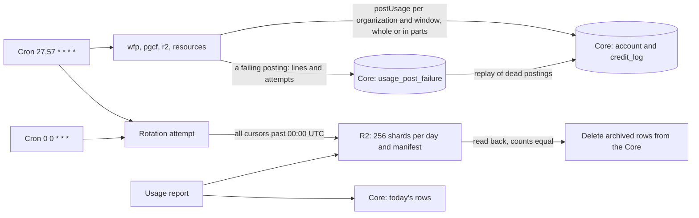
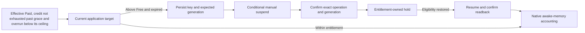

# Credits and billing

This chapter explains how credit is held, charged and authorized on the Core database. The [pricing contract](pricing-contract.md) owns published offers, conversion formulas and prices; this chapter explains accounting and authorization without changing that contract. The model is decided in [D445](decisions/billing-and-usage.md#d445). Provider deployment/payment acceptance and unresolved integration work remain in [PLAN](../../PLAN.md). This audit accessed no payment accounts, credentials or live customer balances.

## Credit account

The Core holds credit as amounts, not as history. Each organization has one `credit_account` row; the reason for every change is a `credit_log` row that lives in the Core for the current UTC day and is then rotated to R2 ([rotation](#credit-log-rotation-and-the-usage-report)). Money is an integer count of micro-credits (one credit is 1,000,000), bound with `CAST(? AS INTEGER)` because D1 binds a JavaScript number as REAL. ([Migration 0600](../../apps/control-store/migrations/core/0600_credit_simple.sql), [account module](../../apps/control-store/src/catalog/credit/account.ts))

| Table                | Holds                                                                                                                                                                          |
| -------------------- | ------------------------------------------------------------------------------------------------------------------------------------------------------------------------------ |
| `credit_account`     | Per organization: monthly credit and the instant it ends, one-time credit, compute reservations, platform overrun, `exhausted_at`, `paid_until` and why                        |
| `project_credit`     | Per project: UTC month, month-to-date use (resets when the month changes), optional budget and its mode (`continue` or `stop`)                                                 |
| `credit_reservation` | One row per open build; a hold left by the removed commit previews stays reserved and has no settlement path                                                                   |
| `credit_grant`       | The idempotency of one-off credit and Paid invoices, keyed by their Stripe or signup identity, with what was paid and what was reversed                                        |
| `usage_cursor`       | Per usage source, the instant before which everything is billed (`wfp`, `pgcf`, `r2`, `resources`)                                                                             |
| `usage_post_failure` | A usage posting the credit service could not book: its log key, lines of the latest attempt, layout, attempt count and last reason, until the key is booked (migration `0631`) |
| `credit_log`         | Today's changes: unique key, instant, organization, kind, signed amount, balance after, JSON detail of the lines                                                               |

The spendable amount is `monthly + one-time - reserved`, never below zero for a decision. The monthly credit is the Free allowance (200 credits) or, while the organization is Paid, the Paid allowance (1,000 credits). It ends with its period (the UTC month; for Paid the earlier of the month and the paid coverage) and its unspent remainder expires. A lapsed month is renewed lazily by the next write of the account, which logs `expire` and `renew` once per period; reads show the renewed month without writing. One-time credit (top-up, auto-recharge, signup bonus, referral reward) never expires. This is a deliberate rule change: earlier top-ups ended with the Paid coverage. Amounts and conversion formulas stay in the [pricing contract](pricing-contract.md#credits). ([Renewal](../../apps/control-store/src/catalog/credit/account.ts#L230), [view](../../apps/control-store/src/catalog/credit/account.ts#L127))

A charge spends the monthly credit first, then the one-time credit; what no balance covers is added to `overrun_micros`, which the platform absorbs, so a customer balance never goes negative and real usage is never recorded as zero. The platform absorbs at most USD 50 (5,000 credits) of overrun per organization and UTC month: `overrun_base_micros` holds the overrun as it stood when the month began, the month's overrun is the difference, and the next renewal restarts it at zero. Once the month's overrun reaches that ceiling and no spendable credit remains, serving stops until the next renewal ([D490](decisions/billing-and-usage.md#d490)). `exhausted_at` is set once when monthly plus one-time credit reaches zero and cleared when it is positive again (grant or renewal). The seven-day grace is derived from it: existing services keep running for seven days after `exhausted_at`; afterwards the runtime decision denies with `insufficient_organization_credits`. ([Spend order](../../apps/control-store/src/catalog/credit/spend.ts#L24), [grace](../../apps/control-store/src/catalog/credit/account.ts#L23))

An organization is Paid while `paid_until` is in the future. The source is `stripe` (invoice period end plus fourteen days, so a late renewal does not cut service; a subscription Stripe reports ended closes the coverage that this same subscription produced, at its end), `granted` (time-bounded access from signup or referral) or `manual` (operator). A later coverage is never shortened by an out-of-order event, and a late event of an ended earlier subscription never closes the coverage of a newer one (`paid_subscription_id`). A Stripe invoice that overwrites `granted` or `manual` access keeps that access's end aside (`granted_until`, `granted_source`, captured at `granted_captured_at`): a subscription end or a refund of the invoice restores it when it runs past the Stripe coverage, and a referral clawback takes its thirty days off it only for a reward granted before that capture, since a later reward never extended the kept access. An operator's coverage set by `setPaid` drops the kept access, so a later subscription end cannot restore it. Paid compute sizes, the mail framework and custom domains require Paid (custom domains also with the powered-by flag). ([setPaid](../../apps/control-store/src/catalog/credit/account.ts#L289))

## One atomic batch per change

Every credit change is one D1 batch, which D1 runs as one transaction, in this order: `INSERT OR IGNORE` of the account (only for an organization that exists), the lazy renewal, one `UPDATE` of `credit_account` (guarded where the caller needs it) and an `INSERT ... SELECT` of the `credit_log` row from the updated account (a charge writes its log row first, because the row records the monthly, one-time and overrun parts the spend takes and the balance it leaves), and then the optional `project_credit` upsert, `credit_reservation` insert or delete, or `credit_grant` insert. `credit_log.key` is UNIQUE: a second change under the same key aborts the whole batch, which is the guard against double posting by a retry, a replayed event or two concurrent writers. There is no wallet version fence or held lock; the arithmetic on the single row is atomic. ([Charge](../../apps/control-store/src/catalog/credit/spend.ts#L84), [grant](../../apps/control-store/src/catalog/credit/grants.ts#L52), [duplicate check](../../apps/control-store/src/catalog/credit/spend.ts#L43))

Each domain function (`chargeOrg`, `refundOrg`, `reserve`, `settleReservation`, `releaseReservation`, `grantCredit`, `reverseGrant`, `renewIfDue`, `setPaid`) returns its statements and a reader of their results, so a caller composes them with its own writes: a deployment accept reserves in the batch that accepts it, a mail claim charges in the batch that claims it. The `run*` wrappers read a duplicate key as "already posted" and return the current account.

| Log key                                   | Kind                     | Written when                                                                                              |
| ----------------------------------------- | ------------------------ | --------------------------------------------------------------------------------------------------------- |
| `usage:<source>:<org>:<window start>`     | usage                    | the credit service bills a window                                                                         |
| `reserve:` / `settle:` / `release:<id>`   | reserve, settle, release | a build is reserved, measured or ended; holds left by the removed commit previews have no settlement path |
| `mail:<request>` / `mailrefund:<request>` | usage, refund            | a send is claimed; the provider rejects it                                                                |
| `mailrecv:<message>`                      | usage                    | a message is received                                                                                     |
| `grant:<credit_grant key>`                | grant                    | an invoice, top-up, recharge, signup or referral credit                                                   |
| `reverse:<grant key>:<refunded>`          | reverse                  | a refund or dispute takes a grant back                                                                    |
| `renew:` / `expire:<org>:<period end>`    | renew, expire            | the first write after a month ended                                                                       |



## Serving decision and admission

The shared gateway asks `GatewayCreditRuntime.read` for each serving decision. It performs one read batch over the organization, owner, project and environment state, the credit account, the project's `project_credit` row with its open reservations and the powered-by flag, and applies the pure `runtimeDecision`. Nothing is written; the answer lives 900 seconds. In order: anything not active is `project_unavailable`; no spendable credit after the grace, or no spendable credit while the month's overrun is at the USD 50 ceiling, is `insufficient_organization_credits`; a `stop` budget whose month-to-date use plus open reservations has reached the budget is `project_budget_exceeded`. A budget stop leaves Paid features alone; exhausted credit takes them too. The Core's function-run claim reads the same decision for each claimed environment, so scheduled crons pause with HTTP and resume at their next occurrence ([D460](decisions/files-functions-recovery.md#d460)). ([Decision](../../apps/control-store/src/catalog/credit/decision.ts#L59), [gateway read](../../apps/control-store/src/catalog/billing/gateway-credit-decision.ts))

A project budget is an optional cap over the shared account, measured by the UTC-month use of `project_credit` plus open reservations. `stop` denies at the cap, `continue` only reports consumption, and removing the cap requires `continue`. It does not allocate an independent balance or move credit between projects. The budget command is one batch on `project_credit`. ([Budget command](../../apps/control-store/src/catalog/billing/public-budget.ts))

Product commands use the same account: a build may reserve only when its Paid requirement, the project's `stop` budget (use, reservations and the quote) and the available credit all hold, and a build has no grace, so it never starts on credit that is not there. The same Paid check refuses a Paid feature, a Paid compute size or a plan change for an organization whose month's platform overrun has reached the ceiling of [D490](decisions/billing-and-usage.md#d490), even inside the grace. The batch that reserves a build repeats the `stop` budget rule against the budget in force at commit, so a limit an Owner lowers after the acceptance read, or a concurrent reservation of the same project, makes the acceptance re-decide to `project_budget_exceeded` instead of reserving above it. Paid compute sizes, the mail framework and paid custom domains read the same facts (`paid_plan_required` without Paid, `insufficient_organization_credits` once the grace ended). ([Build admission](../../apps/control-store/src/catalog/credit/admission.ts#L77), [paid domains](../../apps/control-store/src/catalog/billing/paid-domain-admission.ts), [database commands](../../apps/control-store/src/catalog/database/product-entitlements.ts))

## Builds and mail

Builds and mail charge synchronously in the Core; the credit service does not bill them.

A build's accepted plan quotes the standard-3 sandbox price and the maximum hold. Accepting the deployment reserves the quote in the same batch (`reserve`, guarded by `available >= quote`, so two concurrent builds cannot both take the same credit). The measured execution seconds settle it: they are charged at the quoted rate to the build's project, the rest of the reservation is released and the reservation row is deleted. The seconds are measured by the sandbox Durable Object's clock, not the sandbox's own timestamps. A build that never started releases its reservation without a charge, in the batch that stores its usage row (the build ends `TIMED_OUT`, `FAULT` before launch or `STOPPED`); a started or uncertain build keeps custody until its evidence arrives. ([Reserve](../../apps/control-store/src/catalog/credit/spend.ts#L273), [settlement](../../apps/control-store/src/catalog/build/settlement.ts#L28), [release](../../apps/control-store/src/catalog/credit/spend.ts#L488), [build release](../../apps/control-store/src/catalog/provisioning/build-release.ts))

An organization holds at most four open build reservations at once; a fifth build is refused with `build_capacity_reached` before anything is reserved, and a settled build frees its slot ([D501](decisions/source-and-build.md#d501)).

A mail send charges its recipient quote when the request is claimed, in the one batch that checks Paid and claims it; the claim, like an AI call, is refused once the month's overrun has reached its ceiling with no spendable credit, even inside the grace, and mail-domain configuration is refused on the same condition. Acceptance and an uncertain outcome keep the charge; a request the provider rejects or refuses gives it back once in the same transition batch (`mailrefund:`). The claim's batch records the split it spent (monthly, one-time, overrun) on its `mail:` row, and the refund returns each part to its own bucket: monthly to the current monthly allowance (so it still expires with its month), one-time to one-time, overrun out of overrun. A charge written before the split was recorded, or whose `mail:` row has been rotated to R2 by the daily log rotation before its refund settles (a refund within seconds of a charge at midnight), is refunded as one-time credit, as before. A received message charges once, independent of webhook attempts. The price is the card of the meter's latest activation that has started at that instant ([timeline](#published-prices-and-meters)), rounded up. See [mail lifecycle](mail-and-recovery.md#sending-reputation-and-settlement). ([Claim](../../apps/control-store/src/catalog/mail/send-claim.ts), [transitions](../../apps/control-store/src/catalog/mail/send-transitions.ts), [receipt](../../apps/control-store/src/catalog/mail/received-billing.ts), [price](../../apps/control-store/src/catalog/mail/credit.ts))

## Storage upload claims

A signed upload claim reserves bytes against the environment's storage quota. The Core counts every stored object and every unconfirmed claim of the environment toward the quota, expired claims included, until the claim is completed or erased; the claim and its quota guard are one batch. A confirmation after the upload's expiry is refused with no grace, so bytes that arrive late never become a confirmed object. The storage gateway runs an hourly sweep (`37 * * * *`) over up to fifty unconfirmed claims a day old, oldest first. For each claim it observes the physical object, claims the deletion in its own frozen scope, waits out the thirty-second upload drain after the expiry (a late signed PUT may still land), replaces the payload with an erasure marker and completes the deletion with the marker proof. A claim whose provider answer names another object, or whose erasure fails, stops only that claim; the next pass repeats it ([D495](decisions/billing-and-usage.md#d495)). ([Claim](../../apps/control-store/src/catalog/storage-gateway/uploads.ts), [sweep](../../apps/storage-gateway/src/upload-sweep.ts), [cron](../../apps/storage-gateway/wrangler.production.jsonc))

## Usage billing

The Credit Service is a private Worker with no public route and no secret. Its usage cron (`27,57 * * * *`, twice an hour) bills the finished windows of four sources and posts one charge per organization and window through `CreditRuntime.postUsage`; each source runs in isolation, a failed source is repeated by the next pass, and the invocation fails if any source failed. Each source keeps a `usage_cursor`; an absent cursor row means the source is not billed yet, and the operator inserts the four rows at cutover. After the pgcf pass the same hourly run disables the schedules of two kinds of project: those whose Stop budget is reached (`listStopBudgetProjects`: current month, `budget_mode` stop, use plus open reservations at least the budget, active projects only) and those whose organization is past its credit grace with nothing left (`listCreditDeniedProjects`: no renewal pending, balance minus open reservations at nothing, and either the grace lapsed or the month's overrun at the ceiling). Each list is read on its own and holds at most 50 projects; a project in both is stopped once. The sweep calls `NeonUsageService.stopSchedules`, the narrow PGCF entrypoint of the Neon management Worker, for each project, runs even when billing fails, and never touches a Continue budget ([D498](decisions/billing-and-usage.md#d498)). Re-enabling is manual, as described in [database events](database.md#database-events-schedules-and-execution-billing). The log key `usage:<source>:<org>:<window>` makes a repeated posting change nothing, and the cursor advances only after every posting of a window is booked or durably kept (below).

A window is booked whole or in parts. The Core refuses more than 2,000 lines in one posting, and an organization with many environments can exceed that in one window (two lines per environment for `wfp` and `resources`, three per bucket for `r2`). A window of at most 2,000 lines is one posting that carries neither a part nor a layout, exactly the posting every window had before parts existed, under the unchanged key. The Core is still released before the service, because the service refuses to run against a Core without `recordUsageFailure` and `replayUsageFailures`. A larger window is split by an FNV-1a hash of the environment (the project for a project-scoped resource) into 32 parts, and a part of more than 1,000 lines is cut by position into further parts; each part is posted with `split: true` and its number (at most 255), the key of a part above 0 is `usage:<source>:<org>:<window>:p<part>`, and part 0 keeps the unsuffixed key. The split is by hash, never by position, so a window computed again with other lines (an expired Logpush object, a late delivery) puts every line it has in common into the same part: a part that was booked is not booked again with moved lines. A line that appears only in a retry joins a part that already exists and is then not billed, the same as a late line has always been for a window posted whole.

The layout is decided from the line count of each attempt, so the Core keeps it sticky: a window is booked in the layout of its first posting (`split` in the stored detail), and a posting of the other layout books nothing and answers with the booked layout. The check is part of the booking batch (a guard on the booked rows of the window, code `precondition_changed`); the read before the batch is only the fast path, so two invocations that overlap cannot book both layouts. The service follows the answer. A window booked whole is complete: the lines of the attempt are not posted, which is counted (`layout_superseded`, `lines_superseded` in the pass report) and logged (`credit_usage_layout_superseded`) because a line only this attempt has (a late Logpush object) is billable usage that is dropped, as for any booked key. A window booked in parts is posted in parts. A line count that crosses 2,000 between two attempts of the same unfinished window therefore neither books a line twice nor skips the unbooked parts. The credit log rows of a window are rotated to R2 after the day, and the guard cannot see them; a kept posting (below) never needs them, because a kept posting is never in another layout than the booked one and never for a booked key: the booking batch deletes the kept posting of its own key and the kept postings of the other layout of the window, and `recordUsageFailure` keeps nothing for a booked key or against the booked layout. The window of a kept posting is unfinished when it is kept, so its rows are still in the Core then, and a replay at any later time books it only if it is still kept. The only other thing that can fail a layout is a window with more than 255 parts (about 256,000 lines of one organization), which is a failure of that organization like any other posting.

Posting is isolated per posting. One that fails does not stop the others: the service keeps it in `usage_post_failure` through `CreditRuntime.recordUsageFailure` (the key, the lines of the latest attempt as sent, the layout, the attempts and the last reason; a failure may be caused by the lines themselves, so they are stored unvalidated) and reports `usage_post_failed:<org>:<window>[:p<part>]`. A posting is dead when it has failed four times (two hours of passes), when it cannot succeed by repeating it, and when the organization already has a dead posting for the source, so a poison organization holds the cursor of the first window at most four passes, or not at all, and never again per window. The Core decides whether repeating can help: `recordUsageFailure` validates the kept lines against the posting contract itself, because the identity of an error is lost on its way over the binding (a validation error arrives as a plain `Error` that carries its message); the service adds only the word of a `TypeError`, `RangeError` or `ZodError` that kept its name, and never reads a message for words (a network failure may say "refused" too). While a failed posting is not dead the window is held: the first error is thrown, the cursor stays and the next pass repeats the window, in which every booked key is a duplicate. A dead posting lets the window complete (`usage_post_dead_lettered:...`) and the cursor move on, so one organization whose posting fails for good cannot delay the billing of every other. A window in which no organization is answered at all (more than one was tried) is a failure of the Core, not of a posting: nothing is kept or counted, so an outage cannot dead-letter windows, and the first error is thrown. If keeping the failure itself fails, the pass throws and the cursor stays: the cursor never passes a posting that is neither booked nor kept. Keeping a failure and the deletes that settle it run on the raw Core route, because the failure rows are the credit service's bookkeeping and not the organization's account: the posting of a fenced or moving organization is kept, held for three passes, dead-lettered on the fourth and replayed, with backoff, after the fence is lifted. A kept failure is settled only for a key that is in `credit_log` (or by the empty-lines exit), so a posting that is answered but not booked, such as one for an organization without an account, leaves its row; that row stays for an operator and makes the pass report `incomplete:replay`. Every pass then calls `CreditRuntime.replayUsageFailures` with a base of 20: the Core books the dead postings under their original keys, filed at the Core's clock because the day of their window may already be rotated to R2, oldest failure first. A posting that fails again goes to the back and waits 30 minutes, doubling up to a day, so postings that fail for good never keep a healthy one from being tried, and a call books more than its base while many are due (a fifth of them, at most 100). A posting without lines cannot be booked and stays for an operator. Booking a key by any path (also an empty posting of that key) removes its row. While any dead posting remains, the invocation fails (`credit_service_incomplete:replay`), which is the alert; the rows (`usage_post_failure` with `attempts >= 4`) are the list for an operator, and a corrected deployment books them without further action.

| Source      | Window and lag                      | What is billed                                                                                                                                                                                                                                                                                                                                                                                     |
| ----------- | ----------------------------------- | -------------------------------------------------------------------------------------------------------------------------------------------------------------------------------------------------------------------------------------------------------------------------------------------------------------------------------------------------------------------------------------------------- |
| `wfp`       | Hour; five minutes after it ends    | Logpush objects of the hour in the usage bucket: every `fetch` invocation that ran a script, whatever its outcome except `scriptNotFound` (canceled and CPU-limited invocations are billed, [D497](decisions/billing-and-usage.md#d497)), meters `wfp.requests` and `wfp.cpu`; script to organization, project and environment by `resolveScripts`. [Source](../../apps/credit-service/src/wfp.ts) |
| `pgcf`      | Hour; final two hours after it ends | Native memory rollups of PGCF databases, meter `pgcf.memory.active`; only customer-owned databases that were billable for the whole hour; the same pass disables the schedules of a project whose Stop budget is reached. [Source](../../apps/credit-service/src/pgcf.ts)                                                                                                                          |
| `r2`        | Finished UTC day; one hour after it | Storage peak and class A/B requests of each customer bucket, from the R2 collector. A sampled hour is charged by its sampled count, never zero, because the sample is a lower bound ([D496](decisions/billing-and-usage.md#d496)). [Source](../../apps/credit-service/src/r2.ts)                                                                                                                   |
| `resources` | Finished UTC day                    | Active WFP scripts and custom hostnames of the day times 86,400 seconds at the resources card (`script_second`, `hostname_second`). A script that a project deletion removed (its cleanup attempt is recorded before the day closes) is not active. No waiver is applied. [Source](../../apps/credit-service/src/resources.ts)                                                                     |

Timing of the passes: provider PGCF hours are final two hours after they end, and the provider's usage job needs about twenty minutes more to finalize every database (measured on 31 October 2026: the hour starting 09:00 was final for all databases between 12:00:04 and 12:18:04). A pass at minute 7 found the newest hour only partly final, held it and billed it an hour later (observed lag 3.2 to 4.2 hours after the hour began). The passes therefore run at minutes 27 and 57: the first pass after the finalization window bills the hour (about 2.5 hours after it ended), and the second pass, thirty minutes later, is the retry. Both are the same idempotent pass: the log key, the cursors and the schedules' enabled flag make a second run in the same hour change nothing.

Prices come from `readRates`: for each activated meter the card of its latest activation that started by the window start, each line rounded up once. A window is priced by the activation in force at its start and never repriced; a window that starts before the first activation of a meter is not billed, and the cursor moves on, so that usage is lost for good. A meter no activation prices is counted as `unpriced:<meter>` in the pass report; one meter on two cards at the same instant is an error that the one-activation-per-start key prevents. A pass bills at most twelve WFP windows, twenty-four PGCF hours or three finished days of R2 and resources, so catching up after an outage never exceeds one invocation. Attribution is by the Core: scripts to their current owner, PGCF databases by serving interval (a database platform-owned, unknown, not yet billable or split across owners within the hour is not billed and is counted as `databases_unowned`), buckets and lifetime resources by the project owner at the end of the day. A deleted project stays owned through the day its deletion completed (the completion stamps `updated_at`), so the R2 pass bills that day's buckets and no later one. ([Prices](../../apps/credit-service/src/pricing.ts), [attribution](../../apps/control-store/src/catalog/credit/attribution.ts))

The provider collectors only return data. `NeonManagementService.collectUsage` returns final hourly PGCF memory rollups and `R2ManagementService.collectUsage` final daily bucket usage; neither writes to the Core, and no collection cursor or claim lives there.

## Credit log rotation and the usage report

Rotation runs at the first credit-service pass after 00:00 UTC (both crons attempt it), and only when every `usage_cursor` has passed that midnight; otherwise it waits and reports which source blocks it. It pages `credit_log` rows with `at` before today in 500-row pages and writes `credit-log/<YYYY-MM-DD>/<NN>.ndjson.gz` to the EU R2 bucket `ohmyho-credit-log-<environment>`, where `NN` is the first byte of SHA-256 of the organization id as two hex digits (256 shards per day), plus `manifest.json` with each shard's count and digest. A shard is created conditionally; an existing one is compared by digest. The service reads everything back, compares the counts and only then deletes the Core rows with `seq` up to the highest archived and `at` before today, so an early window of today posted before a late window of yesterday survives. Every step is repeatable. A lifecycle rule deletes objects after fourteen days (1,209,600 seconds), which is the whole retention of the reason for any change. ([Rotation](../../apps/credit-service/src/rotation.ts), [Core reads and delete](../../apps/control-store/src/catalog/credit/runtime.ts))



The customer's usage report reads up to fourteen shard objects (filtered by organization) plus every row of the organization still in the Core, merged by key, and groups the charges by UTC day, project and meter. `CreditServiceRuntime.readUsage` is the Control API's only use of the service. Grants, renewals and reservations are no usage; a build appears as its settlement, and a mail send or receipt as its own charge (a row without `lines` is read from its flat detail; a flat detail the report cannot read is left out of `days` and logged as `credit_usage_row_skipped`, while `projects[].used_micros` still counts it). A refund is not netted into `days`: the day shows what was charged, and `projects[].used_micros` is the month's use after refunds. The report contains only billed usage; later charges may still arrive, so it is not a complete provider invoice. ([Report](../../apps/credit-service/src/report.ts), [grouping](../../apps/control-api/src/d1-credits.ts))

## Published prices and meters

A published rate card is immutable. Meter activation is a separate prospective operator record: publishing a price alone does not start charges. Provider allowances are platform pools. The configuration tables `published_credit_rate_cards` and `usage_meter_activations` are the only price state in the Core, and both are append-only: triggers refuse every UPDATE and DELETE. The activations of one meter form a timeline (primary key `(meter, starts_at)`, migration [`0602`](../../apps/control-store/migrations/core/0602_meter_activation_timeline.sql); the original key `meter` allowed one activation per meter and so no price change): the card of the latest activation that started by an instant prices that instant, a later activation replaces the earlier one from its own start time, and the earlier rows keep pricing everything before it. `readRates` for the usage sources and the mail price read the timeline the same way. Without an activated meter and a card in force the credit service bills nothing for that meter and counts it as `unpriced`. The operator command that writes both tables is [`pnpm credit:prices`](#changing-prices-and-adding-priced-features). The [pricing contract](pricing-contract.md#how-usage-becomes-a-deduction) states the mail rule that the implementation follows: the send is charged at claim and refunded once when the provider rejects or definitively refuses it; a delivery event that arrives after acceptance never changes the credit. ([Rate resolution](../../apps/control-store/src/catalog/credit/runtime.ts), [mail price](../../apps/control-store/src/catalog/mail/credit.ts), [delivery events](../../apps/control-store/src/catalog/mail/resend-events.ts))

## Changing prices and adding priced features

`pnpm credit:prices` is the one way to publish a rate card and to switch a meter to it. It opens the fixed Core of an environment through the operator's certified remote binding (Cloudflare credentials only in the process environment, a private `--custody` directory outside the checkout, a clean checkout of the released commit; the same binding as `credit:cutover`). Opening writes the binding's attestation row and applies migrations the commit has beyond the Core (the `upgrade` path), so run it with the checkout the Core already carries or, in a rollout, inside the stop window after `upgrade`, never on a running Core that is behind the commit; Production needs `--confirm production` for every command, `list` and a dry run included. Writes are dry runs unless `--apply` is given. ([Command](../../scripts/credit-prices.mjs), [rules and statements](../../scripts/credit-prices-model.mjs))

A code-only descendant with the exact complete ordered migration names and hashes can obtain a new source-bound schema head without executing a migration. The operator verifies the recorded base-pin digest, Git ancestry and unchanged live schema fingerprint, appends its canonical head with an empty applied list, then creates the usual fresh cross-channel remote attestation. It never changes an old receipt or invents an applied migration; backward or sibling equal-inventory revisions and schema drift refuse. Source correction and local proof.

```sh
pnpm credit:prices list     --environment development --custody "$P"
pnpm credit:prices publish  --environment development --custody "$P" --card card.json [--apply]
pnpm credit:prices activate --environment development --custody "$P" --meter wfp.requests --card usage-2026-12-v1 --starts-at 2026-12-01T00:00:00Z [--apply]
pnpm credit:prices switch   --environment development --custody "$P" --card usage-2026-12-v1 --starts-at 2026-12-01T00:00:00Z [--apply]
```

A card file, shown for its format only and not as a price proposal (the same shape as the stored `rates` of a published card):

```json
{
  "id": "pgcf-memory-2027-01-v1",
  "effective_from": "2027-01-01T00:00:00Z",
  "rates": [
    {
      "meter": "pgcf.memory.active",
      "unit": "memory_mib_milliseconds",
      "units_per_charge": "2304",
      "provider_cost_micros": null,
      "credit_micros": "30"
    }
  ]
}
```

- `list` prints every card (published, effective, number of rates), the activation timeline of every meter with the card behind each row and its state (`in force`, `pending`, `superseded`), the current price per unit and the meters that sit on a card without any activation.
- `publish` reads a card file: `{ "id", "effective_from", "rates": [{ "meter", "unit", "units_per_charge", "provider_cost_micros", "credit_micros" }] }`. All amounts are decimal strings of whole micro-units (`"25"`, never `25`; `provider_cost_micros` may be `null`), a card holds 1 to 32 rates and no meter twice, and every rate must be priced by the credit service's own conversion (`ratesToCards`, `priceLine`) to exactly the stated credits. A card is rounded up per line with no minimum charge, like every published card. `effective_from` is a UTC hour at least one hour after now, because a price never applies retroactively, and no other card may take effect at the same instant. The same id with identical content is a no-op; the same id with other content is refused (`CREDIT_PRICES_CARD_CONFLICT`), because a published card never changes: publish a new id. The dry run prints each meter's old price (the card of its latest activation) against the new one, per charge and per unit, with the exact percentage.
- `activate` inserts one prospective activation: the start is a UTC hour strictly in the future and not before the card's `effective_from`, the card must contain the meter, and the meter may have no activation that starts at or after it. The same activation again is a no-op. A card that already prices the meter last changes nothing. `switch` activates every meter of a card from one start in a single batch, and leaves meters that already stand on the card alone.
- Every write is one D1 batch of INSERTs (the statements guard themselves, so a refused guard rolls the whole batch back even if another writer got in after the read), is journaled in `credit-prices-<environment>.json` in the custody directory (what, when and the content digest, never a credential; written before the batch and finished after the read-back) and is read back from the Core. Nothing is ever updated or deleted.

**Change the price of a meter.** (1) Write the card file: a new id (convention `<family>-<date>-v<n>`), `effective_from` the hour the price should start and one rate for each meter whose price changes; a card needs no rate for a meter that keeps its card. (2) `publish` as a dry run, read the difference, then with `--apply`; on Production after the owner's go. (3) `activate --meter <meter> --card <id> --starts-at <hour>` for each meter, or `switch` for the whole card, again dry run first. (4) `list` and check the timeline: the old card is `in force` until the start, the new one `pending`. (5) Change the public price contract in the same change set: the credits column of the [rate card table](pricing-contract.md#rate-card) is the source of the public price table (`scripts/credit-pricing-document.mjs` feeds the website, the Mintlify docs and the Skills), and `content/pricing/*` and `content/pricing/breakdown/*` take their numbers from it; the customer balance (`GET /v1/organizations/{organization_id}/credits`) carries no prices, so the price table is where a customer sees a change. (6) After the start, the next pass of the credit service prices the windows from the start with the new card; read the report and the log of one window.

**Add a priced feature.** A new meter is a new name in a new card and one `activate`; the order matters. (1) The code that emits quantities of the meter exists first: a usage source of the credit service (`wfp`, `pgcf`, `r2` and `resources` turn their measurements into `Charge` quantities that [`organizationLines`](../../apps/credit-service/src/pricing.ts) prices) or a synchronous charge in the Core, like mail (`mailPriceSql`) and builds (the build price is [code](../../packages/platform/src/shared/build-pricing.ts), not a card). The tool knows the meters and units of today's sources and refuses another unit for them; for any other meter it only warns that no source posts it. (2) `publish` the card with the new meter and its unit, `activate` the meter from the hour the feature ships. (3) A meter without an activation is reported by the credit service as `unpriced:<meter>` and billed nothing, a published card alone changes nothing, and the unit of an activated meter never changes (the posting code keeps it): a different unit needs a new meter name. (4) Add the row to the pricing contract and the customer copy.

**Windows.** Hourly sources (`wfp.requests`, `wfp.cpu`, `pgcf.memory.active`) are priced by the activation in force at the hour start, so a start on the hour applies from that hour. Daily sources (`r2.*`, `wfp.script`, `domain.custom_hostname`) price each finished UTC day by its start, so a start at 05:00 first prices the next day; start these at 00:00 UTC. Mail meters are priced at the instant of the request or receipt. Usage of a window before the first activation of a meter is not billed and cannot be billed later, so activate a new meter before the first window that should be billed (the dry run says what each source does with the start).

**Limits.** An activation cannot be cancelled or edited: a mistake in a pending activation is corrected by a later activation of another card that starts after it, so read the dry run twice and publish cards well ahead of the start. Published cards pile up in the Core by design; the price table of the pricing contract and the website stays complete. The tool does not know a customer notice period: whether a price may change on short notice is the owner's decision, not a check.

## PGCF memory

The fixed [PGCF tariff](pricing-contract.md#pgcf-database-sizes) is independent of retail allocation of node cost. The collector converts native `memory_mib_seconds` to exact integer MiB-milliseconds before valuation and returns only final, gap-free hours; a final hour without a usable memory quantity (memory, lifecycle, resource-snapshot or pending-rollup gap) is skipped and counted as unbillable, never priced as zero, and unrelated storage, backup or traffic gaps do not matter. The collector also lists every row the provider has not finalized yet (`pending`; a row is never dropped), and the credit service asks the Core for each of those hours which of the databases it attributes in that hour (`resolvePgcfDatabases`, the rule that also owns the final rows). The first hour in which a pending row belongs to an attributable database stops the pass there, so the cursor never moves past usage that is still to be finalized. A pending row the Core does not attribute in its hour (a retired, platform-owned, unknown, not yet billable or shared-owner database) would not be billed even when final, so it holds nothing back and is counted as `pending_ignored` in the pass report; a retired database whose row the provider never finalizes therefore no longer stops the billing of every organization. The tariff is the published rate card `pgcf-memory-2026-10-26-v1`; billing starts only when an operator activates `pgcf.memory.active`. A database is billable from the first full UTC hour after its serving interval started (`pgcf_database_serving_intervals`); delayed hours bind the historical owner and environment, a physical database shared by Dev and Prod is charged once at project scope, and platform Control databases are never charged. Schedule runs and webhook deliveries have no meter of their own; the awake time they cause is billed as memory ([executions](pricing-contract.md#scheduled-and-webhook-executions)). ([Collector](../../apps/neon-management/src/pgcf-rollups.ts), [billing](../../apps/credit-service/src/pgcf.ts), [rate](../../packages/platform/src/shared/usage-pricing.ts))

The private 15-minute database maintenance pass reconciles effective Paid access with the credit account. A current application database above the Free allowance is manually suspended when Paid coverage ends, the credit is exhausted past its grace or the month's overrun has reached its ceiling; idle sleep is insufficient because it can auto-wake. A leased action persists its exact provider identity, original expected generation and idempotency key before dispatch, and the provider atomically enforces `expected_generation`. A hold records the confirmed suspend operation and generation only after matching readback. Restoration resumes only that unchanged suspension when Paid returns or an observation-qualified Free target is authorized; a newer generation or an unrelated operator suspension ends automatic restoration. There is no resize, volume reduction, deletion or synthetic zero usage. Unknown provider outcomes remain durable and failed reconciliation is reported by the cron. ([Reconciler](../../apps/neon-management/src/pgcf-entitlements.ts), [Core adapter](../../apps/neon-management/src/d1-pgcf-entitlements.ts), [action journal](../../apps/control-store/src/catalog/database/product-entitlements.ts))



## Native Auth resource accounting source candidate

The [W37 source candidate](auth-and-secrets.md#omh-native-auth-source-candidate) adds a project-scoped `native_auth_database` to the existing `pgcf.memory.active` meter and published tariff. Its logical environment is null: sharing the physical Auth database between Dev and Prod creates one charge, independently of business-data assignments. The Native target starts billing from the original provider-dispatch hour. Attribution requires one billing epoch to cover the actual target/hour intersection, including its first and final partial hours; the application-data rule above still starts at the first complete serving hour. [Attribution](../../apps/control-store/src/catalog/credit/attribution.ts), [Native collector integration](../../apps/credit-service/src/pgcf.ts), [resource journal](../../apps/control-store/src/catalog/identity/native-auth-resource-operations.ts).

An unresolved dispatched Native create holds PGCF collection at its original hour so an unknown database cannot disappear from accounting. The private reconciliation reader permits only the original admitted identity/key under its exact project, live claim, ownership and billing epoch. Paid/sender or mutable source-head loss can prevent further provisioning without preventing that original outcome from being observed. Recording the exact target releases the unknown-create hold; readiness, role/schema preparation, registration and activation still require normal current admission. No new provider identity or runtime credential is returned by reconciliation. Local D1/PGCF-fixture and credit tests support this source path; actual awake cost and hosted qualification remain open. [Placement](../../apps/neon-management/src/native-auth-placement.ts), [Core guard and observation](../../apps/control-store/src/catalog/identity/native-auth-resource-operations.ts), qualification criteria.

## WFP usage files

Cloudflare Logpush writes compressed WFP usage metadata (timing and counts, never request URLs, headers or bodies) to the private EU-jurisdiction `ohmyho-usage-development` and `ohmyho-usage-production` R2 buckets. The credit service reads the objects of a window directly from its read-only binding; no Queue notification or importer sits in between. The enabled `usage-staging-seven-days` lifecycle rule in each bucket expires every object seven days after creation. R2 deletes asynchronously, typically within 24 hours after expiry, so seven days is the eligibility boundary rather than a deadline: a window can be billed only while its objects exist, and a pass that runs later than that finds nothing for it. There is no public support-download API. ([Object reader](../../apps/credit-service/src/logpush.ts), [Cloudflare lifecycle behavior](https://developers.cloudflare.com/r2/buckets/object-lifecycles/))

## Stripe

### Private boundary

Public billing commands require the current concrete organization Owner's `billing:manage` authorization before Control calls the private Billing binding. The Worker accepts only `billing.internal`, POST and seven closed paths: `/checkouts`, `/checkout-status`, `/portal`, `/sync-webhooks`, `/recharge`, `/recharge-configure`, `/sync-recharge`. Bodies are bounded to 4 KiB and exact fields; ordinary public hostnames return 404. The existing Control scheduler drains billing; the Billing configuration declares no independent cron. A Stripe event whose provider call fails with `stripe_unavailable` gives its claim back, so the outage does not spend its ten-attempt budget; it waits one minute, doubling every ten minutes it has waited up to one hour, and is claimed again once Stripe answers; an outage counts this way only within three days of the event's receipt, so a failure that is not an outage cannot retry for ever. Any other failure counts against the budget and waits one, two, four and so on minutes before the next attempt, up to sixty. After the tenth attempt the event is parked in `reconciliation_required`. The claim re-drives a parked event with a fresh attempt once it is due, but only while it was received less than thirty days ago, because Stripe keeps an event about that long; an older parked event is never claimed again and stays for an operator. The Control maintenance read `listParkedRows` lists the parked events with the other rows that need a person and changes none of them ([D499](decisions/billing-and-usage.md#d499)). The Worker speaks only the Core's closed `BillingRuntime` entrypoint and fails closed before Stripe I/O when it is missing. ([Private handler](../../apps/billing/src/http.ts#L9), [Worker composition](../../apps/billing/src/worker-main.ts), [configuration](../../apps/billing/wrangler.production.jsonc))

Only Billing receives `STRIPE_SECRET_KEY`, a Cloudflare Worker secret. Dev selects Test and the owned Dev return origin; Prod selects Live and the owned Prod return origin, with distinct account, catalog and Portal IDs and Control credentials. The adapter verifies account, mode, active USD price catalogue, tax behavior, customer organization metadata, original request and provider identity before financial work. Hosted card details and invoices stay at Stripe; the Core stores the reference IDs, the Paid coverage and the credit grants, not card numbers or a raw event body. ([Provider account and catalog](../../packages/provider-stripe/src/index.ts), [minimized inbox](../../apps/control-store/src/catalog/billing/stripe-inbox.ts))

The Stripe customer of an organization is one intent row in the Core, written before Stripe is asked; its provider identity is acquired once. The creation is replayed under the intent's request id only while the intent is less than a day old, because Stripe's idempotency window is about that long. An older intent is searched for by that request id first. When Stripe holds no customer of it, the Core renews the intent under a new request id, provided it has no provider identity and its organization is active, so the creation gets a fresh key and the purchase proceeds rather than being refused forever. ([Customer intent](../../apps/control-store/src/catalog/billing/stripe-metadata.ts), [renewal migration](../../apps/control-store/migrations/core/0900_stripe_customer_renewal.sql), [customer creation](../../apps/billing/src/runtime.ts))

The Stripe billing of a deleted organization ends once. The first recharge pass that sees the organization deleted opens its closure in `stripe_billing_closures` and leases it for one attempt. The pass cancels each subscription of the customer that has not ended and detaches each card, at most twenty such changes per pass, subscriptions first. A closure that is not finished stays open and continues on a later pass once its lease runs out, so a closure of many subscriptions takes one lease per twenty changes. The closure is recorded as ended only after Stripe has accepted every change; a failed attempt is retried when its lease runs out. The closure takes one of the pass's three places, so a pass that closes or continues one organization looks at two recharge candidates. Automatic recharge stops with the deletion in the same batch as its tombstone. A Stripe payment of a deleted organization is refused and stays in the inbox for an operator: it is neither credited nor extends Paid coverage. A replay of a payment that was credited before the deletion is acknowledged and changes nothing. A suspended organization's Stripe payments are credited and extend its Paid coverage like an active one's, because no refund is made. A write opens no credit account row for a deleted organization; a suspended one keeps its account, so its payments can be credited. ([Closure](../../apps/control-store/src/catalog/billing/stripe-closure.ts), [closure migration](../../apps/control-store/migrations/core/0901_stripe_billing_closures.sql), [Stripe closure](../../packages/provider-stripe/src/index.ts), [payment guard](../../apps/control-store/src/catalog/billing/stripe-payment.ts), [decision D626](decisions/billing-and-usage.md#d626))

**Deploy order** for the customer renewal and the closure: Core migrations 0900 and 0901 are applied first, then the Core code that carries the renewal and closure commands, then the Billing Worker. The Billing Worker refuses every call while its Core lacks one of those commands, so it never goes first. A Core whose code runs before migration 0901 counts each closure claim as failed while recharge continues for the other organizations.

### Parked Stripe events

A Stripe inbox row is parked (`reconciliation_required`) when the claim of its last permitted attempt fails for a reason other than a provider outage, or when that claim expires. Core migration `0740` gives `webhook_inbox` a `park_count`, which every such parking increments. The Billing Worker writes one structured warning per row, the first time it is parked ([D592](decisions/billing-and-usage.md#d592)): `{"level":"warn","service":"billing","code":"stripe_inbox_parked","inbox_event_id":"<event id>"}`. The line carries the event id only, never the payload. A row that a later re-drive parks again is counted but not logged again, so the warning counts losses rather than retries. The Core has observability disabled and keeps no logs, so the Billing Worker writes the line for the finish path and for the expired-claim recovery; the Billing Worker has observability enabled. No count metric exists. The owner's log alert rule on `code` `stripe_inbox_parked` is the alerting mechanism ([D593](decisions/delivery-and-operations.md#d593)); its configuration is an operator step that this chapter does not evidence. ([Finish path](../../apps/billing/src/d1-persistence.ts#L378), [recovery path](../../apps/billing/src/d1-persistence.ts#L393), [parking count](../../apps/control-store/src/catalog/billing/stripe-inbox.ts#L83), [migration](../../apps/control-store/migrations/core/0740_webhook_inbox_park_count.sql#L3), [Billing observability](../../apps/billing/wrangler.jsonc#L20))

### Checkout, payment and reversal

A checkout is not stored. Its id carries the ten-minute window it was asked in, the offer (Paid plan or top-up), the packs and a digest of organization, actor and idempotency key, so the request, its status and the webhook find the same Stripe Checkout Session without a database row; Stripe's own idempotency key makes creation safe to repeat. A new Paid purchase first checks bounded subscription inventory to route an existing recoverable subscription to billing management. ([Checkout id](../../apps/billing/src/checkout-id.ts), [runtime](../../apps/billing/src/runtime.ts))

Only verified collected money creates credit, and each payment is one Core batch keyed by its Stripe identity, so observing it twice changes nothing. A paid invoice (`invoice:<in_>`) sets the monthly allowance to 1,000 credits (1,250 while an active project shows the powered-by flag) until the invoice period end and extends Paid to that end plus fourteen days. A top-up (`topup:<pi_>`, 100 credits per dollar up to USD 100 and 125 above) and an auto-recharge (`recharge:<pi_>`) add one-time credit that never expires. Refunds and chargebacks take a grant back in proportion to the refunded money, capped at the grant (`reverse:` rows; the grant remembers what it reversed). A fully returned invoice (a full refund, or a dispute that withdraws its whole payment: it counts from the moment Stripe withdraws the funds, and a dispute won later restores neither credit nor coverage) hands its Paid coverage back to the latest `covers_until` of the organization's other invoices that are not fully returned, or ends it now; a partial return changes no coverage, nothing granted or manual is touched, and nothing changes while a standing invoice has no known coverage end. A subscription end closes only a Stripe coverage that the same subscription produced. Ingress verifies the bounded raw payload through the official SDK with server-selected account, mode and signing secret and a five-minute tolerance; Billing claims up to ten minimized inbox events per call, rereads the authentic provider state and runs the same grant or reversal path as an explicit status read. Automatic tax stays enabled. ([Payments](../../apps/control-store/src/catalog/billing/stripe-payment.ts), [reversal](../../apps/control-store/src/catalog/billing/payment-reversal-plan.ts), [grant](../../apps/control-store/src/catalog/credit/grants.ts#L52), [signature verifier](../../packages/provider-stripe/src/webhooks.ts))

Portal is an Owner-only short-lived capability for the confirmed current customer, account and mode, with invoice and payment details and period-end cancellation; it cannot change the approved subscription price.

### Auto-recharge

Auto-recharge is off by default. Enabling requires effective Paid access, Owner consent `off_session_v1` and an explicit gross UTC-month cap; a saved off-session card is obtained through scoped Stripe setup; a setup session that expires is replaced by a new one, with its link, under a fresh setup id. Reading a waiting policy of a Paid organization creates its setup session when it has none, so the owner gets a link on read. A policy without one whose last change is more than 24 hours old first gets a fresh setup id and no session, exactly as an expired session does, because Stripe's idempotency window no longer covers its old setup id; the read then creates the session under the new id and answers its link. A repeated expiry of a session that is already dropped changes nothing, and a session-less policy younger than a day keeps its setup id. The policy lives in the Core. The recharge itself is the draft or open invoice at Stripe, found by listing the customer's invoices; it starts when spendable credit falls below 100 credits, is leased one look at a time in the Core (two minutes) and is credited once by its payment, buying 1,000 credits for at least USD 9. Before another recharge is bought, a collected invoice whose credit was lost (response, event or Core write) is found by listing and credited, so the customer is never charged twice for credit the account does not show. The monthly spend counted against the cap is derived from the recharge grants. Recharge does not extend Paid coverage or bypass a project budget. Only an active organization is looked at, leased or turned on; a suspended one is not charged, while switching recharge off stays allowed for it, and a deleted WorkOS organization turns its policy off in the same batch as its tombstone. ([Recharge runtime](../../apps/billing/src/recharge.ts), [policy and lease](../../apps/control-store/src/catalog/billing/stripe-recharge-metadata.ts))

### Referrals and powered-by

Referral attribution grants no authority. Only valid `ref-<organization>` or currently shown `flag-<project>` sources qualify for the first-workspace signup reward; source identity resolves an active referrer and self-referrals fail. Signup funding is once per user (`signup_bonus:` and `referral_signup:` grants) with a time-bounded granted Paid period. Referral credit and that Paid period go only to the first twenty users recorded through one referrer link, ranked by recording time and then user id, so a later completion keeps its place; later users of the link get the workspace without them ([D491](decisions/billing-and-usage.md#d491)). The referred workspace's first verified Paid, top-up or recharge payment rewards its referrer once (`referral_reward:`): 1,000 credits and thirty days of granted Paid, without shortening active Stripe coverage, manual access or unbounded grants. A referrer organization receives at most ten rewards in its lifetime, reversed ones included ([D492](decisions/billing-and-usage.md#d492)). A refund or lost dispute of the payment that earned the reward takes back its one-time credit and the thirty days it added, never before now. The earning payment is the payer's paid grant made when the reward was granted, or the latest one before it; a refund of any other payment takes nothing ([D493](decisions/billing-and-usage.md#d493)). Offer amounts remain in the [pricing contract](pricing-contract.md). ([Onboarding grants](../../apps/control-store/src/catalog/identity/workos-onboarding.ts), [first-payment reward](../../apps/control-store/src/catalog/billing/payment-referral-plan.ts), [clawback](../../apps/control-store/src/catalog/billing/stripe-payment.ts))

## Warnings

Platform credit warnings use a dedicated Resend sender key and the WorkOS Owner-recipient service. One email goes out per exhaustion episode: `exhausted_at` identifies the episode, `warned_for_exhausted_at` remembers the one already warned and `warning_next_attempt_at` is the claim lease and the retry time after a send that reached nobody. A top-up followed by a later exhaustion warns again; nothing else does. Warning delivery cannot debit credit or block accounting, and public send receipts expose no recipient email. ([Dispatcher](../../apps/mail-gateway/src/credit-warning-dispatch.ts), [claim and finish](../../apps/control-store/src/catalog/mail/warnings.ts))

Balance exhaustion is not deletion authority. Project deletion is an explicitly authorized lifecycle with provider cleanup; closed billing epochs keep attribution for past ownership and transfers instead of silently charging the new Owner. Card deletion, Stripe customer removal and legal retention policy are not implemented by the credit account; do not infer those actions from a project tombstone. See [database ownership](database.md) and [development and release rules](../development.md).

## Cutover from the old ledger

Migration 0600 seeds one account per organization from the lots valid at that moment (expiring non-top-up lots as monthly credit, the rest as one-time credit; approximate by design), Paid coverage from Stripe periods plus fourteen days or operator access, the exhaustion state, project budgets and the month's project use. Reservations and holds are not carried over, so builds are drained before the cutover; the history of lots, holds, valuations, adjustments and usage observations is not migrated. The seed reads the old tables of the Core, which the current Control converter no longer fills (W33.7). Migration 0601 then drops the old chain (88 tables, 215 triggers, 6 views), after a test proved that no trigger on a surviving table names a dropped one. The operator inserts the four `usage_cursor` rows when billing is switched on, with `pnpm credit:cutover init-cursors` from the stop time recorded in the cutover journal (W33.2). Migration `0635` adds `credit_account.paid_subscription_id` and `credit_grant.covers_until`. The credit log is rotated daily, so the migration takes the exact coverage end only from grants of the day and gives every other invoice grant an upper bound of 60 days after the grant (a period is at most 32 days and the grace 14); a return of an old invoice can therefore only leave more coverage in place. An account without a subscription in the log keeps the old end rule until its next paid invoice names the subscription. Core and Billing ship together: the Billing Worker sends `subscriptionId` with every subscription end, and the Core refuses an end without it. Migrations 0600 and 0601 ran on Development and Production on 30 October 2026 (the seed read the live lot tables, which the Cores carried): see the rollout runbook and the [credit-account tables](database.md#credit-account-tables).

## AI gateway charges

The AI gateway admits Paid workspaces through the private Core `AiGatewayRuntime`, reserves credit before the provider call, and settles once against the active `ai.cost` card. The organization-wide eight-call cap, cost telemetry, the conditional LLM-only missing-cost fallback, Stop-budget behavior and price factor are owned by the [pricing contract](pricing-contract.md#ai-usage). The hold is USD 0.50 for multipart and realtime calls. A chat-completions or Responses JSON call holds the output tokens it requests at USD 0.0001 each, at most 16,384, and a call that names no limit is held as 16,384; the hold is never below USD 0.50 ([D494](decisions/billing-and-usage.md#d494)). Settlement and release retain the organization, project and environment scope, and late settlement after an orphan sweep is idempotent. The gateway has no Stripe or database credential. [Gateway flow](services-and-workers.md#ai-gateway), [Core commands](../../apps/control-store/src/catalog/ai/index.ts). Source verification and hosted release evidence remain separate.
