# Build and deployment

This chapter describes checked-in customer source, build and deployment behavior. Worker configuration declares placement and bindings; it does not prove that a particular provider deployment is current. Provider receipts and unfinished hosted acceptance belong in the plan.

## Source custody

Both GitHub and managed Artifacts source are implemented; selected managed release/customer outcomes are retained separately from remaining acceptance. For GitHub, a linked repository, explicit customer authorization, exact repository ID and nonzero 40-character commit SHA identify every request. The private SourceFetcher Worker keeps the GitHub App signing key and OAuth client secret; builds never receive them. Customer OAuth proves repository read access or installation ownership, and Control retains scoped authorization records rather than exposing provider credentials. Installation-scoped source reads mint a short-lived token restricted to one repository and `contents:read`; resolving the requested SHA precedes archive transfer. The codeload redirect must name that same repository and SHA; only its narrowly validated temporary archive query token is allowed, and the installation bearer header is never forwarded there. A GitHub installation is revoked only when GitHub answers 404 for that installation; a rejected credential or a suspended installation leaves the connection unchanged ([D510](decisions/source-and-build.md#d510)). A pushed tag is acknowledged as ignored, so it cannot stall the auto-deploy queue. [Fetcher boundary](../../apps/source-fetcher/src/source-fetcher.ts#L293), [OAuth verification](../../packages/provider-github/src/user-authorization.ts#L141), [exact source transfer](../../packages/provider-github/src/source-provider.ts#L355). The authoritative secret storage and delivery description is in [auth and secrets](auth-and-secrets.md).

Inspection reads the archive as data without executing customer code, requires repository-root `ohmyhost.yaml`, selects its application root and framework, and persists a canonical framework plan digest. Reachable server imports, migration filenames, Worker default exports and their fetch and scheduled handlers are checked before build admission. Supported errors distinguish missing pushed commits, missing configuration, typed conversion refusals, Worker incompatibility and uncertain transfer; [source admission](#source-admission) describes the rules and refusals. [Inspection](../../apps/source-fetcher/src/vite-archive-inspector.ts#L481), [reachable source inspection](../../apps/source-fetcher/src/runtime-source-inspection.ts#L39).

## Source admission

One pure rule set in `@ohmyhost/contracts` judges customer source from file text before any install: `package.json` dependencies and their placement, governed framework versions, exact `react`/`react-dom` versions for Next.js, `scripts.build`, the `better-auth` 1.7.7 pin, the `ohmyhost.yaml` runtime mode, build output, commands and options per framework, required Worker modules, and the framework config text (Next.js `output`, `basePath`/`assetPrefix`, the `@tailwindcss/turbopack` loader and default export; Vite `base`; the TanStack Start plugin and prerender contract). The Next.js, Vite, TanStack Start and functions adapters throw the first finding as a typed diagnostic; `ohmyhost init` lists every finding in the same order, so planning and local inspection answer with the same catalog sentences. Two per-module rules of the same set read source with comments blanked and string literals kept: a Worker module needs a default export with `fetch` under `runtime.mode: functions` and `scheduled` when crons are declared, where only a key or method names a handler and a `fetch()` call does not, and once the judged configuration enables the database no module may read a connection string or import a socket driver, where strings and type-only imports count. In planning and init alike, the database contract judges only `.ts`, `.tsx`, `.js`, `.jsx`, `.mjs` and `.mts` modules, never a TypeScript declaration file, which does not run. A further rule applies whatever the configuration says: no module may load the raw TCP primitive `cloudflare:sockets` (`socket_primitive_unsupported`, [D467](decisions/source-and-build.md#d467)). Planning decides in SourceFetcher's reachable runtime-source walk, which parses each module and compares decoded specifiers, so a static import, a re-export, `import()` and `require()` are found even when the specifier is spelled with a string escape or follows a regex literal; a comment and a type-only import are not specifiers. `ohmyhost init` cannot parse (the CLI denies `@babel/`), so it only hints: it scans the raw text of every `.astro`, `.js`, `.jsx`, `.ts`, `.tsx`, `.mjs`, `.mts`, `.cjs` and `.cts` module, never a declaration file, for the quoted specifier after decoding string escapes. A mention in a comment, a type-only import or a variable that holds the specifier is therefore a false positive that planning does not share. The rule is defence in depth, not the control. It cannot see a specifier built at run time, a dependency in `node_modules` or a workspace package that loads the primitive, a module the walk cannot resolve, or an application whose runtime is static, and it deliberately allows `node:net` and `node:tls`. The control is the Outbound Worker, which Cloudflare documents as disabling `connect()` for a Worker it applies to; before [D467](decisions/source-and-build.md#d467) the deploy health probe was the one run of customer code without it. Planning applies these rules after the reachable runtime-source walk and refuses the first finding; `ohmyhost init` applies them to the existing or proposed `ohmyhost.yaml` it judges and lists every finding, scanning every such application module up to 2 MiB, reachable or not, outside the directories it ignores, among them `node_modules` and the local build output `dist`, `.next`, `.open-next` and `.wrangler`. [Shared rules](../../packages/contracts/src/framework-source-rules.ts#L302), [whole-commit order](../../packages/contracts/src/framework-source-rules.ts#L323), [Worker handler rule](../../packages/contracts/src/framework-source-rules.ts#L535), [database contract rule](../../packages/contracts/src/framework-source-rules.ts#L504), [module selection](../../packages/contracts/src/framework-source-rules.ts#L678), [init hint](../../packages/contracts/src/framework-source-rules.ts#L519), [planning detection](../../apps/source-fetcher/src/runtime-source-inspection.ts#L113), [planning refusal](../../apps/source-fetcher/src/vite-archive-inspector.ts#L548), [init blockers](../../apps/product-cli/src/repository-init.ts#L874), [adapter assertion](../../packages/platform/src/modules/frameworks/framework-plan.ts#L51).

Next.js builds on ohmyho.st use Webpack (`--webpack` from Next.js 16 on), which ignores `turbopack.rules` and applies Tailwind CSS only through PostCSS. A Next.js config with the string literal `"@tailwindcss/turbopack"` is therefore refused as `next_tailwind_turbopack_only` unless the application root has a PostCSS configuration that Webpack reads: a `package.json` `postcss` object, `.postcssrc.json`, `postcss.config.json`, `.postcssrc.js` or `postcss.config.js`/`.mjs`/`.cjs`; a TypeScript one such as `postcss.config.ts` does not count. Otherwise the site would deploy without its Tailwind classes. The catalog sentence asks for a `postcss.config.mjs` with `@tailwindcss/postcss`, the removal of the Turbopack rule, and dependency changes through the package manager so the lockfile records them. `create-next-app` 16.4 with `--yes` (Tailwind CSS on its default Turbopack bundler) writes that rule without a PostCSS configuration and is refused; with `--no-tailwind` or a PostCSS configuration, its config, which enables Cache Components and Partial Prefetching, is admitted. The rules read only the application's files, so a PostCSS configuration above the application root counts as missing. [Tailwind rule](../../packages/contracts/src/framework-source-rules.ts#L385), [Webpack PostCSS files](../../packages/contracts/src/framework-source-rules.ts#L770).

Framework versions are admitted by security floors without an upper bound: `next` 16.4.5 (there is no 15.x floor, because the pinned OpenNext cannot build Next.js 15), `vite` 5.4.6 and `@tanstack/react-start` 1.168.60; [D032](decisions/source-and-build.md#d032) records the advisory basis and [D435](decisions/source-and-build.md#d435) the earlier Next.js floor and its [16 November follow-up](decisions/source-and-build.md#d435-20261116); the source candidate refuses every `next` 15 release and 16.0.0 through 16.4.4 with the minimum 16.4.5. This updated floor is not yet released or hosted-qualified. A stable release passes at or above the highest floor whose major is not above its own and outside every denied half-open range (none are listed); prereleases, malformed versions and majors below the lowest floor are refused, and later patches, minors and majors reach the real build. A trusted lockfile resolution decides: the `node_modules` entry of `package-lock.json` v2/v3 or the root importer of `pnpm-lock.yaml` v6/v9, parsed only up to its `packages:`/`snapshots:` sections, within 5 Mi characters and a 256 Ki pnpm head. A resolved prerelease is refused. Without a resolution, an exact declaration decides; a `^` or `~` range is admitted when every version it allows passes, refused when none can and otherwise **pending**: planning admits it and the build's installed-version check decides. Yarn and Bun lockfiles, links, aliases and other non-registry versions, and unparseable or non-UTF-8 lockfiles leave the declaration to decide. [Floors and verdict](../../packages/contracts/src/framework-build-script.mjs#L32), [classification](../../packages/contracts/src/framework-admission.ts#L182), [lockfile resolution](../../packages/contracts/src/framework-source-rules.ts#L279).

SourceFetcher answers customer faults with typed refusals: an invalid or non-UTF-8 `ohmyhost.yaml`, a missing or empty application directory, a missing, invalid or non-UTF-8 `package.json`, no or several framework families, every package-manager and lockfile reason, a missing framework config, a selected framework config or Next.js runtime source that is not UTF-8 (`source_syntax_invalid`), a functions application without its Worker module and a functions Worker module whose default export has no fetch handler (`worker_module_fetch_handler_required`). A refusal before framework selection carries a null adapter and requirement and always its diagnostic. Archive integrity failures (gzip, tar structure, checksums, unsafe paths, links and size limits) remain platform errors. Only runtime-source inspection limits and a module path outside the catalog path grammar keep their adapter with the generic sentence. Every diagnostic path is repository-relative: application files carry the `applicationRoot` prefix and `ohmyhost.yaml` never does. The grammar admits at most 240 characters of letters, digits and `_@()[]./${}-`, so TanStack Router names such as `src/routes/items.$id.tsx` are named, while a name with a space is not. Refusals cross Workers RPC as own properties of the thrown error under enhanced error serialization, the default since compatibility date 2026-04-21; a real workerd service-binding test pins this at the production compatibility dates. [Adapter selection](../../apps/source-fetcher/src/vite-archive-inspector.ts#L796), [Worker handler refusal](../../apps/source-fetcher/src/vite-archive-inspector.ts#L550), [root prefixing](../../packages/contracts/src/framework-admission.ts#L805), [RPC transport](../../apps/source-fetcher/test/worker-main.test.ts#L154).

Archive inspection streams the gzip-inflated tar forward once and never holds the whole archive. A file body is kept only where a rule reads it: inspection, companion and Worker files, lockfiles and `tsconfig.json`/`jsconfig.json` (16 MiB together); Next.js runtime source under its own limits; and other source and JSON files of at most 256 KiB each within one shared 32 MiB budget. Every other body is skipped, and a skipped body that a later traversal reaches is a limit refusal, never read as absent. The Next.js runtime-source limits (2,000 files, 256 KiB each, 8 MiB together) bind only an application that is detected as Next.js. The Astro template import scan runs in time linear in the file length ([D502](decisions/source-and-build.md#d502), [D503](decisions/source-and-build.md#d503)). Control answers a typed refusal as 409 `framework_conversion_required` whose detail is the [catalog sentence](api-and-mcp.md#framework-conversion-diagnostics). It accepts a null adapter only together with a typed diagnostic; any other adapter/requirement mismatch remains a platform error (503). Control decides a `framework_version_unsupported` refusal again with its own copy of the policy: unless it also refuses that version with the same minimum, planning answers 503 `service_unavailable` (retryable) and reports `SOURCE_ADMISSION_POLICY_INCONSISTENT` instead of blaming the customer source, and GitHub auto-deploy retries the push under `GITHUB_AUTO_DEPLOY_POLICY_INCONSISTENT`. The [D429 policy cohort](decisions/delivery-and-operations.md#d429) releases these consumers with the same policy bytes. [Refusal acceptance](../../apps/control-api/src/product-surface.ts#L1074), [policy re-check](../../apps/control-api/src/product-surface.ts#L1059).

## Managed source publication

The working source implements one private Cloudflare Artifacts repository with a linear `main` branch per managed source connection. Namespace selection follows the project's immutable US/EU region. Control owns source connections, current binding generation, immutable connection proofs, publication requests and exact operation/audit evidence; Artifacts owns code, refs and history. Customer-created projects can request managed source plus the `vite-react` or `empty` template. The durable initializer runs after project provisioning and confirms the child source operation instead of reporting an unlinked project ready. [Public surface and initializer](../../apps/control-api/src/managed-source-surface.ts), [initialization custody](../../apps/control-store/src/catalog/product-api/managed-source-processor.ts), [queued jobs](../../apps/project-provisioning-worker/src/managed-source-jobs.ts).

The `vite-react` seed supplies a static React application with a frozen package/lockfile and `runtime.mode: static`. Its configuration enables no application storage, database, auth or mail capability and requires no Vite API companion. Runtime file storage is added when the application implements that feature; managed-source staging and build archives continue to use private regional R2 independently. US/EU project placement still selects the managed Git namespace and internal staging location. [Seed construction](../../apps/control-api/src/managed-source-surface.ts#L923), [static seed configuration](../../apps/control-api/src/vite-react-template.ts), [actual seeded-file admission regression](../../apps/control-api/test/managed-source-surface.test.ts#L504).

Source publication reserves each immutable file identity under the publication lock before writing R2. Pending and confirmed reservations share the 8 MiB/2,000-file quota, so parallel uploads cannot spend beyond the admitted snapshot. A database receipt requires its matching reservation; identical retries reuse that identity. Publication then stages an immutable complete manifest, including deletions and executable bits. [Upload admission](../../apps/control-store/src/catalog/product-api/managed-source-blobs.ts), [Core migration 0500](../../apps/control-store/migrations/core/0500_original_managed_source_inventory.sql). Requests bind the current source connection/generation, expected Git commit and stable idempotency key. Control rechecks current canonical role, billing epoch, active connection and immutable accepted token restriction before publication. The initial template child may inherit `projects:create` only through its exact queued parent recipe, source connection and unchanged accepted cap; it cannot authorize an arbitrary later source edit. The private SourceFetcher uses `isomorphic-git` in bounded request-local memory: shallow depth-one, single-branch, no-tag checkout; a stable author/time/message; `force:false`; and a pre-push comparison against the expected head. Git receive-pack checks the old ref again on the server. Unchanged bytes and modes retain the existing commit; an empty initial snapshot creates a real empty-tree commit. Restoration reads an exact old commit and writes a new version instead of moving history backwards. [Git adapter](../../apps/source-fetcher/src/managed-git.ts), [private RPC and reconstruction](../../apps/source-fetcher/src/managed-git-rpc.ts), [durable publication](../../apps/control-store/src/catalog/product-api/managed-source-journal.ts).

The deterministic candidate commit/tree is journaled before push. Across private RPC invocations, the adapter reconstructs it from the same persisted payload/time and refuses a different result. Unknown push outcomes stay unresolved for observation rather than being force-pushed or submitted as new work. Completion checks the exact head or proves the recorded candidate reachable through a bounded linear parent walk from a pinned observed head. The existence of a commit object alone is insufficient: a rejected push can leave an orphan. Control re-reads the branch before completion and keeps the observed current-head projection separate from the accepted operation candidate. Scan exhaustion or unavailable proof remains unresolved. [Processor and observation](../../apps/control-api/src/managed-source-surface.ts), [private port validation](../../apps/control-api/src/managed-source-composition.ts).

The local publisher captures current files, including uncommitted/new files and deletion relative to the remote snapshot. It honors nested/ancestor ignore policy, excludes Git metadata, credentials, dependencies and build output, refuses links and unstable files, and hashes the final manifest. It does not change local Git history, index or remotes and imports no local history. Existing project source is retained unless the customer explicitly switches; local workspace GitHub identity and an explicit source choice remain separate inputs. Remote chat tools read managed source through the API and cannot inspect a local machine's directory. [Stable local capture](../../apps/product-cli/src/source-workspace.ts), [manifest publisher](../../apps/product-cli/src/source-publisher.ts), [CLI source selection](../../apps/product-cli/src/cli.ts).

An explicit GitHub-to-managed switch first prepares the destination, then fences source publication against competing deployment/provider work. Completion changes the source binding/generation and GitHub auto-deploy generation, disables that project's auto-deploy, and invalidates old source-bound plans/events. Enabling auto-deploy follows only the current binding: after the switch a GitHub source row that is still ready no longer answers, and the enable is refused as `auto_deploy_source_unavailable`. Project identity, URLs, Dev/Prod environments, databases/files, historical deployments and organization-wide GitHub consent remain separate. Switching source does not deploy the application. [Switch persistence](../../apps/control-store/src/catalog/product-api/managed-source-journal.ts), [generation fences](../../apps/control-store/migrations/core/0456_original_project_source_selection.sql).

GitHub auto-deploy is configured only on the GitHub source the project binds. Enabling is refused with `auto_deploy_source_unavailable` unless a ready GitHub source with a live grant is bound. A disable is accepted whenever the project stores a configuration, even after the binding has moved on: without a bound GitHub source it switches the stored configuration off for the connection that configuration watches, so a project that no longer binds GitHub can still switch auto-deploy off. A configuration reports `enabled`, and a push reaches it, only while its connection is the bound one. No stored configuration re-arms by itself. A switch to managed-Git disables it, GitHub links are refused while the project is managed, and every GitHub link creates a new connection that no stored configuration watches; re-enabling needs an explicit enable of the connection bound now. [Configuration commands](../../apps/control-store/src/catalog/product-api/auto-deploy.ts), [push target reader](../../apps/control-store/src/catalog/github/auto-deploy.ts).

A GitHub push is reserved once per delivery and target. A repeated delivery answers its stored reservation, and a different commit under the same delivery GUID is a replay conflict. A new delivery of a commit already pushed, such as a reset back to it, is a push of its own with the next sequence, and it supersedes the older queued or running pushes of the project. One commit can therefore own several pushes, so the commit tuple (organization, project, source connection, configuration generation and commit) is no longer unique. Core migration `0820` drops that UNIQUE constraint and keeps the delivery GUID and operation unique. It applies to a populated table whatever the length of its superseded chains and their key order: a regression test rebuilds chains of depth 1, 3, 40 and 70 in ascending and descending key order with foreign keys on. A repository renamed on GitHub keeps its repository id, so targets still match by installation and repository id; a target whose stored owner or name no longer names it is refused visibly instead of being planned. Its push is recorded as a failed operation with the public code `auto_deploy_repository_renamed`, which asks for a re-link under the repository's current name, and no deployment is planned from the stored name (CORE-44).
[Push reservation](../../apps/control-store/src/catalog/github/auto-deploy.ts), [migration 0820](../../apps/control-store/migrations/core/0820_github_push_redelivery.sql).

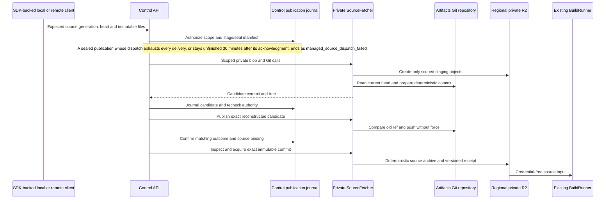

Managed bounds are an 8 MiB working tree, 2 MiB per file/upload, 2,000 files, at most 8,000 directory-tree visits including the root, and safe ASCII paths representable in the existing USTAR envelope. A path may not be both a file and the folder of another path (`docs` with `docs/readme.md`); such a snapshot is refused as `source_snapshot_invalid` before any Git write. Preparation counts the final distinct directory paths after changes, deletions or restoration against the same bound used by reads, before creating Git candidate objects. The adapter separately bounds Git transfer to 16 MiB and its memory filesystem to 32 MiB. A module-owned lease admits one managed RPC or archive/inspection operation per isolate across fresh service/factory instances. Busy work is rejected before execution; the lease remains held after a caller timeout until actual underlying Git, R2 and archive-sink promises settle. The lease keeps a pending count rather than stored credential/candidate values. Worker memory still includes runtime/input overhead, so these configured bounds and admission regressions are not a measured universal heap ceiling. Larger media uses the separate file service. [Public limits](../../packages/contracts/src/managed-sources.ts), [memory and transport limits](../../apps/source-fetcher/src/managed-git.ts).

The project publisher ends a sealed publication whose outbox delivery used every attempt and was never acknowledged, or whose acknowledged dispatch is still unfinished more than 30 minutes later, before it claims more managed-source work: the publication and its operation fail with `MANAGED_SOURCE_DISPATCH_FAILED` (public `managed_source_dispatch_failed`), so the source stops blocking later writes. The Queue retries a message every 30 seconds for at most 30 retries and then dead-letters it, so the 30-minute bound outlives every delivery ([D508](decisions/source-and-build.md#d508), [D627](decisions/source-and-build.md#d627)). The caller reads the current source to confirm whether the change landed, and submits it again under a new idempotency key only if it did not. The same sweep ends a queued initialization that has no child publication whose initialization event used every delivery without an acknowledgment, or was acknowledged more than 30 minutes earlier: the recipe fails with the same code, the source reports that failure instead of pending, and an explicit `source_initialize` may start the template again ([D573](decisions/source-and-build.md#d573)). A sealed snapshot whose file and folder share a path, or that the managed Git adapter refuses as an invalid input, fails once with `SOURCE_SNAPSHOT_INVALID` (public `source_snapshot_invalid`) instead of being retried, because the refusal repeats on every attempt. A stored object or immutable receipt that does not match its recorded file is retried, because the mismatch may be transient; if it never clears, the dispatch sweep ends the publication after 30 minutes ([D627](decisions/source-and-build.md#d627)). A restore or change reads its source commit before the publication opens, so an unreadable commit leaves no staging publication to block renames.

Both providers converge on an exact commit, deterministic archive digest, existing archive inspection and regional BuildRunner receipt. A GitHub repository link records GitHub's canonical owner and name, whatever letter case the customer typed: the typed name is sent to GitHub, which matches names without regard to case, and the owner and name that GitHub returns are the ones the link stores. Managed requests carry a real namespace/repository locator and no invented GitHub installation/repository number. SourceFetcher holds repo-scoped short-lived Git tokens in trusted HTTP headers, validates the reported remote against its configured account/namespace, and excludes `.git` and credentials from source archives. Managed Git HTTP uses manual redirect handling and rejects every 3xx response before Git parses it; credentials are never forwarded to a redirect target. Customer install/build executes later in the existing unprivileged sandbox with neither Artifacts bindings nor Git/provider tokens. [Managed archive path](../../apps/source-fetcher/src/managed-source-runtime.ts), [credential boundary](security/provider-credentials.md).

The 6 October provider receipt records real disposable Dev repositories in US and EU namespaces, one winner from competing writes, three history entries after forward restoration, identical archive bytes/digest, and deletion of the proof repositories. It establishes provider Git behavior through the adapter, not a Production deployment, native Worker-binding rollout, customer build or normal ChatGPT/Claude conversation. That original receipt remains scoped to provider Git behavior. Subsequent retained Dev/Production/client/native observations establish newer selected outcomes, while A01–A06, A36–A39 and A41 retain the exact unproved native/customer obligations.

## Regional build sandboxes

`BUILD_RUNNER` is private RPC. It owns US/EU build-object buckets and `BUILD_SANDBOX` / `BUILD_SANDBOX_EU` namespaces, selected by the project's bucket and immutable region. New objects use North America `enam` or EU `weur`; the container configurations constrain US applications to `ENAM`/`WNAM` and EU applications to EU jurisdiction. Each operation names one durable sandbox object and one deterministic build ID. Dev declares 10 concurrent instances per application; Prod declares 25; the disabled configuration declares one. [Placement](../../apps/build-runner/src/build-placement.ts#L74), [executor](../../apps/build-runner/src/sandbox-executor.ts#L47), [production containers](../../apps/build-runner/wrangler.production.jsonc#L44).

The Durable Object transfers source from R2 to the agent, polls every five seconds, saves terminal usage and destroys the sandbox. Launch has a five-minute limit and execution an eight-minute limit. The durable first terminal result wins; a stopped/restarted sandbox is a fault, and failed destruction is retried. The image pins Node by tag and digest, pins platform build tools and parsers, and contains no credential ([D505](decisions/source-and-build.md#d505)). Its release identity hashes the Dockerfile and every file it copies, including the shared admission policy, so a changed image input always yields a new image name and receipt ([image recipe](../../scripts/platform-container-release.mjs#L1014)). Live policy verification uses a unique name-filtered Container application LIST only for its exact name/UUID, then requires a matching fresh GET with a positive safe integer version and valid image; the completed rollout must still match that version, image and exact source-policy fingerprint ([D429 readback correction](decisions/delivery-and-operations.md#d429-follow-up--authoritative-container-application-readback)). A stale LIST version/image is not rollout proof, and failed/malformed GET results have no LIST fallback. The one operation token authenticates its agent; the agent deletes it from its environment before starting child processes. Customer install/build runs as UID 10001 with a fixed allowlist and without new privileges (`setpriv --no-new-privs`). Remaining customer processes must end within ten kill-and-check rounds (a killed orphan that only lingers as a zombie under the agent does not count), otherwise the build fails before root packages anything and the customer's log says so; then the source tree is handed to root and made unwritable for group and others, and root validates and packages output. Runtime secrets, provider tokens, platform identity digests and database passwords are absent from that customer process. [Sandbox lifecycle](../../apps/build-runner/src/build-sandbox.ts#L88), [process isolation](../../apps/build-runner/sandbox/agent.mjs#L137), [image](../../apps/build-runner/sandbox/Dockerfile#L1).

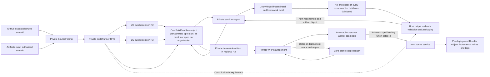

## Build credit

A build is paid from the organization's credit account ([credit account](billing-and-pricing.md#credit-account), [D445](decisions/billing-and-usage.md#d445)), and its price is in the [pricing contract](pricing-contract.md#build-price). The accepted deployment plan quotes the `standard-3` sandbox price for its reserved seconds. Accepting the deployment reserves the quote in the same Core batch that records the intent (`reserve:<operationId>`; the reservation id is the operation id, so start, settlement and release find it again). Admission refuses before any state is written when the plan enables the mail framework and the organization is not Paid or its credit is exhausted past the grace, when a project `stop` budget would be exceeded by this month's use plus open reservations plus the quote, or when the available credit (`monthly + one-time - reserved`) is below the quote. A build has no grace period: it never starts on credit that is not there. An organization holds at most four open build reservations: a reservation counts while its operation is queued or running and either its build started within the last 60 minutes or it is unstarted inside its start window. A fifth claim is refused with `build_capacity_reached` (429, not retryable) before anything is reserved, and a settled build frees its slot ([D501](decisions/source-and-build.md#d501)). [Admission rule](../../apps/control-store/src/catalog/credit/admission.ts#L77), [reservation at acceptance](../../apps/control-store/src/catalog/product-api/accept-product.ts#L600).

The measured execution seconds of the BuildRunner receipt settle the reservation in the batch that stores the usage record (`settle:<operationId>`): they are charged at the quoted rate to the project, the remainder is released and the reservation row is deleted. The billed seconds run from the sandbox start that the Build Sandbox Durable Object recorded (`runningSince`, set once `/start` answered 202) to the Durable Object's own observation of the terminal status, never to instants the sandbox reports; a customer may therefore be billed for the poll lag, a few seconds more than the build ran (about 0.1 credit). A build whose sandbox never started (no `runningSince`) releases the whole reservation (`release:<operationId>`) in the same batch that stores its usage record, with no charge, whether it ends `TIMED_OUT`, `FAULT` before launch or `STOPPED`; the same release runs in the batch that records a known failure before launch or when an abandoned operation is recovered. A started or uncertain build keeps the reservation until its evidence arrives. An instance type without a published price is still an error, never zero usage. A binding refresh creates no build and no reservation. [Settlement](../../apps/control-store/src/catalog/build/settlement.ts), [sandbox clock](../../apps/build-runner/src/build-sandbox.ts), [release on failure](../../apps/control-store/src/catalog/provisioning/failure-build-release.ts), [release on abandonment](../../apps/control-store/src/catalog/provisioning/build-release.ts).

## Framework and runtime contracts

Frozen installs require an exact package-manager declaration and one matching lockfile. Yarn must be 3.0.0 or later, the first release that runs the `--mode=skip-build` flag beside `--immutable` (Yarn 2 has no such flag, and Yarn Classic has no `--immutable`), and any earlier Yarn is refused at admission. npm, pnpm, Yarn and pinned Bun commands disable install scripts; framework build scripts are admitted through the shared contract. Reserved platform paths, archive links/special files, output symlinks/hardlinks, unsafe path ancestry, native addons and unsupported generated provider capabilities are rejected. Database migrations are snapshotted before the customer process and packaged from the read-only snapshot. [Build lifecycle](../../apps/build-runner/sandbox/build-runtime.mjs#L729), [migration snapshot](../../apps/build-runner/sandbox/build-runtime.mjs#L2869).

The user build script exports `YARN_NODE_LINKER=node-modules`, so Yarn 2 and later install into `node_modules` instead of Plug'n'Play. After the frozen install and before the build script, the build checks the installed version of every planned framework package (`next`; `vite`; `@tanstack/react-start` and `vite`) with the shared verdict and selects the build arguments: Next.js 16 and later build with `--webpack`, Next.js 15 without it. A refusal writes one fixed, bounded line to the customer log instead of a stack trace. The customer line names the installed version and the minimum to use; when the exact `package.json` declaration equals the refused installed version, planning admitted it, so the line instead reports an inconsistent platform admission policy and asks to report the operation ID and plan the same commit again later. Missing or unreadable `node_modules/<package>/package.json` metadata has its own customer line. A failed root re-check of the planned package manager and build script before the install reports a fixed platform line instead of an empty excerpt, and customer-safe packaging lines reach stderr once without a stack. [Installed-version check](../../apps/build-runner/sandbox/build-runtime.mjs#L1413), [refusal lines](../../apps/build-runner/sandbox/build-runtime.mjs#L1473), [re-check phase](../../apps/build-runner/sandbox/agent.mjs#L212).

| Adapter/runtime       | Checked build output and delivery                                                                                                                                                                                 |
| --------------------- | ----------------------------------------------------------------------------------------------------------------------------------------------------------------------------------------------------------------- |
| Vite/static           | Static assets including root `index.html`; unknown routes use SPA handling.                                                                                                                                       |
| Vite/edge             | Static assets plus `src/ohmyhost/companion.ts` Worker; `/api/` reaches the companion and other requests reach assets.                                                                                             |
| TanStack Start/static | Prerendered static output; ordinary static 404 handling.                                                                                                                                                          |
| TanStack Start/edge   | Official Cloudflare Vite output at `dist/client` and `dist/server`; exact generated redirect/config and empty unrequested capabilities.                                                                           |
| Next.js/edge          | OpenNext 1.20.9 conversion with the pinned overlay, Wrangler dry-run modules, traced read-only runtime data, asset binding and private build-time cache. Next 16 and later receive `--webpack`; Next 15 does not. |
| Functions             | `src/ohmyhost/worker.ts` default Worker module without a framework build/static assets; optional declared crons.                                                                                                  |

Next.js defaults to a private immutable prerender cache in the deployment's static assets; without an opt-in it refreshes only on a new deployment, and [D430](decisions/source-and-build.md#d430) runs Cache Components on it. W47 introduced an explicit `build.next_revalidate_path: true` mode for on-demand path invalidation ([D601](decisions/source-and-build.md#d601)); the current source candidate requires the installed Next.js version to be exactly 16.4.5 with the pinned OpenNext overlay. The earlier hosted acceptance used 16.4.1 and does not establish a hosted 16.4.5 release. The image pins `@opennextjs/cloudflare` 1.20.9 with `@opennextjs/aws` 4.1.8, which writes the route-scoped response cache keys of every admitted release; static cache population refuses any other OpenNext version. The pinned overlay also inlines `preview-props.json`, scopes the 16.4 module-loading `CacheSignal` per request and strips `next-resume`. For the opt-in cache it propagates cache failures and awaits pending invalidations at the request boundary. The package version, each target occurrence and both source and patched SHA-256 are checked before any file is changed. [OpenNext overlay](../../apps/build-runner/sandbox/open-next-patch.mjs), [image step](../../apps/build-runner/sandbox/Dockerfile).

The build writes its own OpenNext configuration as `.ohmyhost-open-next.config.ts` and its Wrangler configuration as `.ohmyhost-next-wrangler.jsonc` and passes both explicitly (`--openNextConfigPath`, `--config`), so a committed `open-next.config.ts` is ignored like a customer `wrangler.jsonc`, although planning still refuses two `open-next.config` variants (`.js`, `.mjs`, `.ts`) as `framework_config_ambiguous`; only the platform names are reserved build paths. The Next.js Worker configuration declares no `images` binding ([D507](decisions/source-and-build.md#d507)). Request-time `"use cache"` entries remain misses with dropped writes in both modes; concurrent identical calls within one isolate may share a computation, so the cached function must depend on request data only through its arguments. Default-mode cache interception stays on except with Cache Components; opt-in disables it. A Cache Components build also caps `experimental.maxPostponedStateSize` at 25 MB, retaining a smaller valid value. [OpenNext configuration](../../apps/build-runner/sandbox/build-runtime.mjs), [writable overrides](../../apps/build-runner/sandbox/next-writable-cache.mjs).

In the opt-in mode, the build carries the immutable private Static Assets entries as the initial seed. WFP Management asks Core to register the exact current claimed project, environment and deployment before candidate upload; Core pins the project's region in an immutable scope ledger. The candidate receives a private `OHMYHOST_NEXT_CACHE` service binding with those platform-supplied properties. The service uses a jurisdiction-restricted SQLite Durable Object per scope for writable incremental values and path tags; a scope-wide generation rejects a stale render that races any invalidation, including one for another path, and a retired scope cannot be recreated. A failed cache write or deletion, including a stale-generation or capacity refusal, causes the request to return 503 rather than report success. The opt-in buffers responses up to 12 MiB and 30 seconds before returning them so a deferred invalidation failure can still fail the request; default read-only deployments retain streaming. A promotion gets its own target scope; rollback reuses its original deployment scope. Customer Workers cannot choose another tenant or environment through the binding. Deletion first retains the observed gateway tombstone, then Core establishes an irreversible deletion fence; the deletion workflow pages registered scopes, asks the private retirement service to purge each and records a receipt before advancing. Failure keeps cleanup pending. Values are limited to 12 MiB each and 64 MiB per deployment scope, with bounded entry and tag counts; the service cost is platform expense, not customer file storage. [Core registration and retirement](../../apps/control-store/src/catalog/runtime-secrets/next-cache.ts), [cache service](../../apps/next-cache/src/worker-main.ts), [WFP binding](../../apps/wfp-management/src/management.ts), [deletion loop](../../apps/project-provisioning-worker/src/product-workflow-composition.ts).

After the customer build, `next-cache-validate` reads the prerender manifest, server files and reachable application source without executing them; private cache population repeats that check and validates each entry. The `"use cache"` directive is admitted in every form. Value imports and re-exports from `next/cache` must name only `cacheLife`, `cacheTag`, their `unstable_` aliases, `io`, `navigation`, `prefetch`, `refresh` or `unstable_noStore`; the explicit writable mode additionally admits named `revalidatePath` during a Server Action or Route Handler. A call deferred to `after` or `waitUntil` after the response is outside this v1 contract. Partial-prerendering markers without `cacheComponents: true` fail closed. Each refusal ends the build with a fixed customer line. [Next cache admission](../../apps/build-runner/sandbox/build-runtime.mjs), [admission regression](../../apps/build-runner/sandbox/tests/build-runtime.test.mjs).

| Refused                                                                                                                                                                                                                                                                                                                          | Why                                                                                                                     | Fixed line begins                                                                                                                                                                                                                                       |
| -------------------------------------------------------------------------------------------------------------------------------------------------------------------------------------------------------------------------------------------------------------------------------------------------------------------------------- | ----------------------------------------------------------------------------------------------------------------------- | ------------------------------------------------------------------------------------------------------------------------------------------------------------------------------------------------------------------------------------------------------- |
| `revalidateTag`, `updateTag`, `unstable_expireTag`, `unstable_expirePath`, `unstable_cache` and other unsupported `next/cache` references; `res.revalidate`; a fetch `next.revalidate` other than 0 or `false`; a revalidating fetch cache entry. `revalidatePath` is also refused unless the explicit writable mode is enabled. | W47 admits only named path invalidation; tag invalidation and timed ISR remain outside this contract.                   | "Next.js on-demand or time-based revalidation is not supported by this read-only hosting cache."                                                                                                                                                        |
| A revalidate or expire time on prerendered output of a build without Cache Components                                                                                                                                                                                                                                            | The output stays as built until the next deployment                                                                     | "Next.js time-based revalidation of prerendered pages and route handlers is not supported by this read-only hosting cache. Keep build-time static pages or ordinary request-time rendering: …"                                                          |
| The same in a Cache Components build, including a `"use cache"` value in a static shell, since every built-in `cacheLife` profile revalidates                                                                                                                                                                                    | The shell would stay frozen until the next deployment                                                                   | "Next.js time-based revalidation of prerendered pages and route handlers is not supported by this read-only hosting cache: a revalidate setting or a "use cache" value in a Cache Components static shell would stay frozen until the next deployment." |
| In a Cache Components build, a partially prerendered dynamic route with open params that has no static shell, or that has generated params while `partialPrefetching` is set                                                                                                                                                     | Next.js prerenders such a page while the visitor waits; Workers stop that request, and later requests for the page hang | "Next.js Cache Components pages that are prerendered while a visitor waits are not supported by this hosting: Workers stop such a request and later requests for the same page."                                                                        |

Default-mode admission has no upper bound; in the source candidate, opt-in v1 requires installed Next.js 16.4.5. This OpenNext refuses a Next.js major it does not list (17 today) and, since 21 October 2026, the ended Next.js 15 support window; the platform never passes OpenNext's override flag, so such a build fails with OpenNext's own message in the excerpt. The private build-time seed is read through `ASSETS`; public requests for encoded or normalized `/cdn-cgi/_next_cache` paths return 404. Declared crons on edge framework runtimes package the customer's Worker module alongside the framework modules; the scheduler uses an internal invocation with the exact immutable script and declared cron. These contracts are generic; fixture repositories do not choose runtime behavior. Historical W20 evidence covered Next.js 16.4.0 apps with and without Cache Components on local workerd with the then-current real image and pipeline. At that time the 16.4.1 floor differed from 16.4.0 only in version strings outside its compiled production runtimes and a detached-buffer check in the Flight serializer; a Cache Components app on 16.4.1 was part of Development acceptance (W20 proof). The Cloudflare deployment and production entry wrapper were separate release checks. Those historical observations do not establish a full 16.4.5 build or hosted acceptance. [Runtime entry wrapper](../../apps/wfp-management/src/management.ts#L2979).

Deployment finalization binds each cron to the exact activated candidate, deployment, immutable script and egress policy. Scheduled runs are unique per environment/cron/minute and use a 150-second claim lease with at most three attempts; rejection is terminal and retryable failures use the bounded attempt chain. Empty cron sets remove the environment schedule, and project deletion removes all schedules before candidate cleanup. [Schedule custody and claims](../../apps/control-store/src/catalog/gateway/function-schedules.ts).

## Artifacts and limits

For the writable Next cache, verified staging also computes a combined binding-set digest from the platform-selected binding inputs. The private candidate receipt carries that optional value through Core persistence, Workflow and secret-delivery RPCs, activation, rollback preparation and candidate inventory. Core migration `0756` adds a nullable 32-byte immutable column; existing NULL receipts keep their original shape, and no old digest is inferred from provider metadata. Activation and observation require the retained expected digest to match a combined provider tag. The private Workflow remains trusted to supply the stage/Core receipt, as it already supplies provider tag and artifact identity. The separate gateway-derived, explicitly authorized deletion path retains its existing identity-only proof; supplied candidate digests are checked and inventory readers retain them. These source changes still require their exact release and hosted acceptance.

First admission binds `nextRevalidatePath` to the accepted framework plan. Reading that same stored bundle again preserves its admitted mode through the trusted provenance: both the complete archive hash and the canonical artifact digest must match before WFP can use it. The stored manifest alone cannot enable a capability, and a missing plan opt-in still means read-only at first admission. The W47 Development canary exposed a reparse expectation that incorrectly treated an already admitted opt-in as false; its correction preserves these original trust boundaries.

Private object keys are `runs/<project>/<environment>/<operation>/input/source.tar.gz` and `output/bundle.tar.gz`; the failure excerpt and the full log use `logs/<project>/<environment>/<operation>.failure.json` and `logs/<project>/<environment>/<operation>.log`, so the bucket's seven-day `logs/` rule expires both. Multipart receipts bind scope, checksum, bucket, key and exact R2 version; a superseding version is never treated as the requested one. Writes are create-only, and uncertain upload/start results require observation. BuildRunner returns verified manifest/migrations/provenance metadata through RPC; WFP Management reads and verifies the same private bundle independently to avoid copying expanded assets across the 32 MiB RPC boundary. [Archive sink](../../apps/source-fetcher/src/build-archive-sink.ts#L128), [versioned object store](../../apps/build-runner/src/r2-object-store.ts#L90), [artifact RPC](../../apps/build-runner/src/worker-main.ts#L153), [artifact reader](../../apps/wfp-management/src/artifact-reader.ts#L12).

| Boundary                                         | Checked limit                                                                                                              |
| ------------------------------------------------ | -------------------------------------------------------------------------------------------------------------------------- |
| GitHub compressed source and agent source intake | 25,000,000 bytes                                                                                                           |
| Archive inspection                               | 100 MiB expanded, 20,000 entries, 5 MiB per file; retained bodies 16 MiB (named files) and 32 MiB shared (source and JSON) |
| Sandbox extraction defense                       | 512 MiB file bytes, 100,000 entries                                                                                        |
| BuildRunner RPC upload part                      | 16 MiB; SourceFetcher sends 5 MiB parts                                                                                    |
| Deployment bundle                                | 30 MiB compressed and 64 MiB expanded including USTAR headers/padding                                                      |
| Public static assets                             | 25 MiB total, 1,000 files, 10 MiB per file                                                                                 |
| Next private SSG cache                           | 32 MiB default; selected 1–64 MiB in integral MiB, shared 1,000-file asset count                                           |
| Next writable path cache, opt-in                 | 64 MiB value bytes per deployment scope; 12 MiB per value and 8,192 entries / tags                                         |
| Next opt-in buffered response                    | 12 MiB and 30 seconds before response headers; default mode streams                                                        |
| Next prerendered page path                       | Route-scoped cache path fits USTAR fields: always up to 95 bytes of URL path, beyond that by segment layout                |
| Worker modules                                   | 1,000 modules; ordinary main/module 5 MiB and total 10 MiB; Next main/total 15 MiB and total compressed 10 MiB             |
| Migrations                                       | 128 files, 256 KiB each, 2 MiB total; canonical timestamp SQL names and UTF-8/LF bytes                                     |
| Manifest / dependency SBOM                       | 1 MiB / 4 MiB                                                                                                              |
| Agent log / customer failure tail                | 5 MiB agent log tail; 64 KiB read, 200 lines, 16,384 characters for failure excerpt                                        |

The framework plan keeps schema v5 and gains one optional key, `ai`, which is `{ enabled: true, jurisdiction: "eu" | "any" }` and is present only when `ai.enabled` is declared in `ohmyhost.yaml`; the jurisdiction has no default. A plan without the key, every stored plan and every digest, is unchanged. Edge, functions and Vite companion plans accept it; static plans keep exact keys and refuse it, and static Astro, Vite and TanStack applications that declare `ai` are refused at admission as `runtime_mode_unsupported`, because a static site has no Worker to hold the key. [D447](decisions/source-and-build.md#d447).

Build outputs are copied into the artifact only through a descriptor opened without following links. A file that is not a regular file with a single link refuses the build (`unsafe build output`), so the copy reads the file that the walk found ([D504](decisions/source-and-build.md#d504)). The verified manifest's runtime shape is the plan's: a static artifact has no edge sections, an edge artifact must have them, and its entry wrapper must be the one its adapter builds ([D506](decisions/source-and-build.md#d506)).

The artifact is `ohmyhost.artifact/v3` with framework-plan v5, source commit/archive digests, configuration/lock/install/build evidence, immutable output inventories, SBOM and migration digests. Its `credentialScan` records approved custody and output-path rules; it is **not an arbitrary content scan for secrets committed by the customer**. Root packaging failures expose only fixed platform-phase wording or bounded customer-fixable limit lines; a prerendered Next.js page whose cache path does not fit the archive is named with the fix: shorten its URL or render it on request. [Artifact packaging](../../apps/build-runner/sandbox/build-runtime.mjs#L3049), [archive size checks](../../apps/build-runner/sandbox/build-runtime.mjs#L3740), [safe packaging diagnostics](../../apps/build-runner/sandbox/agent.mjs#L272).

## Candidate publication and activation

W47 source lets a customer explicitly create a project with Prod only. Omitting the choice retains the existing Dev and Prod pair; no existing Dev is removed. Core reserves the deterministic Dev hostname with the project but creates no Dev environment or gateway until the customer adds it. Add Dev is an idempotent operation that creates the environment and its assignment in one batch: shared data points to Prod's current data identity, while isolated data receives a new identity; secrets are not copied. An omitted deployment-plan environment selects an existing Dev, otherwise Prod; an explicit missing Dev returns `development_environment_missing`. GitHub auto-deploy remains explicitly Dev-only, and enabling it without Dev is refused with that same reason. Direct Prod plans are allowed with shared data, with a warning that database migrations affect both environments, and retain the existing authorization, migration and idempotency checks. This is implemented source, pending release and hosted acceptance. [D600](decisions/runtime-and-lifecycle.md#d600), [project admission](../../apps/control-store/src/catalog/projects/customer-projects.ts), [Add Dev](../../apps/control-store/src/catalog/projects/add-development-environment.ts), [planning read](../../apps/control-store/src/catalog/product-api/planning-reads.ts), [auto-deploy admission](../../apps/control-store/src/catalog/product-api/auto-deploy.ts).

WFP Management validates the artifact and target registrations, uploads typed static assets, builds a platform-owned entry wrapper and sends multipart Worker metadata with exact tenant/deployment/artifact tags. Database and storage bindings carry trusted scoped properties; runtime secrets enter only through the private manifest. The immutable candidate name is `p-<project>-<dev|prod>-<deployment>`. Replays must match the candidate artifact/bindings, and current secrets are synchronized before activation. Provider script rejection is terminal; unknown publication/secret outcomes remain reconciliation work. [Staging](../../apps/wfp-management/src/management.ts#L540), [trusted bindings](../../apps/wfp-management/src/management.ts#L2625).

Route activation uses the Control gateway registry's current operation claim, candidate receipt and expected previous revision. Private health probes name the exact candidate, account their usage, bound retries/body excerpts, run the candidate under the same CPU and subrequest limits and project egress context as live traffic ([D467](decisions/source-and-build.md#d467)), and distinguish unhealthy responses from unavailable observations. Compensation restores the previous route under its revision fence and removes only the operation's candidate under a separate cleanup claim. Removal verifies exact provider absence and three consecutive public 404s before returning complete. [Activation](../../apps/wfp-management/src/management.ts#L779), [private health probes](../../apps/wfp-management/src/worker-main.ts#L1271), [compensation/removal](../../apps/wfp-management/src/management.ts#L1104).

C3 candidates additionally carry exactly one `layout:gateway-scopes-v1` tag. New uploads still retain the existing customer bindings and binding digests until C4, but Storage URL/allow-list scope is pinned before publication. Provider observations distinguish an exact old-layout receipt as `candidate_bindings_outdated`; stage, settle, preparation and activation refuse adoption, and activation re-observes before registry mutation. The fixed reason is permitted only on candidate reconciliation, survives private redaction and produces the credential-free `WFP_CANDIDATE_OUTDATED` diagnostic. Cleanup and a fresh binding-refresh source may use exact old identity as provenance; secret maintenance may refresh an exact old head without turning it into an executable current-layout candidate. An observed old active route may prove only the exact scoped/revision/policy predecessor for recovery, never health or readiness. Unknown/foreign identity remains closed. [Provider layout fence](../../packages/provider-cloudflare/src/wfp-provider.ts), [Management gates](../../apps/wfp-management/src/management.ts), [D439](decisions/delivery-and-operations.md#d439).

Management rollback to a pre-C3 build is clean only before the first C3 candidate is published; afterward it requires a layout/pin-aware rollback build or forward correction. Separately, a pre-pin Egress build can be restored only before the first pinned active head, even while Storage's strict legacy class remains. Candidate-mutation quiet windows preserve request ingress and schedules, and retained historical rollback records are not deleted to manufacture an empty census. C4's binding removal and `layout:gateway-http-v2` cutover are not established by C3 source checks.

## Promotion and binding refresh

Promotion reuses the verified Dev artifact and source evidence in Prod, with target environment database/storage registrations and current target secrets. It does not copy Dev data or secret values into isolated Prod. A binding refresh freezes the accepted head/candidate identity and data registration/assignment versions, then publishes a new candidate with current platform bindings using the original artifact custody. Success requires exact retirement evidence for the prior candidate; that retired candidate is subsequently unavailable for rollback. Refresh does not create another build or build-credit reservation. An existing rollback candidate is validated against its original artifact and updated target secret manifest before activation; rollback leaves current data in place. [Artifact reuse validation](../../apps/wfp-management/src/management.ts#L511), [binding refresh source fence](../../apps/wfp-management/src/management.ts#L103), [refresh proof](../../apps/control-store/src/catalog/provisioning/binding-refresh-proof.ts), [rollback preparation](../../apps/wfp-management/src/management.ts#L1010).

Refresh validation covers the explicit current provider project/database and registration version. During cutover, owner-recorded refresh permits bind each environment/operation to the prepared target and registration; unrelated mutations stay fenced until explicit release. Candidate activation and rollback reject a database-backed script staged before the current PGCF target existed; historical source/artifact bytes remain reusable only through a newly scoped refresh. Pending provider operations keep the workflow pending until their matching observed receipt completes, rather than becoming a successful deployment or starting duplicate provider work. [Refresh target validation](../../apps/control-store/src/catalog/provisioning/binding-refresh-proof.ts), [candidate persistence](../../apps/control-store/src/catalog/provisioning/deployment-candidate.ts).

A rollback and a promotion of the same environment cannot both be open. Each command is refused while an operation of the other kind is queued or running, because a rollback carries no head and would revert or overwrite the release the other activates ([D509](decisions/source-and-build.md#d509)).

Promotion and rollback acceptance copy the source generation from the exact usable persisted confirmation into the immutable command intent, in the same guarded transaction that consumes that confirmation. A project without a source binding pins generation zero. Execution and provider authorization recheck that accepted generation against the current binding; a missing or replaced pin fails closed. [Acceptance effects](../../apps/control-store/src/catalog/product-api/accept-product-effects.ts), [generation checks](../../apps/control-store/src/catalog/identity/operation-delegations.ts).

## Workflow ownership and recovery

The private project publisher wakes on the every-minute cron or Control RPC and drains accepted operations from the transactional outbox into the project queue. Its consumer sends project-creation messages to `ProjectProvisioningWorkflow` and other product commands to `DeploymentWorkflow`. Queue messages are acknowledged only after a durable terminal result; pending/unknown outcomes retry after 30 seconds. The configured consumer uses batches of ten, five-second batch timeout, thirty retries and a separate dead-letter queue. [Publisher](../../apps/project-provisioning-worker/src/composition.ts#L23), [acknowledgment](../../apps/project-provisioning-worker/src/queue-consumer.ts#L16), [production queue](../../apps/project-provisioning-worker/wrangler.production.consumer.jsonc#L44).

Deployment workflow callbacks renew their operation lease before each actual durable retry and around sleeps. Logical command identity remains stable; explicit bounded replay/provider-reconciliation attempts use a separately verified physical instance. The database sweeper atomically marks an expired operation `OPERATION_ABANDONED`, closes its workflow/deployment, releases its provider claim and returns only demonstrably unstarted build credit reservations. A claim of an operation that ended at least an hour earlier is released by the same publisher pass unless a started bucket create or an open Native create still holds it; a Neon placement reservation holds its claim for seven days after the operation ended, and the same batch then deletes the reservation before the claim ([database chapter](database.md), [D614](decisions/runtime-and-lifecycle.md#d614)). The W21 guard skips only an expired candidate with an unresolved Neon placement reservation (a historical Core row) joined to its exact current organization/project/operation/claim. It preserves those records for existing reconciliation and continues selecting eligible unrelated expired work, avoiding the foreign-key rejection that blocked the scheduled publisher. A stale execution cannot revive its expired lease. A GitHub push that a newer push superseded ends once its candidate has been removed or compensated and the absence of the candidate and its operation artifacts is recorded; an uncertain removal goes to reconciliation and never reaches this step. One batch then cancels the operation, completes its Workflow run, fails its deployment row and deletes its provider claim. The batch refuses with `operation_conflict`, and releases nothing, while the operation's run is not completed or has an active reconciliation attempt, a deployment is not `succeeded` or `failed`, a reconciliation attempt stayed `unknown`, or a placement or bucket reservation or an unresolved Native database create still belongs to it; the lease sweeper then abandons the operation. The delete guard of the claim admits a `cancelled` operation only on the same terms plus the recorded evidence that it was a superseded push with a fully cleaned candidate (core migration 0634), so no other cancellation can release a claim. Apply 0634 to Core before the Worker that releases the claim; a Worker without the release that cancels during the overlap strands one claim, which running the statements of 0634 again releases. 0634 also released the claims of pushes cancelled earlier whose evidence is complete and left every other claim untouched. [Superseded terminalization](../../apps/control-store/src/catalog/provisioning/deployment-cleanup.ts). [Workflow fencing](../../apps/project-provisioning-worker/src/product-workflow-runtime.ts#L12), [lease recovery](../../apps/control-store/src/catalog/operations/operation-leases.ts). Operation records, private receipts and gateway revisions are the persisted source of truth; transport exceptions do not imply absence or success. Build start specifically uses a SHA-256 input fingerprint, a leased claim and a separate authorization immediately before launch; retry observes the existing start and never blindly starts a second build after an uncertain result. [Build reservation](../../apps/build-runner/src/persistent-broker.ts#L67).

The Workflow recognizes the closed authorization-conflict code/name and the exact class-prefixed message produced when a native durable Workflow step serializes that private RPC error. Its existing authorization rejection path fails a claim-free stale operation atomically, or preserves provider reconciliation when candidate/activation evidence still needs resolution. Terminal failure clears the snapshot-matched active replay pointer in that same guarded batch, retaining immutable attempt history and idempotent completed-replay reads. A previously accepted intent with a missing source pin remains immutable and cannot obtain authority from the current binding. [Failure classification and guarded rejection](../../apps/orchestrator/src/deployment-workflow.ts).

Queue-delivery recovery is a narrow response to the recorded fifth/final lease-expired send attempt. A parked `ProjectProvisioningRequested` event is recovered for the same final codes and for `PROJECT_PROVISIONING_QUEUE_SEND_UNCERTAIN` and `PROJECT_PROVISIONING_QUEUE_SEND_TIMEOUT`; its event and final attempt must carry the same one of them, and configuration or contract-invalid codes stay refused. It first persists the owner's exact prepared audit, ensures the original logical Workflow ID, and closes only that failed outbox in the same transaction as its final audit. A matching prepared audit bridges the interval between same-ID Workflow creation and outbox acknowledgment. Source-link recovery also verifies the complete five-attempt history digest and immutable source/grant outcome; closed recoveries preserve their original identity and bounded replay chain. A provider get failure remains unknown, and provider continuation requires exact validated claim/context. The same final-send recovery covers every Workflow run type (source link, rollback, promotion, deletion and data change) whose final Queue send ended with the lease-expired code or `PRODUCT_COMMAND_QUEUE_SEND_UNCERTAIN`: it hands off only in the lifecycle of its type, a deletion while the project is deleting, a data change while it is active, and a source link, rollback or promotion while it is active with no cleanup run. The replay candidate's handoff runs before the run-less acceptance. An exhausted event of any of these types that never got its Workflow run is accepted at its current attempt, so the ordinary handoff matches it. An operation with nothing pending answers `reconciliation_not_pending` (409, not retryable) instead of an unmatched error ([D514](decisions/runtime-and-lifecycle.md#d514)). [Deployment queue recovery](../../apps/control-store/src/catalog/provisioning/queue-recovery-deployment.ts), [source-link recovery](../../apps/control-store/src/catalog/provisioning/queue-recovery-source-link.ts), [reconciliation routing](../../apps/project-provisioning-worker/src/provider-reconciliation-composition.ts).

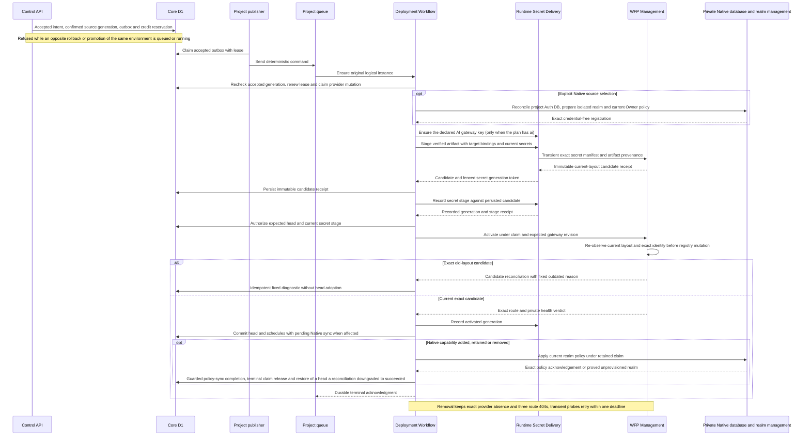

Project deletion removes schedules and only the frozen tenant resource inventory: exact customer Worker candidates/routes, source/build objects, SQL exports, mail/domain resources, private file buckets and physical database registrations/projects. Database authority is revoked before deleting its provider database, and an incomplete provider readback keeps cleanup pending. Data-mode changes first revoke the losing environment's SQL access, reauthorize registrations and switch audited assignments; retired files/databases are purged only after the frozen transition and active upload expiry checks. [Deployment/resource cleanup](../../apps/project-provisioning-worker/src/product-workflow-composition.ts#L1716), [data transition](../../apps/project-provisioning-worker/src/product-workflow-composition.ts#L1932).

Exact WFP removal proves both provider metadata absence and three consecutive public-route 404 responses. The route probe has its own five-second request budget, separate from the one-second polling interval, capped by the remaining thirty-second total deadline. A transport failure resets the consecutive count and retries inside that same deadline; persistent failures, non-404 responses and observations arriving after the deadline remain uncertain. Private Workflow step output retains only the existing closed removal reason (`stale_edge` or `provider_conflict`), while a private warning records fixed probe reason/count/status fields without the customer URL, scope, tags or provider error text. These observations grant no cleanup or reconciliation authority. [Probe implementation](../../apps/wfp-management/src/management.ts), [D320 follow-up](decisions/runtime-and-lifecycle.md#d320-follow-up--bounded-public-absence-proof), local correction and remaining release proof.

Deployment diagnostics retain fixed catalog codes and optional bounded customer build/health excerpts. Their Control table keeps seven days and at most 10,000 records per project environment, read under organization/project/deployment scope with bounded cursor pages; arbitrary provider/root error text is not the public failure message. [Diagnostic persistence](../../apps/control-store/src/catalog/provisioning/diagnostics.ts).

## Branch-based release source

The branch-release tooling aligns release tools with the owner's short-lived-branch
workflow. A clean repository root must be on `main` or an accepted `type/topic` branch. For release,
the checked-out commit, local tracking branch and remote branch must match exactly; for a feature
branch, the locally tracked `origin/main` must also equal remote `main` and be its ancestor.
The fetch and push URLs must be the expected repository. Local rehearsal checks the branch name,
checkout and configured origin but does not establish remote ref equality. Exact-commit complete
CI remains a separate gate; rehearsal and release bind their artifacts and receipts to that source.
The release train preserves Development-before-Production ordering and the existing ingress,
schedule, schema and policy-cohort guards. Repository policy calls for the released branch to be
merged and deleted after completion; a source check alone is not evidence that happened.

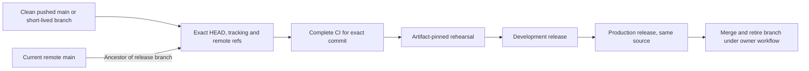

New Worker messages and Container rollout descriptions identify the exact commit with `source`.
The readers also recognize the historical `origin/main` marker for the same commit and
artifact/image, without treating a duplicate match or an unknown marker as unambiguous proof. The
operator's Core mutation path rechecks the source after qualification and before mutation. These
were used for the W45 Development and Production release from the exact CI-green source recorded
in its release evidence. Neither a local
rehearsal nor an old receipt proves a later hosted release. [Release source](../../scripts/platform-release.mjs), [Core operator](../../scripts/control-core-operator.mjs),
[Container provenance](../../scripts/platform-container-release.mjs), [D429 follow-up](decisions/delivery-and-operations.md#d429-follow-up--branch-based-release-source-candidate).

## PGCF release and maintenance tooling

The existing Worker release path includes an exact D1 binding readback. For an existing Worker, an uploaded version must expose each declared D1 binding once, with type `d1` and its exact database ID, before the version is deployed at 100%; completed-release replay repeats that check. Native first creation deploys immediately, so a new Core remains unserved by consumers until its independent binding proof and later data/authority qualification. A matching Worker version or service inventory alone is insufficient. This bounded check creates no database and applies no migration. [Release check](../../scripts/platform-release.mjs), [actual release and replay regressions](../../tests/platform-release.node-test.mjs).

The full and Make observer profiles for `ohmyho-control-api-poc-private-fullstack` and `ohmyho-control-api-production` keep Workers Logs invocation logs off, because their URLs carry OAuth codes and portal handoffs. `versions deploy` applies the declared observability block of an existing Worker, and the release then reads the live script settings of the two Control API Workers back: a live script whose invocation logs are not off stops the release, and a completed-release replay repeats the readback. [Readback](../../scripts/platform-release.mjs), [regression](../../tests/platform-release.node-test.mjs). The MCP profile (`apps/mcp/wrangler.jsonc`) and both webhook-ingress profiles keep invocation logs off too, since their logs would keep request URLs; their live setting is declared, not read back. The private creation path (`create_private`) admits the selected Credit Service or Connection Broker profile. Existing Control API Workers use the separate deployment and settings readback above.

The private Core entry module exports an empty default object solely to select module format in the locked Wrangler bundler; it has no HTTP `fetch` handler and its named RPC entrypoints remain the only callable surface. A regression bundles the actual entry module with the locked release CLI.

The operator-only Core packet compiler accepts an observed EU D1 resource with read replication explicitly disabled and an exact persisted creation identity. It derives only the fixed Development or Production private Core Worker profile from the checked-in template, then writes a new owner-private packet outside the checkout. Resource IDs stay in this packet. The existing normal release path forces the `control-store` package build, rejects a different source entrypoint or stale source SHA before a provider call, and permits no secret file on these two Core Workers. A packet from another checkout cannot select that checkout's ignored executable files. [Packet compiler](../../scripts/prepare-control-core-deployment.mjs), [closed profile and actual release preflight](../../scripts/control-core-worker-profile.mjs).

The operator resource helper persists its exact source/account/environment/creation intent and an exclusive dispatch marker before one creation request. An uncertain reply is reconciled by the original unique database name; concurrent or repeated callers under that configured custody parent never issue another create. The account/environment/creation identity fixes its custody directory name, so another session label cannot fork the dispatch marker. Independent metadata must confirm the UUID, EU jurisdiction and disabled replication. A resource with that name but no matching creation custody is refused. Credentials stay in memory and provider error bodies are not printed or journaled. [Resource helper](../../scripts/control-core-resource.mjs).

The release train knows the shared Core Worker. Its step names the exact D1 resource (`core: {databaseName, databaseId}`, private manifest only) and the Core configuration is rendered from the closed checked-in profile, never from a file that carries an id; the resource is read from the provider by UUID, EU jurisdiction and disabled replication before any upload. The Core counts as a policy consumer in both environments (it bundles the framework-admission and browser-capability modules), is created standalone at most once and afterwards ships only in a train. A Worker whose rendered configuration binds a Core service is a Core consumer: it must bind only its own environment's Core and entrypoints the Core exports, and carry no direct authority D1 binding beside the Core service; its step must depend on the Core step. The private credit service is such a consumer and joins the train as a private Worker creation step after the Core step: its closed profile (`credit_service`) fixes its name, configuration and its two crons (`27,57 * * * *`, `0 0 * * *`), binds `CREDIT_RUNTIME` to the environment's Core `CreditRuntime` entrypoint, `NEON_USAGE` and `R2_USAGE` to the two provider collectors and two EU R2 buckets (`ohmyho-usage-<environment>` and `ohmyho-credit-log-<environment>`), and holds no secret; nothing in a manifest can widen it. Its Core database id is a placeholder in the checked-in profile that the train resolves from the Core step (an unresolved placeholder never reaches a provider). A creation train creates each closed profile exactly once and after the Core, and a Production creation needs a completed same-source Development creation. `control-core:manifest` generates the ordered train manifest of one environment from the checked-in profiles (Core first, then every Core consumer after its callees where service bindings allow), and the WorkOS management preparer takes the Core Worker name from the closed Core profile. [Manifest generator](../../scripts/control-core-manifest.mjs), [credit service profile](../../scripts/release-private-worker.mjs), [WorkOS preparer](../../scripts/prepare-workos-management-deployment.mjs). A Core Worker that does not exist yet is created by the train's first step: its absence is observed as a typed fact (never an inferred failure), it may appear only once that step started, and the before-release ingress check skips it. [Train rules](../../scripts/control-core-train.mjs), [operator observe/migrate command](../../scripts/control-core-operator.mjs), [tests](../../tests/control-core-train.node-test.mjs), cutover runbook.

The Core cutover inventory selects the canonical live profile once per Worker, excluding the fixed manual bootstrap and bounded profiles; duplicate live identities fail closed. Its journaled public write stop also sets the existing maintenance flag on the Connection Broker, whose OAuth start and callback return 503 before authority or Core calls while it is on. A missing or uninspectable public Worker prevents a successful snapshot. Queue, workflow, cron and exact restoration checks remain in force; this source change does not establish a live cutover. [Cutover tool](../../scripts/control-core-cutover.mjs), [Broker entrypoint](../../apps/connection-broker/src/worker-main.ts).

The bounded PGCF Production profile is an explicit standalone update of the existing management Worker. Full Core trains keep the full Native-capable profile for that Worker and reject the bounded profile in `--also` or `--exclude`. Before building the train, the compiler verifies the two profiles have the exact intended Worker name, distinct approved entrypoints, matching account, and the full profile's Native resource binding. All profiles remain in source/resource/bundle verification; explicit manifests continue to reject duplicate Worker identities. This narrow Production exemption leaves discovery and all other train profiles unchanged. [Manifest generator](../../scripts/control-core-manifest.mjs), [regression](../../tests/control-core-train.node-test.mjs), [D441](decisions/data.md#d441).

The import transport uses the Core package's locked Wrangler `getPlatformProxy` with an explicit remote D1 binding, remote bindings enabled, no environment files and no local persistence. It does not execute the Worker program or expose a SQL Worker endpoint. Before returning a database handle for customer import, it initializes only a new empty unserved schema (foreign or partial schemas fail), loads ordered migration bytes from the immutable inspected Git commit, checks the exact source/schema receipt and refuses an activated authority. A worktree edit during remote startup cannot change the certified schema. It persists a random challenge in the canonical command log through the binding, then independently reads that same committed challenge through Cloudflare's API at the verified account and UUID. A local fallback or different database cannot produce that proof. Proof files distinguish remote resource/binding identity from later authority activation. [Remote transport](../../scripts/control-core-remote-target.mjs), [schema bootstrap](../../scripts/control-d1-target.mjs).

The forward schema operator also supports source re-attestation for a Git descendant whose full ordered migration inventory is byte-identical to the recorded base. It requires the recorded base digest and live schema fingerprint to match, appends only the new canonical head with `applied: []`, and leaves migration rows and application data unchanged. The normal remote binding still requires its fresh independently read nonce. This does not waive exact pushed-source CI or Worker release ordering. Bounded source proof.

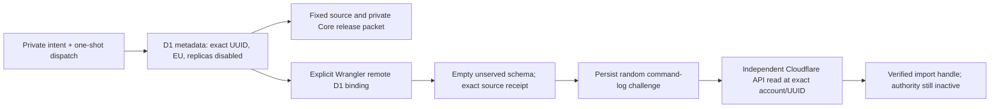

These helpers have local mechanism tests, including actual locked Wrangler API construction without executing a declared Worker, native D1 rollback, wrong-resource/local-fallback refusal and lost/concurrent creation responses. Provider API contracts are grounded in [D1 creation](https://developers.cloudflare.com/api/resources/d1/subresources/database/methods/create/) and the [Wrangler integration API source](https://github.com/cloudflare/workers-sdk/blob/main/packages/wrangler/src/api/integrations/platform/index.ts).

Its separate readback requires the inspected source/template, exact five bindings (`CONTROL_CORE`, the database/environment/source vars and version metadata), private ingress, no schedules, the exact Worker version at 100%, and resource observations ordered after preparation and before final readback. The result is explicitly `resource-and-binding-verified`; it does not certify data import, financial qualification or authority activation. The compiler and verifier make no provider mutation. [Local native-release regressions](../../tests/control-core-deployment.node-test.mjs).

The Core is migrated by its D1 migrations (`apps/control-store/migrations`) and certified by the release train's Core step; the release tooling takes no Control database host, role or credential, and the pipeline has no PostgreSQL migration or backup step. Existing release revision, CI, artifact and environment ordering gates still apply. [Operator observe/migrate command](../../scripts/control-core-operator.mjs), [release pipeline](../../scripts/release-pipeline.mjs).

The private maintenance helper snapshots the explicitly listed Worker cron schedules and Queue settings/consumer identities in an external protected journal. Pause changes only those schedules and queue delivery state; resume restores the recorded settings and verifies them. Uncertain writes retain a pending journal phase and are observed before retry. This helper covers only its listed Cloudflare surfaces; a complete cutover still requires application/admin/database writer fences and session termination from the approved runbook. Local verification is not evidence that live ingress or schedules have been paused. [Maintenance helper](../../scripts/pgcf-maintenance.mjs), [decision D443](decisions/delivery-and-operations.md#d443).

The AI gateway Worker (`apps/ai-gateway`) is a Core consumer of each environment and is not a policy consumer. Its name is not a closed private profile, so the Core train does not create it. Until its one-time creation, the train runs with `control-core-manifest --exclude` for its configuration, which the manifest accepts only while the Worker is absent live. The standalone creation carries its `ORQ_API_KEY` through `--secrets-file` from a private file outside the checkout; afterwards the gateway ships in ordinary train steps without a secrets file. The creation sequence, its host check and the Wrangler custom-domain caveat are [D451](decisions/delivery-and-operations.md#d451); the gateway's own surface is [AI gateway](services-and-workers.md#ai-gateway). The smoke command's `ai` group checks the live bindings, crons, the custom domain and the public route without a key.

## Release tooling safeguards

The release scripts release only the exact source they verified, and each refusal stops the release before it changes a provider or a published file. The Worker and Core steps are [D517](decisions/delivery-and-operations.md#d517), the website, npm, webhook and staging steps [D518](decisions/delivery-and-operations.md#d518), and the public client archives and installer [D519](decisions/delivery-and-operations.md#d519).

- A resumed Worker release takes the newest of duplicate matching versions, the same rule as a fresh upload. Equal or unreadable timestamps still refuse.
- A Core release or preparation reads the Core schema head through the rendered Core configuration (`CONTROL_CORE`) and requires it to equal the schema pin of the source commit. A completed train is re-verified read-only; only the unfinished Core steps of a resumed train check the live head.
- A completed train state is never rewritten as running or interrupted, and a state that this run neither created nor validated is left as it is.
- npm client packages are built only from the manifest's source commit, from a clean tree apart from the release output directory.
- A public client release is prepared only for a source commit that CI verified, and its manifest records the commit and the CI run (`source_commit`, `ci_run_id`).
- The website publishes its contract, client catalog and Skills only when they equal the released client's: `openapi.json` and `mcp-tools.json` of the manifest's source commit, client packages at the release version, and a clean tree. The site, website and docs catalogs are compared with that released catalog. A release that predates its catalog file is baselined by the site catalog only when the file answers HTTP 404.
- Packed client archives carry the served download names `ohmyhost-<package>-<version>.tgz`. Website archives install under the `@amerged` scope that the public packages own.
- The CLI and MCP archives ship an `npm-shrinkwrap.json` that pins the native keyring and its platform packages at the integrity hashes of the lockfile. Platform packages carry their `os`, `cpu` and `libc` constraints.
- The `0.sh` installer checks each tarball against the published `SHA256SUMS`, and requires the release manifest to name the version and a 40-character source commit, before npm installs anything. It removes its downloads before it replaces its shell.
- The Resend webhook setup refuses every slot problem before the provider creates the webhook. The one-time signing secret is appended to the current `.env.local`; the file is never rewritten, renamed over or truncated.
- The staging lifecycle acts on the Production buckets only when `--apply-production` is named. Without an apply flag it reads the Development buckets and changes nothing; `--apply-development` applies to the Development buckets only.

## Verification and fixtures

Unit/integration suites cover source grant and exact commit custody, malformed archives, cross-boundary limits, process isolation, frozen installs, framework/runtime admission, candidate identity, secret-manifest redaction, health and compensation. Framework fixtures supply reproducible Vite/Lovable-like React, TanStack, Next, static and hostile-build cases; functions cases are generated inside tests. The Next fixture now pins `next` 16.4.5 with OpenNext 1.20.9, and the TanStack fixtures lock `@tanstack/react-start` 1.168.60. The overlay tests patch a copy of that fixture's OpenNext, run OpenNext's own code patch on the fixture's 16.4.5 module-loading source and on the 16.3 form derived from it, and compare OpenNext's internal request headers with those of the fixture's Next.js server ([overlay regression](../../apps/build-runner/sandbox/tests/open-next-patch.test.mjs#L76)). The test-only `@ohmyhost/contracts/framework-admission-corpus` holds shared admission cases, among them the `create-next-app` 16.4 configurations, that the contracts, SourceFetcher and CLI suites judge alike; production code never imports it. The phase0 fixture and hostile legacy command shapes are historical/negative inputs, not admitted production recipes. The author reports the updated OpenNext patch tests passing 3/3 and build-runtime tests passing 87/87; these are scoped source checks, not a complete Next.js 16.4.5 application build or hosted acceptance. The Next fixture includes local provider configuration to prove a direct runtime; it does not by itself prove the platform-owned WFP upload path. Generated Worker types and lockfiles are derived inputs, checked against their configured generator and frozen-install contract; they are not evidence of a live provider rollout.

The manual CI can run all eight of its jobs (thirteen with the Vitest shards) on eight official GitHub runner containers inside an isolated Lima VZ Ubuntu 24.04 ARM64 VM on the MacBook, selected by the `runner` dispatch input or the `OHMYHO_CI_RUNNER` repository variable; the owner changed direction on 2026-11-18 so the Node tests, all Vitest shards, coverage, the secret scan and the final gate use the same routing (the secret scan runs the pinned native arm64 Gitleaks v8.30.1 release on the Mac, the Docker image on hosted runners) and the job graph is unchanged ([D436 follow-up](decisions/delivery-and-operations.md#d436), [workflow](../../.github/workflows/ci.yml)). The runner image and provisioning script (`build`, `register` with the registration token on stdin, `start`, `verify`, `recover`) live in scripts/macbook-ci. The image also prefetches the seven pinned public actions of `ci.yml` and `setup-workspace` (checkout, setup-node, upload-artifact, download-artifact, cache, pnpm/action-setup, opentofu/setup-opentofu) from codeload one after another at build time into `/opt/action-archive-cache/<owner_repo>/<commit sha>.tar.gz`, which the runner reads through `ACTIONS_RUNNER_ACTION_ARCHIVE_CACHE`, so eight parallel jobs do not each hit codeload (run 44326796229 got HTTP 429); a failed or corrupt download fails the image build and any action outside the list still downloads normally. The cache is keyed by the resolved commit, so pnpm/action-setup, pinned by an annotated tag object, is listed by its commit `0977fd99725f1db4007ccb2928dbb4e90d06cc86`. The VM needs Docker Engine, 12 CPUs, 24 GiB of memory, no host mounts and no published ports; each container runs one job at a time and its runner work folder is `/home/runner/work`, so the checkout path `/home/runner/work/ohmyho/ohmyho` equals the hosted Ubuntu one that the cross-provider Vitest inventory requires. The entrypoint registers with `--work /home/runner/work` and, before it starts the listener, idempotently rewrites only `workFolder` in an existing `.runner` from the old relative `_work` by atomic `jq` replacement; credentials and runner binaries stay in the persistent state volume and the workspace is container-private. `recover` stops an owned container gracefully, so the runner closes its GitHub session, before it removes it, after the caller has drained it. An offline MacBook leaves jobs queued rather than failing them, so the fallback is to cancel the run and dispatch again with `runner: github-hosted`. The image also bakes the ordinary npm pnpm 10.28.2 package (tarball from the npm registry, SHA-256 `afa99b0b4b3d11c1dad2b472f9318ae2c78673829749ded527f89f09071479a7`) behind a `/usr/local/bin/pnpm` wrapper that runs it with the pinned Node 24.6.0, and `setup-workspace` skips `pnpm/action-setup` only when `runner.name` starts with `ohmyho-macbook-ci-`: the standalone `@pnpm/exe` launcher on ARM64 exited on wrangler's `--env-file /dev/null` argument in Vitest shards 2 and 4 before delegating, while the npm package ran the same wrangler dry run. Hosted runners keep the action and the version pin. Runner registration, the first hosted run on the label and the cutover are not yet evidenced.

The MacBook workspace typecheck runs the root compiler check first and schedules up to two Turbo tasks in parallel. The complete workspace dependency graph and the following production-boundary checks still run. [D436](decisions/delivery-and-operations.md#d436)

No provider or customer resource was mutated for this documentation audit. A local passing test proves its exercised code path; hosted/release claims require the corresponding dated exact-operation or exact-commit evidence in the plan.

## Astro hosting

[D432](decisions/source-and-build.md#d432) adds native Astro plans in the existing v5 envelope: static builds publish `dist`, while SSR uses `dist/client`, `dist/server/entry.mjs` and the official Cloudflare adapter's generated configuration. The initial real fixture versions are Astro 7.4.0 and @astrojs/cloudflare 14.4.0. The shared security policy judges the framework and, for edge builds, the installed adapter after the frozen install. Hosted support is released in 0.1.35: W23 records the exact CI-green Development/Production trains and real static/SSR customer acceptance.

Astro takes precedence over its Vite dependency but conflicts with another application framework. Inspection never evaluates configuration: it checks the standard root directories, the output keys of the top-level `build` object (`client`, `server`, `serverEntry`, `assetsPrefix`; dev-server options such as a top-level `server` or `vite.server` are admitted, while a `build` that is not a literal object, or a literal object with a spread, is refused because its keys cannot be read), edge/static mode, build commands and disabled unsupported resources, then follows Astro frontmatter, local component modules, endpoints and middleware. Dynamic imports, import.meta and require expressions anywhere in an Astro template are refused so they cannot bypass frontmatter inspection. Static Node filesystem/MDX work belongs to the credential-free build. No request-time capability can be enabled in a static Astro plan.

The official adapter receives a platform-owned Wrangler input in the sandbox. Its generated worker config must retain the platform date and nodejs_compat flag, standard entrypoint and ASSETS directory, with no sessions, provider images, cache or other foreign bindings. Unknown capability fields are refused. Public asset packaging rejects source maps and server control files; compiled server maps are excluded from the private module inventory. WFP binds ASSETS, runs the Worker first and applies the same CSP nonce treatment as other SSR frameworks. Cron modules retain the existing separate scheduled-handler contract. No provider credentials or customer source execution are added to SourceFetcher.

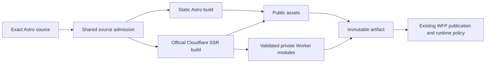

The policy cohort requires SourceFetcher, BuildRunner with both regional containers and Control in Development before Production. This Astro release also includes WFP management for its artifact parser/binding/CSP behavior, DeploymentWorkflow for its persisted framework-plan parser, and the RecoverySandbox Worker plus rebuilt recovery image for its inventory parser. Independent tree-shaken bundle inspection found no other retained runtime consumers. Migration 181 widens only the strict Astro static/edge plan shapes and refuses lossy downgrade once Astro plans exist. Specification, execution.

## Build receipts on Core

The BuildRunner receipt port is implemented by the Control receipt service on Core, including the measured usage and the settlement of the build's credit reservation in one batch. BuildRunner's provider and container protocol is unchanged. [Authority and qualification](database.md#build-receipts-on-d1-w32-source).

## Project dispatch on the shared Core — W32 source checkpoint

The Project publisher, Queue consumer and provisioning Workflow reach Control only through the private
`ProjectDispatchRuntime` capability, which fixes the three event families, service actor,
30-second lease and five-second retry policy. Claim, external Queue send and exact ACK remain
separate transactions. Delivery-attempt history and audit identities remain authoritative.
The adapter preserves the publisher's provisioning, product and managed-source order and
its request-wake/minute-drain budgets. No SQL, transaction callback or generic operation mutation
crosses the binding.

`ProjectWorkflowRuntime` commits the provisioning operation's original start/terminal events,
two service audits and managed initialization enqueue/rejection in one guarded Core batch.
An uncertain Workflow observation records only its original reconciliation audit. Duplicate
completion checks the exact persisted history and service provenance; lost replies resolve the
same event identity. Managed-source Queue reads require the original event, parent/child journal,
billing epoch, environment locator and operation result before acknowledging durable handoff.
The external initializer/publication processor retains its existing interface.

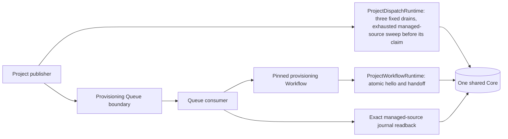

The same abandonment batch releases an open build reservation only when the original
never-started predicate is proved; a Build claim or provider receipt keeps the reservation for settlement.
Native late-failure rollback protects this composition. An uncertain
recovery reply is read back under its original generated failure-event identity before another
expired operation can be selected. Migration0450 preserves populated run bytes while restoring
original long Workflow IDs, terminal-state shape and static intent/operation/outbox/environment
parents, with foreign keys enabled throughout.

Progress and exact checks.

The deployment parent's accepted-run primitives live in the named `DeploymentWorkflowRuntime`
namespace: full context, physical database target and provider mutation claim. The Core claim composes immutable acceptance consent, current
source/owner/epoch/lifecycle checks, run identity, operation start event/audit and deployment start
in one batch. An unknown reply observes the same claim and rechecks current authority. Three
original intent digests alone are hydrated from RPC `Uint8Array` to `Buffer`; no context field or
missing source fact is inferred.
Bounded qualification.

## Deployment failure and health on Core — W32 source checkpoint

The named deployment runtime persists a known failure's operation/deployment/run transitions,
original terminal event/audit, diagnostic and eligible unstarted Build-credit release in one batch.
It retains the original absent-claim exceptions for authorization/stale promotion, active-attempt
identity and started/uncertain Build custody. A lost reply resolves that same terminal run, and a
late diagnostic failure rolls back financial and lifecycle effects. The health command records the
accepted candidate's primary verdict before compensation; a racing verdict suppresses the original
generic terminal diagnostic. No arbitrary diagnostic writer is exposed on a Worker entrypoint.

Core adapters call the named private methods on the binding; their inputs retain deterministic
execution/event/audit identities. Qualified child services remain real, independently owned ports.

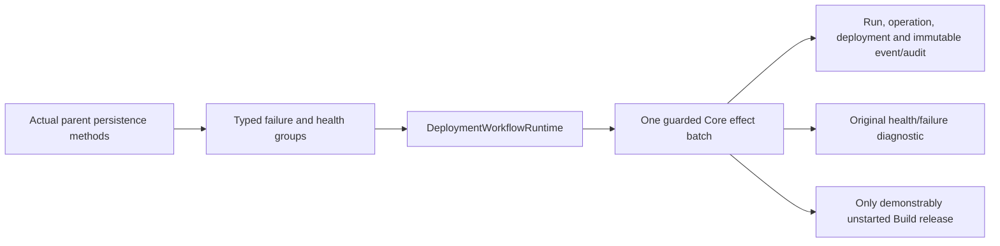

Migration 0454 keeps the 21-field physical diagnostic table and static parents. The scoped writer
keeps its seven-day window and 10,000-item cap.
Bounded evidence.

Migration 0457 repairs only the diagnostic request-ID whitespace predicate after 0454. The source
Unicode class exceeded D1's GLOB-pattern budget and refused valid non-NULL identifiers. Exact
per-character absence checks retain the original Source policy without a new limit. The unserved
replacement keeps all21fields, values, PK/FKs and the same scope index; populated copying and a
late rollback are verified. Migration 0454 remains byte-identical.
Finite predicate proof.

## Source archive custody on Core — W32 source checkpoint

The actual parent calls a typed Source custody port for its archive receipt/object transaction
and separate scoped receipt read. The Core implementation commits the immutable original `source_archives` receipt and
`product_source_archive_objects` locator together, observes a lost reply under the same operation,
and preserves exact stored bytes and opaque fields. Recording an already observed source object
remains possible after ownership freezes; it grants no provider mutation authority.

Migration 0455 preserves the distinct original seven-field `github_source_connections` registration and
fourteen-field `source_archives` table. `source_connections` remains authoritative and separately
captured. The native registration effect has a server-local two-insert plan for the full SourceLink
completion to compose; historical import supplies both original facts, with no generated authority
row or reenacted binding generation. Exact native FK/domain/append-only rules remain enabled.
Unicode object keys retain Source character-count semantics, and finite instr predicates preserve
original URI whitespace checks within D1's engine limits.

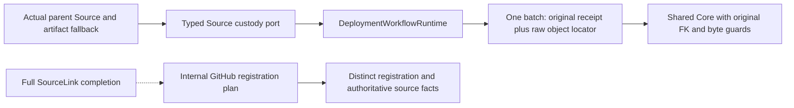

This bounded metadata path retains R2 custody and creates no provider resource.
Native proof.

## Current provider authorization on Core — W32 source checkpoint

Private provider services can receive `ProductProviderAuthorizationRuntime`, whose only method
is the original five-field `authorizeProductProviderMutation` returning no value. It checks the
current accepted claim, operation, environment, active owner and accepted lifecycle version.
Accepted connection proof, current canonical role, immutable token restriction, user/connection revocation and pinned source generation are fenced
with that check in one batch. Source metadata and provider receipts confer no permission.

The original authorization query does not require the claim's epoch to remain current or open.
The Core implementation preserves that behavior: it accepts a closed old epoch
and a later current epoch and refuses a frozen owner. Claim creation retains its separate
original acceptance checks. An uncertain authorization reply rechecks current authority; an old
successful check cannot survive subsequent consent revocation or ownership freeze.

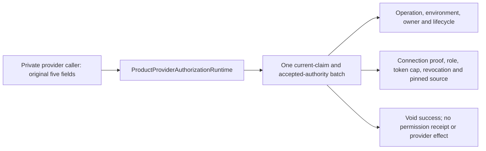

The actual workerd binding proves success and refusal.
Verification record.

## W32 provider reconciliation persistence preparation

The provider-reconciliation composition has a typed data port for its 25 transaction groups. The Core adapter materializes a fixed plain record before invoking the named private runtime method. The four deterministic lost-command transition/audit IDs cross as values, never an allocator callback. Provider observations and Workflow starts stay in the composition.

## W32 lifecycle inventory composition

The Core has closed persistence helpers for deletion evidence, candidate cleanup resources and attempts, data-change cleanup start and audited assignment switch, schedule deletion, managed-source deletion inventory, and the Next cache retirement page and receipt, as nine fixed methods. The Core adapter constructs synchronously with fixed method validation and performs no startup read. It passes only the native typed facts and fixed method inputs; provider credentials, callbacks and SQL stay in their owning service.

Deletion and data-change acceptance prepare an immutable resource plan, then recheck the count and every provider/kind/locator tuple inside the same parent acceptance batch as the intent, operation, audit and outbox. The data-change batch also rechecks the original assignments, environment heads, registration generations and share-target readiness. Deletion retains all providers and the six original legacy Mail resource families. Its masked hash identity and long-locator fallback differ from the original data-change identity and remain distinct. Native JSON equality semantics apply to stored snapshots and audit replay. Additive migration 0500 preserves the original171/175 managed-source blob and reservation facts, including the matching-admission trigger; it seeds no resource.

```mermaid
flowchart LR
  API[Parent API acceptance] --> Plan[Read immutable resource plan]
  Plan --> Batch[One acceptance batch]
  Batch --> Guards[Recheck scope heads assignments and every target]
  Guards --> Facts[Intent operation audit outbox and inventory]
  Workflow[Actual Workflow caller] --> Port[Nine fixed inventory methods]
  Port --> Core[Private Core command helpers]
  Core --> Atomic[Original scoped effects in one batch]
  Facts --> Workflow
```

Progress and exact evidence.

## Lifecycle completion on Core

The typed lifecycle port carries only deletion, data-change completion and refused-handle completion, plus fixed tombstone retention. It reads the existing accepted context and retains deterministic common event/audit identities and the original local clock. Handle refusal sends no terminal JSON: Core derives the requested handle from accepted intent and the fixed `project_handle_taken` outcome. A refused rename ends its operation `failed` with `PROJECT_HANDLE_TAKEN` (public `project_handle_taken`), deletes its provider mutation claim in the same batch and appends `OperationFailed` instead of `OperationSucceeded`; the operation is then terminal and no lease sweep can reopen it.

Deletion composes both original runtime-secret authorization predicates and actual secret purge, exact environment-head CAS, remaining inventory absence, cleanup transition, current-scope project deletion/version increment, database-write cleanup and terminal history/run in one native batch. Historical ownership scopes remain immutable custody/financial parents. Raw publication evidence supplies the original shared-gateway condition; an effective address/rollback projection cannot add deletion authority. Data-change completion verifies the accepted after assignments and cleanup absence before releasing its exact claim. Tombstone retention keeps the original start/audit/operation/cleanup transitions, with no invented attempt fence.

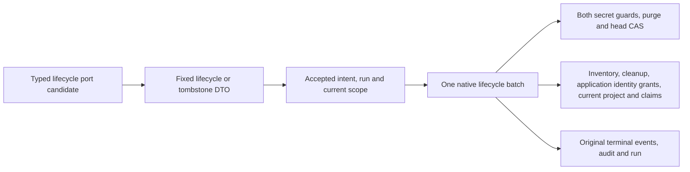

## Workflow parent on Core — W32 source composition

The parent composes SourceLink, Build/candidate, execution/activation,
publication, rollback, binding refresh, candidate cleanup, handle and lifecycle persistence through
closed typed groups on `DEPLOYMENT_WORKFLOW_RUNTIME`. Each transaction is one Core
batch, including its Gateway, schedule, secret-deletion and operation/Workflow history plans. Metadata
never grants provider authority. The Core constructor validates bindings before use; an unported path fails closed.
DeploymentWorkflow, ProviderReconciliationWorkflow
and ProductProviderReconciliationService use that complete named
protocol. The separate provider-authorization capability remains
unchanged. Dispatch checkpoint.

The original step lease preserves logical/physical recovery pointers, expiry refusal and the succeeded
cleanup exception. Rollback preserves historical data assignment, provider binding, in-progress data
change and completed cleanup restrictions. Fresh metadata uses PostgreSQL JSONB rendering; opaque
Source strings remain untouched. Local source progress,
[parent constructor](../../apps/project-provisioning-worker/src/core-deployment-workflow.ts),
[compound finalization](../../apps/control-store/src/catalog/provisioning/deployment-finalization.ts).

## Development-only live-preview spike deployment candidate

The W41 measurement spike is a separate Development QA cohort with private authority and service entrypoints, not a product release. Its source candidate composes narrow QA reads, the Development EU database runtime with a manifest supplied privately from verified readbacks, a private QA Auth Worker, temporary shared Native, Mail and Runtime Secret Delivery QA bindings, a private QA mail Worker and the spike Worker. The Native, Mail and custody configuration helpers validate and copy the complete canonical Development profiles before adding their QA bindings and flags, preserving existing services, schedules and credential declarations; the Mail recipient scope is supplied privately, outside its overlay. These retained overlays are source candidates. Canonical Native, Mail and custody profiles and Production profiles are unchanged. [Native overlay](../../scripts/preview-spike/auth/native-config.mjs), [Mail overlay](../../scripts/preview-spike/mail/gateway-config.mjs), [custody overlay](../../scripts/preview-spike/mail/custody-config.mjs), [Auth Worker profile](../../scripts/preview-spike/auth/authority.wrangler.jsonc), [database profile](../../apps/project-database-runtime/wrangler.development.eu.jsonc).

For the active hosted mail repair, a dedicated private fixed-scope key broker replaces the old Core and Runtime Secret Delivery QA overlays in the key path. Only the owned QA mail Worker's `QA_MAIL_KEY_CUSTODY` service target was changed; its runtime JavaScript, other eight bindings, schedules, private ingress and permit Durable Object namespace were preserved. The provider settings PATCH omitted the prior debug source map, so this is not a claim that every prior source file was preserved. The newer shared Core and Runtime Secret Delivery release remains in place; it was not downgraded. The broker's scoped key and current authorization checks and the read-only post-repair observations are recorded in the Mail repair checkpoint. They do not establish a mail send, inbox delivery, G1 or G2.

The mail and spike Workers refer to each other. The mail bootstrap profile first omits the spike authority and fails closed; after the spike exists, the final private mail profile adds that authority and both bindings must be read back. Before removing disposable Workers, reconcile unknown mail outcomes, retire each exact spike session and preview Auth generation, then restore and verify any temporary shared Native, Mail, custody or database configuration changes. Preserve existing credentials and resources throughout. Source and local tests do not by themselves establish hosted acceptance. The subsequent gate correction for encoded Next.js chunks was implemented and locally tested but had not been deployed when the checkpoint was recorded. [Bootstrap profile](../../scripts/preview-spike/mail/wrangler.bootstrap.jsonc), [final mail profile](../../scripts/preview-spike/mail/wrangler.jsonc), [QA activation and cleanup details](../../scripts/preview-spike/auth/README.md).

The G1 operator permits only its private empty mode-0600 environment file. Its Node preload normalizes that single option after the Wrangler command arguments, before a literal argument separator, so the greedy array option cannot consume the command. Duplicate, foreign or unsafe files fail before execution. Local `verify:fast` and CI materialize the separately locked worker toolchain with pinned Root npm and lifecycle scripts disabled; the prerequisite checks Wrangler and Sandbox SDK 1.0.1 against the manifest, lock and installed versions. Real offline dry-run regressions exercise both Wrangler 4.145.0 and 4.158.0. [Environment guard](../../scripts/preview-spike/deployment/wrangler-guard.mjs), [verification prerequisite](../../scripts/verify-fast.mjs), [CI setup](../../.github/actions/setup-workspace/action.yml).

The spike image keeps the immutable fixture archive separate from its declared runtime HMR instrumentation. The generated context inventories the overlay helper along with the driver, capabilities and tooling; the benchmark checks the fixture-specific overlay descriptor hash against image metadata and trusted runtime status. Instrumented module results do not establish framework component refresh or product acceptance. [Overlay and provenance contract](../../scripts/preview-spike/benchmark/README.md).

The operator also projects session-checked backup identity, reported compressed bytes and controller phase timestamps from existing setup or status responses into a private resource journal. Cold and wake checkpoints are synced after the timed operation; the cold checkpoint is written before cleanup. A valid wake checkpoint can remain as raw evidence when the wake or capability proof fails, without claiming success. Invalid checkpoint data or an uncertain write fences further control mutations for reconciliation. This locally tested candidate adds no provider request or timing threshold; CI, deployment and hosted acceptance remain pending. [Adapter and checkpoint validation](../../scripts/preview-spike/benchmark/cloudflare.mjs), [journal contract](../../scripts/preview-spike/benchmark/README.md).

The operator's control status, lease, target verification and provider provenance reads use bounded GET retries: at most three attempts, each at most 15 seconds, within the caller's original absolute deadline and cancellation signal. Authorization failures, malformed results and identity drift fail closed; diagnostics use the same bound and omit provider bodies and secrets. Control mutations are never retried. The QA mail permit precheck, single POST and postcheck share a maximum 60-second budget, with the POST itself limited to 30 seconds; an uncertain dispatch remains for reconciliation. These implementation changes leave timing thresholds and measurement boundaries unchanged. The implemented candidate passed focused local checks and awaits the next CI and Development deployment; earlier hosted receipts do not establish this candidate's G1 or G2. [Read helper](../../scripts/preview-spike/deployment/read-only-json.mjs), [target verification](../../scripts/preview-spike/deployment/control-target.mjs), [QA permit](../../scripts/preview-spike/deployment/qa-adapter.mjs).

## Native Auth deployment candidate

W37 source admission recognizes only explicit `auth.provider: omh-native`; dependency detection does not enable it. Its closed artifact plan carries `/api/auth/v1` and `OHMYHOST_AUTH`. Static browser applications can select Native without a business database or an auth companion. Detected source routes in that reserved namespace produce a typed conversion refusal; dynamically constructed routes are shadowed by the gateway. [Source admission](../../packages/contracts/src/framework-source-rules.ts#L616), [plan construction](../../packages/platform/src/modules/customer-auth/customer-auth.ts#L41), [static plan validation](../../packages/platform/src/modules/frameworks/framework-plan.ts#L220).

**Historical packaging and routing checkpoints — 6 November 2026:**

The first real Development canary reached a successful install and Wrangler dry run but failed in platform artifact packaging. At released source `acc31412`, the sandbox's independent customer-auth requirement validator accepted `none` and pinned Better Auth but refused the canonical `omh-native` requirement already accepted by the platform, broker and WFP parsers. The same unchanged application and canonical requirement reproduced `customer auth requirement invalid` in the local actual packager. The correction admits only the exact canonical Native provider, reserved route and binding, with its existing strict JSON byte order, and preserves that requirement through packaging and the artifact digest. A real functions-artifact regression without a business database and local packaging of the actual app passed, followed by independent reviews. The diagram shows the requirement as trusted packaging input and retains the existing agent/DO upload path. Exact source `1f7c8a72` subsequently passed complete CI and its coordinated Development release; the unchanged hosted app now has a successful build receipt. The subsequent role-validity correction at `090bb1f0` also passed full CI and its complete Development rollout. The unchanged app then deployed successfully with an active Native artifact and storage readiness. Actual protected-Dev admission returned 503 because the Control route validator omitted Core Native metadata; that bounded transport correction and new qualification remain pending. Current execution checkpoint. Hosted login and Production qualification remain pending. [Sandbox validator and packager](../../apps/build-runner/sandbox/build-runtime.mjs).

**Current delivery checkpoint — 7 November 2026:** both full `d0bff935` platform trains completed, and Lab Development deployment and Production promotion passed the recorded password flows using the same application artifact. Native remains an explicit `omh-native` artifact requirement, with a private regional Worker/Durable Object runtime and deployment-scoped session binding; no business database or embedded application Auth engine is implied. General availability remains held in allowlist mode because observed protected/reload samples exceed the planned 500 ms target. The later private-session correction reached both Development Native regions at exact-source CI-green `68a7b447`; the fresh C5 functional flow passed, while protected/reload samples of 3,275 / 3,436.6 ms still exceed the target. The subsequent v1 profiler release at `082a254a` also reached both Development regions, but neither controlled observation produced phase data. The later `d44ae1fb` v2 release yielded one qualified controlled phase record, with HTTP 4,839.9 ms and DO total 3,254 ms. These observations do not update the earlier Production checkpoint or establish p95/latency qualification. Atomic v1 source requires the genuine full train with same-source Core before Native: standalone CLI refuses before provider I/O; internal Worker rehearsal proof validates that Worker, while the train owns Core ancestry/live proof. Upload and completed-step replay verify the exact mode variable. The atomic correction later entered a partial a4 cohort and supplied one supporting v3 sample; this does not qualify p95 or the local wave2 correction. Actual delivery, latency and remaining limits.

The sandbox runtime is a shared admission-policy fingerprint input and a Container image input. A change to it requires new exact-source verification, images and a coordinated policy-consumer cohort: Core, SourceFetcher, Control and BuildRunner with its regional Containers must be rehearsed and released in Development before Production. Rehearsals of `acc31412` retain that source identity and cannot qualify a later correction. [Policy inputs and cohort guard](../../scripts/release-policy-cohort.mjs), [image recipe](../../scripts/platform-container-release.mjs).

The Workflow places the independent Auth database and prepares the logical realm before staging the candidate. The WFP provider verifies the exact regional `NativeSessionService` binding, deployment-scoped properties and binding digest with the artifact. Publication affecting Native commits the new head with pending policy synchronization and retains its mutation claim until private policy acknowledgement; refresh cleanup and rollback use the same retained synchronization identity. Selecting non-Native source advances the Core revocation fence while retaining the directory. Current Owner policy governs later activation; a deployment does not clear an administrative pause. [Workflow composition](../../apps/project-provisioning-worker/src/product-workflow-composition.ts), [binding verification](../../packages/provider-cloudflare/src/wfp-provider.ts), [head and acknowledgement persistence](../../apps/control-store/src/catalog/provisioning/deployment-finalization.ts). The diagram above includes these W37 source-candidate branches. [Auth policy](auth-and-secrets.md#customer-application-auth) owns their admission rules; progress distinguishes the Development release from the packaging correction and remaining hosted and Production acceptance.

### Core, Control and Gateway admission rollout — local source

A canonical Shared Gateway profile with `DEV_AUTH_ATOMIC_MODE=v1` requires the real artifact-pinned Core-first, Control-first train. The standalone CLI refuses v1 or an invalid present mode before provider I/O; absent mode preserves the legacy route. The internal release validates its own Worker proof, while train preparation requires the selected same-environment Control ancestor and its Core ancestor. Rendered `DEV_ACCESS` must target that Control's `DevAccessService`; its `DEV_ACCESS_RUNTIME` must target that Core's `DevAccessRuntime`. Both edges use Cloudflare's default `production` service environment even for the separately named platform Development Workers. Version upload and completed replay verify declared variables; service readback compares environment, treating absent and explicit default equivalently.

The stock Core generator does not select Shared Gateway automatically: use its existing `also` option with `apps/wfp-dispatch/wrangler.shared.jsonc` or `apps/wfp-dispatch/wrangler.production.shared.jsonc`. No new in-process attestation protocol is introduced. The wave2 source changes no schema, image input or public SDK/OpenAPI contract; this does not relabel older source images or complete the paused broader cohort. Root reports the a4 operator paused23/31 at CF10013, with Support permission/coordination pending. No new commit/push/Main advance or provider writes occur under that intent; local checks are not exact-source CI or rollout approval.

For the paused a4 intent, Root selected a forward transition pending operator acknowledgement before push. Its original state, 23 receipts and staged version remain immutable. A later coordinated new Main requires new exact CI and fresh manifest/rehearsal/state plus live omission proofs; this is not a replay of the old source intent. Main remains a4 at this local checkpoint.

## Live Preview source handoff

[D608](decisions/runtime-and-lifecycle.md#d608) adds a separate product development loop to the accepted source path. A managed publication stores its exact accepted commit and durable preview target/outbox in the same Core batch. Immediate notification is best effort; scheduled replay acknowledges only an actor-accepted target. GitHub notifications first re-read the selected branch head using the exact repository installation grant, then compare Core source/configuration generations and sequence before acceptance. Old or force-pushed-away events cannot replace a newer target.

`SourceFetcherService.previewDiff` rechecks current preview/source authority, obtains the exact saved commits, inspects the archive/framework plan and returns hash-checked writes/deletes without credentials. Code-only deltas retain the running VM and real development server. Package/lockfile changes use a frozen script-free install and a bounded project-cache checkpoint before framework startup; a guest acknowledgement does not attest quiescence or executing code. Sleeping previews overlay the current accepted source after restoring only their own environment's cache. The entire VM is untrusted, while Worker-held source policy and Core authority select its capabilities. Preview startup never replays customer migrations. Publishing Dev or Prod still uses the unchanged explicit deployment plan, build, validation and immutable artifact path. Source implementation and local behavior do not establish hosted release acceptance.
