# Database architecture

Current release scope is Auth-only. The W41 source candidate has 149 CLI commands, 156 local MCP tools and 168 REST operations; the last accepted client cohort is 0.1.59 and the new source remains unreleased. Commit previews are not part of the platform: they were removed on 13 November 2026 and live only on branch `feat/sandbox` (commit ccf25327); their tables remain as [leftovers](#leftovers-of-the-removed-commit-previews). Ordinary project creation still defaults to real Dev and Prod environments. W47 source additionally allows an explicit Prod-only project; an omitted deployment environment selects Dev when present, otherwise Prod. This source change awaits release and hosted acceptance.

This chapter describes the checked-in implementation. The Control database of each platform environment (Development and Production) is Cloudflare D1: one shared "Core" database per environment (`CONTROL_CORE`, layout `shared-core-v1`), held only by the private `control-store` Worker ([D444](decisions/data.md#d444)). Customer application databases are PGCF PostgreSQL databases in the US and EU regions. Neon survives only as history: its placement and role receipts remain in the Core as provenance rows. A configured Worker or passing test is not a fresh observation of its deployed version.

The Database Management Worker keeps its historical deployed identity: the Worker `neon-management` with entrypoint class `NeonManagementService`, the service binding name `NEON_MANAGEMENT` and the binding name `NEON_USAGE` under which the credit service calls it. It hosts only PGCF database management, the PGCF usage rollup `collectUsage`, which writes nothing to the Core, and the budget-sweep write `stopSchedules`, which changes only PGCF schedules ([Credit Service](services-and-workers.md#credit-service)).

## Schema and Control state

The Core owns organizations, project ownership and billing epochs, logical environments, desired provider resources, operations, claims, outbox/inbox records, immutable audit history, one credit account per organization ([Credit account tables](#credit-account-tables)) and encrypted customer secret records. These are platform records, separate from each application's database. The migrations in `apps/control-store/migrations/core` are an ordered schema history: a superseded column, receipt shape or AWS resource in an early migration does not describe the current execution path. The commands in `apps/control-store/src/catalog` establish the operative contract together with the final migration state.

Tenant records use concrete organization/project/environment identifiers, composite foreign keys and scoped queries. Active ownership and the current billing epoch are checked when accepting or replaying work. An operation claim does not give a caller authority over an unrelated environment. The Core is not a customer-accessible SQL service. [Secret schema](../../apps/control-store/migrations/core/0201_shard.sql), [secret scope query](../../apps/control-store/src/catalog/secrets/environment-secrets.ts), [operation-bound secret claim](../../apps/control-store/src/catalog/runtime-secrets/claim.ts).

Product projections join current ownership rather than treating immutable creation ownership as current authority. Deployment/rollback reads also bind artifact and environment-head evidence to the current physical data assignment; a retired binding-refresh candidate or ambiguous assignment timestamp is not a safe rollback target. [Product projections](../../apps/control-store/src/catalog/product-api/reads.ts).

A consumer Worker holds no Control credential and opens no Control connection. It reaches the Core only through typed private service-binding capabilities of the `control-store` Worker (`ControlRuntime`, `BillingRuntime`, `WorkosRuntime` and the other fixed entrypoints below); there is no SQL surface for consumers. A Worker's request composition requires exactly the capability bindings it uses, a missing or mixed binding fails closed before any read or write, and there is no error-driven fallback to another store. [Control API request composition](../../apps/control-api/src/worker-main.ts).

The `control-store` Worker is the only holder of the D1 binding: ONE shared Core database, `CONTROL_CORE` with layout `shared-core-v1`, holds the authoritative Directory, every mutable catalog and the credit account (see [Shared core authority](#shared-core-authority) and [Credit account tables](#credit-account-tables)). It exposes typed commands through Workers RPC entrypoints and accepts no SQL. D1 offers one atomic `batch()` and no interactive transaction, so every command is one of three shapes: a set-based statement, a version-guarded batch whose stale guard aborts the batch through a named `CHECK` in `guard_fail` and re-reads, or an idempotent insert keyed by a natural key, a `command_log` identity or, for an amount of credit, the UNIQUE `credit_log` key. The retry protocol, router and migrations are tested against real local D1 databases (Miniflare on workerd) with `pnpm --filter @ohmyhost/control-store test`. The Core is migrated by the checked-in SQL under `apps/control-store/migrations`, applied by the release train's Core step and never by a Worker.

A command with a `commandId` records its name, input digest and result in `command_log` as the first statement of its batch. A replay answers from that row only when both the name and the input digest match; a reused id with another command name or another input is refused as `idempotency_conflict` (reason `command_name` or `input_digest`) and applies nothing. `plan.result` receives the results of the command's own statements only, never the log insert. A lost response is resolved through the log or the natural key; an unresolved outcome is reported as `store_outcome_unknown`, never as not applied.

Every organization has a `bucket` (0 to 1023, `NOT NULL`) computed once from its identifier. In the shared Core the bucket is routing metadata and the unit of an operator quarantine, never a selector of an authority database. A bucket can be fenced in `bucket_fences` as `moving` (writes of the bucket's organizations are refused) or `moved` (reads are refused as well). Every write batch begins with a `bucket_fenced` guard against that table in the same D1 batch; a refused command drops the cached route, routes again once and otherwise fails with `bucket_moving`. Partition-wide sweepers and purges skip organizations whose bucket has a fence row through `organizations.bucket`, so no value bypasses a live fence. No executor that moves a bucket exists; the guard contract is tested by simulating the operator steps.

The store has entrypoints with different authority:

| Entrypoint           | Authority                                                                                                                                                                                                                                                                                                                                                                                                                                                                                                                                                                                                          |
| -------------------- | ------------------------------------------------------------------------------------------------------------------------------------------------------------------------------------------------------------------------------------------------------------------------------------------------------------------------------------------------------------------------------------------------------------------------------------------------------------------------------------------------------------------------------------------------------------------------------------------------------------------ |
| `ControlRuntime`     | Commands bound to the organization, outbox or inbox event, or exact operation the caller names: the WorkOS organization snapshot and delegation assert, the eight WorkOS user-key and session commands, project admission and reads, accept, queue, load, transition, lease renew and exact recovery, exact outbox and inbox forms, environment secrets, Cloudflare project domains, the four build receipt methods, MCP, project note and recovery reads. Its ordinary forms refuse a partition drain (`shardId`) and "any expired operation" (no `exactOperation`) with a `TypeError` before anything is routed. |
| `WorkosRuntime`      | The fixed WorkOS identity, poller and onboarding methods for the private WorkOS management Worker, including its global claim and final-lease recovery, which ordinary `ControlRuntime` and `MaintenanceRuntime` do not carry.                                                                                                                                                                                                                                                                                                                                                                                     |
| `MaintenanceRuntime` | Partition drains and reapers, the doorbell claim, settle and heal steps, unrouted inbox routing, project reservation resolution and domain reservation settlement. The Control API's scheduled work binds it as `CONTROL_MAINTENANCE_RUNTIME`.                                                                                                                                                                                                                                                                                                                                                                     |
| Retention            | Implemented and tested, fail closed on registered exports; exposed by no entrypoint.                                                                                                                                                                                                                                                                                                                                                                                                                                                                                                                               |

The Worker exports 48 entrypoint classes and `test/entrypoint-surface.json` pins every method of each. The other fixed entrypoints (billing, credit, webhook ingress, mail, storage, R2, diagnostics, scheduler, provisioning, database management, gateway and recovery) are named in the diagram below and described in their sections; each carries only the commands of its Worker.

Partition-wide lease recovery aborts its batch when the candidate's bucket was fenced after it was read. `acceptApiOperation` evaluates the PGCF provider-cutover gate (six gated events), deletion admission, the live paid-domain check and the consumption of an action confirmation (principal, subject etag, token digest, expiry, source generation) in its snapshot decision and again as guards of the one accept batch, so a failing guard leaves no operation, audit, outbox, receipt or consumed confirmation. Lease recovery never selects an operation with an unresolved Neon placement reservation ([D431](decisions/data.md#d431)), guards that in the recovery batch and ends unfinished GitHub push deployments of an abandoned operation as `failed`, without touching a provider; `cleanup_required` stays 0 because only superseded `cleanup_pending` rows carry it. Once no lease is expired, the publisher's sweep releases the provider claim of one succeeded or failed operation that ended an hour earlier, unless a started bucket create or a `reserved` or `dispatched` Native database create still holds it. A Neon placement reservation keeps the claim until its operation ended seven days earlier (owner approval 2026-11-15, [D431](decisions/data.md#d431)); the same batch then deletes that reservation before the claim, which it references without `ON DELETE`. A queued, running or cancelled operation's claim is never selected ([D614](decisions/runtime-and-lifecycle.md#d614)). A data change whose data assignment switched keeps its provider claim and stays replayable through an explicit `:reconcile` for 24 hours after the switch, so its retired Dev database and files are not stranded in that window; a switch that commits after the candidate was read aborts the recovery batch. Once 24 hours have passed without reconciliation the sweep abandons it as `OPERATION_ABANDONED`, releases its provider claim and names the switched data change in the failure and the audit; the retired data is then not purged by that operation ([D628](decisions/runtime-and-lifecycle.md#d628)).
Its reconciliation status names that route. The delegation assert rechecks the pinned source generation, source link and repository grant. An unrouted inbox event carries its own `max_attempts`; unroutable keys, content conflicts and exhausted attempts are terminal rows, never selected again and never deleted silently, and a fenced bucket is a wait, not an attempt. Ingress records every provider event in the canonical global `webhook_inbox`; auth-only WorkOS events are acknowledged evidence with zero attempts even before their organization exists. `inbox_unrouted` is a retained compatibility buffer, never new intake. A GitHub push carries no organization and is a global-identity event: the push consumer claims it on the shared partition and renews, acknowledges or fails it by its inbox event and claim id, with a null `organization_id` matched as such.

Evidence retention fails closed: `purgeEvidenceBelowHorizon` deletes an audit or operation event only when it is at or below the retention horizon and lies inside a month with a registered `evidence_exports` row of its organization and table. `purgeReconciliationInbox` (store maintenance only, on no entrypoint) deletes a `reconciliation_required` inbox row only at or below the `webhook_inbox` horizon, inside a registered export month of its organization and not referenced by a GitHub push deployment; a trigger enforces the export. A verified R2 export writer that registers such a month does not exist, and `purgeMcpHandoffRoutes` (expired handoff routes) is likewise maintenance-only.

Environment secrets (sealed put, ensure, receipt-backed mutate, list, provider-claim authorization; ciphertext, nonce, digest, key version and AAD identity are stored byte-identically) and the Cloudflare project domains (claim, receipts, deletion state, soft delete) are store commands. The claim of the two project names is part of the one batch that writes the domains row. For `reserved` rows the earlier resumable claim saga remains: `domain_directory` holds a `reserved` row with a stable `claim_id` and an expiry, the domains row is the truth, and the claim is confirmed afterwards, again on every replay. Another owner never adopts a name; `settleDomainReservations` confirms an expired reservation whose domains row exists and releases one without a row. The release is fenced: the sweep writes an abort tombstone (`domain_claim_aborts`, keyed by class, name and the stable claim id) in the same batch that proves no backing row exists, and the claiming command guards its insert against that tombstone (`claim_lost`, then re-read as `domain_reservation_expired`), the same pattern as `project_creation_aborts`. A claimant that was only delayed therefore cannot commit after its reservation was released and another owner reserved the name. Only the `app_prod` and `app_dev` classes are wired to a command. Sealed secret envelopes allow 17 to 65552 ciphertext bytes so historical rows stay importable; the public limit is 5120 UTF-8 bytes (not characters), so the current cipher emits at most 5136, and only the Dev share-link tables carry the 5120 bound. Writes guard the active project ownership, open billing epoch and, for provider writes, the current provider mutation claim inside the same batch. `ControlRuntime` carries the secret and domain commands through the same bucket fence and route refresh as every spine command; `settleDomainReservations` scans the whole directory, so it is on `MaintenanceRuntime` only.

### Identity namespaces

`store.identity` holds the full WorkOS snapshot (`applyOrganizationSnapshot`: organization, every membership, absent-member revocation, barriers, local grants, audit and the inbox acknowledgement in one batch, with no membership cap), membership barriers, terminal revocations, session eligibility, own API-key requests and the MCP handoff, consent and grant commands. A WorkOS organization without a Core row keeps its barriers in the directory tables and the first snapshot adopts them; the adoption writes the organization first and deletes the directory rows only afterwards, so a crash repeats as no-ops. `store.domains` holds the scoped DNS authorization commands (issue, consume, read grant, refresh tokens, revoke, record receipts) for the application identity and workspace mail purposes. Authority for these commands is the actor's active ownership, the delegated MCP consent and the exact consent generation (resource revision), evaluated by one SQL definition for both the snapshot read and the in-batch guard. The user's terminal revocation is read before the organization read and before the batch, never inside it: a recorded revocation is final, but a "not revoked" answer can be outrun by a revocation recorded before the batch commits.

### WorkOS identity

WorkOS user API keys and session revocation. `ControlRuntime` carries exactly eight closed identity methods for the private WorkOS management Worker: `authorizeUserApiKeyScope`, `claimUserApiKeyCreation`, `finishUserApiKeyCreation`, `readUserApiKeyNames`, `recordUserApiKeyRevocationAudit`, `readSessionRevocation`, `recordTerminalRevocation` and `isSessionEligible`, each `storeFor(env).identity.<method>(input)` through the bucket fence. Each transaction is one command, never a sequence of RPCs a caller could interleave; the claim commits before any provider key exists. `readSessionRevocation` reads the session revocation owner (the lookup before the provider call) and `recordUserApiKeyRevocationAudit` writes one of two fixed event types for the user as actor with the key id as payload, in one guarded batch (`scope_inactive` on organization and WorkOS id); an identical repeat is a no-op and different content `result_conflict`. The revoked stage is written once per user and key, and only after that key's requested event: a concurrent second write aborts on `precondition_changed`, and a retry with a fresh event id or a key never requested writes nothing. `isSessionEligible` re-reads the revocation after the organization answer and before any positive result. No arbitrary SQL, event type, actor, permission list, clock or generic financial, maintenance or DNS method reaches the entrypoint; `wave1-integration.test.ts` and the real-binding test in `apps/workos-management/test/d1-control-runtime.integration.test.ts` pin that. The WorkOS Worker holds only the `CONTROL_RUNTIME` service binding to its dedicated `WorkosRuntime` entrypoint of the `control-store` Worker.

WorkOS snapshot poller. The private `WorkosRuntime` entrypoint exposes the eight user-key/session commands plus seven fixed WorkOS poller commands. Its global claim and final-lease recovery are absent from ordinary `ControlRuntime` and `MaintenanceRuntime`; the WorkOS consumer keeps the binding name `CONTROL_RUNTIME` but targets `WorkosRuntime`. Claim adoption of an unmapped WorkOS organization preserves one stable internal identity; source provider/external-event identity, attempt limits and the oldest-first due order are retained, except that events which can end access (`organization.deleted`, `organization_membership.updated`, `organization_membership.deleted`) are claimed before every other due event, so a backlog of creations never delays a removal ([D461](decisions/identity.md#d461)). Snapshot, members, barriers, local grants, audit and exact inbox acknowledgement commit in one batch. Deletion likewise commits the terminal organization, membership, machine-binding, legacy API-key and local-grant revocations, audit, acknowledgement and covered-event supersession together; a delete-before-create event stays terminal and a late snapshot cannot resurrect it. Claim, failure, recovery and polled acknowledgements check the SQL execution clock, so a batch queued beyond expiry rolls back its authority changes. Migration `0320_workos_poller.sql` retains the legacy API-key metadata and global inbox-event identity.

WorkOS consumer. `WorkosRuntime` has 23 fixed methods: eight key/session methods, seven poller methods, five onboarding operations, two read-only warning-recipient prerequisites and one signup-feedback recipient claim. The WorkOS Worker composes profile, organization creation, its scheduled poller and the named credit-warning service on them. Preparation stores the idempotency digest, frozen origin, first attribution and stable request identity before provider I/O, and refuses a sixth new request of one user within a rolling hour with `forbidden` (a replay of an accepted idempotency key is never counted; the count is guarded in the same batch as the insert); each provider attempt is recorded before its POST, and lost provider replies are observed under that original identity. The final onboarding command commits organization/member/local-grant/audit/beta/completion state with the optional signup and referral credit (`signup_bonus:<user>` and `referral_signup:<user>`, each a `credit_grant` and a `credit_log` row) and the Paid instruction in ONE Core batch. A late failure rolls it all back; a committed replay rechecks current authorization rather than trusting a stale log response. The configured bonus, global source identity, thirty-day referral access and first-workspace rules apply inside that batch. Warning contacts stay in the WorkOS provider boundary: Core returns only the active/beta/exact-grace scope and current consistent owner authorization, checked again before returning contacts.

WorkOS deployment capability. The WorkOS management artifact emits a closed runtime contract. Preparation requires the qualified Control Worker name/version and the private `CONTROL_RUNTIME` service binding to `WorkosRuntime`; no SQL URI, provider-target configuration or direct database binding is accepted. Activation is verified against the exact expected binding set, actual private Worker settings, disabled public routes/previews, one 100% consumer version and one 100% qualified Core version, then a successful read-only profile call through the actual bound WorkOS Worker. The external localhost probe returns only artifact, version, environment and time, never contact or user data. A settings-only receipt, wrong entrypoint/version, mixed traffic or failed Core read is not convergence. [Capability](../../apps/workos-management/scripts/runtime-contract.mjs), [preparation and convergence](../../scripts/prepare-workos-management-deployment.mjs), [private probe](../../.github/scripts/phase1-workos-capability-probe.mjs).

WorkOS onboarding schema (`0323`). The canonical `user_signup` row has an explicit `origin_present` discriminator: an absent original origin is distinct from an explicitly frozen NULL origin. The signup source configuration and powered-by period history are retained; flag periods keep their organization attribution, one open period per global project and close-only semantics. Request/attribution reference guards preserve the first-request dependency, so retention cannot discard the first request still needed by referral history. No campaign or bonus is seeded. Migration `0757` adds nullable JSON-object `utm_parameters` to `user_signup`: first explicit authenticated campaign metadata is frozen independently of referral attribution; NULL means unobserved, `{}` means explicitly empty. Recording metadata grants no credit or access. [Account metadata](api-and-mcp.md#dynamic-campaign-snapshots).

Stripe tables. Of the Stripe tables of migration `0340`, the Core keeps `stripe_billing_customers` (provider identity can be acquired only once; an intent without one may start a new attempt once it is a day old, [migration 0900](../../apps/control-store/migrations/core/0900_stripe_customer_renewal.sql)), `stripe_recharge_policies` and `stripe_billing_closures`, one row per deleted organization whose Stripe billing has been ended ([migration 0901](../../apps/control-store/migrations/core/0901_stripe_billing_closures.sql)); events arrive through the global `webhook_inbox` below. Checkout, payment, refund, dispute, tax and recharge-attempt tables no longer exist: a payment is one `credit_grant` and `credit_log` batch keyed by its Stripe identity ([Credit account tables](#credit-account-tables), [Stripe](billing-and-pricing.md#stripe)).

Migration `0840` adds the covering index `environment_secrets_key_lookup` on `(project_id, name, value_sha256)`, which serves the gateway key lookups of the AI and mail gateways without a Core-wide scan of `environment_secrets`. Migration `0606` re-creates the two framework-plan insert triggers from `0336` so that they judge the plan without its optional `$.ai` key, and adds `deployment_plans_ai_shape`, which admits `ai` only as `{enabled: true, jurisdiction: eu|any}`. Without it, the exact-key triggers would abort every plan that declares AI. The AI jurisdiction has no settings table: the gateway authorization (`catalog/ai/auth.ts`) reads `$.ai.jurisdiction` from the framework plan of the environment's active revision (`environments.active_revision_id` to `deployment_revisions.plan_id` to `deployment_plans.framework_plan`), so a later head or a rollback decides it ([D448](decisions/source-and-build.md#d448)). Migration `0605` creates the credit reservation table `ai_gateway_reservations` for admitted AI calls. Migration `0607` adds an in-batch guard for the organization-wide cap of eight unresolved calls; a ninth admission rolls back without reserving credit. The Control database is D1; the Postgres lineage is not changed.

## Global webhook inbox on the shared Core

Core migrations `0326`–`0327` hold the global `webhook_inbox`: its 17 fields, global event primary key, provider/event identity and state/attempt/claim facts. Nullable `organization_id` is routing metadata only and is not payer authority. WorkOS retains its verified signature timestamp; GitHub and Stripe retain NULL. Migration `0740` adds `park_count` (default 0, rows already parked start at 1): how often the Core parked the row for an operator, so the Billing Worker logs `stripe_inbox_parked` only for the first parking ([D592](decisions/billing-and-usage.md#d592)). The auth-only zero-attempt acknowledgement and the signed-32-bit attempt range are valid. Resend uses its separate mail transaction and is not a global-inbox provider.

The GitHub child rows reference the global inbox id, independently of routing metadata, and the existing verified-export deletion guard stays in force. Incompatible prototype signatures or contradictory cross-buffer identities fail and roll back rather than being repaired or discarded. Existing unmapped-buffer facts are retained; an identical canonical event is required before consuming a legacy copy, and the legacy expiry cutoff no longer authorizes deletion.

Intake writes the global table directly and never requires an organization. The dedicated private `WebhookIngressRuntime` exposes exactly three recording commands (WorkOS, GitHub and Stripe). Ordinary `ControlRuntime` has no generic recording RPC and keeps its exact-organization claim/recovery restrictions. WebhookIngress holds only the capability binding; its raw-body bounds, signature verification and minimized provider payloads remain in ingress, and provider secrets never cross the binding. An absent or ambiguous binding fails closed. The Resend mail transaction returns unavailable before SQL when the mail capability is not bound.

The WorkOS recording command composes its raw fact and membership barrier or terminal revocation in one Core batch. Replays inspect the projection too: an old inbox row alone is not proof that authentication state was applied. The provider subject determines a membership mapping, guarded again with the final writes; unmapped membership barriers stay pending without minting an organization. WorkOS global claim and recovery admit NULL routing, unknown/non-organization history and provider-separated held tokens. Snapshot/deletion resolves the actual provider subject and commits authority and ACK together with final SQL-clock lease guards. The legacy adoption branch keeps its same-token final barrier and exact signature fact. Stripe economics and its separate final ACK remain with Billing; no routing hint or inbox lease becomes payer authority. Specification, progress.

## Shared core authority

The production `ControlStore` requires exactly one `CONTROL_CORE` D1 binding whose `core_layout` row says `shared-core-v1`; a missing binding, a wrong layout or a legacy `CONTROL_GLOBAL` / `CONTROL_SHARD_nnnn` binding next to it fails closed with `core_configuration`. This replaces the eight organization-sharded financial plan of [D444](decisions/data.md#d444). Consumers hold only service bindings. Money, authentication and operations never route to the 1024 bucket identities, which stay as routing metadata for future derived fact shards; no bulk shard is an authority.

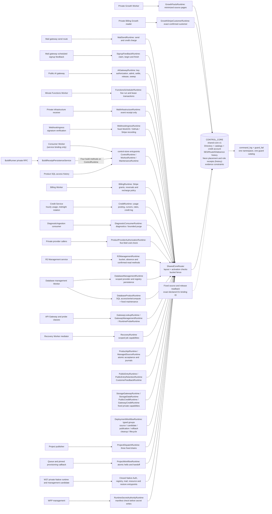

Migrations live in `apps/control-store/migrations/core`: `0101..0190` (Directory objects) and `0201..0290` (tenant objects) are the schemas of the unreleased earlier design of one Directory database plus organization-hashed shards, with identical DDL, pinned by `test/core-layout.test.ts` against `migrations/directory` and `migrations/shard` except the replaced objects (`guard_fail`, `command_log`, `shards`, `shard_buckets`), the changed ones and the additions. Only the two DDL name conflicts (`command_log`, `guard_fail`) are resolved, in `0001_core_layout.sql`: `command_log` carries a command-namespace version and the one `guard_fail` catalog is the union of the fourteen codes both originals carried plus a `guard_unregistered` check so an unknown code still aborts its batch. The union is pinned against `GUARD_CODES` by test.

The Core runtime requires an immutable `core_authority_activation` qualification receipt: a fresh or loading target is refused before any ordinary command, even if an isolate already read its layout. A positive activation may be cached because SQL permanently refuses any import context after activation, never updates or deletes activation, and refuses activation while an import is open. Migrations insert no activation; tests seed a fixture qualification receipt.

- Ownership history (`0300`): the composite `(organization_id, project_id)` keys are kept, so a former owner's operations, epochs, sources and data aliases keep their exact parents and no row is relabelled. `project_identities` restores the global project identity, at most one scope row of a project is current (the former owner's is `transferred`, only after its billing epoch is closed, and it changes again only by an ownership RETURN: the row goes back to `active` with a fresh third epoch id that opens after every earlier epoch ended, an ownership version above every scope row of the project and the retired state appended to the append-only `project_scope_history`, so A to B to A keeps both earlier epochs and everything keyed by them byte for byte and creates no second active project), one billing epoch of a project is open globally (billing epochs are a chronological chain that only ends, once, and is never deleted), and the creation and import batches end with the same `ownershipInvariantGuard` (one current owner, one global open epoch, the owner points at it). Every first copy and return carries the lifecycle state and version of the last current project scope; returning to an earlier owner cannot restore its stale active state or resurrect a deleted project. Environment and data-environment ids stay one identity across scopes. Tested by `test/ownership-history.test.ts`: import with foreign keys on, the A to B to A return under a fresh third epoch, a new mutation of the former owner is refused, the new owner is admitted, a second open epoch, second current scope, cloned identity or unclosed transfer is refused, and a transfer copy or return takes the lifecycle the project last had.
- Global identity (`0310`): the billing epoch, operation, operation event, outbox event and audit event ids are global (billing epoch, operation and event primary keys). A retained id of another organization is a typed `global_identity_conflict`, decided before any write when the decision can see it and classified from the global table after one re-read otherwise, never `store_busy`. A credit grant is keyed globally by its own identity (`credit_grant.key`, see [Credit account tables](#credit-account-tables)). Project-keyed current-state rows, token hashes, domain names (Directory claims) and server-minted aggregate ids that the former PostgreSQL schema keyed globally stay organization-composite on purpose: a global key on a project-keyed row would forbid the history-preserving transfer. Tested by `test/global-identity.test.ts`.
- One batch where several writes must agree: `projects.createInitialProject` (Directory claim of the project id and handle, project, epoch, environments, assignments, operation, audit and outbox), `identity.applyWorkosSnapshot` (Directory claim, organization, memberships, the adopted pending barriers and their cleanup, local grants, audit and the Directory state mirror) and `domains.claimCloudflareProjectDomainsOperation` (the two name claims and the domains row) each commit as one core batch. The read has no side effect; a claim or fence that moves between the read and the batch aborts the batch through its own guard or UNIQUE key and is classified again. The abort tombstones and claim identities remain as late-writer fences for rows left `reserved`, and a closed claim never frees its name while its outcome is unknown. A late failure of the last statement rolls back each of the three (tests in `projects.test.ts`, `identity-q1-scale.test.ts`, `domains/cloudflare-project-domains.test.ts`). The doorbell is an advisory idempotent statement after the batch.

### Customer project admission

The Control API's project `POST`, collection `GET` and single-project `GET`/`HEAD` paths call the closed `CONTROL_RUNTIME` binding. A missing binding fails closed. [Worker composition](../../apps/control-api/src/worker-main.ts), [closed consumer port](../../apps/control-api/src/d1-project-persistence.ts).

`admitCustomerProject` is one Core batch: canonical HTTP idempotency receipt and stored 202 answer, global id/handle claim, current project/epoch/environments/data assignments, queued operation, audit/outbox, optional managed-source recipe (state `waiting`) and both initial platform domain claims. It reuses the seed, audit-key hashing and verified handle-receipt generator; an exact retry with new proposed IDs returns the original answer. Project and operation timestamps stay distinct. Both logical data-identity rows exist, including the unused Prod identity in shared mode; both shared assignments select Dev's data identity. A late domain failure, consent revocation or organization deletion rolls back the whole acceptance. The source recipe retains its exact creation principal, region, epoch and consent; an organization-level creation consent becomes neither a project edit nor a publication grant. [Atomic admission](../../apps/control-store/src/catalog/projects/customer-projects.ts), [schema and publication dependency](../../apps/control-store/migrations/core/0321_customer_project_admission.sql).

The project reads use global ordering, authorized organization/project filters and cursor validation. Authorization requires an active beta-admitted organization, the current matching WorkOS membership/local grant, and for a project the current active owner/epoch and optional exact environment. Conflicting roles and stale scoped grants deny. WorkOS organization and exact M2M binding reads use the same Core. Every money and authentication read uses the primary. [Caller tests](../../apps/control-api/test/d1-project-worker.integration.test.ts), [admission tests](../../apps/control-api/test/d1-project-admission.integration.test.ts).

## Workflow database target metadata

The parent Workflow's database-target metadata reader is a Core helper. One bucket-fenced read batch returns the exact current ownership/head, latest registration receipt or pending reservation and the historical Neon placement metadata. Registration versions, scope, provider/database identity, metadata validity and retired cleanup heads are read from the Core rows. It opens no provider connection and cannot reactivate a Neon target. [Helper](../../apps/control-store/src/catalog/provisioning/context.ts), [target tests](../../apps/control-store/test/provisioning/context-target.test.ts).

The Core imports the `@ohmyhost/database` workspace package as a development dependency for Workflow DTO type declarations only. Turbo builds those declarations before Core on a clean checkout; type-only use adds no database transport to the Core runtime, and the emitted Core bundle has no database or `pg` runtime input.

### Full product Workflow context

`readProductWorkflowContext` returns the persisted command context from Core rows. It retains the exact accepted intent/run, active ownership/lifecycle, source grant and consent, artifact/output scopes, effective gateway receipt and runtime policy, abandoned candidates, secrets count, mail configuration and deletion custody. A promotion whose source or target head moved returns `promotionStale` with no source artifact or deployment, so its domain failure path keeps its context. Rename reads cleanup evidence internally while its public `deletionInventory` stays empty.

Each trusted SELECT is planned by a count, then read in pages of 128 raw rows inside **one** fenced D1 batch, together with verifying counts. The base intent, accepted run, current project/environment and identity set used to plan conditional reads must equal that snapshot. A count or base change retries up to three times, then fails with a conflict. There is no row/history cap or aggregate JSON history cell; a native D1 operational limit remains an error, never partial context. The reader opens no provider or generic SQL transport. The application restores the three intent digest `Buffer` fields from Worker RPC `Uint8Array`; every other DTO field keeps its contract, including `Date` metadata. Exact opaque JSON types are preserved before parsing provider hints.

Migration `0452` supplies GitHub connection/consent/authorization and raw source-object evidence with identity, shape, foreign-key and append-only rules. It uses the merged organization/ownership and historical environment parents; no upload-row alias or invented archive is used. `0450` (workflow identity) and `0451` (intent restoration) are independent prerequisites. Source generation pinning and lifecycle mail-detachment effects belong to the accepted command writers; this reader never infers them. [Reader](../../apps/control-store/src/catalog/provisioning/context-reader.ts), [tests](../../apps/control-store/test/provisioning/context-reader.test.ts), scoped evidence.

## Historical import into the Core

The Core was populated once from the former PostgreSQL Control by the operator tool `scripts/control-d1-migration.mjs` with its closed mapping registry (`scripts/control-d1-*-mappings.mjs`) and the remote target tooling (`scripts/control-core-*.mjs`). The tool is operator-only, exposes no SQL RPC, creates no provider resources and changes no consumer binding. It stays in the repository only until the Production cutover has been observed; the Core's migrations and runtime do not depend on it. The credit, metering, usage and billing tables of the former Control are accounted as `removed` dispositions (row count and source digest recorded, rows neither imported nor archived); balances come from the seed of migration `0600` ([Credit account tables](#credit-account-tables)). Runbook, converter progress.

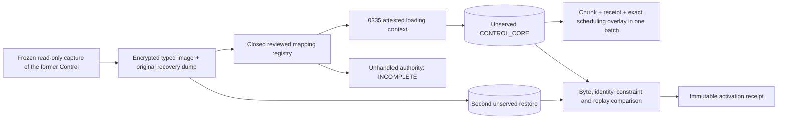

The capture reads the source in one read-only, repeatable snapshot with a custom-format dump taken from the exported snapshot. Credentials and the 32-byte encryption key are never command arguments or artifacts (the key comes from an explicit file descriptor). Typed chunks, the source manifest and the recovery dump are authenticated with AES-256-GCM in an exclusive owner-private directory, and an external HMAC journal stays available independently of the Core. Decimal int8/numeric values and array bounds stay text, bytea stays bytes, timestamps keep six microseconds and infinity has its own tag. Type/null/length framing and SHA-256 multiset proofs preserve duplicate rows and never reinterpret historical text or JSON evidence.

Every source table must be mapped by a reviewed adapter that checks the pinned Core migration names and ordered hashes, the source schema hash, the source identity and the target revision. An unhandled table, view reader, sequence replacement or format gate is an explicit **INCOMPLETE** blocker (CLI exit 2), even when empty. The tool refuses to invent versions, relabel historical epochs or infer consent and retention; new storage-only metadata has declared provenance in the plan. Target rows and their chunk receipt share one batch, a lost reply is observed before retrying, and a changed schema, a different replay or an unknown commit without a matching receipt is refused. Adapters declare contiguous named atomic units; a unit that needs foreign-key deferral keeps it enabled through its final check and commit, and there is no `foreign_keys=OFF`. Only a real cyclic dependency (the WFP deployment/revision graph) shares a deferred unit; older history loads topologically. Readback uses fixed typed keyset pages of at most 128 rows with row and byte bounds and streamed count/digest proofs. Sequence state (`last_value`/`is_called` of the migration runner and the feature-position allocator) is captured and restored explicitly, never derived from `MAX(rows)`.

The single `core_historical_import` context (`0335`) is direct trusted-operator authority on an unserved target and is on no RPC. Its immutable plan digest binds the authenticated source manifest, the exact temporal table allowlist and the expected runtime DDL fingerprint. Loading closes once, with whole-import comparison evidence and the exact restored DDL fingerprint; activation binds that closed comparison. After any activation SQL permanently refuses to open an import, and an activation is refused while an import is open; the CLI never closes or activates an incomplete import. Static identities, historical foreign keys, bytes and append-only guards stay active while loading. Only reviewed temporal current-authority admission predicates recognize the exact allowlisted historical tables, because replaying discarded ownership or domain states would invent history. Derived source triggers have a separately attested overlay: a closed set of named triggers (the three `pgcf_serving_interval_on_head_*` callbacks of `0353`, the byte-pinned `0466` Mail callbacks `mirror_legacy_workspace_mail` and `mark_mail_capabilities_dirty_insert`, and `github_grant_bind_source` of `0336`), each qualified by the hash of its migration and of its exact SQL, is removed and restored in the same atomic batch, with the overlay hash in the receipt and the exact runtime schema checked afterwards. Unknown versions, edited trigger bodies and a trigger outside the set refuse. `0499` adds the scoped authorization and grant names to the temporal context under its literal pin. [Activation and context schema](../../apps/control-store/migrations/core/0335_historical_import_activation.sql), [runtime preflight](../../apps/control-store/src/core.ts), [boundary fixtures](../../apps/control-store/test/historical-import.test.ts).

`0411` keeps the former migration runner's `control_db_migrations` as a separate read-only source-history table (legal zero/negative int4 ids, empty names, unchanged wall-clock components) together with the exact `last_value`/`is_called` of its sequence. It never feeds the Core's migration allocator.

Schema notes of the import migrations:

- Operation spine (`0381`–`0385`): retained operations keep their organization/project/epoch and final state; only their old current-owner INSERT admission can recognize the attested `operations` loading family. `delivery_attempts` is a ten-field history that claim, failure, ACK and terminal recovery update in the same batch as the outbox, including exhausted Recovery dispatch. Audit namespaces are independent tables with independent global IDs. The `001`/`002` evidence tables reject UPDATE and DELETE unconditionally; prototype exports never confer deletion authority. Read-only evidence exports use an explicit projection format. `0384` assignments keep their recorded organization while referencing the stable `(project,environment)` identity, with a separately named loading exception for old-owner assignments and the live current-scope INSERT rule.
- Identity backbone (`0410`): all six principal-observation columns are kept, including an organization identifier without a mapping and clocks with no ordering constraint; no new organization FK or chronology policy is inferred. The twelve-field delegation table uses the global operation primary key, the global grant UUID FK, the exact operation organization/project/epoch relationship and the exact environment scope FK. A grant in another organization is a legal FK fact; execution consent still performs its separate current-authority checks. Inbox routing metadata is NULL on import and the runtime resolves the provider subject.
- Identity keys: legacy API-key metadata, machine bindings and WorkOS user-key issuance requests are kept without any provider key value. Scope and permission arrays keep order, duplicates and quoted/NULL elements through an exact text/JSON round trip.
- Billing: only `stripe_billing_customers` and `stripe_recharge_policies` are imported; payments, grants, lots and every other credit table are `removed` dispositions.

## PGCF serving history and source evidence

Forward migration `0351` keeps the serving episode identity: a new target revision with the same PGCF provider project, database and activation time leaves the open serving interval unchanged, and the interval retains the target version with which it started. A changed database/activation closes the previous episode, and deleting a head closes its open episode using the database clock. Unchanged caller `updated_at` likewise uses the database clock when closing. The exact first complete UTC hour is calculated from the stored hour prefix, so a timestamp ending in `.999999` does not round across the boundary in SQLite. The credit service bills PGCF memory from that first full hour of a serving interval ([PGCF memory](billing-and-pricing.md#pgcf-memory)). The table rebuild copies every history field unchanged and retains its target-revision foreign key and append-only guards; incompatible prior facts fail rather than being restated. [Migration](../../apps/control-store/migrations/core/0351_pgcf_serving_parity.sql).

The static evidence schema (`0334` / `0336`) represents the build uploads/parts, executions, artifacts, cleanup attempts, WFP candidate/publication/cleanup receipts and shared routes, with their source, accepted-plan and deployment/revision parents. Source connections, repository grants, plans and revisions have global identity; all 17 plan, 16 deployment and 10 revision fields are available. The main deployment/publication environment relation is stable by project/environment, while candidate, shared-route, plan and promotion-source relationships keep their organization scope. Historical admission never invents an old current environment or relaxes a static tenant, artifact, hash or append-only guard; only source-proven temporal publication/cleanup admission checks recognize the attested unserved import context. One atomic schema replacement stages and restores its affected children and exact bytes, validates the cyclic deployment/revision references at commit and refuses an activated target; it neither fills missing history with NULL nor recomputes historical digests. The v5/170/181 plan rules are compiled into separate SQLite guards, and exact JSON decimal comparison avoids REAL rounding at the SSG cache bound. [Evidence schema](../../apps/control-store/migrations/core/0334_lifetime_source_evidence.sql), [static parents](../../apps/control-store/migrations/core/0336_deployment_static_integrity.sql).

## PGCF provisioning and registry on the shared Core

`NeonManagementService` serves `placeProject`, `migrateProject`, `readRuntimeBinding`, `reauthorizeDataEnvironment` and `deleteProject` through `DatabaseManagementRuntime`. That dedicated entrypoint exposes accepted provider operations, target and registry facts, current scope/Paid reads and authority metadata. Ordinary `ControlRuntime` gains no provider or global maintenance capability. Application SQL uses the session-capable PGCF WSS driver; no SQL callback, app credential or price crosses the Core binding. [Consumer](../../apps/neon-management/src/worker-main.ts), [D1 adapter](../../apps/neon-management/src/d1-pgcf-management.ts).

A current mutation proves the persisted claim and operation belong to the current owner's same open billing epoch and accepted lifecycle, both when resolving its physical data environment and in the final guarded command. App connections reauthorize before requesting credentials or executing SQL. New target activation composes the global physical claim, the immutable target revision and the head in one Core batch; late failure leaves none of them. Retirement under the exact frozen deletion inventory composes head retirement, a no-active-backing check, the claim's abort fence and exact owned claim release in one batch. External provider prepare, dispatch and observe stay separate: operations retain their durable request body/key before dispatch and reconcile provider/registry replies under the same identity. Scope, role names, AAD coordinates and shared Dev/Prod physical identity stay unchanged. Paid expiry never changes an existing target's RAM or volume. [Authority](../../apps/control-store/src/catalog/database/authority.ts), [activation](../../apps/control-store/src/catalog/database/provider-targets.ts), [retirement](../../apps/control-store/src/catalog/database/deletion.ts).

Provider operation request bodies are stored as opaque JSON text. A fresh request keeps a compact locale-sorted digest input and the JSONB storage form; semantic comparison preserves numeric scale equivalence without collapsing adjacent integers above 2^53, and begin and record guard the exact stored body, digest and state snapshot. [Request storage](../../apps/control-store/src/catalog/database/provider-request-jsonb.ts).

Registry reservations precede the regional `ProjectDatabaseAdmin`/Durable Object effect and matching observed receipts follow it. The explicit rebind closes invalidated pools and refuses stale provider generations; scoped reauthorization preserves only the authorized logical environments. An uncertain registry reply leaves a durable reservation; replay observes or repeats the same registration identity. App migration replay uses the immutable app ledger and retains the first Core migration receipt's fields, even when a retry reports replayed paths. A historical Neon registration is provenance only: no empty placeholder or Neon registration becomes a ready binding. [Registry commands](../../apps/control-store/src/catalog/database/registration.ts), [registry and pool invalidation](../../apps/project-database-runtime/src/worker-service.ts).

The Core cannot start a cutover from a Neon source: an active Neon head is forbidden. The twelve completed customer cutovers remain as released historical receipts beside their active PGCF target. `readControlAuthority()` returns the closed descriptor `{provider,databaseId,environment,activationId,qualificationSha256,runtimeSchemaSha256}` from the configured `CONTROL_CORE_DATABASE_ID` and `CONTROL_PLATFORM_ENVIRONMENT` plus the immutable `0335` activation, the exact layout and the no-open-import check before provider action. Configured UUID metadata is **not provider introspection**: the root release separately verifies the actual D1 binding ID, the configured values and 100% exact Core/management Worker versions. `CONTROL_CORE_RELEASE_SOURCE` stays separate release metadata and adds no descriptor field. No import, activation or arbitrary SQL RPC exists. [Authority read](../../apps/control-store/src/catalog/database/control-authority.ts).

Migration `0352` keeps the verification, receipt and binding-refresh fields, global operation identity and proof bytes of the cutover history. Binding-refresh history uses the static global logical environment identity plus its retained historical organization/project scope, never a manufactured current environment. Migration `0353` restores the physical data-environment and full operation/project foreign keys for the closed provider family; it stages its ten dependent tables in one batch, restores every row/index/immutable/head trigger unchanged and never disables or defers foreign keys. The deployment-plan/source graph belongs to `0336` and is not redefined by this slice.

## Shared mail custody and current project authority

W25 separates workspace sender resources from project bindings and intended-application proofs. The Core keeps provider IDs, ciphertext/AAD coordinates, DNS ownership receipts and inbound history. Resources use their immutable organization/resource custody tuple; applications receive only their own environment gateway keys. Global live-domain uniqueness remains enforced. See [mail ownership](mail-and-recovery.md#same-domain-shared-sender-contract) and [D434](decisions/domains-and-mail.md#d434).

Mail custody and historical attribution use stable project/environment identities instead of foreign keys to mutable current-organization ownership. A real project transfer therefore leaves the sender resource and historical sends/inbound records in their original workspace while detaching only the transferred project's binding. Current tenant access is enforced by scoped queries, active ownership/lifecycle, environment membership, resource ownership and current proof, rather than relabelling old ciphertext or send history. Lifecycle mutations share the per-project mail lock; current proof/binding/resource locks fence attachment, retirement and verification. The bounded automatic proof attempt timestamp is scheduling metadata, not another permission or mail charge.

A send checks Paid and charges its recipient quote in the same batch that claims the request; acceptance and an uncertain outcome keep the charge and a request the provider rejects or refuses gives it back once ([Credit account tables](#credit-account-tables)).

## Connection grants

The W44 source candidate adds Core migration [0759](../../apps/control-store/migrations/core/0759_connections.sql). It stores one-use connection and portal handoffs, callback attempts, encrypted grants, and orphaned issued or refreshed tokens for bounded revocation. Identity triggers make handoff and attempt identities immutable. Private `ConnectionControlRuntime`, `ConnectionBrokerRuntime` and `ConnectionBrokerMaintenanceRuntime` entrypoints expose only their pinned methods; customer Workers receive no binding. The migration is not evidence of application to either environment. [D609](decisions/identity.md#d609).

## Credit account tables

The Core holds the credit of an organization as amounts; the reason for each change is a row of the credit log. Rules, prices and the customer-visible contract are in the [billing chapter](billing-and-pricing.md#credit-account) and [D445](decisions/billing-and-usage.md#d445). Migration [`0600`](../../apps/control-store/migrations/core/0600_credit_simple.sql) creates six `STRICT` tables. Money is an `INTEGER` count of micro-credits (one credit is 1,000,000), bound with `CAST(? AS INTEGER)` because D1 binds a JavaScript number as REAL.

| Table                | Key                                   | Holds                                                                                                                                                                                                                                                                                                                                                                                                                                                                                                                                                                                                                                              |
| -------------------- | ------------------------------------- | -------------------------------------------------------------------------------------------------------------------------------------------------------------------------------------------------------------------------------------------------------------------------------------------------------------------------------------------------------------------------------------------------------------------------------------------------------------------------------------------------------------------------------------------------------------------------------------------------------------------------------------------------- |
| `credit_account`     | `organization_id`                     | Monthly credit and the instant it ends, one-time credit, reserved and overrun amounts, `exhausted_at`, `paid_until` with `paid_source` (`stripe`, `granted` or `manual`) and, for a Stripe coverage, the `paid_subscription_id` that produced it (`0635`), the instant of a lazy Paid renewal that the invoice of its period has not yet replaced (`paid_renewal_at`, `0810`), a granted or manual access that an overwriting invoice kept aside (`granted_until`, `granted_source`, `0811`) with the instant it was kept (`granted_captured_at`, `0812`), and the exhaustion-warning claim (`warned_for_exhausted_at`, `warning_next_attempt_at`) |
| `project_credit`     | `project_id`                          | UTC `period`, month-to-date `used_micros` (reset when the period changes), optional `budget_micros` and `budget_mode` (`continue` or `stop`)                                                                                                                                                                                                                                                                                                                                                                                                                                                                                                       |
| `credit_reservation` | `reservation_id`                      | The quote of one open build (`amount_micros > 0`); the row is deleted when the build settles or is released                                                                                                                                                                                                                                                                                                                                                                                                                                                                                                                                        |
| `credit_grant`       | `key`                                 | One-off credit and Paid invoices once (`invoice:<in_>`, `topup:<pi_>`, `recharge:<pi_>`, `signup_bonus:<user>`, `referral_signup:<user>`, `referral_reward:<payer org>`), with `paid_minor`, `reversed_micros`, `granted_at` and, for an invoice, `covers_until` (the Paid coverage it gives, `0635`)                                                                                                                                                                                                                                                                                                                                              |
| `usage_cursor`       | `source`                              | `through`: everything before it is billed. Sources `wfp` and `pgcf` are hour aligned, `r2` and `resources` UTC-midnight aligned; `pnpm credit:cutover init-cursors` inserts the four rows at cutover and a source without a row is skipped                                                                                                                                                                                                                                                                                                                                                                                                         |
| `usage_post_failure` | `key`                                 | A usage posting the service could not book (migration `0637`): the lines of its latest attempt, its layout (`split`), `attempts` and last `reason`, kept until its key is booked                                                                                                                                                                                                                                                                                                                                                                                                                                                                   |
| `credit_log`         | `seq` (`AUTOINCREMENT`), UNIQUE `key` | Instant, organization, `kind` (`usage`, `reserve`, `settle`, `release`, `grant`, `renew`, `refund`, `reverse`, `expire`), signed `delta_micros`, `balance_micros` after the change and a JSON `detail`; indexes on `at` and `(organization_id, seq)`                                                                                                                                                                                                                                                                                                                                                                                               |

Every change of an amount is ONE `db.batch` in a fixed order ([`chargeOrg`](../../apps/control-store/src/catalog/credit/spend.ts#L84) is the model): `ensureAccount` (`INSERT OR IGNORE` for an existing organization), the lazy renewal of a lapsed month, the guarded `UPDATE` of `credit_account`, the `credit_log` `INSERT ... SELECT` from the updated row (for a charge before the `UPDATE`, from the row it is spent from), then the optional `project_credit` upsert and `credit_reservation` or `credit_grant` write. The UNIQUE `credit_log.key` is the double-posting guard: a duplicate aborts the whole batch, which D1 runs as one transaction, and the `run*` wrappers read it as "already posted" ([`isDuplicate`](../../apps/control-store/src/catalog/credit/spend.ts#L43)). There is no wallet version fence. The domain functions return their statements and a result reader so a caller composes them with its own writes (deploy accept, mail claim); the keys and the rules are in [one atomic batch per change](billing-and-pricing.md#one-atomic-batch-per-change).

Configuration tables stay as they were: `published_credit_rate_cards`, `usage_meter_activations`, `stripe_billing_customers`, `stripe_recharge_policies`, `webhook_inbox`, `signup_sources`, `user_signup`, `project_powered_by_flag_periods` and the `pgcf_database_entitlement_*` tables. `project_credit_budgets` was folded into `project_credit`.

Migration [`0602`](../../apps/control-store/migrations/core/0602_meter_activation_timeline.sql) rebuilds `usage_meter_activations` with the key `(meter, starts_at)` instead of `meter`, copying every row unchanged and keeping the append-only and meter-grammar triggers. The original key allowed one activation per meter and so no price change; now the latest activation that started by an instant prices the meter at that instant ([prices](billing-and-pricing.md#published-prices-and-meters), [operator command](billing-and-pricing.md#changing-prices-and-adding-priced-features)).

Migration [`0603`](../../apps/control-store/migrations/core/0603_database_access_delete_operation_replace.sql) lets a PGCF access replace its write-once `provider_delete_operation_id`. A failed role deletion is re-issued under a key derived from the failed operation id, and a second failure of that re-issue stuck, because the store refused any replacement. The store now replaces the id by compare-and-set on the id the caller saw fail, and only while the access is revoking (revoked, role not yet dropped). The trigger enforces the same state rule and still refuses clearing the id, changing it on an active or fully revoked access, and changing the create operation id. No data changes and no table rebuild: the identity guard is recreated with its 0400 text, and the ULID update check of 0401 is recreated after it, so an invalid identifier still reports the ULID domain first.

Migration `0600` seeds one `credit_account` per existing organization from the lots valid at that moment (expiring non-top-up lots become the monthly credit, the rest one-time credit; approximate on purpose), `paid_until` from the Stripe coverage (period end plus 14 days, capped by the subscription end) or the operator access, `exhausted_at` from the old grace, the budgets and this month's use into `project_credit`, and it marks an exhaustion whose warning mail was sent as warned. Reservations, holds and history (lots, holds, valuations, movements) are not carried over, so builds are drained before the cutover ([cutover](billing-and-pricing.md#cutover-from-the-old-ledger)).

Migration [`0601`](../../apps/control-store/migrations/core/0601_credit_drop_old.sql) is generated by `scripts/core-credit-drop.mjs` from the table list in [`CREDIT_DROP_ROOTS`](../../scripts/core-credit-drop.mjs#L25) and a test fails when it is stale. It drops 88 tables, 215 triggers and 6 views of the old chain and rebuilds `mail_send_requests` without its `credit_*` columns, together with the mail tables that reference it. No trigger on a surviving table may write into a dropped table, because organization and project creation, and so login, would break; [`credit-drop.test.ts`](../../apps/control-store/test/credit-drop.test.ts#L500) proves that no trigger, view, index or foreign key names a table that is gone.

Entrypoints. [`CreditRuntime`](../../apps/control-store/src/worker-main.ts#L1338) is the private credit service's view of the Core, table-driven like the other entrypoints, with fifteen methods: `postUsage` (a whole window or one part of a split one, at most 2,000 lines, one layout per window), `recordUsageFailure` and `replayUsageFailures` (the kept postings, [usage billing](billing-and-pricing.md#usage-billing)), `readCursor`, `advanceCursor`, `resolveScripts`, `readRates`, `readLogPage`, `deleteLogThrough`, `cursorsThrough`, `readLogsToday`, `resolvePgcfDatabases`, `listR2Buckets`, `readResources` and `listStopBudgetProjects` (the stop budgets reached in the current month, at most 50, for the budget sweep). Time is the Core's clock; a caller cannot name it. The other entrypoints that read or charge the account:

- `PublicCreditRuntime` (five fixed methods: `readCreditAccount`, `readCreditOrganization`, `readCreditUsage`, `readProjectCreditBudgetPublic`, `configureProjectCreditBudget`) and `GatewayCreditRuntime` (`read`, the serving decision, which writes nothing).
- `BillingRuntime` (`grantStripePayment`, `reverseStripePayment` and `readOrganizationPaid` beside the inbox, customer and recharge-policy commands).
- `MailSendRuntime` (the claim charges the quote, a rejection refunds it once) and `MailWarningRuntime` (exhaustion warning claims).
- `ProductApiRuntime` (acceptance reserves the build quote in the accept batch). The settlement runs in the build-receipt batch (`putBuildUsage` of `ControlRuntime`) and the release in lease recovery and deployment failure.
- `DatabaseProductRuntime` and `CloudflareDomainRuntime` (admission of product database commands and of paid project domains from the same serving decision).

## Managed source and remote-client records

The Core holds provider-neutral `source_connections`, managed repository registrations, `project_source_bindings` and staged/sealed publication journals. Managed grants use a real namespace/repository identity with no GitHub installation number. Source bindings carry a generation; accepted plans and product intents pin it so an explicit source switch cannot reuse an old plan or auto-deploy event. Git owns current code/history; the Control commit projection and journal are scoped authorization/replay evidence rather than an independent file store. [Schema](../../apps/control-store/migrations/core/0500_original_managed_source_inventory.sql), [journal commands](../../apps/control-store/src/catalog/product-api/managed-source-journal.ts).

Every publication read, write and replay checks active ownership and billing epoch. Staging blobs carry exact R2 receipts and a sealed canonical full manifest. Preparation reads the provider repository and records the deterministic Git candidate/tree before any push or branch mutation; uncertain mutation outcomes retain observation work, and an unchanged snapshot retains its source version. Source switching and initialization exclude conflicting project work. Ordinary source commits update their branch with optimistic concurrency. Template initialization has a separate durable parent/child recipe, with queue delivery and terminal child evidence before completion. [Source persistence](../../apps/control-store/src/catalog/provisioning/managed-source.ts), [queue processing](../../apps/project-provisioning-worker/src/managed-source-jobs.ts).

Binding refresh keeps the historical artifact and source identity while pinning the currently selected source generation, without another source read or build. [Refresh generation guard](../../apps/control-store/src/catalog/identity/operation-delegations.ts), [binding-refresh proof](../../apps/control-store/src/catalog/provisioning/binding-refresh-proof.ts).

Remote MCP uses `mcp_portal_handoffs`, `mcp_client_grants` and `mcp_client_revocations`. Handoffs store a random-link hash, user/client/consent hash, target metadata and a one-use window: one hour for connection grants, ten minutes for GitHub and provider secrets, one hour for plain environment-secret links. Project grants bind current ownership version and billing epoch, with creation scope separate from publish permission. Grants are checked against current active owner/beta membership and local revocation, alongside ordinary REST authorization; queued operations retain immutable delegated-client evidence. Grouped plain-secret links store the ordered names, the winning submission ID and final per-field outcomes in the existing secret-target JSON. These tables store no provider bearer/refresh token or environment-secret value. Migration `0380` keeps each grant family's global UUID uniqueness; populated duplicates refuse the migration rather than being merged or relabelled. A pending consent can continue while keeping its grant UUIDs and incrementing int8 revisions exactly above 2^53; revoked consents stay refused. [Remote-client schema](../../apps/control-store/migrations/core/0210_identity_access.sql), [grant checks](../../apps/control-store/src/catalog/identity/mcp-delegations.ts), [consent flow](auth-and-secrets.md#remote-connect-delegation-and-portal-custody).

Project deletion queries the managed repository and per-operation staging-object inventory only under the running deletion command, current billing/ownership and deleting-project tombstone. Source RPC cleanup receives that exact inventory, never an arbitrary caller prefix. Deployment/runtime artifacts and application data keep their existing deletion custody. [Scoped source deletion inventory](../../apps/control-store/src/catalog/provisioning/lifecycle-inventory.ts), [storage cleanup limits](storage-and-domains.md#managed-source-staging-and-repository-history).

## Customer database runtime

Each project explicitly selects isolated or shared Dev/Prod data. Logical authorization remains environment-scoped in both modes; shared mode maps the two authorized logical environments onto one physical database registration. Hosting region selects the regional US or EU database service. The configured production graph binds the Database Management Worker (deployed as `neon-management`) to the regional `ProjectDatabaseAdmin` entrypoints and binds a customer application only to `ProjectDatabaseService` as `OHMYHOST_DATABASE`. [Trusted administration bindings](../../apps/neon-management/wrangler.production.jsonc), [customer binding](../../apps/wfp-management/src/management.ts).

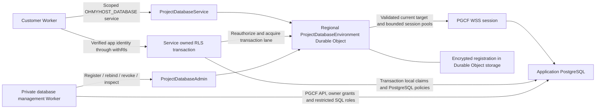

The Durable Object's name binds organization, project and physical environment. Its registry verifies target identity, registration generation, authorized logical environments and revocation state before decrypting the connection URI. Registration is persisted encrypted under `registration`, with a separate `DATABASE_REGISTRY_KEY` Worker secret. Customer code does not receive that URI, key, admin entrypoint or provider API credential. The Durable Object opens its own bounded sockets to the PGCF gateway. Egress and acceptance evidence for this path is recorded under W26. [Object and entrypoints](../../apps/project-database-runtime/src/worker-service.ts), [registry](../../apps/project-database-runtime/src/registry.ts), [credential custody](auth-and-secrets.md#database-credential-custody).

Core registration records enumerate credential-free target metadata. Admission requires the current owner/provider claim, matching scoped role and migration receipts, the pinned PGCF origin host and database, and an append-only authority-generation reservation. Cleanup also considers a pending reservation whose private RPC outcome was never committed locally; only exact private readback can recover that receipt before revocation. [Registration persistence](../../apps/control-store/src/catalog/database/registration.ts), [registration contracts](../../apps/control-store/src/catalog/database/contracts.ts).

When a later Dev environment shares an existing PGCF target, its first deployment refreshes logical authorization through the normal `register` command at the next reserved generation. The registry retains the authorization floors of continuously authorized Prod, admits new Dev only from that new generation, and rejects a changed physical target. The explicit `rebind` command remains limited to authorized legacy Neon-to-PGCF replacement; cross-region movement still revokes the previous registration before registering the destination. Add Dev itself creates the assignment, not an active Dev Worker or an already refreshed provider registration. [Management selector](../../apps/neon-management/src/pgcf-runtime.ts), [registry continuity](../../apps/project-database-runtime/src/registry.ts).

A failed operation's incomplete registration reservation stays unchanged until it is superseded. A current claim may issue a higher normal PGCF generation only when the active prior registration is PGCF in the same region and every pending foreign reservation above that active floor has a failed operation, no surviving provider-mutation claim and exactly the desired target, origin, scope and authorized environments. Core checks those facts again with the current claim, owner, target, assignments, migration receipt and maximum reserved generation in the write batch. The new generation exceeds every retained receipt/reservation; retry of its exact claim retains that generation. Active or unknown foreign work, changed authority/target, legacy cutover and cross-region replacement remain blocked. Normal registry monotonicity fences late lower-generation writes. A reservation is never updated or adopted. The one deletion is supersession ([D612](decisions/data.md#d612)): before a registration or reauthorization reserves, the pending reservations of failed operations without a surviving claim whose failure is at least seven days older than the claim's operation are deleted (migration 0920). A reservation of an open or succeeded operation, and every receipt, never leaves.

The service supports parameterized queries, transactions and bounded held connections. Input and result limits constrain query bytes, parameter counts, row counts and serialized result size. Held connections have finite statement, lifetime and idle limits; advisory transaction locks enforce a database-side concurrency bound. Writes returning rows are committed only after their returned result passes limits. A failed or oversized result must not silently commit a write that a retry would duplicate. [Execution and limits](../../apps/project-database-runtime/src/service.ts).

The customer runtime's optional Kysely dialect supports the `^0.29.5` patch line. The platform and direct runtime dependency remain pinned to `0.29.5`; strict public-package consumer types and compiler, leased-transaction, RLS and Better Auth adapter cases were also checked against `0.29.8` during this correction. Fresh strict pnpm installs check both automatic-peer settings. This corrects the exact optional-peer conflict introduced by Better Auth's compatible transitive Kysely range without changing server pins or accepting another minor line. [Adapter](../../packages/customer-runtime/src/database-kysely.ts), [packaged-client qualification](../../tests/customer-clients-package.node-test.mjs), [D387](decisions/data.md#d387).

Each physical environment shares separate lanes with one query, two transaction and two auth connections, each with at most thirty-two waiters. PGCF application connection establishment/pool waiting is bounded at seventy seconds to cover provider wake and actual PostgreSQL readiness; a connection that the gateway refuses with `08006`, `53300` or `57P03`, or that fails with `WebSocket send() after close`, before any SQL (a database going to sleep or waking) is retried for up to 90 seconds with delays of 1, 2, 4 and then 8 seconds, so no statement is ever repeated. The budget is checked before each sleep, so a final attempt may start inside it and run for its own seventy-second connection timeout; callers sleeping between retries do not count against the thirty-two waiters. Server statements remain bounded at ten seconds and the client query deadline is twelve seconds. Held/RLS lifetime and idle clocks start or reset after acquisition. Held RPC sessions expire after thirty seconds or five idle seconds and reauthorize each use. A scope withdrawal interrupts its queued/active/held work while preserving continuously authorized Prod transactions; auth leases are reset before another scope can borrow them. Errors expose a SQLSTATE or closed redacted category rather than SQL/password details; deterministic limits return `54000`. [Lane policy](../../apps/project-database-runtime/src/connection-pool.ts), [scope and error boundary](../../apps/project-database-runtime/src/worker-service.ts).

A pooled session serves its next lease only after `RESET ALL` returns it to the platform defaults, so a timeout or setting that one tenant query changed cannot reach the next tenant. A session whose reset fails is destroyed rather than pooled, and its error listener stays attached, so a backend error reported after that is absorbed ([D523](decisions/data.md#d523)). [Pool](../../apps/project-database-runtime/src/connection-pool.ts#L214).

## Provider lifecycle and compute

Compute changes select the current physical data target and are serialized through a durable project/environment job. A claim records its sixty-second lease and mutation-start marker before provider I/O. The first authorized attempt applies one update; a later expired or response-uncertain attempt observes that exact target rather than repeating a potentially committed PATCH. Completion requires matching provider/endpoint/profile/idle and operation receipts. An unfinished job fences incompatible project work. Provider failure is not silently interpreted as a new choice or zero usage. The PGCF size classes are described under [PGCF implementation](#pgcf-implementation); pricing and credit remain owned by [billing](billing-and-pricing.md). [Compute claims and receipts](../../apps/control-store/src/catalog/database/product-compute.ts).

A PGCF compute change ends failed when PGCF refuses the resize with a 409 whose reason is not transient (only `mutation_in_progress`, `not_ready`, `node_capacity`, `idempotency_in_progress` and `generation_changed` keep the job running), when no PGCF operation exists for its dispatch 20 minutes after acceptance, when the observed PGCF operation failed, or by the read rules below. An uncertain dispatch whose Paid coverage ended is decided at that deadline by one read-only reading of PGCF's database instead: the target size completes the job once PGCF has observed it (a size not yet settled keeps it pending), any other size fails it, and a failed read is handled by the read rules below. The residual is a dispatch that PGCF applies only after that reading: it is recorded failed while the database keeps the target size, and the platform does not read it again. Read rules, for an accepted operation and for an uncertain dispatch's database alike: a read that PGCF permanently refuses with a 4xx other than 401, 403, 408 and 429 (such as a vanished operation) fails the job at once; reads that still fail 24 hours after acceptance fail it too, and each pass past those 24 hours writes one operator log line (`pgcf_compute_observation_overdue`). Every other failed read keeps the job running, including platform credential failures (401, 403), which are an outage to wait out. Without such a read, the observed operation status decides the job, and a job that has not settled 24 hours after acceptance fails at that ceiling whatever its status, with the same operator log line. Such a status is a provider operation still pending or running, or one reported succeeded while the database's generation is still unobserved. The failures above record the single code `DATABASE_COMPUTE_FAILED`; Paid access that ended before the first dispatch records `DATABASE_COMPUTE_PLAN_CHANGED`. Both keep the previous size and the database keeps running. The operation shows the fixed message and suggested action of [the public operation failure catalog](../../packages/contracts/src/operation-failure.ts) on REST (`error.message`, `error.suggested_action`), CLI (`operation get`, `database compute set --wait`, `project status`) and MCP (`operation_get`, `project_context_get`), never provider text; the stored `operations.failure` message is the same sentence. The owner keeps one code, since separate codes would need a CHECK-constraint migration. Status: implemented; Development acceptance of the resize path is open in W35-3.

An organization holds at most ten live databases. A database-enabled deployment, and a promotion into an isolated production environment whose revision enables a database, is refused with `database_limit_reached` (409) when the organization already holds ten and the target environment has none. Only active database heads count; a retired head or a deleted database does not. The check runs in the acceptance batch and a guard repeats it, so two accepted operations cannot both take the eleventh place ([D526](decisions/data.md#d526)). [Acceptance](../../apps/control-store/src/catalog/product-api/accept-product.ts#L513).

## Data identity changes

Logical Dev/Prod identities remain stable while versioned `environment_data_assignments` select their physical data identity. Four explicit transitions are implemented: split shared data keeping Prod's existing data, split shared data keeping Dev's existing data, share existing Prod data, and reset isolated Dev. The preserved side keeps its data identity; a fresh identity is required for a new isolated/reset side. Sharing requires confirmed Prod database readiness. Sharing/reset retires the prior Dev data identity and removes the Dev deployment; the affected environment must redeploy. These operations do not copy Dev rows into Prod. [Transition planner](../../apps/control-store/src/catalog/product-api/data-changes.ts), [assignment writer](../../apps/control-store/src/catalog/provisioning/project-data-change.ts).

Acceptance consumes the exact action confirmation for a credential-free plan and rechecks its project version, both environment heads and registration generations. Cleanup freezes only the Dev scripts and explicitly retired physical databases. Completion is refused until the exact absence inventory and assignment switch are durable; failure in the terminal transaction preserves the running claim rather than partially declaring success. File placement follows [the storage chapter](storage-and-domains.md), including original-uploader bucket custody across a shared data namespace.

Before switching an assignment, the workflow narrows authority to the surviving logical environment or revokes all authorization for retired data. Continuous authorized generations remain usable, but a withdrawn environment cannot recover authority merely by replaying an old binding after later reauthorization. The assignment writer checks the exact active operation/provider claim, lifecycle version and prior assignment versions under project/storage fences, and records an append-only assignment tied to that operation. [Registry generation tests](../../apps/project-database-runtime/test/registry.test.ts).

## Leftovers of the removed commit previews

Commit previews were removed from `main`, Development and Production on 13 November 2026; the work lives only on branch `feat/sandbox` (commit ccf25327). Ordered Core migrations 0622–0630 and their tables, rows and receipts stay as leftovers. Migrations are append-only, so the receipt chain and every Core upgrade from `main` stay forward, and Development and Production carry the same chain. The application code that wrote and read these tables was removed with the feature; no public or private operation uses them, except that credit attribution still reads the archived Dev tables `dev_environment_restorations` and `free_dev_retirement_resources` for history. Removal record.

Actual already-created Prod-only and retired-Dev resources remain readable for history, exports and deletion without fabricating a Dev identity. Owner disposition, Auth-only source accounting.

## Core and shard migrations from 0640

Core migrations `0640` onward and the shard migration `0091` are listed here; earlier migrations are described in their topic sections. Every file is append-only and carries its own header comment. Shard `0091` gives the shard series the same `function_runs` state as Core `0651`.

| Migration                                                                                         | Change                                                                                                                                                                                                                                    | Recorded in                                        |
| ------------------------------------------------------------------------------------------------- | ----------------------------------------------------------------------------------------------------------------------------------------------------------------------------------------------------------------------------------------- | -------------------------------------------------- |
| [`0640`](../../apps/control-store/migrations/core/0640_paid_domain_hostname_proof.sql)            | A Paid hostname is platform-wide exclusive only after its owner proves control of it; an unproven claim reserves the name for seven days and holds nothing against a proven one                                                           | Domains and mail                                   |
| [`0641`](../../apps/control-store/migrations/core/0641_mail_suspended_name_hold.sql)              | A suspended workspace sender name stays held in every organization while the suspension holds                                                                                                                                             | Domains and mail                                   |
| [`0642`](../../apps/control-store/migrations/core/0642_paid_domain_displaced.sql)                 | Terminal state `displaced` for an unproven Paid reservation whose hostname a proven project took; the table is rebuilt                                                                                                                    | Domains and mail                                   |
| [`0643`](../../apps/control-store/migrations/core/0643_workspace_mail_name_verified_hold.sql)     | A workspace sender name is held platform-wide only once its domain is verified, or when it is a legacy mirror                                                                                                                             | Domains and mail                                   |
| [`0645`](../../apps/control-store/migrations/core/0645_displaced_scoped_dns_tokens.sql)           | Records a replaced customer DNS grant token pair until Cloudflare revokes it                                                                                                                                                              | Domains and mail                                   |
| [`0646`](../../apps/control-store/migrations/core/0646_user_secret_digest_cleanup.sql)            | Clears the legacy unsalted digests of user secret rows ([D532](decisions/data.md#d532))                                                                                                                                                   | [D532](decisions/data.md#d532)                     |
| [`0650`](../../apps/control-store/migrations/core/0650_runtime_secret_attempt_rotation.sql)       | `last_attempted_at` on runtime secret delivery states, so the sweeper rotates through pending scopes ([D549](decisions/files-functions-recovery.md#d549))                                                                                 | [D549](decisions/files-functions-recovery.md#d549) |
| [`0651`](../../apps/control-store/migrations/core/0651_function_run_skipped_state.sql)            | Rebuilds `function_runs` with state `skipped` for a missed occurrence ([D547](decisions/files-functions-recovery.md#d547))                                                                                                                | [D547](decisions/files-functions-recovery.md#d547) |
| [`0660`](../../apps/control-store/migrations/core/0660_mail_webhook_secret_generation.sql)        | `webhook_secret_generation` (zero for existing receivers) on mail domains; rotation advances it                                                                                                                                           | Domains and mail                                   |
| [`0665`](../../apps/control-store/migrations/core/0665_r2_bucket_absence_evidence.sql)            | Append-only absence evidence for a project R2 bucket reservation                                                                                                                                                                          | Files and storage                                  |
| [`0666`](../../apps/control-store/migrations/core/0666_r2_spent_reservation_absence.sql)          | A spent reservation may leave once a read after the spend proves its bucket absent                                                                                                                                                        | Files and storage                                  |
| [`0670`](../../apps/control-store/migrations/core/0670_credit_overrun_month.sql)                  | `overrun_base_micros`, so the monthly overrun ceiling counts only the current month                                                                                                                                                       | Credits and billing                                |
| [`0675`](../../apps/control-store/migrations/core/0675_feedback_retention_redaction.sql)          | `redacted_at` and an update trigger that allows only the twelve-month redaction of a report ([D545](decisions/project-and-feedback.md#d545))                                                                                              | [D545](decisions/project-and-feedback.md#d545)     |
| [`0690`](../../apps/control-store/migrations/core/0690_project_handle_releases.sql)               | A released project handle is held for 30 days against other organizations                                                                                                                                                                 | Project state                                      |
| [`0700`](../../apps/control-store/migrations/core/0700_platform_key_versions.sql)                 | Installed Storage gateway keys are versioned: an owner rotation appends the next version, the gateway authorizes the newest one, and every existing key stays version 1                                                                   | Storage and domains                                |
| [`0701`](../../apps/control-store/migrations/core/0701_environment_secret_rotation_action.sql)    | The environment secret receipt table admits the action `rotate` for the owner's rotation of an installed platform key                                                                                                                     | Auth and secrets                                   |
| [`0710`](../../apps/control-store/migrations/core/0710_paid_hostname_proofs.sql)                  | A Paid hostname's ownership proof is its own record, keyed by project and hostname; every verified application identity is copied into it, and proving a hostname no longer couples it with the mail identity                             | Domains and mail                                   |
| [`0711`](../../apps/control-store/migrations/core/0711_paid_hostname_proofs_end_with_project.sql) | A project that changes owner or leaves its active lifecycle ends its Paid hostname proofs                                                                                                                                                 | Domains and mail                                   |
| [`0720`](../../apps/control-store/migrations/core/0720_r2_reservation_failure_release.sql)        | An ended operation's provider mutation claim releases its bucket reservation in the same delete; an unspent reservation leaves without evidence, a spent one only after an absence read ([D570](decisions/runtime-and-lifecycle.md#d570)) | Files and storage                                  |
| [`0730`](../../apps/control-store/migrations/core/0730_storage_upload_sweep_attempt.sql)          | `project_r2_upload_sweep_attempts`: the attempt stamp of each upload claim the hourly sweep tried and did not erase ([D574](decisions/files-functions-recovery.md#d574))                                                                  | Files and storage                                  |
| [`0740`](../../apps/control-store/migrations/core/0740_webhook_inbox_park_count.sql)              | `webhook_inbox.park_count`: the parkings of a Stripe inbox row, so its alert fires on the first parking only; existing parked rows start at one                                                                                           | Credits and billing                                |
| [`0800`](../../apps/control-store/migrations/core/0800_ai_gateway_reservations_organization.sql)  | Index `ai_gateway_reservations_organization` on the organization, so the open-call guard of an AI admission no longer scans the whole marker table.                                                                                       |
| [`0810`](../../apps/control-store/migrations/core/0810_credit_paid_renewal.sql)                   | `credit_account.paid_renewal_at` records the lazy Paid renewal; an invoice whose period began at or before it nets the spent part of that allowance.                                                                                      |
| [`0811`](../../apps/control-store/migrations/core/0811_credit_granted_shadow.sql)                 | `credit_account.granted_until` and `granted_source` keep the granted or manual Paid access that a Stripe coverage replaced.                                                                                                               |
| [`0812`](../../apps/control-store/migrations/core/0812_credit_granted_captured_at.sql)            | `credit_account.granted_captured_at` stamps when the kept access was captured, so a referral clawback only takes days from access that the reward extended.                                                                               |
| [`0820`](../../apps/control-store/migrations/core/0820_github_push_redelivery.sql)                | Rebuilds `github_push_deployments` without the commit-tuple UNIQUE; chained superseded rows are parked before the DROP so it applies to a populated table.                                                                                |
| [`0840`](../../apps/control-store/migrations/core/0840_environment_secrets_key_lookup.sql)        | Index `environment_secrets_key_lookup` on `(project_id, name, value_sha256)` for the AI and mail gateway key lookups.                                                                                                                     |
| [`0900`](../../apps/control-store/migrations/core/0900_stripe_customer_renewal.sql)               | `stripe_customer_identity` admits a renewal of a day-old customer intent that has no provider ID, under a new request ID.                                                                                                                 |
| [`0901`](../../apps/control-store/migrations/core/0901_stripe_billing_closures.sql)               | `stripe_billing_closures` records the leased, once-only closure of the Stripe billing of a deleted organization.                                                                                                                          |
| [`0920`](../../apps/control-store/migrations/core/0920_superseded_registration_reservations.sql)  | The reservation delete trigger also admits the reservation of a failed operation whose provider claim is gone.                                                                                                                            |
| [`0921`](../../apps/control-store/migrations/core/0921_user_api_key_not_sent.sql)                 | Rebuilds `user_api_key_requests` so its `failure_code` admits `KEY_CREATION_NOT_SENT`.                                                                                                                                                    |
| [`0950`](../../apps/control-store/migrations/core/0950_storage_gateway_key_lookup.sql)            | Index `storage_gateway_keys_project_digest` on `(project_id, key_sha256, environment_id)` for the gateway authentication and the cross-environment reuse check.                                                                           |
| [shard `0091`](../../apps/control-store/migrations/shard/0091_function_run_skipped_state.sql)     | The `skipped` state of `function_runs` on the shard series                                                                                                                                                                                | [D547](decisions/files-functions-recovery.md#d547) |

Core migration `0820` is not released. It drops the commit-tuple UNIQUE of `github_push_deployments` ([build and deployment](build-and-deploy.md#managed-source-publication)) by rebuilding the table. Its `superseded_by_id` references the same table with `ON DELETE RESTRICT`, so before the table is dropped the migration parks every chained row (state `reserved` without an operation, `failed` with one, and `superseded_by_id` cleared); the copy then restores every row exactly. The migration is proven on a populated table of any chain length and key order by [its regression test](../../apps/control-store/test/github-push-redelivery-migration.test.ts), with foreign keys on, and is no longer provisional. Its number remains an open decision.

## Roles, migrations and application RLS

Provisioning creates separate environment-derived migration, runtime and read-only SQL roles, using random passwords and `NOSUPERUSER NOCREATEDB NOCREATEROLE NOREPLICATION NOBYPASSRLS`; PGCF creates them through its API. Subsequent runtime connections authenticate as the restricted runtime login, and application migrations execute through the scoped migration role. Role and schema grants are explicit, including selected additional schemas; a read-only role does not receive the runtime write grants and never holds privileges on the customer `auth` schema ([D520](decisions/data.md#d520)). PostgreSQL's defaults would still let every role create temporary tables (TEMPORARY on the database is PUBLIC's) and persist state or WAL through five `pg_catalog` functions that PUBLIC may execute (the large-object creators `lo_create`, `lo_creat` and `lo_from_bytea`, and the two `pg_logical_emit_message` signatures, which write a WAL record of up to 1 GB per call), which fills the shared volume from a login that holds no write privilege. Every migration therefore runs the owner-side grants through the database owner `app`, with no superuser and no CREATEROLE: PUBLIC loses TEMPORARY, and only the migration and runtime roles receive TEMPORARY and EXECUTE on the five functions. Only a superuser changes a `pg_catalog` function ACL, so PGCF's own baseline revokes the five functions from PUBLIC and grants them to each database's owner role WITH GRANT OPTION. The owner's GRANT of the five functions therefore behaves differently in three PGCF states. While PUBLIC still holds them (before the baseline), or while the owner holds them without a grant option, it is a no-op and PostgreSQL only warns. Once the baseline is complete it takes effect. If PUBLIC lost the functions but the owner holds none, PostgreSQL raises `insufficient_privilege`; the statement sits in a `DO` block that turns that error into a warning and runs after every essential grant, so such a database never aborts a migration or its deployment. In the last state the migration and runtime roles simply lack the functions until the owner holds them and the next migration runs. A read credential is refused until PGCF's baseline covers all five functions. The release order is the PGCF baseline first and then this change. An existing environment receives the grants with its next deploy or migration, and issuing a `read` credential brings the TEMPORARY and persisting-function grants up to date itself first, so that credential needs no deploy ([D462](decisions/data.md#d462)). Both writers of these catalog rows, the migration's owner grants and that call, take the migrations advisory lock, because two overlapping GRANT or REVOKE statements on one row fail the later one with "tuple concurrently updated"; a held lock is retried once by `migrateProject` after a 10 s pause (at most 5 s + 10 s + 5 s inside the 2-minute step), and only a lock still held parks the deployment as `reconciliation_required` until an explicit `operation reconcile` restarts it (not automatic, at most 32 attempts); the issue continues to the proof. The second half of the defect is only half closed: from the moment the baseline revokes the five functions from PUBLIC until that environment migrates once more or has a `read` credential issued, its runtime and migration roles lack them, so a customer application that uses large objects or logical messages, or a `write` psql session, gets 42501 for them, and an environment with neither stays that way. Closing it for every environment at once would be an operator sweep that runs the same statements for every environment right after the baseline; the repository has none (it needs the list of all PGCF-placed environments, wakes every sleeping database, whose awake time is billed, and is an owner decision). [Role creation](../../apps/neon-management/src/pgcf-runtime.ts), [role grants](../../packages/platform/src/modules/database-migrations/role-grants.ts), [grants at issue](../../apps/neon-management/src/pgcf-role-grants.ts).

Versioned SQL files retain immutable path/checksum history and the expand-only schema contract. [D427](decisions/data.md#d427) adds a bounded authorization-DDL exception for native policy lifecycle and ENABLE/FORCE on explicitly qualified, migrator-owned ordinary public/private tables. Structured lexical admission reads identifiers, dollar-quote tags and whitespace with PostgreSQL's scanner classes, refuses quoted identifiers longer than 63 bytes (PostgreSQL would truncate them) and joins statements from tokens rather than matching regexes over the joined text. Additive `ALTER TABLE ... ADD` is recognised from its tokens, so `IF EXISTS` and quoted or non-ASCII names are admitted as CREATE TABLE admits them, while a comma that starts any other action is refused; a comma inside parentheses or brackets, such as the elements of `ARRAY[...]`, belongs to an expression, and unbalanced parentheses or brackets refuse the statement. The executor runs each admitted statement as one extended-protocol command, which PostgreSQL never runs with a second command, and the transactional executor checks declared policy/RLS catalog changes, ordinary catalog preservation and exact ledger readback before commit. Every RLS-touched table must finish enabled and forced; policy-free means default-deny. Runtime/read roles cannot alter ownership, grants or policies. [D630](decisions/data.md#d630): the SQL policy applies to the files the database has not yet applied: the deployment Worker and the PGCF runtime check only the bundle structure (count, ordered unique paths, sizes, digests) because neither can read the ledger, and the executor reads the `ohmyhost.schema_migrations` ledger under the migrations lock, requires it to be an exact path-and-digest prefix of the bundle (an edited, dropped, reordered or inserted applied file is a `ledger_conflict`), skips statement policy for that proven prefix without executing it again and admits every pending file as a fresh deployment would, rolling back with `not_admitted` and the pending file's path otherwise. [Shared admission](../../packages/contracts/src/database-migration-admission.ts), [executor](../../packages/platform/src/modules/database-migrations/migration-executor.ts).

The source candidate for [D605](decisions/data.md#d605) carries a closed migration failure diagnostic through the deployment workflow, operation read, event stream and project status. It can contain the reason, canonical migration file and, together, the one-based failed statement index and a five-character PostgreSQL SQLSTATE; it contains no SQL, parameters or server message. Only a definite PostgreSQL statement error followed by a confirmed rollback is attributed to a statement. A transport interruption, server shutdown, unclassifiable failure or unconfirmed rollback is uncertain and enters reconciliation rather than becoming a terminal statement failure. The operation row stores the validated diagnostic separately from the immutable failure event's original code and message. This is source behavior, not evidence of a deployed fix. [Execution classification](../../packages/platform/src/modules/database-migrations/migration-executor.ts), [terminal record](../../apps/control-store/src/catalog/provisioning/deployment-failure.ts), [public diagnostic](../../packages/contracts/src/operation-failure.ts).

An old generated `is_service_role_request()` predicate is adapted only if its exact body, SQL language, volatility, owner and security attributes match the known template; a custom predicate fails rather than receiving a guessed RLS bypass. The current helper checks the scoped runtime login plus transaction-local `app.service_request`. [Controlled predicate adaptation](../../apps/neon-management/src/sql-role-bootstrap.ts).

A customer function declared `SECURITY DEFINER` runs with its owner's rights, and PostgreSQL grants EXECUTE on a new function to PUBLIC. After each migration run the migration role revokes PUBLIC's EXECUTE on every `SECURITY DEFINER` function it owns outside `information_schema` and the `pg_*` schemas, while the runtime role keeps its own EXECUTE on the functions of every customer schema, including RLS helpers outside `public` ([D521](decisions/data.md#d521)). A read login may not execute such a function: the read proof refuses a credential that can, with the fixed code `definer_function`. The shared admission accepts a `SECURITY DEFINER` body only when every `SET search_path` in its header pins the path to an empty list or to a list that starts with `pg_catalog`; a function without such a setting, or with a later setting that does not pin, is refused and the refusal names the requirement ([D522](decisions/data.md#d522)). Admitted customer migrations still refuse GRANT and REVOKE statements. Customer code should prefer `SECURITY INVOKER`, or refuse any caller whose `session_user` cannot use a runtime role (`pg_has_role(session_user, role, 'USAGE')` for a role named `ohmyho_rw_<physical environment>`), which admits the hosted runtime login and a `write` access login and refuses a `read` one. [Customer Skill](../../skills/ohmyhost-manage-database/SKILL.md), [D466](decisions/data.md#d466), [definer revoke](../../packages/platform/src/modules/database-migrations/role-grants.ts#L151), [runtime grant](../../packages/platform/src/modules/database-migrations/role-grants.ts#L184).

## Backend RLS identity and transactions

The coordinated `0.1.30` release provides `database.withRls({subject, claims?}, callback)` and explicit anonymous `null`, using the existing private service binding. The SDK and service share one strict plain-JSON identity normalizer: opaque text subject, reserved sub/role protection, PostgreSQL-compatible Unicode and bounded bytes/depth/nodes/keys. Normalized claims derive authenticated/anon without changing a PostgreSQL role. Trusted migration preparation installs exact versioned `ohmyhost.user_id()` and `ohmyhost.claims()` invoker helpers with verified owner/body/signature/search_path and exact function grants. Existing read-role ledger SELECT remains; no runtime ledger privilege is added. [Identity contract](../../packages/customer-runtime/src/database-rls.ts), [helper preparation](../../apps/neon-management/src/sql-role-bootstrap.ts).

`openRls` creates a query-only customer scope on one server-owned transaction. It rechecks project/environment authority before work and commit, binds complete claims with parameterized transaction-local set_config, serializes queries and retains finite slots/time/statement/result limits. Transaction/session control is refused by client and server; query/validation failure makes the scope rollback-only even if caught. Callback success waits for dispatched work before commit; abandonment/revocation/expiry rolls back and destroys uncertain connections. A lost COMMIT acknowledgement returns nonretryable `database_transaction_outcome_unknown`; it is not proof of rollback. The optional `createRlsTransactionDialect` binds Kysely to this same scope without nested transactions or ownership of cleanup. [SDK](../../packages/customer-runtime/src/database.ts), [private lifecycle](../../apps/project-database-runtime/src/service.ts), [RPC/revocation](../../apps/project-database-runtime/src/worker-service.ts).

Application authentication remains customer-owned. Verify the real server session before the short data transaction and propagate only selected server-controlled claims; platform WorkOS login, CLI/MCP grants, Dev tickets and client-provided user IDs are not app identities. Admin/jobs need explicit policies, and context-free product SQL or temporary logins receive no implicit row bypass. A temporary login can still run `set_config('ohmyhost.request_claims', ...)` itself, because any role may set a dotted custom setting, so its holder acts as any application user: treat a credential as read (or write) access to all application rows. Custom PostgreSQL settings are trusted-backend assertions, not a defense against arbitrary SQL injection or a compromised backend. Better Auth session/account tables are not automatically put under application RLS.

The Supabase baseline converter has an explicit reviewed preserve-rls mode. It translates only selected compatible identity/claim/role expressions while retaining native permissive/restrictive and implicit check semantics. Unknown policy dependencies stop conversion; no policy is omitted in that mode. The local `--report-only` mode reports preserved, translated and blocked policies and declared extensions without writing migration files. Pending customer migrations may explicitly install `pg_trgm`, `citext` and `ltree` with `CREATE EXTENSION IF NOT EXISTS … WITH SCHEMA extensions`. The migrator uses its existing restricted role, and the immutable applied prefix still follows [D630](decisions/data.md#d630). See [the admission decision](decisions/data.md#supabase-policy-report-and-optional-extensions). [Conversion source](../../skills/ohmyhost-migrate-supabase-postgres/scripts/create-portable-baseline.mjs), [customer procedure](../../skills/ohmyhost-build-portable-app/references/row-level-security.md).

The coordinated database-service/helper/executor/client release is live on Development and Production (W13 acceptance): unchanged ordinary apps, populated opt-in and new databases, plus scoped auth/SQL/export/restore. Existing applications first deploy context-ready code, then enable policies after every live consumer of the physical data is ready, including both shared Dev/Prod heads. Supported rollback targets must already be context-ready; enforcement is never automatically removed to rescue older code. WorkOS proof covers customer SDK password/signed-session routes on protected logical Dev of both platforms; browser OAuth, provider Production and Clerk remain outside it. Completed scope and limits.

## Customer SQL access

Authorized customers can explicitly request a temporary direct PostgreSQL credential in read or write mode. Its TTL is five minutes to twenty-four hours, with at most three live credentials per logical environment. The platform first verifies current physical assignment, ready role/registration and credit admission, then creates an `ohmyho_da_<data-id>_<suffix>` LOGIN role through the PGCF API, which answers synchronously with the role and no operation: connection limit five, bounded expiry, membership of exactly the read-only or runtime role with inherit and `SET` disabled, no bypass or owner rights. The SQL proof uses PGCF's exact truncated whole-second deadline while the API access record and returned credential retain the requested nominal milliseconds; an adjacent earlier or later SQL deadline is refused. It verifies a real login as that role and rechecks scope before returning the URI once. A `read` credential is enforced by privileges, not by a session setting: the role's `default_transaction_read_only=on` is only a convenience, because any login can switch it off. Before the role is created, the platform brings the grants for TEMPORARY and the five functions up to date through the database owner `app` (`ensureProjectRoleGrants`, `read` mode only; a `write` credential never opens the owner connection), so an environment that has not migrated since [D466](decisions/data.md#d466) needs no deploy for its first read credential ([D462](decisions/data.md#d462)). It verifies the origin host and the owner login, then reads whether PUBLIC still holds TEMPORARY or the migration or runtime role lacks TEMPORARY or a function. In the steady state nothing is missing and the cost is one extra owner connection with two read queries (the owner check and the state), no transaction, no lock and no write (`current`); it wakes a sleeping database, but the same issue connects to it moments later for the new role's own login. Only when something is missing does it run the statements in one transaction under the migrations lock (`ensured`; idempotent, never aborted by any PGCF state), or answer `busy` when a migration holds that lock. It grants nothing to the read-only role and removes none of its explicit grants, and a failure of the owner path happens before the role exists. Before returning a read URI the platform proves on the real login that it holds no TEMPORARY or CREATE on the database, no CREATE on any non-system schema, no EXECUTE on any of the five persisting `pg_catalog` functions (`lo_create`, `lo_creat`, `lo_from_bytea` and the two `pg_logical_emit_message` signatures), no EXECUTE on a `SECURITY DEFINER` function outside the platform's `pgcf` schema (`definer_function`), and no INSERT, UPDATE, DELETE, TRUNCATE or sequence USAGE/UPDATE on any user relation; any violation refuses the credential with `scope` and the ordinary failure path takes the new role back. A `write` credential keeps temporary tables, large objects and logical messages through the runtime role once the grants above are in place ([D466](decisions/data.md#d466)). A refused proof logs one fixed-code line (`database_access_issue_failed` with the mode, the failed checks `database_privilege`, `schema_create`, `persisting_function`, `data_write` or `definer_function` in `proof`, and `grants` with the owner-grant outcome `current`, `ensured` or `busy`; both are null for any other failure), so an operator tells a proof refusal from an outage and a missing PGCF baseline (`persisting_function` with `current` or `ensured`) from owner grants that could not run because a migration held the lock (`busy`, which a retry fixes); the response to the caller stays `unavailable`. The Core retains the identity/mode/expiry/revocation metadata and provider operation IDs, never the password or URI. This is distinct from the permanent private runtime registration. [Access lifecycle](../../apps/neon-management/src/pgcf-access.ts), [metadata and admission](../../apps/control-store/src/catalog/database/product-access.ts).

PostgreSQL `VALID UNTIL` bounds new logins. Revocation deletes the role through the PGCF API and reports it dropped only when the operation is complete and the role is absent; otherwise cleanup stays pending. A database PGCF reports deleted (the same database of this PGCF project with desired and observed state both `deleted`) is the one terminal answer for its roles: PGCF answers every role call of such a database with 404, so a 404 from the role deletion or the role listing counts as dropped only after that read. A bare 404, a database still deleting, a live one and a failing read leave the access pending ([D559](decisions/data.md#d559)). Scheduled maintenance also revokes expired, budget-denied and creation-failed access, while a data-identity change revokes credentials for its losing logical environment. Retiring a PGCF database target after its deletion is confirmed closes every open access on that database as role-dropped (reason `data_change`, actor `platform`), because the database takes its roles with it; the sweep never retries them. Unlike the membership and user revocations, this batch writes no `DatabaseAccessRevoked` audit event; its evidence is the succeeded `database.delete` provider operation that the retirement requires. The sweep reads at most 50 accesses per category (expired, undropped, budget) per pass across all tenants and at most five per organization ([D524](decisions/data.md#d524)), ordered by `sweep_attempted_at` first (never tried before tried; migration [`0639`](../../apps/control-store/migrations/core/0639_database_access_sweep_attempt.sql)) and by expiry or revocation second. For the expired and undropped categories a stamp counts as a try only when it is later than the access's expiry or revocation, so a credential the budget check kept while it was active does not wait behind rows tried after its expiry ([D575](decisions/data.md#d575)). `readAccessSweep` stays a pure read. After the pass, `markAccessSweepAttempts` stamps with the pass time every row the pass tried: a revocation that failed and a credential the budget check kept. A row the 45-second budget never reached keeps its place at the front. A row the sweep cannot finish, or keeps, therefore moves behind every row not yet tried, so a tenant's untried rows are reached at five per pass and cannot hold the head of the list against other tenants' expired credentials. Apply migration `0639` to Core before the Control Worker: the sweep reads the column. Do not describe expiry alone as instant termination of every already-open session.

Membership and user events end open database access as well. A membership snapshot that removes a member, or suspends one, ends each open access that member holds in the organization; a barrier ends the open accesses of the member it names; a user revocation ends that user's open accesses in the one organization it names or in every organization it reaches; and a WorkOS organization deletion ends the organization's open accesses. Each ended access writes one `DatabaseAccessRevoked` audit event under the platform actor, with reason `principal` and the causing event, and the access sweep then drops its login role. The revocation is part of the membership batch: a row that is no longer open fails the batch with `precondition_changed`, and the caller decides again ([D525](decisions/data.md#d525)). [Revocation batch](../../apps/control-store/src/catalog/identity/database-access-revocation.ts), [membership snapshot](../../apps/control-store/src/catalog/identity/membership-state.ts#L1125).

The product SQL write path is separate from application runtime queries. The private PGCF writer accepts one exact scoped and canonically digested request through its durable Core receipt, revalidates the restricted runtime login, and executes bounded parameterized INSERT/UPDATE/DELETE inside a transaction. The result is metadata, not returned customer records. A submitted/commit-uncertain attempt becomes `DATABASE_WRITE_OUTCOME_UNKNOWN`; replay observes the receipt and never opens a second execution attempt. If the admission batch commits but its reply is lost to a transient D1 error, the command's own retry answers the execute answer for its running row, so the admitting operation runs the write; a moved provider project, database or data environment refuses that retry with `scope` and the write is not executed, while any other operation with the same key observes the running write. The dedicated receipt survives ordinary twenty-four-hour API idempotency cleanup, and a stale sixty-second write claim is finalized as unknown. [Durable acceptance/completion](../../apps/control-store/src/catalog/database/product-writes.ts), [D1 write persistence](../../apps/neon-management/src/d1-product-database.ts).

## Recovery and deletion

Customer backups are on-demand SQL exports in password-encrypted ZIP archives. They include confirmed physical application databases once, so shared data is not duplicated; they exclude runtime secrets, source, files and platform configuration. The customer retains the archive password. A separately encrypted temporary job input allows the trusted executor to perform the job; this is not a customer-password vault. See [custody](auth-and-secrets.md#recovery-passwords).

A lapsed database stays awake while a queued or running SQL export of its environment still holds unexpired sealed input: an owned suspension is resumed for the export and no new suspension is chosen. The export's wake retry then waits up to the entitlement budget of ten minutes instead of ninety seconds ([D527](decisions/data.md#d527)). A job whose database could not be woken or read fails with `RECOVERY_DATABASE_UNAVAILABLE`, and that failure does not count against the one-export-per-24-hours window. [Entitlement hold](../../apps/control-store/src/catalog/database/product-entitlements.ts#L104), [failure window](../../apps/control-store/src/catalog/recovery/jobs.ts#L136), [wake budget](../../apps/project-recovery-worker/src/container-runtime.ts#L109).

The executor is a private Cloudflare Worker/Container boundary. `RecoveryContainerService` accepts only the parsed closed command, creates one trusted Container per operation, passes the environment-specific `RECOVERY_CONFIGURATION` Worker secret to that Container, authenticates its internal invocation and validates the bounded response. Cleanup destroys the Container and removes its agent token; unsuccessful destruction remains pending rather than being reported as completed. It is not an AWS Lambda execution path. [Worker/Container implementation](../../apps/recovery-container/src/worker-main.ts), [configuration](../../apps/recovery-container/wrangler.production.jsonc), [composition](../../apps/project-recovery-worker/src/container-runtime.ts).

Export state, claim leases, capture fences and archive metadata live in the Core. The Container reaches them only through the mediated `RecoveryRuntime` capabilities, scoped again by the Worker mediator's action, job token and Container identity. The executor uses direct verified project database access for SQL capture and private R2 archive storage; signed downloads are bearer capabilities with finite expiry. Terminal/expired input envelopes are cleaned according to the job contract. Project deletion uses durable cleanup observations before final lifecycle completion: provider runtime removal precedes encrypted environment-secret purging, and registry revocation retains its receipt while removing decryptable database credentials. [Secret purge](../../apps/control-store/src/catalog/provisioning/runtime-secret-deletion.ts), [registry revoke](../../apps/project-database-runtime/src/registry.ts).

Project deletion first requires removal of any undeleted custom-domain connection. Its accepted inventory freezes exact Worker/candidate, route, source/artifact version, SQL archive, bucket, database registration/project, Resend key/domain/DNS and domain-receipt identities. Historical AWS locators can remain in old receipts; this does not activate an AWS runtime. A failed deletion may accept a fresh scoped continuation after competing work is terminal, carrying forward only exact immutable-object absence observations. A provider deletion mutation is recorded once before I/O and a replay observes its target. Final cleanup does not invent absence from a timeout. [Admission and inventory](../../apps/control-store/src/catalog/provisioning/lifecycle-inventory.ts).

## PGCF implementation

The narrow `@ohmyhost/provider-pgcf` adapter targets Management API 1.7 with project-bound credentials, bounded requests, exact project/database/operation checks, stable mutation keys and redacted errors. The Database Management Worker places new databases with the configured PGCF provider; no other database provider exists. [Adapter](../../packages/provider-pgcf/src/pgcf-provider.ts), [selection](../../apps/neon-management/src/provider-runtime.ts).

The 1.7 compatibility candidate accepts `database.archive` and `database.rehydrate` only as resume receipts or operation reads. A pending cold restore may name generation N+1 while the database remains at N; that exception requires the current matching storage operation and restoring residency. Final cold activation uses N+2 and local residency. A deferred ordinary resume may be one generation ahead while snapshot cleanup still holds the database in archiving residency. Historical same-key receipts remain readable, and an accepted 202 with an invalid receipt remains an unknown outcome. This adapter change does not enable backend archival, change connection deadlines or grant a new mutation permission. Source verification.

Append-only `database_provider_target_revisions`, a versioned current head and durable management-operation receipts separate current authority from retained Neon provenance. Mutations reserve identity before I/O, persist provider operation receipts and reconcile pending or uncertain results. Current ownership, physical assignment, lifecycle version and operation claims remain required. Shared Dev/Prod uses one physical target with two logical authorities. Neon placement and role receipts stay in the Core as immutable history; a placement receipt holds provider project, root-branch and operation metadata, never a database password. [Target persistence](../../apps/control-store/src/catalog/database/provider-targets.ts), [provider execution](../../apps/neon-management/src/pgcf-runtime.ts).

A completed create remains pinned to its original database and operation when a later generation has idled before OMH resumes preparation. The replay verifies the persisted name, region and size recipe and current native convergence; it does not create a replacement. Only explicitly idle, hibernated targets can wake through required SQL. Manual, entitlement or unknown suspension stays closed, including an already prepared cutover target. An unknown original response reuses its original idempotency key. [Provisioning reconciliation](../../apps/neon-management/src/pgcf-runtime.ts).

The Core retains the provider-cutover mechanism. A provider switch has an owner-authorized cutover record pinned to the manifest digest, exact prior target/registration and project version. Preparation and roles have distinct receipts; imported data and recovery checks are bound by operator verification before registration. Rebinding compares the complete expected old receipt, advances its generation and invalidates existing pools and sessions. The new generation rejects old application bindings even when their logical environment survives. Runtime cannot release the migration fence: final activation needs the owner-only release record after writer bindings and rollback fences are verified. While that record is absent, only explicitly owner-permitted binding refreshes for the prepared target may proceed. [Cutover history](../../apps/control-store/migrations/core/0352_pgcf_cutover_history.sql), [registry](../../apps/project-database-runtime/src/registry.ts), [session invalidation](../../apps/project-database-runtime/src/worker-service.ts).

PGCF WSS validates host, database and role independently of the password-bearing URI, then uses one PostgreSQL session per pool client through `/v2`. Driver settings are per client; connect pipelining is disabled so acquisition waits for PostgreSQL ReadyForQuery, and a transaction retains its connection. `@neondatabase/serverless` supplies the protocol implementation but the selected PGCF connection opens only its pinned PGCF host, never a Neon endpoint. The customer still receives `OHMYHOST_DATABASE`; neither a provider key nor a connection URI enters a customer build. Native PostgreSQL tools use the reviewed loopback bridge instead. [Worker transport](../../packages/database/src/worker-postgres.ts), [native bridge](../../packages/postgres-bridge/src/bridge.ts).

Future projects retain their authoritative selected US or EU database region. The manifest-scoped migration moved only the twelve existing application databases and existing project metadata to US; it does not force future EU projects onto US. Existing R2 buckets, managed Git namespaces and artifact receipts retain their original placement; source readers use the persisted repository location. Project context reports storage jurisdiction separately from compute region, using the unique owned bucket receipt/reservation jurisdiction; a mixed or unavailable authority is reported unavailable rather than guessed. A changed project-region label is not evidence that these objects moved. [Source location](../../apps/source-fetcher/src/managed-source-runtime.ts), [storage jurisdiction read](../../apps/control-store/src/catalog/projects/api-metadata.ts).

The five fixed RAM/volume classes, five-minute idle policy and included seven-day backup retention follow the [price contract](pricing-contract.md#pgcf-database-sizes). A resize completes only against matching observed resource generation. Free admission permits 256 MiB/500 MiB; larger classes require Paid. Placement takes no size, so every new database is created at 256 MiB/500 MiB whatever the entitlement, and a larger class is reached only by a resize while Paid. A requested smaller volume fails with a migration requirement, and an entitlement change does not silently shrink or delete an existing database. Idle sleep is reported as `cold` with `disabled=false`; manual or other non-idle suspension is `suspended` with `disabled=true`. Reading compute metadata does not open SQL or wake the database. The public `memory_mib` choice replaces provider CU autoscaling for PGCF. [Size contract](../../packages/contracts/src/database-sizes.ts), [compute persistence](../../apps/control-store/src/catalog/database/product-compute.ts).

PGCF creates the environment-scoped migration, runtime, read-only and private export roles through its API; SQL access roles are described under [Customer SQL access](#customer-sql-access). Access provenance and provider operation IDs remain in Core metadata, without privileged role comments. Export authority is separate and private so forced application RLS does not silently omit rows from a backup. [Export composition](../../apps/project-recovery-worker/src/container-runtime.ts).

Historical Neon metadata without a live source can be retired only through owner-only `database_provider_legacy_retirements`, pinned to its exact target/version and manifest/inventory digests. Later provisioning advances a monotonic PGCF target before provider I/O. Existing US registry authority uses explicit rebind; an existing EU registration is revoked before a newer US registration, so old bindings and pools stay invalid. This retains provenance and does not authorize unproved absence. Retired Neon targets remain history and are excluded from active deletion inventory and cleanup context; their old registrations cannot reactivate provider calls. [Retirement authority](../../apps/control-store/src/catalog/database/provider-targets.ts).

The twelve original application databases completed the US1 cutover on 27 October 2026, including fresh imports, grant/recovery checks and the bounded observation recorded in the execution status. Retired application targets no longer count as active bindings. The Control databases moved from Neon to the Core by the W32 switch ([D444](decisions/data.md#d444), runbook).

## Database events, schedules and execution billing

Status: **implemented in source; release and live acceptance pending** ([D446](decisions/data.md#d446), W34). Webhooks, schedules and execution usage are PostgreSQL-provider (PGCF) capabilities. OMH exposes them through its REST, CLI, MCP and SDK surfaces, keeps tenant isolation and the customer contract; executions have no price of their own. PGCF delivers events, runs schedules and counts executions per database and hour.

Tenant isolation starts with the environment's compute scope (`readProductComputeScope`). The service requires a PGCF target on the OMH provider project and uses only that target's database id; an environment that has no database yet (no target) answers the same absent result as an unknown id, for every operation and for `database compute get` and `database query`, while a target of another provider project is a platform fault (503). A PGCF webhook is owned when it belongs to the OMH project and its `database_ids` is exactly that one id; a missing or foreign webhook answers the same absent result as an unknown id. A schedule is visible only when its stored role is the environment's runtime role. A usage row must name that database and the OMH project. The customer never supplies `database_ids`, `project_id` or `role`, and the strict parsers reject them. The additive subscription lifecycle also persists its own generation and receipt, described below. [Legacy event service](../../apps/neon-management/src/pgcf-database-events.ts), [subscription service](../../apps/neon-management/src/pgcf-webhook-subscriptions.ts).

A schedule runs as the environment's own runtime role, `ohmyho_rw_<physical environment>`, which PGCF already creates and holds for the application. Row-level security therefore applies as for the application's own queries. `timeout_ms` is limited to 1,000 to 30,000 because that role carries `idle_in_transaction_session_timeout = 5s` and, on PostgreSQL 17 and later, `transaction_timeout = 30s`. `timeout_ms` sets only the schedule's initial `statement_timeout`; the schedule's own statements can change it (for example `SET LOCAL statement_timeout = 0`), so the 30,000 ms ceiling is a field limit, not a promise. The real bounds are the platform abort at `timeout_ms` plus 75 seconds (`outcome_unknown`), the database class and credits; the role's timeouts are defaults that the schedule's own statements can also override. Schedules themselves add no Core table or Worker.

Stop budgets. A project whose Stop budget is reached has its schedules disabled automatically, within about an hour of the billed usage reaching the budget: the credit service does this after its hourly pgcf pass, and Continue budgets are never touched. While the budget is reached, `schedule set` with enabled true and `schedule run` are refused with `project_budget_exceeded` (HTTP 402). Re-enabling is manual: raise the budget (or wait for the next UTC month) and run `database schedule set --enabled true` again with the schedule body (read it with `schedule get`). The guard reads `readProjectDatabaseAdmission`, the same serving decision that database access and writes use, and refuses before `databaseEvents` is called; the sweep is the credit service's `stopSchedules` call to `NeonManagementService`, which disables each enabled schedule of the runtime role in dev and prod (idempotent, the stored body with `enabled` false). Schedule reads and listings, deletes and disabling are never refused. A watch list is refused like a watch create or delete, because listing wakes the database.

The service exposes one closed RPC method, `databaseEvents`, with an operation per REST action (webhook create, list, get, delete, test; delivery list and replay; schedule set, list, get, delete, runs and run; usage get) and returns `ok`, `absent` or `rejected` with a fixed code. PGCF 409 reasons map to the codes in [API and MCP](api-and-mcp.md#database-events-schedules-and-executions); any other provider failure is rethrown and control-api answers 503. Watch operations (`watch.create`, `watch.list` and `watch.delete`) travel through the same method: `isDatabaseWatchOperation` recognises them, they share the request envelope of `pgcf-database-request.ts`, and `pgcf-database-watches.ts` serves them.

Event types are the platform types `database.created`, `database.ready`, `database.woke`, `database.slept`, `database.suspended`, `database.resized` and `database.deleted`, plus the data events `data.<topic>` and `data.*` described under [Data events and table watches](#data-events-and-table-watches). Operation events, PGCF's own `webhook.test` events and every other wildcard (`*`, `database.*`) are not offered, because operation events carry ids of OMH's own provider calls. A delivery is PGCF's signed envelope, including OMH's PGCF `project_id` and the `database_id`, unchanged. Delivery is at least once; receivers deduplicate by the event `id`, and PGCF's retry schedule applies.

Execution counts. `usage.get` reads PGCF's `GET /v1/execution-usage` for the environment's one database (hour or day rows). The counts are not billed: what a schedule or a webhook costs is the awake compute time of the database, which `pgcf.memory.active` already charges ([pricing contract](pricing-contract.md#scheduled-and-webhook-executions)). The owner decided this on 31 October 2026; the 0.1.42 billing path (an hourly project-wide execution read and two never activated meters) was deleted.

Shared data: when a project uses shared Dev and Prod data, both logical environments resolve to one physical database, so they list the same webhooks and schedules. This is documented, not special-cased.

Idempotency and replay. The database write, the Dev share-link revocation and the four database routes that act on an existing object (webhook delete, webhook test, delivery replay and schedule run) require an `Idempotency-Key`. The four database routes replay the stored answer of an identical request. The Control API passes the key to the database service, which derives a PGCF key from the organization, project, environment and key; PGCF then returns its stored answer for the same request, refuses a key reused for another request (`idempotency_key_reused`, 409) and answers pending for a key whose first request is still running. Secret routes take no key ([D530](decisions/data.md#d530)). [Route registration](../../apps/control-api/src/app.ts#L6934), [PGCF key and refusals](../../apps/neon-management/src/pgcf-database-events.ts#L374).

Orphan webhooks. PGCF keeps the webhooks of a deleted database, and they count against the one cap every customer shares. A scheduled pass deletes them, at most fifty per pass, and reports complete only when no orphan is left and every page was read. A webhook of a live database is never touched, and each delete uses a fixed key per webhook ([D529](decisions/data.md#d529)). [Sweep](../../apps/neon-management/src/pgcf-database-events.ts#L305), [pass limit](../../apps/neon-management/src/pgcf-worker-main.ts#L398).

Audit and digests. Each change of a database event (webhook, schedule, watch, table or replay) writes one `ProjectDatabaseEventChangedV1` audit event under the principal that made it ([D528](decisions/data.md#d528)). Readers without `projects:write` see a SHA-256 digest of each schedule statement in place of its SQL text; writers see the text ([D533](decisions/data.md#d533)). [Audit record](../../apps/control-store/src/catalog/database/product-access.ts#L629), [digest](../../apps/control-api/src/app.ts#L7461).

Blocker B1: PGCF caps webhooks at 20 per PGCF project by default, and OMH serves all its customers from one PGCF project. The PGCF operator raises the cap with the Worker variable `WEBHOOKS_MAX_PER_PROJECT` on the Development and later the Production PGCF API Workers before real use; this is an operator step, not a code change. Until that value is raised, the 21st webhook of the whole platform answers `database_webhook_limit` (409). OMH enforces its own limit of five webhooks for the resolved database so that one customer cannot consume the shared budget. PGCF keeps the webhooks of a deleted database, so `deleteProject` removes every webhook stored for exactly that database (not one that names several or all databases) after PGCF confirmed the deletion and before the target is retired; a webhook PGCF refuses to delete hands the deletion to reconciliation with the target still active, and a replay repeats the removal ([D559](decisions/data.md#d559)). A 404 on a webhook deletion counts as deleted, a webhook the strict parser rejects is skipped with a fixed log line and never deleted, and a listing beyond the page limit also hands the deletion to reconciliation. Webhooks that deleted databases left behind before this rule, and an organization-wide cap on database webhooks, are not covered. The legacy create route still checks the cap before provider replay, so an exact retry at the cap can be refused; it now rejects a creation answer absent from the current webhook list instead of reporting it active. The additive lifecycle below provides durable replay for its own activations; it does not recover a legacy webhook's secret.

### Durable webhook subscription lifecycle

The [D604](decisions/data.md#d604) source candidate adds client-chosen subscription ULIDs and explicit activation generations. A scoped PUT creates generation 1 or reconciles the same generation, request and idempotency key. A later generation requires a new key and a confirmed inactive predecessor; an old receipt is refused after deactivation. GET exposes only the subscription ID, logical environment, state, generation and provider ID. Before reporting an active generation it reobserves the provider webhook and its exact database scope; a missing or mismatched provider resource fails closed instead of reporting a stale active state. An authorized exact activation or retry returns that generation's original signing secret with no-store response headers; status and legacy list/get never return it.

Core migration `0752` stores generation state, keyed request/key digests, the provider identity and the sealed secret; the private `DatabaseProductRuntime` exposes only the six fixed lifecycle operations. Management seals and opens the secret with its dedicated webhook keyring, binding AES-GCM to organization, project, physical and logical environment, subscription ID and generation. No headers, plaintext secret or generic SQL cross into Core. Exact replay is checked before capacity. Core reserves capacity atomically and management verifies the provider's database ownership; an over-cap creation is fenced before deletion and only closed after confirmed absence. Deactivation is similarly fenced before provider deletion. Pending deliveries have no delivery guarantee while deactivation is in progress or after it completes. An uncertain initial provider create is retried under its generation-specific provider key while safely inside PGCF's 24-hour retention; after 23 hours 55 minutes it stays pending rather than risk a second create. An already sealed active receipt remains recoverable by its exact authorized retry. [Lifecycle](../../apps/neon-management/src/pgcf-webhook-subscriptions.ts), [Core state machine](../../apps/control-store/src/catalog/database/webhook-lifecycle.ts), [schema](../../apps/control-store/migrations/core/0752_webhook_lifecycle.sql).

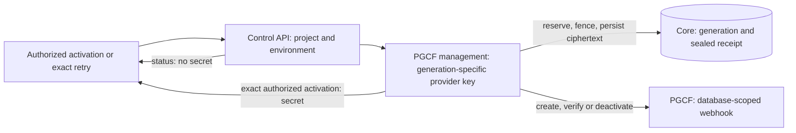

### Data events and table watches

Status: **implemented in source; release and live acceptance pending** (W34). These surfaces require at least PGCF contract 1.6.0 on the API and matching nodes; the current adapter targets 1.7.0 for the cold-resume compatibility described above.

A watch is the row trigger `pgcf.capture(columns)` on one table, attached by the environment's migration role. `pgcf-database-watches.ts` runs one transaction. It takes the migrations advisory lock (`hashtextextended('ohmyhost:migrations', 0)`) with `statement_timeout` 10 s, `lock_timeout` 5 s and `idle_in_transaction_session_timeout` 15 s, and answers `pending` when the lock is busy. The trigger name is deterministic: `pgcf_watch_` plus the first 8 hex digits of the SHA-256 of `schema.table`. That gives one watch per table and the same name in every environment, and migration admission does not admit names of that form, which keeps the watch count exact.

A table is eligible when it is an ordinary permanent table, not a partition, owned by the migration role, and every listed column exists. The outcomes are `watch_table_unavailable`, `watch_column_unavailable`, `watch_events_unavailable` (`pgcf.capture()` is not installed), `watch_conflict` (a migration-declared capture trigger, or a non-capture trigger under the reserved name), `watch_limit` (100 per database) and `pending`. Create is idempotent. A changed definition is replaced by DROP and CREATE in the same transaction. Deleting a missing watch answers absent. List reads only the reserved-name triggers, at most 100, and never SQL text. Tenant isolation is unchanged: the database comes from the product scope, never from the caller.

Migrations may declare the same trigger instead. `database-migration-capture.ts` in the contracts reads that one form, and the migration executor's `verifyCaptureTrigger` checks the live table, its owner, its columns and the absence of another capture trigger. The catalog comparison allows only that trigger, matched on the `pg_get_triggerdef` shape.

Event types: `isDatabaseWebhookEventPattern` accepts the platform types, `data.<topic>` with `^[a-z][a-z0-9_]{0,47}$`, and `data.*`. A bare `*` does not match data events. `dataEventTopic` mirrors the SQL rule of `pgcf.capture`, and a contract test pins the two. The provider accepts `data.<topic>` as an event type of a delivery.

In the checked PGCF source, `capture` inserts its outbox row in the same transaction as the application write. The node drain posts committed rows, retaining retryable failures; PGCF then matches the database and `data.*` or exact topic before creating a delivery. A local PostgreSQL 18 run of the checked-in capture SQL produced INSERT, changed-column UPDATE and DELETE rows, omitted a rolled-back INSERT and an update of only an unlisted column, and excluded the private column. The reported Production test with committed CRUD and empty deliveries still lacks historical node-drain and match evidence; a successful test-webhook request does not establish which part of that path failed.

Deliveries are PGCF's signed envelope, unchanged by OMH, with the event `id` `<database_id>:<epoch>:<seq>` and the fields `epoch` and `seq`. Delivery is at least once. Receivers order by (`epoch`, `seq`) and deduplicate by `id`, because arrival order is not guaranteed. The operator-facing failure behaviours are PGCF's: a full outbox (10,000 undelivered events per database) fails the application's write with SQLSTATE 53400; an event over 16 KiB (schema, table, operation, `record` and `old_record` together, so an update counts the listed columns twice) or over 32 nesting levels counted from the event fails it with SQLSTATE 54000; undelivered events keep the database awake, and a suspension or move can answer `power_outbox` until the receiver catches up; a restore starts with an empty outbox. A logical dump of a customer database needs `pg_dump --exclude-schema=pgcf`. OMH's own dumps (project export and recovery archives) do not pass that option yet, which is a release blocker for the data-events release.

Cost: counters only, `events_emitted` and `event_bytes` in the execution metrics. The awake time of the database is the charge, the same rule as [D446](decisions/data.md#d446). Not built: remote mutation (decision D-4), row filters, history or backfill, custom events, and a price.

## Build receipts

The `BuildReceiptPersistenceService` calls the private `CONTROL_RUNTIME` binding for the four BuildRunner calls: `claimBuildInput`, `authorizeBuildStart`, `putBuildReceipt` and `putBuildUsage`. A missing binding fails closed. Core migration `0322` supplies the build reservations, immutable receipts and immutable usage. Follow-up `0325` references receipts and reservations through `environment_identities` by the stable `(project_id, environment_id)`; their organization and operation remain the exact accepted historical scope, and usage keeps its receipt/organization/project/epoch references. The populated migration preserves every row and immutable trigger in one batch, and a retained old receipt needs no former owner's current environment row. Global claim/provider identities remain unchanged.

Claims use the database clock at the write, preserve the four-minute start window, and recheck current ownership in that same batch. A reclaimed or different-fingerprint claim cannot adopt a provider receipt. Start authorization also requires the unresolved build input reservation, the open `credit_reservation` of the build (`reserve:<operationId>`, taken when the deployment was accepted) and a live SQL-clock lease/window. A late measured result is attributed through the immutable receipt and accepted operation/epoch, rather than the current project owner. The recorded usage and the accepted-plan settlement share one guarded batch: the settlement charges the measured seconds at the quoted rate to the project, releases the rest of the reservation and deletes its row (`settle:<reservationId>`), and all of it rolls back with a failed usage or settlement write. The stored plan fixes pricing; the caller sends measured runtime facts, never a price. A build whose sandbox never started (no provisioning instant) releases its whole reservation in the same batch as its usage row (`release:<reservationId>`) instead of settling it, and an unpriced instance still refuses; an old observation without an open reservation or accepted plan is recorded without back-billing.

## Gateway and probe

The Gateway routing handlers and `RuntimeCreditService.beginProbe` call the Core through separate private entrypoints: hostname lookup (`GatewayLookupRuntime`), route management (`GatewayManagementRuntime`) and the fixed native probe (`RuntimeProbeRuntime`). Route decisions retain ownership/lifecycle/operation/claim, current-head, predecessor, cleanup and compensation rules; public receipts retain their exact array digest and database observation instant. No arbitrary SQL or provider credential crosses these ports, and a missing or mixed binding fails before any call. The provider removal path refuses an absent or expired exact cleanup lease before issuing DELETE, and reobserves absence before returning `removed` or `not_found`.

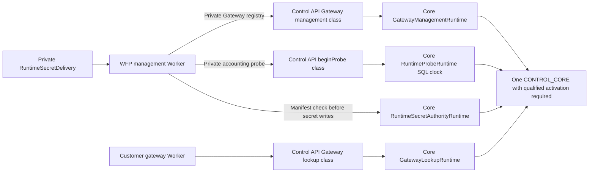

Migrations `0360`..`0364` keep probe, schedule/run, rollback, address and cleanup-authority identities and constraints. Lineage-only schedule cursor values stay optional compatibility metadata, with no fabricated value for new 9-field schedule writes. The populated migrations retain exact rows/cursors, reject invalid shapes and roll back both schema and data on a late failure. The closed temporal-import allowlist adds only `wfp_rollback_activation_receipts`; static/FK/append guards stay active and an ever-activated authority cannot import. Legacy nullable v7 rollback fields and every gateway digest byte remain unchanged. The effective publication view uses current-head rollback and exact address evidence rather than treating any raw candidate as serving.

The earlier merged cleanup prototype remains read-only compatibility history. Its complete request/claim authority is projected only when the original identities and shapes hold; partial or foreign records abort the migration. Opaque resources/outcomes never become invented immutable absence evidence. Provider actions remain outside Core batches. Full publication/completion must compose its schedule and serving effects atomically.

## Product database jobs

Core migration `0400` holds the access, write and PGCF compute tables. Access roles keep their physical identity and write-once provider operation IDs, revocation fields remain mutable, SQL writes keep their terminal rules and deletion guard, and compute jobs keep the unconstrained historical class/failure text and signed lifecycle int4. Additive `0401` independently restores the Crockford ULID domain on all eighteen ULID fields, including the nullable compute claim. Forward validation refuses existing invalid facts; INSERT and UPDATE guards do not rely on a matching Core parent to establish that domain. Both scalar character count and full byte length are checked, including embedded-NUL rejection. The Neon compute evidence of `0337` is separate. No provider password or connection URI is copied into these tables.

The closed `readProjectDatabaseAccessHistory` read keeps the exact organization/project and optional logical environment, newest-50 ordering, expiry/revocation precedence, millisecond product timestamps and PGCF WSS projection. Its Core RPC and API adapter expose no SQL. Issuance and revocation stay in the private management boundary. The access and write callers use `DatabaseProductRuntime`: Core combines current owner/lifecycle/data-change, physical target/latest registration/logical authorization, credit admission (the serving decision of the account), live-login limit, receipt, operation and audits in one guarded batch. A database the entitlement reconciler has suspended, or is suspending (its suspend action is still reserved, dispatched or pending), while its organization has no Paid coverage refuses a new credential or database write with `paid_plan_required` (402) before any row is written; it is not a retryable outage. A Paid organization's database is admitted as before. The provider helper keeps role membership with SET disabled, bounded expiry, native login proof, idempotent provider keys and confirmed role-drop evidence. A failed role deletion is re-issued and replaces the failed operation id in the access row, so every retry derives its key from the newest failed id; a failed deletion from a creation failure is stored with its revocation, so an access never stays active while it carries a delete id. Customer SQL remains in management with the execution deadline, result limits, single extended-protocol statement and immutable unknown-outcome receipt. Write deadline maintenance expires at most twenty receipts in ONE Core batch with their complete operation/audit effects and one captured business timestamp; a late error rolls the whole batch back and an exact pass replay observes its committed result. `maintainDatabaseProducts` composes that batch, then entitlement reconciliation and access maintenance; the scheduled management Cron runs the last two. Access maintenance leaves the roles of a database that is suspended or being suspended to the resume: a role drop there would raise the database generation and end its automatic restoration. The end-to-end regression is in the [PGCF access-expiry integration test](../../apps/neon-management/test/pgcf-access-expiry.integration.test.ts). Residual, not gated: a principal or data-change revocation of a suspended database still deletes its role, which ends the same automatic restoration, and so does a creation-failure revocation when the database was suspended between admission and role creation. Owner decision open: a principal revocation could instead record the revocation and leave the drop to the resume sweep, at the cost that the revoked role stays loginable from the resume until that sweep runs. Native Auth role creation is not gated: its target must be the Free size, and the entitlement does not suspend a database whose target and observed size are both Free. Private diagnostics use the read-only role, extended protocol, result/byte limits and the current physical registration. The public API admits only exact database compute/access/write/query routes and operation reads, with current WorkOS owner/member and tenant scope; no M2M/remote authority is broadened. [Product database commands](../../apps/control-store/src/catalog/database/product-access.ts), scoped evidence.

The Core-first rollout retains the private `databaseManagement.readPlacementPaidAccess` and `productDatabase.readExpiredWrites` methods for deployed database-management consumers. The new consumer maps a Core write rejection for `paid_plan_required` to the same product error. Removing the compatibility methods requires evidence that the old consumers have retired. [Core store methods](../../apps/control-store/src/store.ts) and [database write persistence](../../apps/neon-management/src/d1-product-database.ts).

## Workflow intent storage

Migration `0451` holds the product intent primary key `(organization,project,environment,operation)`, seven command shapes, static operation/epoch/environment/plan/grant/deployment/revision/artifact/cleanup parents, identifier/text/counter rules and append-only evidence. `data_change` is a plain TEXT enum, read directly by publisher, Gateway and database authority. The prototype hash uniqueness is removed; an optional target-only digest is kept when present and never invented for a source row. The binding-refresh JSON key/type/self-scope and exact numeric/trunc rules are native guards, including fractional values that SQLite could otherwise round at the safe-integer edge.

Source-legal populated rows copy byte for byte; malformed prototype or cross-scope facts reject the entire migration without rewriting history, and native FKs and guards stay on. Source-generation pinning and lifecycle effects belong to the accepted command producers; imported history and this schema do not infer or replay them. Scoped evidence.

## Compute operation arrays

The compute-change receipt's `provider_operation_ids` keeps `uuid[]` element semantics. Migration `0481` validates existing facts before adding independent insert/update guards: every non-NULL scalar is a canonical stored UUID and total cardinality stays at most 16, including nested arrays. Duplicates, NULL entries, array structure and microsecond timestamps remain unchanged. Invalid prior prototype facts refuse the migration; they are never normalized or discarded. Placement `0413` separately keeps the 128-element UUID array contract, dimensions and nondefault lower bounds. Scoped evidence.

Migration `0482` adds nullable technical `provider_operation_ids_bounds` metadata to the receipt; the source column set and typed proof framing remain unchanged. NULL metadata means the ordinary all-one lower bounds; an empty array has zero dimensions, and a SQL NULL array stays NULL. Captured nondefault bounds are stored explicitly, with the JSON nesting and every duplicate/NULL element, and freeze with the immutable non-NULL operation IDs. No lower bound is guessed from remaining rows or flattened values. Independent always-on guards require rectangular arrays, at most six dimensions, int32 lower bounds and the upper-bound overflow rule: an upper bound of INT_MAX is rejected because its one-past-end position must remain representable. Migration `0483` adds the common scalar/NULL leaf-depth check, because uniform per-level extents alone cannot establish equal rank across sibling subtrees: mixed-depth siblings, including NULL leaves, are refused, and empty root arrays keep zero-dimensional semantics. The closed parser consumes canonical `array_out` text and verifies exact reconstruction, including explicit nondefault dimension headers. A late abort restores the column, guards and data completely; earlier migrations stay immutable and no captured value is repaired.

## Workflow attempt evidence

The Core schema holds all 30 provider-observation fields, 19 reconciliation-attempt fields, 14 Workflow-replay-attempt fields and nine replay-failure fields. Migration `0453` keeps the 32-attempt budget, int4/domain/byte/NULL semantics, unique keys and immutable evidence. Reconciliation references the observation's complete 11-field identity; replay failure references its exact five-field attempt identity. Neither family acquires an enduring parent in an ephemeral claim or run.

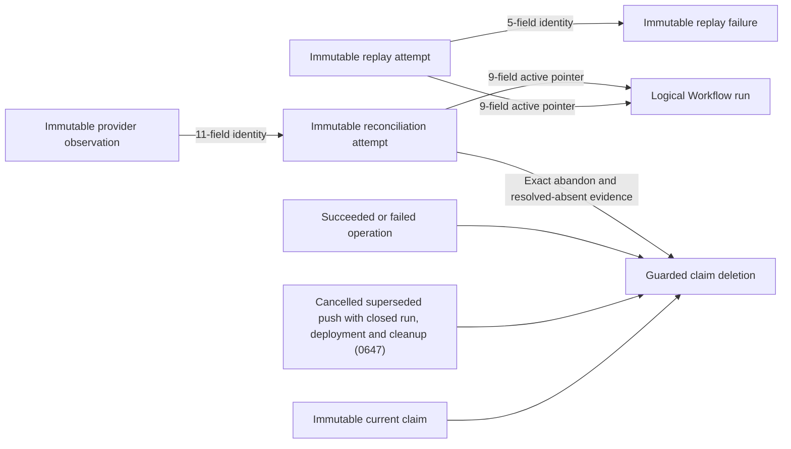

The run replacement keeps every existing field, including its technical archive locator, with foreign keys on. Its nullable active pointers bind all nine identity fields. Current claims remain immutable on UPDATE; DELETE requires the succeeded/failed operation, an exact matching abandon/resolved-absent attempt, or (Core migration `0634`) a `cancelled` operation that ended as a superseded GitHub push with complete candidate cleanup receipts, a completed run without an active reconciliation attempt, closed deployments, no unknown reconciliation attempt and no open placement or bucket reservation or Native database create. The original PostgreSQL schema still admits only the succeeded/failed operation or the abandon attempt. The physical claim child family is preserved. Independent source columns keep opaque Unicode/tag values and CHECK's NULL behavior; representable instants use finite canonical UTC microseconds with valid calendar fields, and unrepresentable source instants remain conversion failures, never omitted history or a new retention rule.

Current-claim INSERT validation belongs to the closed record-effect batch of the Workflow runtime. Historical evidence can outlive that claim without reenacting its former admission. Scoped evidence.

## PGCF entitlement persistence on Core

The bounded PGCF Production profile (`wrangler.pgcf.production.jsonc`) uses `pgcf-worker-main.ts`, preserving the deployed `NeonManagementService` name, default Worker, four private service bindings and maintenance cron. The full `worker-main.ts` extends the same implementation for separately qualified Native Auth capabilities, and the bounded bundle imports none of those modules or bindings. Development keeps its existing full entrypoint and already deployed Native bindings. Full Native Auth release trains select `wrangler.production.jsonc`; the bounded sibling remains an explicit manual PGCF-only release profile. Both actual bundles belong to the production-boundary build inventory. This source split does not change Core policy, customer database routing or SQL execution authority. Release qualification.

The PGCF policy and action families have a closed Core port. Five fixed functions read targets, claim an action, authorize dispatch, record its provider observation and record a failed check of an active target, which moves its check time forward (never backwards, not in a fenced organization) so one failing target cannot starve the others (CORE-58). The management reconciler uses this narrow persistence port. Provider I/O stays in management; Core accepts no SQL, transaction callback or provider success substitute.

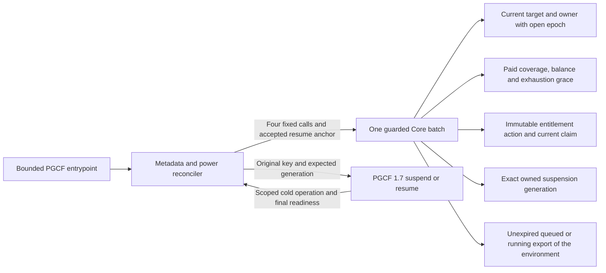

Paid expiry only suspends compute. It never deletes a database, shrinks a volume or changes a size class. Free admission requires both the saved Free class and physically observed 256 MiB memory/500 MiB storage. Paid access uses effective coverage and the zero-balance exhaustion grace, without a monthly grant or project-budget decision. A resume owns precisely the recorded manual suspension at its confirmed generation; a separate operator stop is preserved. While a database is held by its entitlement suspension, a compute resize of the project is refused with `compute_change_pending`, and a claimed resize of that database is not dispatched (it fails with `DATABASE_COMPUTE_PLAN_CHANGED`), because PGCF would move the generation past the one the resume matches (CORE-36). Uncertain provider outcomes retain the original action, key and expected generation until observation resolves them.

For a cold rehydrate resume, Core's immutable `provider_generation` stores the accepted action anchor, `min(observed operation generation, expected generation + 1)`. Activation may advance the provider operation itself to N+2 without rewriting that accepted anchor. Completion still checks the actual operation/database generation, observed readiness, power intent and local residency. A coalesced archive parent retains N and can finish through its N+1 local wake or N+2 restored child; a later operator pause is classified as superseding the action and is never undone. Suspension ownership continues to use its exact confirmed generation. The existing observation projection sends only the original entitlement fields to Core, keeping cold-storage metadata outside policy authority.

Every mutation fences the current active PGCF target, owner/lifecycle, open billing epoch, policy/action snapshot, current claim and organization bucket. Its credit snapshot reads the account of the organization (Paid coverage and exhaustion grace) in the same batch and the entitlement writes no amount. Dispatch rechecks current entitlement, physical Free capacity and pending compute state. Terminal actions and provider receipt identities stay immutable. Evidence and prerequisites.

The compute caller reaches the Core through a narrow persistence port: acceptance checks the current target, Paid coverage, the account's credit and exhaustion grace, pending compute/entitlement exclusions and idempotency; claims fence lifecycle/epoch/target and expire in sixty seconds. `database.resize` has its own live native claim authority. A replacement claim observes the provider request key/body without rewriting its stored identity. Provider observation, confirmed target/head revision, operation and job completion commit in one Core batch. Unknown outcomes stay running and cannot invent a confirmed size. Neon compute evidence remains read-only history; active dispatch never opens a Neon provider.

## R2 storage facts

Migration `0492` adds the R2 reservation/upload/object/delete facts required by bucket management and storage-jurisdiction reads. The canonical `0337` bucket receipt table is unchanged and private producer commands must preserve one-shot bucket creation. Daily R2 usage is not collected into the Core: the R2 Management Worker returns it to the credit service ([usage billing](billing-and-pricing.md#usage-billing)). Bounded foundation proof.

## Core resources

The operator prepares the two fixed environment names `ohmyho-control-core-development` and `ohmyho-control-core-production` in EU jurisdiction, because Control metadata lives in the EU; retained UUID-suffixed resource names have the same EU contract (region EEUR, read replication disabled). Both paths keep exact account/database UUID verification, the private checked-in Core profile, immutable source/configuration proofs and an independent provider/API binding challenge. This finite existing-resource path creates no arbitrary resource-name or region override. The remote D1 binding mechanism supplies the migration batches; there is no SQL HTTP Worker and no alternate restore bypass.

A Core without its immutable activation receipt refuses every RPC with `core_configuration`. Measured through a service binding against a disposable activated copy of the same bundle and schema, from a consumer in Europe: a typed read costs p50 30 to 49 ms and p95 43 to 65 ms, an idempotent replay p50 29 to 43 ms and p95 36 to 53 ms, a first write 74 to 114 ms (three runs of 30 calls), and the Worker RPC hop itself 8 ms. A US-jurisdiction Core measured p50 175 ms for the same read, which is why the Controls live in the EU. Runbook.

## Storage Gateway and retired-data purger

The default Storage Gateway reaches the Core through its complete twelve-method private persistence port (`StorageGatewayRuntime`); the separate `StorageDataRuntime` entrypoint carries three fixed retired-data methods. Provider credentials, signed S3 requests, payload observation and erasure-marker verification stay in the Gateway.

Every current-user read and mutation includes the frozen organization/project/logical-environment/data-environment assertion in the same batch as its SELECTs or effects. An assignment change or queued data transition refuses the old deployment. Retired cleanup uses its running reset/share operation, exact accepted claim, active owner/lifecycle/version and retired assignment history; it does not borrow the current-user file authority. Source and delegation fences share each privileged effect's batch.

Erasure barriers require `0497` in addition to `0492`. Their twelve fields remain independent of delete receipts. The closed completion validates the deterministic SHA256 marker, exact upload/request/bucket identity and both accepted timestamps, then writes barrier and receipt atomically; the raw importer must validate the same captured marker and cannot fabricate a proof. Whole bulk claims and erasure vectors use bounded 128-row JSON parameters within ONE D1 batch, preserving the 4000-item maximum without partial commits or per-row RPC.

The hourly upload-claim sweep reads at most 50 unconfirmed claims a day old of the whole partition. It lists the claims it has never tried first and then the least recently tried ones. After the pass it stamps, with the pass time, each claim it tried and did not erase (a claim deferred for the late-PUT drain, or one whose erasure failed) in `project_r2_upload_sweep_attempts`. The stamp never decides erasure, and the erasure of a claim deletes its stamp in the same batch. A failing stamp write is logged as `storage_upload_sweep_stamp_failed` and keeps the pass summary ([D574](decisions/files-functions-recovery.md#d574)). Migration `0730` applies to Core before the Control Worker, whose unconfirmed-claims read joins the table, and the Control Worker applies before the storage-gateway Worker, which needs the new persistence method.

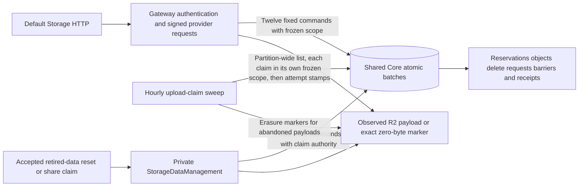

Owning progress and finite evidence.

## Product API persistence

The public ProductSurface shares its orchestration through twenty fixed persistence operations. Source inspection, framework refusal, cost and impact text, confirmation tokens and public response rendering stay in the API. Core producers materialize fixed plain records before named RPC calls; no callback or SQL crosses the private capability.

The Core product catalog implements project/source/status/deployment reads, exact cursor order, planning-source and deployment-plan reads, promotion/rollback targets, deletion/rename admission, immutable plan and action-confirmation writes, auto-deploy configuration with its complete operation/audit/idempotency effect, and preflight replay. Status projections read source selection, active gateway evidence, head deployment, latest operation/reconciliation and cleanup in one native snapshot. Rollback snapshots and their exported accepting-batch guards include the current data assignment/provider registration and precise maintenance cleanup hash. Read-only command scope does not require an open epoch.

Migration `0501` keeps the global action-confirmation identity by a unique index on `confirmation_id` under the existing unserved guard; it refuses collisions and rewrites no historical row. The Core reuses the `@ohmyhost/project-handles` package for address validation.

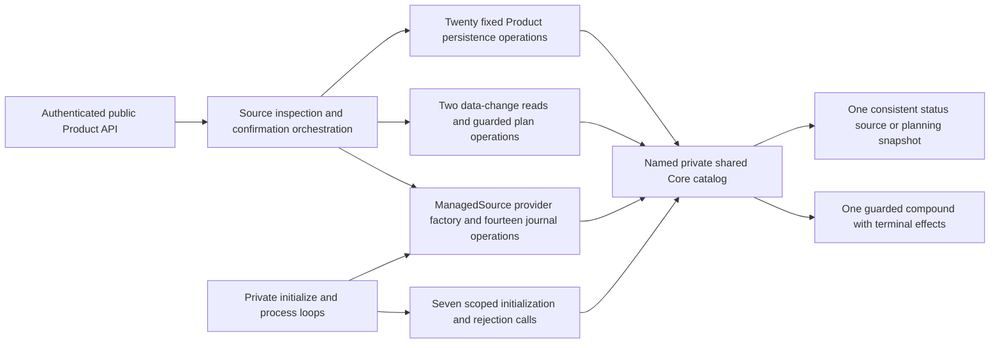

The data-change adapter reuses the transition/ETag/response helpers and creates its confirmation under the complete data snapshot guards. Protected-link encryption stays in the API; a server-local renewal plan recomputes owner/membership/mode/epoch/generation and emits the sealed replacement plus epoch bump for the END of the same created acceptance batch. Public/absent links keep their distinct outcomes. The ManagedSource provider composition reuses the factory with a closed fourteen-method journal port; its constructor performs no reads. The fourteen server transactions and seven private initialization/rejection methods are the fixed calls of the private initialize/process loops, which also use the MCP attach/find port and keep the distinction between creation consent and project edit permission.

The `0456` source-selection, `0495` GitHub configuration and `0500` managed-source-blob prerequisites are owned by the Workflow/Delivery schema. Product acceptance is a separate server command (see [Product API acceptance](#product-api-acceptance-on-core)); the base `acceptApiOperation` alone is insufficient for it. Exact checkpoint.

## Provider reconciliation context

The fixed five-identity provider reader keeps the reconciliation-required claim/run/intent/deployment and active current owner/lifecycle checks. It returns the WFP target, retained rollback target, known/runtime-secret receipts, abandoned candidate evidence and source/build resource states from one native D1 snapshot. It adds no open-epoch condition. Count planning never truncates the returned history. A server-local plan supplies guards rebuilt on the consuming routed database: row counts, multiplicities and every returned scalar/blob are rechecked in the same effect batch. No SQL, callback or prepared statement crosses Worker RPC.

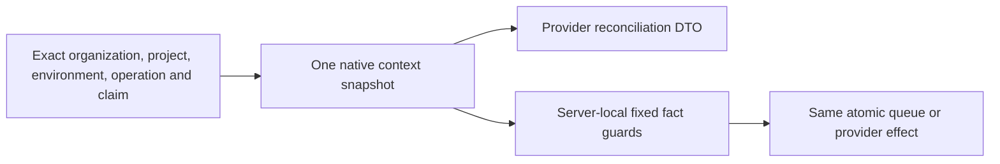

The fixed provider commands keep candidate/replay reads, the complete preflight observation and attempt, optional abandonment history and exact physical terminal recovery. The context fact guards, attempt budget, unresolved-attempt exclusion, native preflight observations and optional terminal effects share the consuming batch. Generated JSONB, digest bytes and time identities stay intact.

The Product acceptance/replay server helper returns an operation only after its projection agrees with contiguous immutable event history, preserving the rehydration and diagnostic catalog. The row and history share one primary read batch; missing history yields no operation, and a replay never invents queued state. Reader.

Migration `0506` reconstructs the Dev-link/rotation graph with its global project key, global token uniqueness and complete environment parent. Captured ciphertext/AAD scope and every rotation organization attribution, key, generation and time copy unchanged. Rotation parentage uses the global project key, so a newly sealed link can rehome to the current owner in the same accepted data-change batch without relabelling old rotation history. Duplicate prototypes refuse the atomic schema batch; the `0502` global-index and static-parent trigger names/predicates remain present.

Queue recovery consumes the Workflow's `0456` project-source selection and `0496` candidate-operation cleanup prerequisites, which keep their independent history and static fields rather than aliasing current binding or inventory metadata. Dependency provenance.

Migration `0505` restores `provider_resources` as nine physical fields keyed by organization, operation and capability, with the operation scope FK, mutable state and exact identity constraints. It is independent of `run_resource_inventory` and provider-specific receipts. Both infinity tags and finite UTC6 values keep their ordering for `observed_at >= created_at`. It seeds no resource or absence and refuses an already activated Core. Prerequisite.

## Queue delivery recovery on Core

Eight fixed transactions serve the ProjectProvisioning, SourceLink and Deployment queue recovery commands. Preparation records the exact principal audit before the caller touches the deterministic Workflow. Finalization rechecks the operation/outbox/owner/claim state and closes only the exact final delivery, with its final audit in one Core batch. For ProjectProvisioning this recovers the exact exhausted, uncertain Queue send; an uncertain terminal Workflow with a still-queued operation remains unresolved. SourceLink additionally keeps all five attempt records and their history digest, queued terminal failure effects, and older append-only Workflow replay evidence; it never substitutes the current replay pointer for a historical attempt. Acknowledged or never-parked SourceLink history answers not applicable; a parked signal that is not the exact final delivery is refused, as ProjectProvisioning refuses it.

The pure input, payload, timestamp, replay-routing and outcome decisions are shared with the app adapters. Global project/ownership views are represented by Core scopes whose `owner_state` is not `transferred`; retained former scopes remain intact and never multiply the current view. Each server-local fixed read records complete rows and cardinality; those observations are rechecked in the consuming batch, including replay and read-only results. No SQL, callback or guard plan crosses RPC. The Deployment provider-continuation branch requires the positive five-ID reconciliation context and its fixed fact guards in the SAME outbox/audit batch. An earlier DTO response never becomes lasting permission. Local clock/identity factories remain an app-adapter responsibility and cross Core only as plain values.

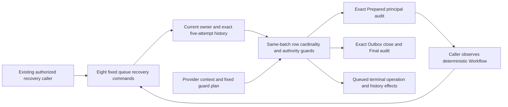

The supporting `0456`/`0496` prerequisites stay owned by the Workflow; `0505` restores the distinct provider-resource fact table. Owned queue evidence.

## Workflow replay and lost command recovery

Nine fixed server commands serve the replay candidate, queue handoff, preparation, attempt read, terminal recovery, lost-rename find/abandon and run-less find/accept transactions. The queue handoff and the run-less acceptance cover every Workflow run type, each with its own lifecycle and cleanup preconditions ([D514](decisions/runtime-and-lifecycle.md#d514)). They reuse the Queue observation/guard mechanism and the exact current-owner views. Replay preparation writes its immutable attempt, active run pointer, optional cleanup restart and user audit in one batch. Terminal recovery preserves the actor-bound failure and releases exactly that active pointer. The historical attempt result keeps its completed/prepared decision rather than inventing another attempt.

A lost rename keeps the operation aggregate rehydration, two platform transitions, their event/audit ordering and running/terminal lease effects. The Worker supplies four plain event identities; no ID or clock factory crosses RPC. Operation history, run completion, outbox close and final abandonment audit commit together. Every observation uses fixed read-only SQL and every resulting mutation is guarded in that same batch. No ordinary context or metadata substitutes for the original authority.

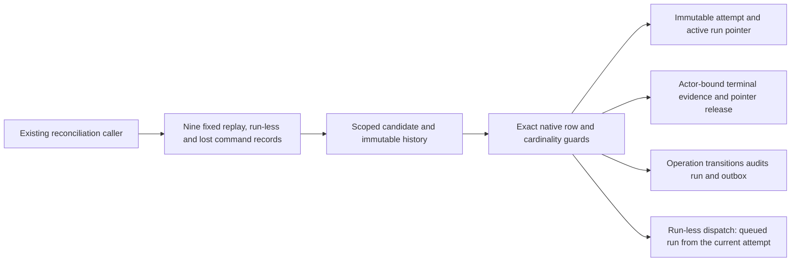

Source status.

## Product API acceptance on Core

The fixed `ProductApiRuntime` acceptance command composes idempotency/confirmation/delegation, operation/audit/outbox, seven intents and their deployment/cleanup effects in one batch. The credit reservation of a build (`reserve:<operationId>`, guarded by the available credit and a `stop` budget), deletion/data-change snapshot guards, access/lifecycle/continuation and protected Dev-link compound share that batch. Replays retain exact intent and immutable operation history; SourceLink's managed-binding check still precedes replay. Acceptance evidence.

Rollback and promotion intents retain the source generation of their exact usable persisted action confirmation, including zero for an unbound project. The acceptance transaction consumes that confirmation under its current-generation guard and stores the same pin; provider execution rechecks it. Missing pins in historical immutable intents do not gain authority from a later current binding. [Acceptance reader](../../apps/control-store/src/catalog/product-api/accept-product.ts), [intent effects](../../apps/control-store/src/catalog/product-api/accept-product-effects.ts), [execution fence](../../apps/control-store/src/catalog/identity/operation-delegations.ts).

The operation-polling read is `ProductApiRuntime`'s fixed `readApiProductOperation` capability. One native snapshot supplies the stored projection and full contiguous event history, deployment identity in EVERY state, and the blocking/reconciliation/build-or-publishing observation only while queued/running. The accepted-operation helper validates history but never substitutes its intentionally narrow response. API-side typed parsing rehydrates the full Operation and retains result, failure diagnostic and all events before adding scoped observations. It introduces no owner/lifecycle/open-epoch permission; historical transferred scope rows are excluded only where the global current ownership row was required.

## Native Auth database candidate

W37 adds an independent project PGCF Auth target, created at `r256-s500m` in the project's region with the original durable provider-operation key. It is independent of business-data assignments and supports an Auth-only project. Dev and Prod use distinct logical schemas, runtime and migrator roles and registry identities; a project backup role is private. Management verifies actual effective PostgreSQL privileges and pinned Native migrations before registering a credential. Core stores target, role-operation, preparation and registration metadata; encrypted runtime credentials remain in the regional Native registry. Ordinary application SQL, migration and temporary access credentials do not reach that database. [Placement](../../apps/neon-management/src/native-auth-placement.ts), [role and privilege proof](../../apps/neon-management/src/native-auth-roles.ts), [migration cohort](../../apps/neon-management/src/native-auth-migration.ts), [private registry](../../apps/native-auth-runtime/src/registry.ts).

The SQL purity proof treats `rolvaliduntil IS NULL` and positive `'infinity'::timestamptz` as the two unbounded-password representations. It rejects every finite deadline and negative infinity while preserving all other role predicates. The provider metadata check separately requires `validUntil === null`. First provisioning and restore reuse these same three SQL checks; temporary customer SQL credentials retain their exact finite-deadline policy. This corrects a live Development mismatch between PGCF's null metadata and PostgreSQL's positive-infinity catalog value, without altering existing roles or passwords. Bounded observation, [Native boundary](auth-and-secrets.md#omh-native-auth-source-candidate).

A lost create response retains its exact original identity for observation and project billing attribution, even after a prerequisite is withdrawn; this reconciliation cannot authorize further provisioning or readiness without current admission. Deletion uses the frozen independent target, per-realm pool quiescence and SQL policy fences, provider absence and registry purge proofs before closing its billing period. [Resource authority](../../apps/control-store/src/catalog/identity/native-auth-resource-operations.ts), [deletion](../../apps/neon-management/src/native-auth-deletion.ts), [frozen cleanup authority](../../apps/control-store/src/catalog/provisioning/native-auth-deletion.ts), [billing](billing-and-pricing.md). Restore and archive handling belong to [mail and recovery](mail-and-recovery.md#native-auth-mail-and-recovery-candidate); [Auth policy](auth-and-secrets.md#customer-application-auth) owns runtime authorization. This is an in-progress source candidate with bounded local PostgreSQL/D1 evidence, not hosted qualification, final Astra approval or a release.

Native-bearing export settlement additionally retains `native_export_effects` outside the job's terminal status. Its immutable protected locator/bytes/digest/manifest/expiry identity is inserted before the one-time upload permit; uncertain effects cannot be cleared for recapture. Exact retirement receipts gate frozen cleanup and terminal project deletion, while the existing maintenance service owns bounded Core-clock expiry cleanup independently of the original actor's later rights. Restore derives the protected export locator from its authenticated job. This source candidate changes neither business-data assignments nor V1 export settlement. [Protected Native export flow](mail-and-recovery.md#protected-native-export-settlement-candidate), [native constraints](../../apps/control-store/migrations/core/0620_native_export_effects.sql).

Growth uses a separate measurement D1, not the Core or a customer application database; its retention and replay suppression are described in [Growth](growth.md). The EU resource is pending deployment verification.

## Product Live Preview source candidate

Migration `0758_project_previews.sql` adds new per-project-environment identities and source/usage records; migrations 0622–0630 remain immutable historical tables. The current preview record pins billing epoch, ownership/lifecycle, logical environment, physical assignment, source and runtime/token/Auth generations. The API stores only encrypted capability envelopes plus lookup hashes. Preview commands use guarded Core batches; pending source delivery and scope/backup cleanup remain durable across RPC failures.

Regional `ProjectDatabasePreview` receives an exact preview fence from the trusted Worker and resolves the current registry receipt through the read-only `PreviewDatabaseAuthorityRuntime`. The logical environment must be authorized by the exact current physical registration; shared data can authorize both logical environments without permitting a different physical assignment. Query, transaction and bounded/RLS connection paths enforce current authority before dispatch and owned commits and recheck results. A lost post-commit reply is SQLSTATE `08007` or the corresponding typed RLS unknown outcome, never an automatic write replay. The ordinary customer database entrypoint retains its existing ABI. [D608](decisions/runtime-and-lifecycle.md#d608), [regional authorization](../../apps/project-database-runtime/src/preview-database.ts), [Worker entrypoints](../../apps/project-database-runtime/src/worker-service.ts). No hosted release is inferred.
