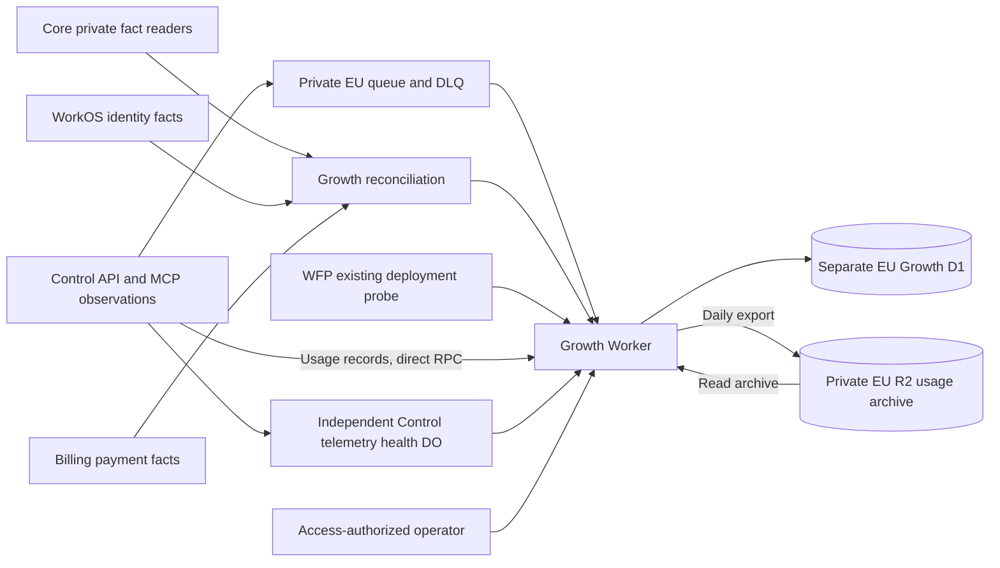

# Private Growth and MCP/API call records

W49 was first released at runtime source `68eae0a97ea3c025f8cb29f6420bb44624d33cb6`. The current W50 Core/Growth/Control runtime is `da088fff053439af3621c37c8aa127f215664569` in Development and Production; its release receipt records actual call capture and natural archive acceptance. The private measurement plane is separate from customer application storage and the public REST, CLI and MCP contracts. The release receipt records exact-source gates, provider versions and scoped hosted acceptance. Human operator acceptance and the first mature learning cycle remain separate from the deployed capability.

Each environment has a separate EU Growth D1 and EU queue with DLQ; provider jurisdiction and the deployed bindings were read back. EU storage and queue jurisdiction do not establish an EU-only processing boundary for Workers or the original identity/payment providers. The Worker receives validated events and reconciles narrow private Core, WorkOS and Billing facts. Reconciliation records source attempt, success, completed scan, error class, quality flags, watermark and history floor; migration 0003 owns source status. Event occurrence time is distinct from scan completion. Missing history, actors and source coverage remain unknown, not zero or churn. Current attribution is an observed per-account snapshot, not proof of first acquisition. Dynamic UTM parameters are retained; `null` means unavailable and `{}` is an observed empty set.

Authenticated MCP/REST usage records skip the queue: Control calls the Growth service binding, which writes the record idempotently by `record_id` to D1 and returns `accepted` only after that write (D606). Events, deployment health and source health still use the queue and DLQ. The reason is quota: each call emits a start and a finish record, and a queued record costs about three Queue operations against the free daily limit of the account.

The WFP path forwards observations from its existing deployment health probe, scoped to its candidate, organization, project, environment and deployment. A lost observation leaves health unknown; Growth does not probe customer applications anew. Control's independent SQL Durable Object counts offered and unconfirmed telemetry and pushes a summary to Growth, avoiding a circular read dependency. Queue or producer failure and stale or missing source status should be investigated before interpreting changes in funnel numbers.

Growth stores validated bounded events without email, prompts, raw URLs or IP addresses. Only actual external browser login entry paths can record an approximate request country from Cloudflare request metadata; REST, MCP and server-origin paths do not infer a user country. Missing or invalid country is unknown, and request headers are not used as its source. The retention job removes raw events after 30 days and facts, milestones and activity after 180 days. A deletion suppresses replay with a domain-separated SHA-256 subject digest and deletion timestamp, retained while source history can reintroduce that subject; the tombstone contains no raw account identifier. The scheduled projection retains coarse daily global account cohorts for the current and preceding 12 calendar months. It writes only fully mature 1-day and 7-day windows with at least five accounts and suppresses output when the account read exceeds 10,000; each row remains marked incomplete because historical coverage is unknown. The operator dashboard displays these retained daily cohorts for the all segment; its current account-window figures are calculated from the 180-day account projection. The threshold alone does not establish that a rollup is non-identifying. Campaign expiry retains a minimal stable campaign key and first-observed/expiry times to prevent a rescan extending the original expiry while source history can replay it. Historical coverage is bounded by source availability and retention.

The operator hosts are deployed at `growth.example.test` (Production) and `growth-dev.example.test` (Development), behind Cloudflare Access. The Worker verifies RS256 assertions against the exact configured team issuer and application audience and maps the verified subject to configured permissions. Aggregate reading, identity reading, experiment management and segment management are separate permissions. Identity and attribution are revealed only by explicit authorized requests and audited by their private providers; customer ownership alone grants no operator privilege. Pages use no-store responses. The deployed access policies were preserved and unauthenticated/forged-assertion requests were blocked at Access. Positive human Access login, the operator UI and a real identity-reveal audit remain unverified pending the owner’s operator-account decision; exact-source tests cover the permission and audit contracts. No account or scope was switched to bypass that limitation.

Operators should first check environment and source health, watermarks, unknowns and cohort maturity. An authorized operator can manually tag an account or organization as `test`, `non_test` or `unknown`; untagged entities are unknown, and `all` includes test and unknown. Account cohorts use account tags; return and payment views use organization tags. Each change records the operator, entity type, subject digest, segment and time in an audit row. Identity-reveal and segment audit records expire after 180 days. Deleted accounts cannot be retagged. Account and timeline lists are pseudonymous until an authorized explicit reveal. Timelines show the recorded transport separately from client identification: a proven remote MCP call remains visible when the client brand is unknown. A missing stage is an absence of observed evidence, not evidence of intent. Return cohorts use completed UTC observation days and a 180-day history limit; money reflects confirmed provider facts in minor units by currency, including refunds and disputes, not lifetime value. Experiments register a hypothesis, evidence basis, segment, metric, guardrails, horizon and exposure mode. Read results as observed outcomes, with their coverage and maturity; a before/after comparison does not establish a causal winner.

Sources: [event store](../../apps/growth-analytics/src/event-store.ts), [reconciler](../../apps/growth-analytics/src/fact-reconciler.ts), [retention](../../apps/growth-analytics/src/retention.ts), [account projections](../../apps/growth-analytics/src/account-projection.ts), [segments](../../apps/growth-analytics/src/segments.ts), [operator data](../../apps/growth-analytics/src/operator-data.ts), [operator authorization](../../apps/growth-analytics/src/operator-auth.ts), [operator routes](../../apps/growth-analytics/src/operator-routes.ts), [health observations](../../apps/growth-analytics/src/deployment-health.ts), [source status migration](../../apps/growth-analytics/migrations/0003_source_status.sql), [Control health](../../apps/control-api/src/growth-health.ts), [WFP health](../../apps/wfp-management/src/growth-health.ts). [Decision D606](decisions/data.md#d606); W49.

## Release qualification

Both environments have successful post-release reads from all ten sources. At the recorded Production snapshot, nine sources had completed a full scan after the rollout; deployment history had a successful page and a continuation cursor. This is a partial backfill, and source watermarks/history floors remain unknown. One EU and one US Core project/deployment pair in each environment matched the Growth facts in a bounded comparison; these four samples do not establish region-wide or complete historical coverage.

Consented website CTA and real prompt-copy events were observed with HTTP 204 and without raw campaign values or prompt content. Denied consent produced no Google requests. GA4 treats the fixed `cta_click` as an immediate intent key event without a default monetary value; it is not a completed signup or payment. Independent copied-prompt/native continuity remains unknown. Before drawing business conclusions, review source quality and manually tag known test accounts; the all segment includes unknown and test entities. The first mature baseline and measured improvement remain open in the Superpowers plan.

## MCP and API call log (W50 source)

W50 is released and qualified in Development and Production. It is a separate usage-call log, not a change to the released Growth retention above. Authenticated remote MCP tool and REST calls produce immutable start and finish rows sharing a call ID; MCP children carry a parent ID. Rows contain a canonical operation name, verified actor, organization and project references where available, duration, status, safe error code, and typed operation ID/status where available. Arguments, results, URLs, emails and tokens are excluded. These pseudonymous references remain reidentifiable and are protected by the existing Access/IAP operator role scope. A missing finish means completion was not observed; a 202 means accepted, not that a job succeeded. `operation_get` job status is separate. Local stdio is visible only through server API calls; SDK schema rejection before a callback is a known gap, so this is not a record of all client activity.

The Growth D1 is the rolling buffer. The first nonempty export starts immediately; subsequent rotation starts 24 hours after successful completion. The existing five-minute cron drains bounded pages and retries. Private EU R2 per environment holds subject-prefixed, received-day/hash NDJSON shards, with only a minimal D1 file index and deduplication receipts. Delete exact raw rows only after successful object put. Scheduled indexed deletion expires archive objects 90 days after upload, with provider lifecycle as a backstop; application deletion is bounded while provider deletion can be eventual. Account deletion records a tombstone, clears D1 usage and index, prevents reingest and export, and cleans the archive prefix after a one-hour grace (maximum scheduled wall time 15 minutes), retrying until empty. The target is within the existing 24-hour deletion contract, subject to provider availability. See W50 specification.

The private `/growth/calls` view reads a selected UTC receipt day from the buffer and archive index. Bounded keyset pages cover every buffered record and archive shard; ordering and start/finish folding apply to each page, not a complete global timeline. A missing/oversized archive is reported as a partial read and is retryable. A separate archive-health status shows pending observations and upload/cleanup failures. Minimal replay receipts expire after 90 days when their raw record is no longer buffered.

W50 acceptance used actual managed MCP identity/setup calls and an intentionally nonexistent-project read in both environments. Root matched the real archived NDJSON to D1 records and checked parent linkage, safe failure classification and absence of payload fields. The first natural exports completed at 09:05:44 UTC (Development) and 09:15:28 UTC (Production) on 16 November; the next rotations were recorded 24 hours later. This is not a claim that ninety real days elapsed or that a positive human Ops login was tested.
