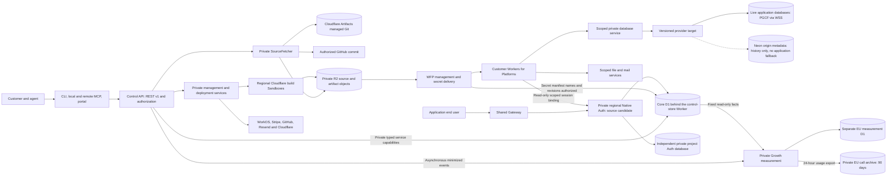

# Current platform architecture

The platform is a strict TypeScript pnpm modular monolith with separate deployables at concrete runtime and trust boundaries. The public contract is REST `/v1`; the SDK is generated from OpenAPI, and product CLI, MCP and the portal use that contract. Public product changes are coordinated with schema and exact-record client parsers. [Decisions](decisions/index.md) preserve accepted policy and historical reasons without presenting old infrastructure as current.

## System boundaries

The Control API holds authoritative project, authorization, operation and credit state in one Core D1 database per platform environment. For managed source, the Artifacts branch owns current code and history; Control records its tenant binding, generation, grants and immutable publication evidence. Customer application records live in project databases; customer file objects live in scoped R2 buckets. Current checked-in Dev and Prod Worker profiles share a Cloudflare account with distinct names, bindings and Core D1 databases; the chapter on services records what is actually declared rather than claiming separate accounts. US is the customer default, with an ordinary immutable EU choice and a separately authorized, inventory-pinned US cutover. Existing Git/R2 artifact locations remain independent of that project metadata transition. Shared data versus isolated Dev/Prod data is a separate project decision.

The optional [Native Auth source candidate](auth-and-secrets.md#omh-native-auth-source-candidate) adds private regional runtime entrypoints and an independent Auth database while retaining customer-owned authentication providers. It is the active Auth-only W37 lane; fresh exact-source Dev/Prod qualification and GA gates remain separate.

Managed Git, bounded local snapshot publication and remote product MCP are implemented under [D426](decisions/clients-and-public-content.md#d426). The 6 October Artifacts receipt establishes disposable Dev US/EU Git behavior. Newer retained release/client/native observations establish selected Production Worker/discovery scope, public client 0.1.29 and eight native ChatGPT Production cases; they do not certify fresh database ACL/migration completeness or full cross-client/refresh/revocation/secret/desktop acceptance. Those exact remaining scopes are A01–A06, A36–A39 and A41. The D453 source candidate replaces separate remote project consent with current account rights, explicit token caps and immutable execution proofs; native and release acceptance remain separate. [Client/authorization boundaries](api-and-mcp.md#remote-product-mcp), [source/build custody](build-and-deploy.md#managed-source-publication).

A private Credit Service bills usage into the Core credit account: hourly it turns finished Worker, PGCF, R2, script and hostname usage into one charge per organization and window, and after 00:00 UTC it rotates the day's credit log to R2 for 14 days. Mail and builds charge synchronously in the Core. [D445](decisions/billing-and-usage.md#d445), [billing](billing-and-pricing.md#usage-billing) and [service boundaries](services-and-workers.md#credit-service) describe the components.

## Chapters

| Chapter                                         | Responsibility                                                                                    |
| ----------------------------------------------- | ------------------------------------------------------------------------------------------------- |
| [Growth measurement](growth.md)                 | Private measurement plane, operator use and bounded retention                                     |
| [Services and Workers](services-and-workers.md) | Deployables, profiles, private calls, Worker resources and schedules                              |
| [API and MCP](api-and-mcp.md)                   | Public contract, SDK/CLI/MCP, portal and publication ownership                                    |
| [Build and deploy](build-and-deploy.md)         | GitHub and managed Git custody, Sandbox builds, R2 artifacts, admission, publication and rollback |
| [Database](database.md)                         | Physical data identities, SQL roles, schema, scoped runtime and migrations                        |
| [Storage and domains](storage-and-domains.md)   | R2 custody, file capabilities, gateway routing, DNS and customer consent                          |
| [Auth and secrets](auth-and-secrets.md)         | Customer identity, app auth, encrypted secret values and runtime delivery                         |
| [Mail and recovery](mail-and-recovery.md)       | Resend mail and request-only password-encrypted SQL exports                                       |
| [Billing and pricing](billing-and-pricing.md)   | Credit account, usage billing, Stripe, budgets and the [price contract](pricing-contract.md)      |
| [Security](security/index.md)                   | Trust boundaries, data classification, provider credentials and operator access                   |

## Sources and evidence

[Control composition](https://github.com/amerged-org/ohmyhost/blob/main/apps/control-api/src/worker-main.ts#L46), [private database runtime](https://github.com/amerged-org/ohmyhost/blob/main/apps/project-database-runtime/src/worker-service.ts#L73), [secret delivery](https://github.com/amerged-org/ohmyhost/blob/main/apps/runtime-secret-delivery/src/worker-main.ts#L109), and actual Wrangler declarations are current source facts. Release claims cite the plan evidence. CI and the source review ledger establish source verification, not a live provider inventory.

## Explicit future work

The twelve original application databases completed their PGCF US1 cutover on 27 October 2026; their data/recovery comparison and application-only observation are recorded in the execution status. Both platform Controls run on the D1 Core; Neon survives only as immutable history in Core rows (rate cards, valuations, placement and role receipts, consumption observations). See [the provider and Control boundary](database.md#pgcf-implementation-and-cutover). Proposed providers, unused adapters and retained AWS implementations are not active services merely because their source or historical receipts exist. Open capability-specific acceptance and provider-setting work stays in the plan.
