# Mail and customer SQL recovery

This chapter describes checked-in implementation and configuration. The gateway identity and attachment sections include the 24 October 2026 C3 source candidate under the gateway completion specification; their source state does not establish a C3 release, hosted attachment acceptance or C4 completion. Provider activation, quotas, deployed versions and historical acceptance remain separate evidence in [PLAN](../../PLAN.md) and the completion progress. See [billing](billing-and-pricing.md) for the common credit account, and [authentication and secrets](auth-and-secrets.md) for general secret custody.

## Mail services and authorization

Resend is the current managed mail provider. The retained `ses-management` package and deployed Worker names are historical identifiers: all current entrypoints execute `resend-worker.ts`, contain no AWS credential binding, and call Resend plus the private Cloudflare DNS service. The management Worker owns domain creation, verification, sending keys, receiving webhook setup and retirement; the Mail Gateway owns sends, temporary inbound access, customer delivery and platform credit warnings. Both reach the Core only through typed private capabilities and hold no SQL pool. ([Management composition](https://github.com/amerged-org/ohmyhost/blob/main/apps/ses-management/src/resend-worker.ts#L8), [configured entrypoint](https://github.com/amerged-org/ohmyhost/blob/main/apps/ses-management/wrangler.production.jsonc#L5), [gateway composition](https://github.com/amerged-org/ohmyhost/blob/main/apps/mail-gateway/src/resend-worker.ts#L12))

Public management requests are authorized by Control before its private management binding is called. Deployment-triggered mail setup independently requires the persisted provider-mutation claim and accepted lifecycle version. Gateway runtime requests instead authenticate the project plus the platform-generated environment `OHMYHOST_MAIL_KEY`; its SHA-256 must match exactly one environment secret in that project under active ownership and project lifecycle. A duplicate Dev/Prod key digest fails closed. Runtime receiving reads additionally require the Prod mail-domain environment. Provider-management keys never become application credentials. (Deployment authorization, [runtime key authorization](../../apps/control-store/src/catalog/mail/auth.ts#L123), [runtime received reads](https://github.com/amerged-org/ohmyhost/blob/main/apps/mail-gateway/src/resend-worker.ts#L362))

Ordinary Mail send failures that become HTTP 503 emit a private `mail_send_unavailable` event at the send or entrypoint boundary. Its phase and reason come from closed operational enums; unknown errors use `unknown`. The event contains no raw exception, stack, request identity, credential or mail content, and logging failure preserves the original HTTP response. Authentication, credit admission, claim persistence and provider dispatch retain their existing order.

The source candidate generates a new environment's Mail key independently and atomically refuses installation if its digest matches another environment of the project. Ensure preserves an already installed key, including a historical duplicate; it does not rotate or silently repair it. In the bounded Production investigation for feedback `01M6VCKH31C34C591SQHPNKW97`, the named project's Dev and Prod Mail key digests matched, so the existing ambiguity fence rejects either matching key. The active Dev binding was revision 4, its identity was verified and current, sender readiness and original key custody were present, and the active delivery record included the Mail key. These observations do not read the deployed plaintext. An explicitly authorized owner rotation of the affected Dev key and delivery/readback of that key are the pending repair; the source guard alone does not fix existing duplicates or establish a live success. [Atomic install](../../apps/control-store/src/catalog/runtime-secrets/platform.ts), [fresh generation](../../apps/runtime-secret-delivery/src/runtime.ts), [rotation and authorization test](../../apps/control-store/test/mail/key-rotation.test.ts).

For a deployment waiting on Mail, the operation progress source candidate includes the current domain readiness, observation time, next check and validated DNS records when available, with the action to use those records. If no records are available it directs the caller to current Mail status; an invalid or unavailable projection reports `mail_status_unavailable`. This guidance keeps the same operation and does not treat a completed build as a completed deployment. [Progress contract](../../packages/contracts/src/operation-deployment-result.ts), [DNS projection](../../apps/control-api/src/d1-project-mail-domains.ts).

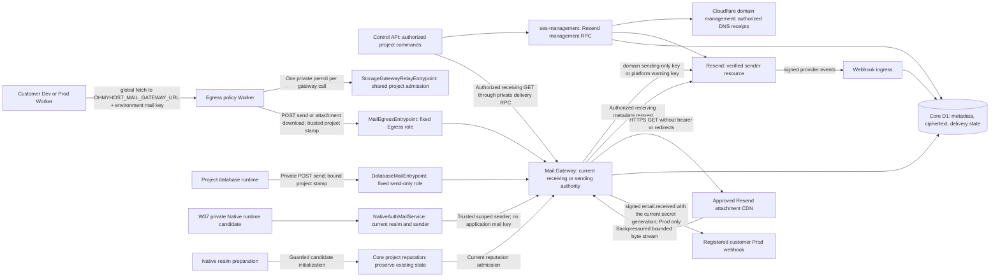

Customer Workers use global `fetch` on `OHMYHOST_MAIL_GATEWAY_URL`. In the C3 candidate the Egress Worker forwards only `POST /v1/send` and `POST /v1/attachments/download` on the exact effective gateway origin. It strips every caller-supplied `x-ohmyhost-egress-*` header and stamps `x-ohmyhost-egress-project-id` from trusted dispatch context. Shared admission runs once through Storage's private `permit(projectId)` before either gateway is reached; Mail adds no second admission call. Gateway-family names, including malformed prefixed names, never fall through to public fetch. Transport errors and redirects retain the relay's closed JSON failure vocabulary. [Relay](../../apps/wfp-dispatch/src/outbound.ts), [private binding declarations](../../apps/wfp-dispatch/wrangler.production.outbound.jsonc), [shared admission](../../apps/storage-gateway/src/egress-entrypoint.ts), [D437](decisions/domains-and-mail.md#d437).

The named `MailEgressEntrypoint` has a fixed Egress role that permits those two routes; `DatabaseMailEntrypoint` has a separate send-only role. Their capability comes from the exported private class, never `ctx.props`. Both require a canonical project stamp and a matching JSON `project_id` before invoking the serving implementation. Control JSON is bounded to 256 KiB for sends or 1 KiB for attachment requests, with a five-second body-read deadline. The database runtime keeps its private Mail binding, writes the project from its bound scope into both header and body, and strips the internal stamp before passing incoming requests to customer auth code. Choosing the database class cannot grant attachment access through forged Egress props. [Named role guard](../../apps/mail-gateway/src/mail-entrypoint.ts), [exports and serving dispatch](../../apps/mail-gateway/src/resend-worker.ts#L330), [database Mail stamp](../../apps/project-database-runtime/src/http-worker.ts#L196), [regional private binding](../../apps/project-database-runtime/wrangler.production.us.jsonc).

The original static-props readback criterion is **superseded, not passed**: fresh native Cloudflare version, script-settings and service-binding readbacks omit declared props. The new named Mail roles declare none. This does not weaken the separate generic strict structural readback for a binding that still declares props; absent observation does not satisfy that declaration. The legacy Storage class and its retained props guard belong to the Storage migration, not these Mail roles. Existing customer `OHMYHOST_MAIL_GATEWAY` service bindings remain unsupported during C3; removing them and completing the customer cutover is C4/W29. Readback decision and evidence boundary, progress.

## Sender domain and credential custody

One active domain belongs to each customer project and is configured against its Prod environment. Dev and Prod applications may send through it with distinct environment keys. The domain must be customer-configured; a hosting hostname supplies no default sender. Domain identity is immutable during a setup, and domain/name retirement locks prevent a replacement setup from taking an uncertain old resource. Sending readiness depends on provider verification and the sending key; pending receiving MX does not by itself block sending. ([Domain persistence and Prod scope](../../apps/control-store/src/catalog/mail/resource.ts), [readiness](https://github.com/amerged-org/ohmyhost/blob/main/apps/ses-management/src/resend-runtime.ts#L203))

The 5 November source correction rejects platform namespaces as customer mail domains and application-domain proof: `ohmyho.st`, `omh.st`, their descendants and the reserved `*.poc.aixyte.com` deployment namespace. The separate customer-domain classifier preserves generic mailbox and external Reply-To normalization. New legacy/shared setup, current customer send/receive admission and new provider/DNS effect permits apply this boundary, including retained rows admitted by older code. Owner history reads, unknown-outcome observation and explicit cleanup remain available. Provider capability housekeeping for an already known retained resource is not customer sending authority and continues to preserve sibling/deletion semantics. An already in-flight provider request cannot be cancelled by a source check; cutover requires a fresh scoped inventory of reserved bindings, grants and operations. [Customer-domain policy](../../packages/platform/src/shared/mail-domain-identity.ts), [actual send authority](../../apps/control-store/src/catalog/mail/auth.ts), [inbound admission](../../apps/control-store/src/catalog/mail/received-ingress-step.ts).

The server creates a Resend key with `permission: sending_access` and a fixed provider domain ID. Its one-time token is encrypted with the environment-secret AES-GCM cipher using the mail domain's organization/project/Prod-environment scope and name `RESEND_DOMAIN_SEND_KEY`. Control stores this ciphertext directly in `resend_mail_domains.sending_key_ciphertext`, alongside nonce, SHA-256 and key version. The separate Cloudflare Worker secret `MAIL_DOMAIN_KEY_ENCRYPTION_KEY_BASE64` is required by management and the gateway; the gateway decrypts only for its provider call. This is a separate encrypted record from the application's `environment_secrets` row containing `OHMYHOST_MAIL_KEY`. ([Restricted provider key](https://github.com/amerged-org/ohmyhost/blob/main/packages/provider-resend/src/index.ts#L164), [encryption](https://github.com/amerged-org/ohmyhost/blob/main/apps/ses-management/src/resend-runtime.ts#L56), [ciphertext persistence](../../apps/control-store/src/catalog/mail/resource.ts), [private read/decryption](https://github.com/amerged-org/ohmyhost/blob/main/apps/mail-gateway/src/resend-send.ts#L101))

An uncertain one-time key creation cannot recover its token. After the five-minute claim fence, management enumerates and revokes only keys with that domain row's deterministic name before allowing a replacement. Domain creation records a preflight timestamp; uncertain recovery may attach only the matching name from that creation window. Incomplete inventories remain unresolved. The observed Resend account domain limit has a specific retryable capacity classification; other provider errors expose no raw provider text. ([Key recovery](https://github.com/amerged-org/ohmyhost/blob/main/apps/ses-management/src/resend-keys.ts#L3), [creation reconciliation](https://github.com/amerged-org/ohmyhost/blob/main/apps/ses-management/src/resend-runtime.ts#L54), [safe provider errors](https://github.com/amerged-org/ohmyhost/blob/main/packages/provider-resend/src/index.ts#L49))

## Same-domain shared sender contract

W25 is implemented in the reviewed source candidate; this section records its source contract, not a Production delivery claim. [D434](decisions/domains-and-mail.md#d434) owns the decision, while the W25 progress records verification and rollout separately. Existing original-project bindings remain compatible until explicitly edited.

The domain/provider/key/DNS resource belongs to the workspace. One active send binding per project selects that resource, the Prod environment, a revision, an exact sender-address list, a default From address and optional default Reply-To. Dev and Prod retain separate application gateway keys, project attribution, budgets, usage, idempotency and message access. Receiving remains exclusive to the original project's Prod webhook; attaching a sender grants no inbound content or administration rights. Disabling, detaching or changing the outbound binding leaves that original inbound owner and webhook intact while its ownership, lifecycle and receiving configuration remain valid. Webhook administration and runtime content reads resolve original Prod receiving ownership independently of the current outbound binding.

New reuse requires current authority for both the selected resource and target project, plus a current verified application identity with the **same registrable main domain**. Server-side PSL classification includes private suffixes. A verified `mail.example.com` or apex `example.com` sender can serve `example.com` and `sign.example.com`, but cannot serve `different.com`, including within one workspace. A technical OMH hostname or matching unverified declaration supplies no proof. Equality is checked at attachment/settings persistence and runtime admission; expired, revoked, replaced or mismatching identity cannot inherit old authority. [Classifier and settings validation](../../packages/platform/src/shared/mail-domain-identity.ts), [project identity flow](storage-and-domains.md#application-identity-before-mail-gated-deployment).

The application identity is independent of Paid hostnames. Declaring, re-declaring or verifying it never suspends or refuses a Paid connection, and a Paid hostname write never suspends a sender binding. A Paid custom hostname's ownership proof is a separate record ([storage and domains](storage-and-domains.md#paid-hostname-ownership), [D558](decisions/domains-and-mail.md#d558)). The same-registrable-domain rule above governs only sender reuse.

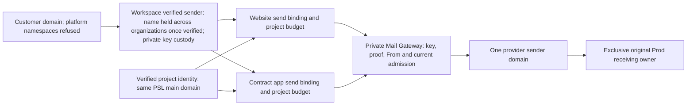

Workspace sender readiness describes verification of the shared resource separately from each project's sending switch. The provider domain must explicitly be verified, its required non-receiving DNS records verified and its restricted sending key present. A retained verified resource therefore remains selectable after its last outbound binding is disabled or detached. Reattachment still requires current same-main-domain proof and authority; actual sending still requires an enabled binding and all runtime admission checks. Pending provider verification or missing key material remains ineligible. Reading a project's mail domain never creates or revokes its restricted sending key: configure, reconciliation and ensure own that custody, and a read during an open key claim reports the sender as pending. A workspace verification request that Resend definitely refuses releases its ten-minute claim at once, so the next ensure asks again; an uncertain answer keeps the claim. A workspace holds at most five live senders whose sending is not ready (`PENDING_MAIL_DOMAIN_LIMIT`, an owner-adjustable product default in the control store); a sixth create answers `mail_domain_pending_limit`; verifying one, or completing its retirement, frees its slot. [Provider observation](../../apps/ses-management/src/workspace-mail-runtime.ts), [compatible legacy observation](../../apps/ses-management/src/resend-runtime.ts), [resource and binding persistence](../../apps/control-store/src/catalog/mail/shared.ts).

A sender name is held across organizations only once its domain is provider verified, or when it is a legacy mirror (migration 0643). An unverified reservation holds its name for seven days; the scheduled mail reconciliation then retires it through the provider path, which frees the name and its provider domain. A name whose sender was suspended for reputation stays held for every organization while the suspension holds, even after its owner retired the sender (migration 0641). When a sender's verification completes while another organization's live sender of the same name is verified, the observed sender is retired in the same write. [D473](decisions/domains-and-mail.md#d473), [D474](decisions/domains-and-mail.md#d474), [D475](decisions/domains-and-mail.md#d475).

Sender settings are non-secret. Addresses use the resource's exact domain; adding a local part needs no DNS record or provider registration and creates no mailbox. Explicit per-message From must be allowed; omission uses the configured default. Explicit Reply-To overrides the optional default and may name an external existing mailbox, preserving a contact form's visitor Reply-To. Legacy settings retain the previous whole-domain From behavior and default until the owner opts into the exact list. A durable send claim freezes effective defaults/settings revision and the effective-message digest so a settings edit cannot change an uncertain same-key provider payload. Current authority is still rechecked before new provider effects.

Attaching an already verified sender creates no provider resource and changes no sender DNS. New sender DNS automation has a separately consented workspace/resource/purpose/revision grant; original website grants and encrypted AAD are not relabelled. Provider sending/receiving flags must be computed from all active send bindings plus the exclusive receiving owner. Resend requires at least one domain capability to remain enabled. An idle retained resource with no receiving owner therefore keeps the provider sending capability while platform admission denies every project send; it does not enable receiving or rotate/revoke the shared key merely to represent idle state. Provider capability is not project admission. [Provider contract](https://github.com/resend/resend-openapi/blob/main/resend.yaml#L4750). Detach, deletion or transfer of one project cannot disable siblings or destroy the shared key. Original ciphertext keeps immutable custody coordinates even if its creator leaves; historical messages, provider IDs, DNS receipts and billing remain attributed to their original scope. An unused shared resource survives until explicit workspace retirement with no live send/inbound reference and settled provider effects.

The old project response shape stays exact. Legacy setup returns `mail_domain_conflict` when explicit workspace attachment is needed; legacy deletion of a shared resource conflicts before effects. Explicit detach ends only the target binding. Compatible readers, gateway/provider reconciliation, inbound and every deletion/transfer path must ship before the multi-binding capability is enabled. The [API chapter](api-and-mcp.md#shared-sender-management) owns the public operations and consent intersection.

## Sending, reputation and settlement

The private send boundary accepts one canonical recipient, an idempotency key and bounded message JSON. The sender's domain must exactly match the configured domain; subject/text/HTML/address limits are validated before provider I/O. Control persists request, recipient and content digests, provider identity and outcome, rather than message bodies or recipient plaintext. The claim reads the credit account and the project's budget and checks effective Paid access, warm-up and reputation. An exhausted credit keeps sending through its seven-day grace and then refuses with `insufficient_organization_credits`; a `stop` budget whose month use is spent refuses with `project_budget_exceeded`. The claim then inserts the request in state `reserved` and charges the recipient quote in the same Core batch (`mail:<request>`, the project's month use counted), and active sending scope is rechecked immediately before the provider starts. The price is the newest published `mail.sent` card with an activated meter at the instant of the claim, rounded up ([pricing contract](pricing-contract.md)). ([Gateway parsing](https://github.com/amerged-org/ohmyhost/blob/main/apps/mail-gateway/src/resend-worker.ts#L42), [send workflow](https://github.com/amerged-org/ohmyhost/blob/main/apps/mail-gateway/src/resend-send.ts#L17), [claim and charge](../../apps/control-store/src/catalog/mail/send-claim.ts#L177), [access and budget gates](../../apps/control-store/src/catalog/mail/credit.ts#L71), [provider input limits](https://github.com/amerged-org/ohmyhost/blob/main/packages/provider-resend/src/index.ts#L417))

Accepted and rejected replays preserve their result and charge nothing again. The charge made at the claim stays through acceptance and through an uncertain outcome. A request the provider rejects or definitively refuses becomes `rejected` and gives the charge back once in the same batch (`mailrefund:<request>`, at the price of the claim's instant). A first attempt whose sending key is definitively absent, whose sender no longer matches its key, or whose key is not a Resend key is refused the same way before any provider call. A transient D1 or decrypt failure after authorization is not a refusal: the request stays `reserved` with its charge, and a retry with the same idempotency key replays it as uncertain (authorization already stamped its provider start) and sends. A provider-started uncertain send may replay for less than 23 hours under the original provider idempotency key. A replay's refusal cannot refund the charge of an original request whose send outcome is unknown; only the first attempt's definite refusal can refund a request still `reserved`. A signed provider event can complete the same request once, which changes the request and never the credit. A reserved request without provider-start evidence is not covered by that resend recovery and may remain uncertain. A delivery failure that Resend reports after acceptance keeps the charge. ([Replay and uncertainty](https://github.com/amerged-org/ohmyhost/blob/main/apps/mail-gateway/src/resend-send.ts#L167), [transitions and refund](../../apps/control-store/src/catalog/mail/send-transitions.ts#L251), [refund step](../../apps/control-store/src/catalog/mail/send-transitions.ts#L176))

Warm-up is project-wide across Dev and Prod: 10 sends in the first day, 25 before day three, 50 before day seven, then 100 per UTC day. Thirty-day complaint rates above 0.1% or hard-bounce rates above 5% suspend sending. Reinstatement is an explicit operator review with digest evidence, at least seven days after suspension, acceptable metrics and no later reputation event; it restarts warm-up. ([Warm-up and thresholds](../../apps/control-store/src/catalog/mail/send-claim.ts), [reputation decision schema](../../apps/control-store/migrations/core/0461_mail_send_original_facts.sql))

## Inbound content and delivery lifetime

Provider intake verifies the raw signed body with a five-minute timestamp bound. Event IDs serialize exact replays: identical redelivery is acknowledged; the same ID with changed bytes conflicts. Only provider facts mapped to registered project domains, sends or warning notices produce stored events. A received message that spans multiple managed tenants is ambiguous and is never fanned out. Its registered Prod domain must be live, receiving-enabled, verified (webhook), unsuspended and sending-ready (`sending_status` is `ready` once the provider reports the domain verified). A domain the provider has not verified stores nothing and is not billed, so a leftover receiving MX of a retired domain delivers nothing to a later registrant until that registrant's own domain is verified at the provider; whether the provider issues new sending keys for a recreated domain is a provider property this repository does not prove, and an owner who has just added the MX waits for the provider's verification before the first message is stored. ([Signature verifier](https://github.com/amerged-org/ohmyhost/blob/main/packages/provider-resend/src/webhooks.ts#L3), [event replay fence and one-tenant receipt](../../apps/control-store/src/catalog/mail/resend-events.ts))

Control stores provider message ID, scope, original receipt time, expiry, billing and attempt metadata. Message content remains at Resend and is fetched on demand. Platform access ends 72 hours after original receipt, including already-delivered messages; expiry is an access/state transition, not proof of provider-side erasure. No platform body archive or permanent inbox is created. Content reads recheck active scope after provider I/O. Original receiving ownership remains exclusive: sharing an outbound sender grants no received-message or attachment access. [Temporary content and metadata links](../../apps/mail-gateway/src/inbound-delivery.ts#L85), [receiving key authorization](../../apps/control-store/src/catalog/mail/auth.ts#L123), [current receiving ownership and expiry](../../apps/control-store/src/catalog/mail/delivery.ts#L55).

### Streamed attachment transport — C3 source candidate

W30 supplies the fixed runtime route `POST /v1/attachments/download`. Its closed JSON body contains exactly `project_id`, `environment_id`, `message_id` and `attachment_id`; the first three are canonical ULIDs and the attachment identifier is bounded to 128 alphanumeric, underscore or hyphen characters. No caller-selected URL, origin or attachment path enters the relay route. After the named-role/project guard, the gateway authenticates the environment `OHMYHOST_MAIL_KEY` with `receiving: true`, requires that key's receiving environment to equal the body environment, and reads the exact message under current project ownership and the original verified receiving domain. [Runtime route and authorization](../../apps/mail-gateway/src/resend-worker.ts), [receiving lookup](../../apps/control-store/src/catalog/mail/auth.ts#L123).

The provider adapter validates the attachment ID, nonnegative safe-integer size, timestamp expiry and HTTPS download destination. Only `inbound-cdn.resend.com` or a subdomain of `cloudfront.net` is accepted, without userinfo or a nondefault port. The authenticated metadata request stays at Resend's fixed API origin; its bearer is not sent to the CDN. The subsequent CDN GET uses `redirect: manual`, requests identity encoding and accepts only a direct HTTP 200 with no other content encoding. Known provider size and Content-Length are checked before response headers; a declared length must be a decimal safe integer, within 50 MiB and equal to the validated metadata size. [Metadata validation](../../packages/provider-resend/src/index.ts#L243), [CDN boundary](../../apps/mail-gateway/src/mail-attachment-stream.ts#L98).

The CDN transfer has a 15-second deadline, shortened by the earlier of provider URL expiry and the message's 72-hour access expiry. The gateway requires a BYOB-capable byte stream, reads at most 64 KiB per pull and sets its application stream queue to `highWaterMark: 0`; it does not buffer an attachment-sized array, Blob or tee. It counts consumed bytes even when Content-Length is absent, rejects size overflow and requires exact metadata size at EOF. Current receiving ownership and expiry are rechecked before headers, before the first released chunk, during pull processing once 1 MiB has accumulated or one second has elapsed since the previous check, and at EOF. A recheck after a threshold occurs before that bounded chunk is released. Already-delivered bytes cannot be recalled. [Bounded reader, rechecks and final size](../../apps/mail-gateway/src/mail-attachment-stream.ts#L19), [fresh ownership read](../../apps/mail-gateway/src/inbound-delivery.ts#L219).

No Core batch spans provider/CDN I/O; scope checks are separate Core reads until the stream terminates. EOF, read failure, receiving-scope revocation, caller cancellation and deadline share one memoized terminal closer: it clears the timer and request listener, aborts the CDN controller and cancels the upstream reader or body. A paused or abandoned download therefore retains the transfer deadline. Before headers, expiry can return JSON 410 `mail_content_expired`, a known oversized attachment JSON 413 `mail_attachment_too_large`, an unavailable message 404, or a fixed unavailable response. After HTTP 200 headers, truncation, overflow, expiry, receiving-scope revocation and transfer failures error the byte stream; they cannot replace that status with 410/413. Complete EOF consumption is required for success, and an unused stream must be cancelled. Provider URLs, bodies and raw error details are not exposed through stream errors. [Terminal cleanup and failures](../../apps/mail-gateway/src/mail-attachment-stream.ts#L49), [runtime statuses](../../apps/mail-gateway/src/resend-worker.ts#L398).

The source candidate restores `createMailAttachmentClient` as a supported Runtime helper on the root and `mail-attachment` exports. It validates metadata's existing `download_path` locally against the configured project and optional expected environment, then sends the four identifiers over the fixed POST using the injected gateway URL, environment key and global fetch. It returns a pull-driven byte stream and propagates cancellation rather than fetching the metadata path as an arbitrary URL. The management helper `downloadManagedMailAttachment` uses the existing generated authenticated Control GET with explicit `parseAs: "stream"` and `responseStyle: "fields"`; binary success returns the original Response/body, while the existing JSON `{status:"expired"}` response remains distinct and bounded to 1 KiB. Neither helper routes binary success through automatic Blob/JSON parsing. These are source/package exports, not a claim that the new public client cohort is published. [Runtime helper](../../packages/customer-runtime/src/mail-attachment.ts#L17), [management SDK helper](../../packages/sdk-ts/src/managed-mail-attachment.ts#L17), [unchanged Control response route](../../apps/control-api/src/app.ts#L2312).

Local regressions cover metadata validation, runtime/management stream contracts, wrong scope, actual receiving revocation, size/expiry boundaries, backpressure and terminal cancellation. The real-workerd wiring pack additionally exercises the actual named-role factories, shared admission, project stamps and cancellation through both private hops. Those fixtures and the separate U6 hostname probe support the design; they do not establish a real received attachment through hosted customer Development and Production, or C4 closure. [Gateway regressions](../../apps/mail-gateway/test/resend-worker.test.ts), [receiving checks](../../apps/mail-gateway/test/inbound-delivery.test.ts), [provider metadata regressions](../../packages/provider-resend/src/index.test.ts#L121), [Runtime tests](../../packages/customer-runtime/src/mail.test.ts), [management SDK tests](../../packages/sdk-ts/test/managed-mail.test.ts#L58), [workerd wiring](../../tests/gateway-forward.node-test.mjs), remaining acceptance.

The customer webhook is HTTPS on a public DNS destination, with no URL credentials or private/reserved address. Setup derives a per-domain HMAC signing secret from the Worker-held root, returns it to the authorized setup caller, and stores only safe command-response fields; a replay reconstructs the secret rather than saving it in the command receipt. The secret belongs to a generation: generation zero is the original derivation, so receivers configured before generations keep their secret. A changed endpoint URL advances the generation, and the owner's rotation (`POST .../mail-webhook:rotate`) advances it too, ends receiving until the endpoint verifies the new secret, and makes every earlier secret stop verifying ([D477](decisions/domains-and-mail.md#d477)). Receiving is disabled locally before endpoint changes and enabled only after a signed test receives a direct 2xx. Each actual delivery resolves DNS again, follows no redirect, times out after at most 15 seconds and signs the complete body with stable message ID. ([Destination and signatures](https://github.com/amerged-org/ohmyhost/blob/main/packages/provider-resend/src/customer-webhooks.ts#L4), [setup verification](https://github.com/amerged-org/ohmyhost/blob/main/apps/ses-management/src/resend-runtime.ts#L265), safe command receipt, [delivery](https://github.com/amerged-org/ohmyhost/blob/main/apps/mail-gateway/src/inbound-delivery.ts#L116))

One initial attempt and three retries share the same four-attempt budget, including manual retries. Automatic retries are at 1, 24 and 71 hours after the first attempt, always bounded by the original 72-hour receipt deadline. A claimed attempt holds a two-minute lease until its answer is recorded: a second claim during that lease, from a cron sync or a manual retry, returns no claim, so the in-flight answer is still recorded, and the claim's expired and delivery-failed transitions wait for the lease to run out. Content retrieval and DNS checks are prerequisites rather than customer webhook attempts; when one fails the attempt is deferred without being spent, and an automatic claim waits while `next_attempt_at` lies in the future (the claim batch fences on it, so a deferral written after the read refuses the claim), whereas the owner's manual retry bypasses the deferral. A lost response can require delivery again, so customer storage must deduplicate by message ID before acknowledging 2xx. Receipt-time inbound billing charges each message once (`mailrecv:<message>`) and is independent of webhook delivery attempts; one unbillable tenant does not block the batch. ([Retry policy](https://github.com/amerged-org/ohmyhost/blob/main/packages/platform/src/shared/mail-delivery.ts#L1), [attempt claim](../../apps/control-store/src/catalog/mail/delivery.ts#L73), [billing batch](../../apps/control-store/src/catalog/mail/received-billing.ts#L38))

## Mail deletion and historical records

Standalone domain retirement disables all local admission first, revokes the scoped provider key, verifies provider-domain absence and leaves DNS unchanged with released receipts returned to the customer. The retired row retains encrypted credential material and provider receipts for audit; revocation, rather than row removal, ends provider authority. Scoped Cloudflare DNS grants are different: when a grant is revoked (by revoking its authorization, by completing sender retirement, or by completing the deletion of the project that owns an application-identity grant), its stored refresh token is revoked at Cloudflare and both sealed tokens are wiped, so the ciphertext is not retained. Withdrawing an application identity (its `revoke` action) stamps `revoked_at` on that identity's scoped DNS authorization and grant in the same batch as the revocation, so the grant stops being usable or inspectable, and the scheduled mail reconciliation then revokes its refresh token at Cloudflare. A re-authorization that replaces a grant records the displaced refresh-token pair the same way, and the sweep revokes it before its record is deleted ([D476](decisions/domains-and-mail.md#d476)). The revoke call only commits the revocation; the scheduled mail reconciliation (every minute) revokes the stored refresh tokens of up to 20 revoked grants, picked at random, and wipes each ciphertext only after Cloudflare has accepted the revocation. Any failure, a Cloudflare rejection included, keeps the ciphertext for the next sweep, and the sweep log shows the failed count. A grant that a newer authorization only superseded is not revoked and keeps its tokens. The authorization row and revocation receipt remain for audit. Project deletion instead requires its persisted deletion intent, lifecycle and frozen inventory. It removes a mail resource only when no workspace mail domain records it (an unmirrored Resend domain, its sending key and its DNS records); a workspace mail domain, its sending key and its DNS records survive project deletion until explicit workspace retirement, and the deletion reports only evidence belonging to that inventory. An uncertain old creation must be found and removed before cleanup can be declared complete. ([Retirement persistence](../../apps/control-store/src/catalog/mail/retirement.ts), [provider retirement](https://github.com/amerged-org/ohmyhost/blob/main/apps/ses-management/src/resend-runtime.ts#L331), [project cleanup](https://github.com/amerged-org/ohmyhost/blob/main/apps/ses-management/src/resend-deletion.ts#L6))

Workspace sender retirement (`beginRetirement`) is refused as `mail_domain_in_use` while an active send binding or the exclusive receiving owner holds the domain, and while a reserved or uncertain send requested within the last 24 hours can still settle. An older reserved or uncertain send never blocks it, because it can no longer start or be resent; the Control API answers this with a message naming those steps.

The SES receipt tables remain historical data and the two Route 53 receipt tables remain unread history: Route 53 is retired and no code reads or writes it. Current management never calls an AWS provider. For old project SES resources (tenant, configuration set, event destination), deletion requires append-only `legacy_aws_mail_absence` observations naming only locators from that project's creation receipts; missing evidence keeps deletion pending. Route 53 resources are not part of that inventory. Historic `ses.*` and `route53.zone` rate-card rows do not imply that AWS serves current mail. ([Legacy absence](../../apps/control-store/src/catalog/mail/legacy-resources.ts), [historical SES receipts](../../apps/control-store/migrations/core/0463_mail_historical_ses_receipts.sql), [Route 53 receipts](../../apps/control-store/migrations/core/0464_mail_historical_route53_receipts.sql))

## Customer SQL exports

Exports are explicit asynchronous operations, available at zero credit balance and limited to one accepted request per project in a rolling 24 hours. The Control operation/outbox owns request identity, state and retries; another accepted request is refused with a retry time. The private recovery protocol accepts only run/download/purge scope and claim identifiers, never caller-selected database URIs, provider credentials, buckets or object keys. SQL export does not include customer files, source, configuration or runtime secrets. ([Acceptance quota](../../apps/control-store/src/catalog/recovery/jobs.ts#L143), [closed private protocol](https://github.com/amerged-org/ohmyhost/blob/main/packages/platform/src/modules/recovery/input-cipher.ts#L134), [SQL-only archive](https://github.com/amerged-org/ohmyhost/blob/main/packages/project-recovery/src/index.ts#L51))

The following sequence describes application-only V1 exports. Native-bearing exports reuse the private capture and download boundary, with the [protected settlement and retirement flow](#protected-native-export-settlement-candidate) below instead of V1 discard-and-recapture.

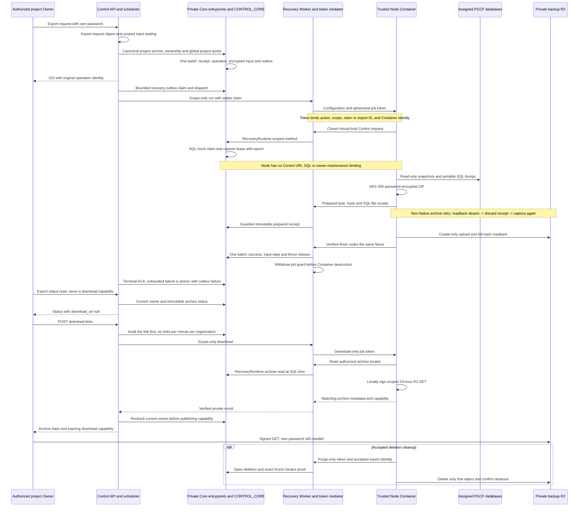

The current executor is a Cloudflare Container managed by a SQLite Durable Object per operation. Calls for that object run serially; one random private bearer authenticates its trusted Node agent. Public Worker fetch returns 404. Each invocation starts the Container with environment configuration, waits at most thirteen minutes and destroys it in `finally`, including failed startup. A repeated download of one operation within twenty seconds of the start of its last successful download returns that remembered result without a start; any run or purge clears it. The trusted image pins PostgreSQL 18.6, Node and the CA bundle, executes as `postgres`, and includes only the built platform agent. Customer code never executes there. ([Container ownership](https://github.com/amerged-org/ohmyhost/blob/main/apps/recovery-container/src/worker-main.ts#L64), [lifetime](https://github.com/amerged-org/ohmyhost/blob/main/apps/recovery-container/src/worker-main.ts#L103), [private agent](https://github.com/amerged-org/ohmyhost/blob/main/apps/project-recovery-worker/src/container-agent.ts#L10), [image](https://github.com/amerged-org/ohmyhost/blob/main/apps/project-recovery-worker/container/Dockerfile#L1))

The API's export routes preserve the original Owner-only `projects:write` action, keyed password-request digest and zero-credit policy. A current Paid project with Dev retains its actual Dev logical anchor; Free and Prod-only projects use their actual Prod identity. Core requires canonical Prod and checks the same preferred, currently allowed anchor again in the acceptance batch. No Dev identity is fabricated for an export. General operation polling is enabled only for the qualified Recovery kind; other unported D1 operations fail explicitly rather than losing their deployment/reconciliation metadata. The D1 scheduled entrypoint runs the actual Recovery dispatcher, while still reporting the remaining unported compatibility tasks as unavailable; it does not claim a complete healthy pass. [Current anchor and acceptance](../../apps/control-store/src/catalog/recovery/api.ts), [atomic policy guard](../../apps/control-store/src/catalog/recovery/jobs.ts).

Run, download and purge all use this same operation-scoped Container boundary. Only the audited `download-links` POST reaches the download path; the status read never does, so polling a ready export starts no Container ([D485](decisions/identity.md#d485)). For download, the Node runtime reads the authorized Control archive receipt and signs the GET capability locally; the result returns through the Worker and Control. The customer's later GET downloads the archive from R2. ([Command dispatch](https://github.com/amerged-org/ohmyhost/blob/main/apps/recovery-container/src/worker-main.ts#L64), [Node download authorization](https://github.com/amerged-org/ohmyhost/blob/main/apps/project-recovery-worker/src/recovery-runtime.ts#L37), [local signing](https://github.com/amerged-org/ohmyhost/blob/main/apps/project-recovery-worker/src/r2-archives.ts#L131))

PGCF extends the private capture path with an exact provider target and a loopback WSS bridge per database session. Control reads use the private Core entrypoints; the Node configuration has no Control target. The PGCF API supplies only the private export role, distinct from customer runtime/read/temporary roles; native dump authority is checked so forced RLS does not omit rows. Bridge cleanup and snapshot/capture fences apply on success and failure. Existing archive objects remain in private Cloudflare R2. [Provider-aware capture](../../packages/project-recovery/src/capture.ts), [Container composition](../../apps/project-recovery-worker/src/container-runtime.ts), [database inventory](../../apps/control-store/src/catalog/recovery/scope.ts).

Provider-managed continuous recovery and customer-requested encrypted SQL ZIP exports are separate mechanisms. The PGCF product tariff includes seven days of provider backup retention; on-demand ZIP exports retain their existing cadence, password custody and R2 archive rules. Neither a successfully provisioned empty database nor its initial backup proves that imported data has a recoverable archive. The cutover requires a successful post-import suspend/archive check before resuming. Cutover requirements.

## Customer export passwords

The customer chooses and keeps the archive password. Creating an export requires at least 12 characters (`EXPORT_PASSWORD_MIN_CHARACTERS`, a product default counted in code points), enforced at the REST parser with a 400 `invalid_request` that names the rule and never echoes the value, and early in the CLI and the MCP password-file reader before any request. Capture, archive and restore keep only the non-blank 1–1024-byte check, so archives made with an earlier shorter password still open. Control temporarily stores an AES-256-GCM job-input envelope in `project_recovery_jobs.input_ciphertext`, `input_nonce` and `input_key_version`, authenticated to organization/project/operation. Its eligibility lasts one hour; terminal success/failure/cancellation and scheduled expiry maintenance clear all three fields. This temporary envelope is separate from the archive's password encryption. The private runner decrypts the envelope and zeroes the plaintext byte buffer after parsing; the parsed password is used transiently for the ZIP and is not returned in operation status, receipts or logs. Exact user password bytes, including a trailing newline, are preserved. ([Input cipher](https://github.com/amerged-org/ohmyhost/blob/main/packages/platform/src/modules/recovery/input-cipher.ts#L19), [one-hour storage](../../apps/control-store/src/catalog/recovery/jobs.ts#L242), [clearing](../../apps/control-store/src/catalog/recovery/jobs.ts#L1198), [transient decryption](https://github.com/amerged-org/ohmyhost/blob/main/apps/project-recovery-worker/src/job.ts#L246), [ZIP encryption](https://github.com/amerged-org/ohmyhost/blob/main/packages/project-recovery/src/index.ts#L114))

Control's `RECOVERY_INPUT_KEY_BASE64` matches `inputKeyBase64` in the environment-scoped `RECOVERY_CONFIGURATION` Worker secret. The configuration holds only the PGCF project integration, private R2 authority and input key; it carries no Control target. The Recovery Worker alone holds `RECOVERY_CONTROL_STORE`, a private service binding to `RecoveryRuntime`; the Container reaches it only through the intercepted virtual hostname `recovery-control.internal`. A missing binding fails closed. The Worker passes an ephemeral job token to Node, stores only its digest in the outbound grant, and withdraws that grant before destruction even when destruction fails. The image and scope-only dispatch contain no credential. No customer archive password is a configuration field. [Configuration](../../apps/project-recovery-worker/src/container-runtime.ts), [mediation and grant](../../apps/recovery-container/src/control-mediator.ts), [Container lifecycle](../../apps/recovery-container/src/worker-main.ts).

## Capture, archive and cleanup guarantees

The Worker mediates Node's Control access through ten closed executor/archive methods plus one purge-only frozen-target read. A run grant cannot read an archive or purge; a download grant cannot mutate a job; a purge grant cannot capture. Scope, claim/export identity, action and Container identity come from the Worker grant, never from a Node body. Binary envelope/receipt bytes round-trip through the bounded codec (16 KiB request, 64 KiB response). Production entrypoints force the SQL clock for every time-sensitive decision and final guard; a forged future instant cannot bypass a live capture or alter an authorized archive read. Store error names survive real workerd RPC so an uncertain outcome stays distinct and retryable; other errors remain redacted. [Closed wire](../../apps/project-recovery-worker/src/control-wire.ts), [actual entrypoints](../../apps/control-store/src/worker-main.ts).

Inventory is one consistent Core snapshot of current allowed data assignments, active deployment metadata and exact PGCF targets. Canonical Prod is mandatory; current Paid may additionally include Dev. A present Paid Dev with an incomplete assignment is refused, and retained Dev rows are excluded for Free. Shared data is dumped once to `shared.sql`; isolated data produces only the selected actual `dev.sql` or `prod.sql` files. The private wire and both archive formats accept a real Prod-only map while preserving existing Dev/Prod maps. Historical Neon metadata is refused before Node database I/O. The production Container reader independently checks target, private backup role, inherited membership with SET ROLE denied, BYPASSRLS and connection limit. A durable capture lease with epoch covers claim, acquire, claim again, renewal, and guarded finish/release. An accepted Dev job loses new capture authority after downgrade; SQL-clock guards also refuse a downgrade between a write's decision and execution. Its identity is never retargeted to Prod. Existing completed archives remain readable under their current ownership and archive authorization. An independent watchdog and the unchanged ten-minute capture bound stop a stalled renewal or stale holder. Each physical database has its own exported repeatable-read read-only snapshot; independent Dev/Prod databases do not form a distributed atomic snapshot. [Core inventory](../../apps/control-store/src/catalog/recovery/scope.ts), [current data authority](../../apps/control-store/src/catalog/recovery/shared.ts), [capture fences](../../apps/control-store/src/catalog/recovery/fence.ts), [Node lifecycle](../../apps/project-recovery-worker/src/job.ts), [private SQL authority](../../apps/project-recovery-worker/src/container-runtime.ts).

Native Auth recovery uses only the exact current realm schemas in the authorized manifest. Free omits Dev realms, and `pg_dump` receives one explicit `--schema` per selected realm; another retained Dev schema is neither dumped nor placed in the archive. Each selected schema must exist and match its policy revision, epoch and migration proof. Local PostgreSQL 18 regressions verify Prod contents are present while retained Dev contents are absent; this is supporting source/runtime evidence, separate from hosted Container, PGCF and R2 qualification. [Scoped capture](../../packages/project-recovery/src/capture.ts), [Native selection and manifest checks](../../apps/control-store/src/catalog/recovery/jobs.ts).

The HTTP Worker, Core service bindings, Node control client/Worker mediator and encrypted SQL capture/download/purge path are exercised locally with real D1/workerd and a real PostgreSQL 18 for the dumped customer database. Hosted Container interception and PGCF/R2 readbacks are release evidence. The exact archive reader/purge path alone does not complete project deletion: purge targets are read only from an accepted open deletion and its exact frozen SQL-export locator.

For application-only V1 exports, native `pg_dump` outputs portable plain SQL without owner, privilege, tablespace, publication, subscription or security-label statements. SQL is bounded to 256 MiB per job, local files are exclusive 0600, linked/changed dump sources fail closed, the ZIP uses AES-256 AE-2, and temporary dumps/archive directories are removed. The runner first persists an immutable prepared byte/hash/file-list receipt, then create-only uploads to the scoped archive key and independently reads the complete object to verify bytes, content type and SHA-256. A lost PUT response is decided by readback; failed/unknown readback cannot produce successful operation evidence. A prepared retry verifies the same archive instead of capturing another snapshot. Only when the readback reports the object absent (never when it differs or cannot be read) and the sealed input is still held, the unfinished job clears its unlanded receipt with `discardArchive`: a compare-and-set on the exact receipt, the current claim, the current fence holder and the running operation; migration 0604 lets the archive-final trigger clear a prepared archive but never replace it. The job then captures a fresh archive. With the input gone the job fails `RECOVERY_ARCHIVE_LOST`; a finished or verified archive stays immutable. ([Capture flags](https://github.com/amerged-org/ohmyhost/blob/main/packages/project-recovery/src/capture.ts#L163), [source/ZIP integrity](https://github.com/amerged-org/ohmyhost/blob/main/packages/project-recovery/src/index.ts#L52), [prepare and verify](https://github.com/amerged-org/ohmyhost/blob/main/apps/project-recovery-worker/src/job.ts#L224), [R2 adapter](https://github.com/amerged-org/ohmyhost/blob/main/apps/project-recovery-worker/src/r2-archives.ts#L30))

The private archive bucket is `ohmyho-development-backups` or `ohmyho-production-backups`; the current adapter targets the EU R2 endpoint. This archive placement is independent of the customer's US/EU application hosting region. Archive eligibility ends seven days after capture. Download requires active project ownership and independently verified success, and returns a 24-hour signed GET only when at least 24 hours of archive retention remain. The URL is a bearer capability and the customer still needs their own password to decrypt it. Application-only V1 project-deletion purge derives its location from authorized Control cleanup state and verifies DELETE with HEAD absence; no caller can supply an arbitrary bucket or key. Native-bearing retirement also permits the permanent marker proof described below. ([Retention receipt](../../apps/control-store/src/catalog/recovery/jobs.ts#L564), [authorized download](../../apps/control-store/src/catalog/recovery/jobs.ts#L1047), [24-hour capability](https://github.com/amerged-org/ohmyhost/blob/main/apps/project-recovery-worker/src/recovery-runtime.ts#L44), [purge](https://github.com/amerged-org/ohmyhost/blob/main/apps/project-recovery-worker/src/r2-archives.ts#L158))

## Operator infrastructure alerts

The bounded W14 registration,
specification,
tasks,
progress and
[D428](decisions/domains-and-mail.md#d428) keep this notification outcome separate from migration.

The additive PGCF capacity receiver is implemented in the existing Mail Gateway's private
`InfrastructureAlertsService` fetch entrypoint. It accepts the generic version-1 PGCF warning
and regional-node-cap events through a Cloudflare service binding, with an independent bearer
secret and an `Idempotency-Key` equal to the immutable event UUID. It exposes no customer mail
operation and does not change ordinary Mail Gateway HTTP ingress. PGCF owns regional thresholds,
infrastructure caps, event episodes and delivery retries; this adapter owns only operator mail.

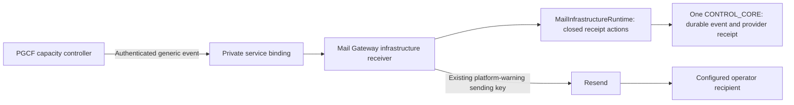

`PGCF_CAPACITY_WEBHOOK_SECRET` and `PGCF_CAPACITY_ALERT_RECIPIENT` are private Mail Gateway
configuration. The recipient and Resend credentials never enter PGCF event payloads. The sender
reuses `RESEND_PLATFORM_WARNING_API_KEY` and the environment's existing verified platform sender.
Missing or invalid configuration fails closed. Event payloads are strictly bounded to 8 KiB,
contain only infrastructure metadata, and cannot select a recipient or arbitrary message body.

The Core stores the event UUID, a digest binding its immutable payload, local recipient and
provider-key fingerprint (never the key itself),
the first provider-attempt time, a bounded 30-second claim lease and the accepted provider message ID.
Concurrent callbacks and later receiver instances use the same durable receipt. A conflicting
event UUID is refused. An uncertain provider attempt retries the same Resend idempotency key
within the Mail Gateway's existing conservative 23-hour replay window; after that window it
fails closed for reconciliation rather than sending a possible duplicate. A callback returns
success only after provider acceptance is durably recorded. Provider acceptance is distinct
from verified mailbox delivery.

The receiver selects the separate `MailInfrastructureRuntime` receipt capability. Its bearer
authentication, 8 KiB schema, configured operator recipient, provider-key fingerprint, platform
From/subject/body and stable `pgcf:platform:event` provider idempotency key remain in the Gateway.
Core receives only the event UUID, immutable digest, original times and accepted provider
reference; it has no arbitrary recipient, alert body, mail-key or financial authority. An unknown
committed claim or completion is surfaced without reconstructing send permission, and the narrow
receipt observation proves a real RPC method before the provider is constructed.

Service-binding and secret installation, exact-release verification and an authorized real
delivery are separate acceptance work. This scope does not implement customer PGCF migration or
the other external telemetry destinations in W02.

## Environments and verification boundaries

Mail management and gateway Dev/Prod configurations use separate Worker names, Control connectivity and recipient-service bindings. The C3 Mail gateway declarations keep all four default/sandbox/Dev/Prod profiles private with `workers_dev: false`, preview URLs disabled and `enable_request_signal` for cancellation; Dev/Prod minute crons remain declared. A source profile is not evidence of the current hosted listener or release. Resend domain creation currently selects `us-east-1`. Recovery Dev/Prod use distinct Workers, configuration secrets and archive buckets, with Container placement restricted to ENAM/WNAM and at most ten standard-1 instances per configuration. [Mail environment config](../../apps/mail-gateway/wrangler.production.jsonc), [default and sandbox declaration regressions](../../apps/mail-gateway/test/configuration.test.ts), [provider region](https://github.com/amerged-org/ohmyhost/blob/main/packages/provider-resend/src/index.ts#L137), [Recovery environment config](https://github.com/amerged-org/ohmyhost/blob/main/apps/recovery-container/wrangler.production.jsonc#L1).

Tests cover signature/tenant rejection, uncertain sends, one-domain sharing, bounded retries/expiry, attachment limits, deletion evidence, Container authentication/lifetime, immutable archive readback, password encryption and PostgreSQL restore/RLS behavior. Their fixtures are local proof, not a current provider readback. Checked-in historical PLAN receipts record the Resend and Container cutovers; current deployment and quota verification was outside this audit. Platform Control disaster recovery is a separate operator flow, covered by [development and release rules](../development.md), not this customer SQL export API.

## Recovery caller port

The closed Node control port is wired through `RecoveryRuntime`, with owner export acceptance/status/dispatch on `ControlRuntime` and global recovery housekeeping on `MaintenanceRuntime`. Time-sensitive production calls select the SQL clock. Purge targets are read only from an accepted open deletion and its exact frozen SQL-export locator; the production Node wire, mediator and container database reader are PGCF-only.

## Mail receipts and send facts on the Core

Migration `0460` holds the Resend event receipt, infrastructure alert receipt, shared capability, send outcome and workspace reputation decision tables plus the global identity indexes; it seeds no row or capability. The signed Resend consumer's atomic transaction is distinct from the global WorkOS/GitHub/Stripe inbox.

Migration `0461` defines the gateway-key, send-request, event, project-reputation, decision and outcome shapes; migration `0601` rebuilt the send request without its credit columns and without foreign keys into the removed credit tables, and the other mail tables keep their rows and guards. Global identities and stable project/history foreign keys, key-version/global-digest/append-only rules, request sender/terminal guards, event/reputation shape and active-to-suspended or reviewed suspended-to-active transitions are enforced in the schema. Project and workspace reputation decisions remain distinct. Legacy attribution is computed by the closed runtime insert plan, so importing a NULL snapshot cannot attach it to today's resource.

Internal Core authentication and sealed-key reads match environment-key ambiguity, current owner/lifecycle, same-main-domain proof, suppression, original receiving ownership and immutable encryption custody. No plaintext runtime/provider key or message body enters these calls. Receiving remains available to its original Prod owner after outbound detachment; actual lifecycle revocation refuses both paths. The environment key, immutable fingerprint and reputation initialization use the Runtime Secret compound, with genuine encryption/AAD checks.

The send claim composes the Paid-at check, request/default snapshot, rate-card quote, warm-up/daily limits, credit account, budget and the charge into one Core batch: the request row is inserted in state `reserved` and `chargeOrg` books `mail:<request>` (balance, project month use and log row) beside it. A fingerprint of the source, sender, ownership, reputation, price and count facts, the unique log key and the ten-second foreground admission deadline guard the batch, and a late failure leaves no change. An ambiguous committed reply aborts without a command-log answer, natural lookup or a second decision; a later caller observes the retained unresolved request. Known clean conflicts may retry.

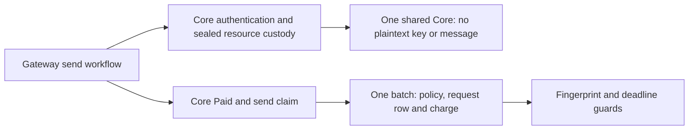

## Ordinary sender on the Core

The Gateway send route calls the seven fixed methods of private `MailSendRuntime`; message and recipient plaintext, provider/encryption keys, entropy and cipher operations remain in the Gateway. Paid eligibility is sampled before the awaited check; the claim's request identity, hashes and requested-at supplier then run inside that same call. Authorization, key read, rejection, completion and uncertain settlement suppliers stay lazy. Per-send timing measures these fixed domain calls without exposing SQL. Existing ciphertext/AAD handling, immutable sender defaults and the less-than-23-hour provider idempotency recovery apply. Real RPC methods can appear callable even when missing, so creation performs the narrow digest authentication read and validates its exact nullable result before constructing a provider. This read seeds no readiness state or business timestamp.

A send changes the credit only at its claim and, on rejection, at its refund; acceptance by the provider changes the request alone. Completion sets state `accepted`, a rejection or definite refusal sets `rejected` and gives the charge back in the same batch, and an unresolved attempt sets `uncertain`. Completion and rejection keep their foreground deadline; unknown writes remain explicit errors, and authorization never reconstructs permission after a response is lost.

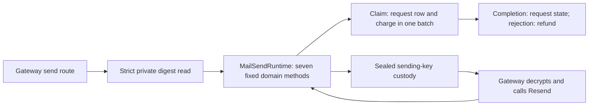

Accepted, rejected and uncertain next actions preserve the less-than-23-hour Resend idempotency recovery. See the progress record.

## Historical SES and Route 53 records

Migration `0463` holds the physical `ses_tenant_receipts`, `ses_project_mail_resource_receipts`, `ses_event_destination_receipts` and `legacy_aws_mail_absence` families. The 49 fields keep exact scalar values and dimensions, global/composite identities, the foreign-key chain, final status domains, the int4 lifecycle bound, the ordered event list and append-only rules. Microsecond timestamps, binary evidence and the 1024-character absence locator are exact. Historical scope uses the retained organization/project relation and requires no current active owner. No AWS call, fabricated absence, provider success or row is seeded.

Migration `0464` holds the 15-column `route53_dkim_change_receipts` and 7-column `route53_dkim_receipts` families without provider calls, a writer capability or any reader; only the one-time converter's mail mappings still write them, and a forward migration drops both tables when the converter is deleted after the Production observation. The SES parent chain, global domain/hosted-zone/change identities, composite child identity, int4 lifecycle bound, DNS/record shapes, observation order and append-only behavior are exact. The text-array check has cardinality 4, no NULL elements and values at indices 1..4; the single `name_servers` field stores a closed lowerBound/values representation that keeps all four strings and never silently flattens bounds. The LIKE underscore semantics of the record predicate apply rather than a stricter provider-name assumption.

## Received metadata and retry on the Core

Migration `0470` holds all 15 `mail_received_messages` fields, order, defaults and global identities, the four-coordinate receiver foreign key, the 72-hour microsecond deadline and the attempt/first-attempt/HTTP/immutable identity rules. The provider reference is unrestricted UTF-8 text with its length; an embedded NUL is refused. ASCII identities and 27-byte timestamps cannot hide trailing bytes.

The internal catalog implements read/list/due/claim/complete, two-query housekeeping and manual retry acceptance/resumption/completion. The 1/24/71-hour timing, two-minute lease, four-attempt limit and pre-update claim reply apply. Claim and retry-command attempt join one batch; lost committed replies remain explicitly unknown. Content, provider/signing keys, receipt billing, warnings and receiving admission are separate capabilities (see the receiving section below).

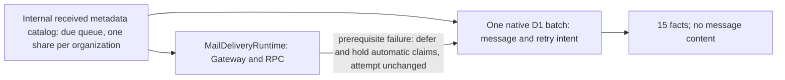

## Management facts and shared capability writer

Migration `0466` holds the eight domain, workspace, command, application-proof and sender-binding physical families. Stable/global identities, historical custody and key/AAD groups are independent of current ownership. Binding INSERT alone recognizes the exact `0335` OPEN unactivated context; the finite ten-name allowlist trigger covers the seven source/secret names, the binding family and two names of credit tables that migration `0601` dropped. Static sender/FK/value/immutability guards stay closed. The redundant two-column legacy receiving parent key remains until the four-column child replacement. Migration `0491` restores the website identity callbacks after `0480` recreates its table.

The provider capability writer accepts one narrow persistence port; Core exposes only claim/read/confirm/release. The two-minute lease and four provider observe/update/recheck attempts apply, with settled-only release and no provider permission reconstructed from an ambiguous committed claim. Desired sender proof and current ownership stay separate from immutable provider/key custody.

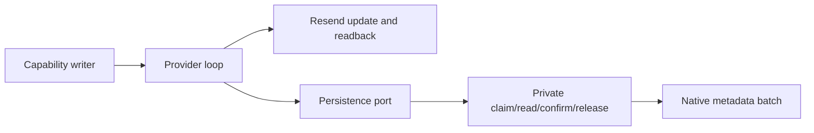

Generated metadata uses JavaScript serialization followed by PostgreSQL-JSONB-compatible text ordering, spacing and number rendering (Unicode key ordering, nested JSON, exponents and refused strings); captured opaque source strings never enter this formatter.

## Cloudflare components for Mail

The source composer supplies scoped OAuth/DNS, application-proof persistence/public TXT observation and Mail DNS requirements/receipts to the general CF runtime through closed Core capabilities. The general CF owner supplies customer DNS and accepted-deletion access; Mail does not substitute ordinary access or manual success. The scoped use fences its selected resource, grant, membership and local/MCP rows across provider calls. Every HTTP request renews a technical lease before it starts; lease UUIDs and SQL time do not consume the domain ID/clock suppliers. Successful refreshed tokens and DNS receipts commit together, while a successful refresh still commits when the post-refresh authority recheck refuses DNS. Failed provider work retains prior SQL token/receipt facts.

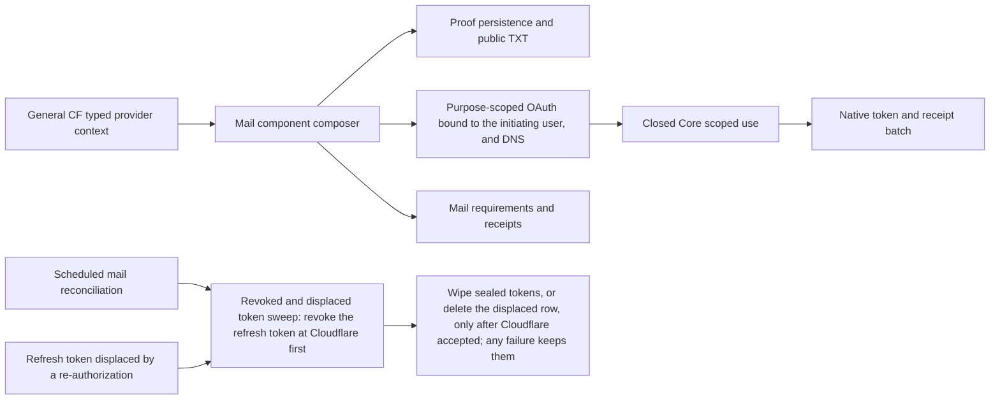

Migration `0467` holds the three consent/grant/revocation families; `0468` is technical locking metadata, not a source fact or activation marker.

## Receiving, warnings and signed Resend on the Core

Gateway private receiving and the public content/attachment paths call `MailDeliveryRuntime`. Its strict adapter keeps the metadata/date/retry replies and digest-only environment-key authentication. Content, recipients, signing/provider keys, attachment URLs and streaming remain Gateway-only. The size/time/pull/recheck/cancellation/closer rules of the [attachment transport](#streamed-attachment-transport--c3-source-candidate) apply unchanged.

The scheduled path composes receipt-time billing, receiving admission, delivery and warning dispatch. Billing derives scope and price in Core and, in one batch, charges the message once (`mailrecv:<message>`) and sets `billed_at`; a message that arrived before the `mail.received` meter was activated is marked billed without a charge, so it cannot hold the head of the queue. Admission reads the credit account's serving decision (Paid, grace and budget, read only), commits local disable before the single shared capability writer, and preserves provider/DNS readback. The warning is the exhaustion warning of the credit account, one email per exhaustion episode: `exhausted_at` identifies the episode, `warned_for_exhausted_at` remembers the one that went out, and `warning_next_attempt_at` is the claim lease (15 minutes) and, after a send that reached nobody, the retry time (5 minutes). The dispatcher in the Mail Gateway sends it to the Owner through the recipient service. `MailWarningRuntime` has two methods, claim and finish, and exposes no credit grant or administrator reinstatement. ([Billing](../../apps/control-store/src/catalog/mail/received-billing.ts#L38), [admission read](../../apps/control-store/src/catalog/mail/receiving-admission.ts), [warnings](../../apps/control-store/src/catalog/mail/warnings.ts#L40), [dispatcher](../../apps/mail-gateway/src/credit-warning-dispatch.ts))

Signed ingress calls a separate `MailResendIngressRuntime`. Signature/body limits remain ingress-owned. Its minimized fixed DTO contains provider references, signed domain classifications, tags/digest and recipient domains; no body, subject or full recipient enters Core. Receipt replay precedes the lazy receive identity. Core runs one receipt-first/owned-effects/receipt-last batch with the UUIDv5 identity, foreign no-receipt acknowledgement, ambiguity refusal, project/workspace reputation latches, warning events and outcome rank. A signed event completes or records the send and never changes the credit. It never routes Resend through the global WorkOS/GitHub/Stripe inbox.

For a signed `domain.updated` with valid records but no `capabilities` field, the source candidate treats the capability states as unknown and preserves the existing per-capability sending and receiving states. Workspace sending verification is still derived from the signed records and domain status. An invalid records shape remains invalid; no missing capability is inferred enabled. Previously the missing field made an owned event invalid and its Core ingest failed, causing a retryable ingress failure. This correction is source-tested, with release and provider delivery still to be verified. [Ingress classification](../../apps/webhook-ingress/src/resend-observation.ts), [atomic effects](../../apps/control-store/src/catalog/mail/resend-events.ts).

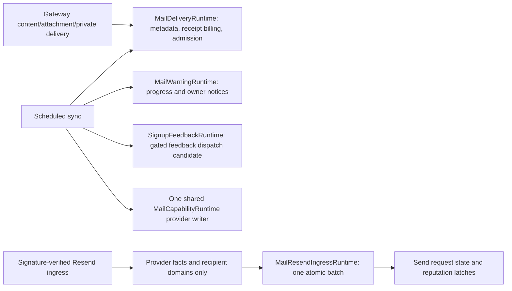

Raw mapping and readback of the mail facts is part of the staged conversion in [the database chapter](database.md#staged-control-conversion-w32). Evidence.

## Signup feedback mail

The released service sends one personal feedback message per platform signup. The Core records a
user-ID-only dispatch state; the campaign gate is initially closed. New signup origins create a
pending entry only while the gate is enabled, due no earlier than one hour after their recorded signup.
The owner approved all historical signup IDs, including test/review identities and users without
workspaces; an atomic activation queues that reviewed cohort as immediately due and opens the gate.
The gateway claims bounded
work through a private Core RPC and the WorkOS service resolves only a live claimed user, checking
the claim again after the provider read. Only verified addresses are sent. Missing users are skipped;
unverified users and transient pre-send failures wait for a later retry.

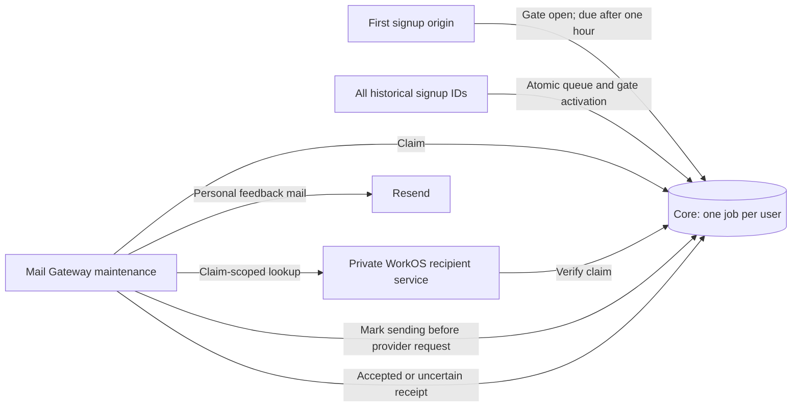

An expired pre-send claim may be reclaimed; once the send boundary is crossed an uncertain result
is not automatically retried. Closing the gate prevents new claims and starts, but does not cancel
an already started provider request. The email uses a reply address selected by the owner. Source
and owner-only preview alone do not establish delivery. The campaign is active in Production; the
release evidence separates accepted,
delivered, bounced, skipped and uncertain historical outcomes. A live new-signup one-hour delivery
has not yet been observed. W45.

## SES management Worker on the Core

The private SES management Worker uses closed resource, command, deletion and scheduled-job capabilities plus the shared provider writer and the exact five-field Workflow authorization. Preflight/key recovery, custody/AAD, safe webhook replay and accepted-parent ordering remain in the callers. Only explicit wire fields cross each RPC; legitimate richer caller objects do not weaken the strict server DTOs.

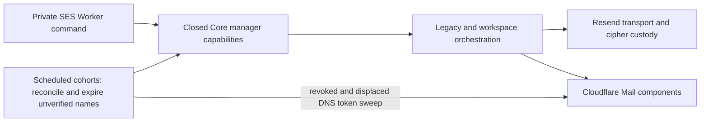

## Native Auth mail and recovery candidate

W37 introduces private `NativeAuthMailService` calls from the Native runtime. Each call resolves current realm and authorized project-sender authority, checks exact same-origin verification/reset/invitation URLs and allowlisted application paths, then uses the existing Resend send/charge workflow under an environment/message idempotency identity. Native does not inject an application mail key or provider sending credential into customer source. Current Paid, sender and Auth admission rules remain owned by [Auth policy](auth-and-secrets.md#customer-application-auth). [Private mail validation](../../apps/mail-gateway/src/native-auth-mail.ts), [entrypoint composition](../../apps/mail-gateway/src/resend-worker.ts), [current mail authority](../../apps/control-store/src/catalog/identity/native-auth-readiness.ts).

Native Auth mail is not retried by the platform. Each verification, reset or invitation message is one durable outbox row, sent by the request that staged it. A refused or uncertain provider result, a refused send claim or a thrown sender error leaves the row undelivered. For a verification or reset the request answers `503 auth_unavailable` after its commit; for an Owner invitation the Control API fails the request with `native_mail_unavailable` after the invitation is staged. No background sweep sends the row. The same request replayed with its `Idempotency-Key` delivers the still-undelivered message again while the row is less than one hour old, and a claim lease holds for one minute. An invitation is sent again only by the Owner's next request, either a replay of the same request or a resend, which cancels the undelivered row and stages a new one. The send uses the project's ordinary daily claim, so Native mail shares the cap in [sending and warm-up](#sending-reputation-and-settlement): 10 messages per UTC day in the first 24 hours of warm-up, 25 until day three, 50 until day seven and 100 per UTC day after that, across Dev and Prod. A message over the cap is refused with `mail_send_daily_limit` (customer code `mail_send_limit_exceeded`) and is not queued. Anonymous sign-up on an open project stages verification mail and can use up that cap. ([Outbox delivery](../../apps/native-auth-runtime/src/password-handler.ts), [request failure](../../apps/native-auth-runtime/src/realm-worker.ts), [owner invitation dispatch](../../apps/native-auth-runtime/src/worker-main.ts), [daily claim](../../apps/control-store/src/catalog/mail/send-claim.ts))

The first hosted Native-only signup on Development source `76e9df4d` returned 503 after creating a pending user, stored success receipt and encrypted outbox; no Core mail request or actual message was observed. The project's reputation row and application mail gateway keys were absent. The send claim requires project reputation, while that released source's reputation foreign key requires an application mail gateway key, even though Native's private mail path does not use one. This is a concrete bootstrap gap; the retained response and outbox do not prove delivery or successful login. [Current claim](../../apps/control-store/src/catalog/mail/send-claim.ts), [released foreign key and guards](../../apps/control-store/migrations/core/0601_credit_drop_old.sql).

The source candidate's forward migration `0621_native_mail_reputation_project.sql` re-anchors reputation's `project_id` foreign key to stable `project_identities`, preserving the organization/project primary key, organization ULID check, all history and the four original append/version triggers. Explicit copies retain all nine state and twelve decision columns. The Native initializer atomically inserts default active warm-up state at version 1 under existing Native effect guards, using `ON CONFLICT DO NOTHING` so existing active or suspended state and history never reset. It creates no application or dummy mail key and grants no new sending authority; the normal sender, Paid, budget and reputation checks remain. The diagram shows this implemented candidate; release and hosted verification remain open. [Forward migration](../../apps/control-store/migrations/core/0621_native_mail_reputation_project.sql), [guarded initializer](../../apps/control-store/src/catalog/identity/native-auth-resource-operations.ts).

Recovery capture now inventories typed application and Native database resources, including Auth-only projects. A Native SQL archive carries an authenticated project/target/realm manifest and individually digested schema slices; private backup-role capture is independent of business-data sharing. The private restore candidate decrypts and checks all slices before taking realms offline, reserves and verifies an encrypted R2 restore pin, then uses externally retained Core generations and exact realm acknowledgements. Import and sanitization stay offline until fixed migrations, privilege verification and removal of sessions, challenges, OAuth state and pending mail have completed; Owner resume is a separate action. Restored SQL cannot restore authority from an older Core epoch. [Capture](../../packages/project-recovery/src/capture.ts), [archive validation](../../packages/project-recovery/src/native-restore-archive.ts), [private coordinator](../../apps/project-recovery-worker/src/native-restore-job.ts), [Core fence](../../apps/control-store/src/catalog/identity/native-auth-restore.ts), [sanitizer](../../apps/native-auth-runtime/src/restore.ts).

The pin uses the exact organization/project/restore path outside expiring snapshots. Lifecycle inspection rejects any enabled expiry rule that could match it, and completion/deletion require scoped payload absence proof. Private operator observation precedes each execution; same-generation resume and explicit old/new claim rearm retain their original archive identity. The bounded source reviews and local restore/coordinator/operator checks do not establish final complete-candidate verification, hosted ServiceRPC compatibility, provider recovery or release. [Pin storage](../../apps/project-recovery-worker/src/r2-archives.ts), [private operator](../../scripts/native-auth-restore-operator.mjs), bounded operator procedure and limits. The customer SQL export sequence above remains the export flow; this private restore candidate is a separate command.

## Development-only preview mail QA source candidate

The W41 `next-app-mail` fixture uses a private QA mail Worker and the existing Development Mail Gateway. Trusted scope selects the one authorized recipient; the private Worker reads the existing fixed-scope environment mail key from Runtime Secret Delivery rather than a separately provisioned static key. It rereads and reauthorizes the key before dispatch; the operator and guest receive no real key, and the guest gets only fixture markers. The Worker rechecks the exact live spike lease and generation, Dev grant, credit and mail-key scope. Its two-minute permit is bound to the session, generation, message ID and scope; consumption is atomic. A confirmed gateway acceptance permits the fixture's same-ID idempotency check. A dispatched send with an unknown outcome stays locked for reconciliation and cannot be automatically rearmed or retried. Cleanup removes only the matching safe permit, after exact-session retirement; uncertain or in-flight sends remain for reconciliation. [QA mail adapter](../../scripts/preview-spike/mail/adapter.mjs), [permit state](../../scripts/preview-spike/mail/permit.mjs).

For `next-native-auth`, `NativePreviewAuthMailService` allows only verification or password-reset messages to a private list of two to eight distinct QA recipients. The bounded list preauthorizes two fresh users for each of the four instance-type journeys; each request still needs exact recipient membership. It checks the current preview identity and real sender before and around dispatch, then uses the existing sender, custody, billing and idempotency path. A lost response or authority change after dispatch is uncertain; no later check can recall a sent message. These are Development-only source candidates; local tests do not establish a deployed binding, verified sender, inbox delivery, G1 or G2. [Native preview mail](../../apps/mail-gateway/src/native-preview-auth-mail.ts), [private entrypoint](../../apps/mail-gateway/src/resend-worker.ts), [QA procedure and limitations](../../scripts/preview-spike/mail/README.md).

## Protected Native export settlement candidate

A Native-bearing export uses `native-exports/<organization>/<project>/<operation>.zip` in the existing private backup bucket. The adapter checks that no enabled provider lifecycle expiry can match this protected key; its R2 mutation client permits one SDK attempt. Core migration `0620` retains the first effect identity, exact bytes/digest/manifest and seven-day expiry independently of the job's later terminal state. Preparing the archive records this immutable journal before a separate guarded `reserved` → `dispatched` transition grants the only upload permit. A lost permit reply grants no PUT; a replay cannot obtain another permit. A missing or unknown PUT/readback preserves that original identity and cannot discard metadata or recapture a different archive. V1 application-only exports retain their existing behavior. [Immutable effect journal](../../apps/control-store/migrations/core/0620_native_export_effects.sql), [Core prepare and dispatch](../../apps/control-store/src/catalog/recovery/jobs.ts), [capture coordinator](../../apps/project-recovery-worker/src/job.ts), [protected R2 operations](../../apps/project-recovery-worker/src/r2-archives.ts).

Before Native credential capture, preparation, upload dispatch and successful finish, Core rechecks the original requesting human's current canonical Owner `projects:write` authority, accepted MCP restrictions/connection where present, current billing epoch, project lifecycle and capture claim/fence. The export action remains the existing full-project export permission; it does not invent a separate Native administration grant. Loss of that authority stops new capture/effects. Expiry or accepted project-deletion cleanup uses a distinct narrow service/deletion proof, so retirement does not depend on the former actor keeping Owner access. [Current actor and billing guards](../../apps/control-store/src/catalog/recovery/jobs.ts), [cleanup authority](../../apps/control-store/src/catalog/recovery/cleanup.ts).

The existing recovery maintenance tick atomically selects at most one expired unsettled Native effect at Core time and claims its next attempt for five minutes. The dispatcher invokes private purge with the exact persisted artifact identity; an unknown invocation remains due for later observation. Capture, replay and purge select the same organization/project/archive Sandbox and serialize there; a surviving running Container causes a closed busy refusal instead of being destroyed to guess quiescence. For an uncertain upload with no readable payload, conditional creation of a permanent nonsecret marker competes with the original create-only PUT and fences any delayed arrival. A verified payload can be deleted only after exact hash/type readback, followed by HEAD absence. Core records `tombstoned` or `absent` accordingly; the former proves payload retirement, not literal object absence. Project cleanup inventories the exact protected key, and both finalizer and native trigger refuse terminal project deletion while an effect is unretired. [Bounded expiry claim](../../apps/control-store/src/catalog/recovery/maintenance.ts), [actual dispatcher](../../apps/control-api/src/d1-recovery-dispatch.ts), [artifact-scoped Sandbox](../../apps/recovery-container/src/worker-main.ts), [retirement](../../apps/project-recovery-worker/src/recovery-runtime.ts), [frozen inventory](../../apps/control-store/src/catalog/provisioning/lifecycle-inventory.ts), [terminal guard](../../apps/control-store/src/catalog/provisioning/lifecycle-completion.ts).

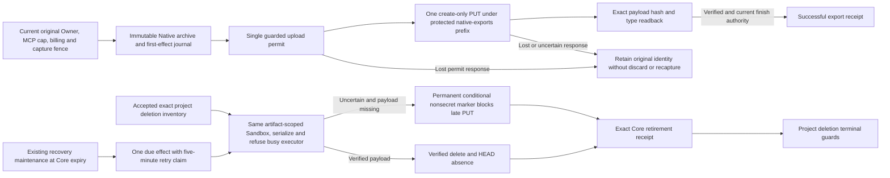

Restore archive reads derive the same protected Native export prefix from the authenticated receipt before creating the separate restore pin. Unexpected unreleased Native jobs prepared before `0620` without an effect journal fail closed: replay, dispatch, restore/deletion bookkeeping must be explicitly reconciled under a qualified procedure, never silently backfilled, discarded or reclassified as V1. This is source-level correction and bounded independent review evidence. Actual R2 lifecycle/IAM/conditional-write/in-flight behavior, hosted private ServiceRPC, final candidate verification and release remain unqualified. [Restore locator](../../apps/control-store/src/catalog/identity/native-auth-restore-job.ts), implementation and review limits.

## Live Preview recovery data

The W41 source candidate keeps Preview dependency backups separate from customer SQL recovery. Native Realm SQL exports exclude only the ephemeral `native_preview_realm_policy` and `native_preview_policy_migrations`: the backup role has no permissions on these internal Preview tables, and they are reconstructed from current platform authority rather than restored as customer data. Normal Native users, sessions and application tables retain their existing capture path. [Capture](../../packages/project-recovery/src/capture.ts), [D608](decisions/runtime-and-lifecycle.md#d608).
