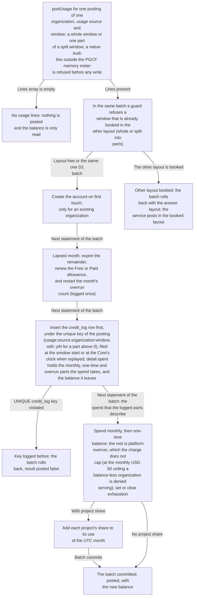

# Core credit account — charging one posted usage window

Generated by Mermaider. View: **implemented**. Basis: **agent-reviewed semantic model**.

## Sources

- [apps/control-store/src/catalog/credit/account.ts · ensureStatement:205](../../../apps/control-store/src/catalog/credit/account.ts#L205)
- [apps/control-store/src/catalog/credit/account.ts · renewalStatements:230](../../../apps/control-store/src/catalog/credit/account.ts#L230)
- [apps/control-store/src/catalog/credit/decision.ts · runtimeDecision:59](../../../apps/control-store/src/catalog/credit/decision.ts#L59)
- [apps/control-store/src/catalog/credit/runtime.ts · createCreditCommands:186](../../../apps/control-store/src/catalog/credit/runtime.ts#L186)
- [apps/control-store/src/catalog/credit/spend.ts · spendAssignments:24](../../../apps/control-store/src/catalog/credit/spend.ts#L24)
- [apps/control-store/src/catalog/credit/spend.ts · PROJECT_USE_CONFLICT:33](../../../apps/control-store/src/catalog/credit/spend.ts#L33)
- [apps/control-store/src/catalog/credit/spend.ts · isDuplicate:43](../../../apps/control-store/src/catalog/credit/spend.ts#L43)
- [apps/control-store/src/catalog/credit/spend.ts · chargeOrg:84](../../../apps/control-store/src/catalog/credit/spend.ts#L84)
- [apps/control-store/src/catalog/credit/spend.ts · runChargeOrg:148](../../../apps/control-store/src/catalog/credit/spend.ts#L148)

Freshness checks confirm the recorded source evidence and generated output. They do not establish live deployment or prove every semantic interpretation.
