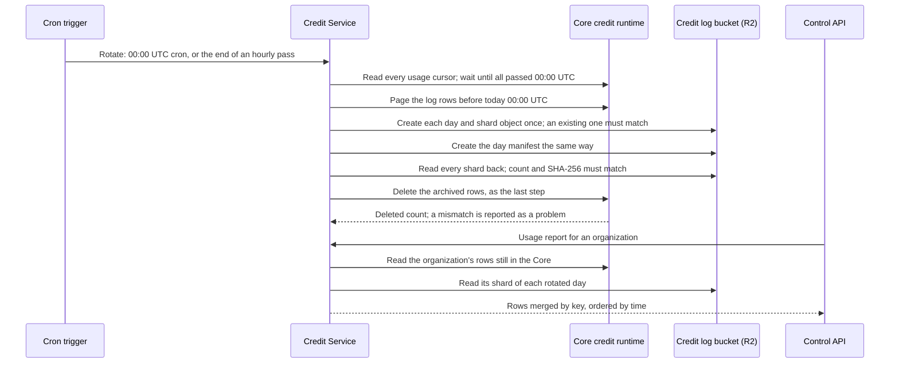

# Credit log — daily rotation to R2 and the usage report

Generated by Mermaider. View: **implemented**. Basis: **agent-reviewed semantic model**.

## Sources

- [apps/control-api/src/d1-credits.ts · createD1CreditManagement:212](../../../apps/control-api/src/d1-credits.ts#L212)
- [apps/control-store/src/catalog/credit/runtime.ts · createCreditCommands:186](../../../apps/control-store/src/catalog/credit/runtime.ts#L186)
- [apps/credit-service/src/report.ts · readArchivedDay:66](../../../apps/credit-service/src/report.ts#L66)
- [apps/credit-service/src/report.ts · readUsage:87](../../../apps/credit-service/src/report.ts#L87)
- [apps/credit-service/src/rotation.ts · scan:97](../../../apps/credit-service/src/rotation.ts#L97)
- [apps/credit-service/src/rotation.ts · createOnce:169](../../../apps/credit-service/src/rotation.ts#L169)
- [apps/credit-service/src/rotation.ts · rotateCreditLog:206](../../../apps/credit-service/src/rotation.ts#L206)
- [apps/credit-service/src/worker-main.ts · ROTATION_CRON:29](../../../apps/credit-service/src/worker-main.ts#L29)
- [apps/credit-service/src/worker-main.ts · runRotation:115](../../../apps/credit-service/src/worker-main.ts#L115)
- [apps/credit-service/src/worker-main.ts · runUsage:135](../../../apps/credit-service/src/worker-main.ts#L135)
- [apps/credit-service/src/worker-main.ts · CreditServiceRuntime:176](../../../apps/credit-service/src/worker-main.ts#L176)
- [apps/credit-service/src/worker-main.ts · CreditServiceRuntime.readUsage:177](../../../apps/credit-service/src/worker-main.ts#L177)
- [apps/credit-service/wrangler.production.jsonc:15](../../../apps/credit-service/wrangler.production.jsonc#L15)

Freshness checks confirm the recorded source evidence and generated output. They do not establish live deployment or prove every semantic interpretation.
