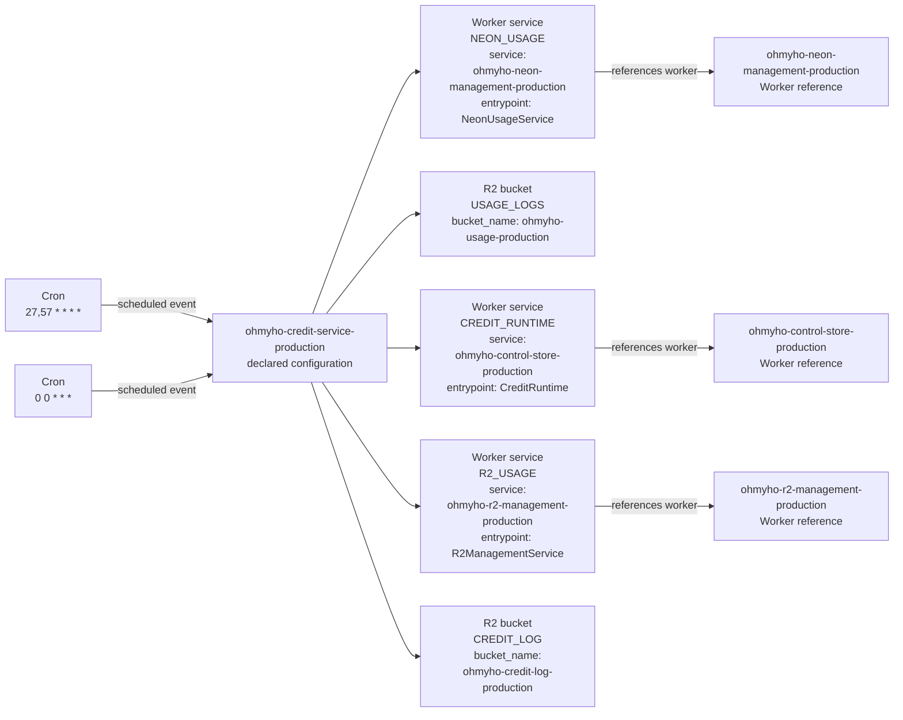

# Credit Service — declared resource topology

Generated by Mermaider. View: **implemented**. Basis: **declared source structure**.

## Coverage notes

- **wrangler-worker-ambiguous**: Multiple configurations declare Worker ohmyho-neon-management-production; deployment identity is unresolved.

## Sources

- [apps/credit-service/wrangler.production.jsonc:3](../../../apps/credit-service/wrangler.production.jsonc#L3)
- [apps/credit-service/wrangler.production.jsonc:15](../../../apps/credit-service/wrangler.production.jsonc#L15)
- [apps/credit-service/wrangler.production.jsonc:28](../../../apps/credit-service/wrangler.production.jsonc#L28)
- [apps/credit-service/wrangler.production.jsonc:29](../../../apps/credit-service/wrangler.production.jsonc#L29)
- [apps/credit-service/wrangler.production.jsonc:36](../../../apps/credit-service/wrangler.production.jsonc#L36)
- [apps/credit-service/wrangler.production.jsonc:41](../../../apps/credit-service/wrangler.production.jsonc#L41)
- [apps/credit-service/wrangler.production.jsonc:46](../../../apps/credit-service/wrangler.production.jsonc#L46)
- [apps/neon-management/wrangler.pgcf.production.jsonc:3](../../../apps/neon-management/wrangler.pgcf.production.jsonc#L3)
- [apps/neon-management/wrangler.production.jsonc:3](../../../apps/neon-management/wrangler.production.jsonc#L3)
- [apps/r2-management/wrangler.production.jsonc:3](../../../apps/r2-management/wrangler.production.jsonc#L3)

Freshness checks confirm the recorded source evidence and generated output. They do not establish live deployment or prove every semantic interpretation.
