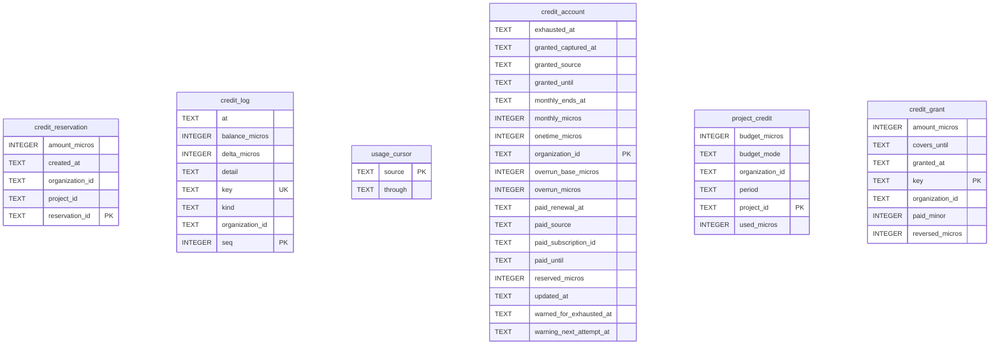

# Core credit account tables (selected view of the replayed migrations)

Generated by Mermaider. View: **implemented**. Basis: **declared source structure**.

This view is an explicitly selected subset of the source model.

## Sources

- [apps/control-store/migrations/core/0001_core_layout.sql:1](../../../apps/control-store/migrations/core/0001_core_layout.sql#L1)
- [apps/control-store/migrations/core/0101_directory.sql:1](../../../apps/control-store/migrations/core/0101_directory.sql#L1)
- [apps/control-store/migrations/core/0110_directory_commands.sql:1](../../../apps/control-store/migrations/core/0110_directory_commands.sql#L1)
- [apps/control-store/migrations/core/0131_domain_claim_saga.sql:1](../../../apps/control-store/migrations/core/0131_domain_claim_saga.sql#L1)
- [apps/control-store/migrations/core/0140_identity_routes.sql:1](../../../apps/control-store/migrations/core/0140_identity_routes.sql#L1)
- [apps/control-store/migrations/core/0173_pgcf_database_claims.sql:1](../../../apps/control-store/migrations/core/0173_pgcf_database_claims.sql#L1)
- [apps/control-store/migrations/core/0190_inbox_unrouted_policy.sql:1](../../../apps/control-store/migrations/core/0190_inbox_unrouted_policy.sql#L1)
- [apps/control-store/migrations/core/0201_shard.sql:1](../../../apps/control-store/migrations/core/0201_shard.sql#L1)
- [apps/control-store/migrations/core/0202_workflow_spine.sql:1](../../../apps/control-store/migrations/core/0202_workflow_spine.sql#L1)
- [apps/control-store/migrations/core/0210_identity_access.sql:1](../../../apps/control-store/migrations/core/0210_identity_access.sql#L1)
- [apps/control-store/migrations/core/0211_project_operation_guards.sql:1](../../../apps/control-store/migrations/core/0211_project_operation_guards.sql#L1)
- [apps/control-store/migrations/core/0220_billing_ledger.sql:1](../../../apps/control-store/migrations/core/0220_billing_ledger.sql#L1)
- [apps/control-store/migrations/core/0231_secrets.sql:1](../../../apps/control-store/migrations/core/0231_secrets.sql#L1)
- [apps/control-store/migrations/core/0232_domains_mail.sql:1](../../../apps/control-store/migrations/core/0232_domains_mail.sql#L1)
- [apps/control-store/migrations/core/0233_domain_claim_aborts.sql:1](../../../apps/control-store/migrations/core/0233_domain_claim_aborts.sql#L1)
- [apps/control-store/migrations/core/0250_billing_policy.sql:1](../../../apps/control-store/migrations/core/0250_billing_policy.sql#L1)
- [apps/control-store/migrations/core/0251_rate_cards.sql:1](../../../apps/control-store/migrations/core/0251_rate_cards.sql#L1)
- [apps/control-store/migrations/core/0252_measured_usage.sql:1](../../../apps/control-store/migrations/core/0252_measured_usage.sql#L1)
- [apps/control-store/migrations/core/0253_measure_effects.sql:1](../../../apps/control-store/migrations/core/0253_measure_effects.sql#L1)
- [apps/control-store/migrations/core/0254_metering_cohort_lane.sql:1](../../../apps/control-store/migrations/core/0254_metering_cohort_lane.sql#L1)
- [apps/control-store/migrations/core/0270_database_provider_targets.sql:1](../../../apps/control-store/migrations/core/0270_database_provider_targets.sql#L1)
- [apps/control-store/migrations/core/0271_pgcf_database_registrations.sql:1](../../../apps/control-store/migrations/core/0271_pgcf_database_registrations.sql#L1)
- [apps/control-store/migrations/core/0272_pgcf_serving_intervals.sql:1](../../../apps/control-store/migrations/core/0272_pgcf_serving_intervals.sql#L1)
- [apps/control-store/migrations/core/0273_provider_history_inventory.sql:1](../../../apps/control-store/migrations/core/0273_provider_history_inventory.sql#L1)
- [apps/control-store/migrations/core/0274_pgcf_database_claim_aborts.sql:1](../../../apps/control-store/migrations/core/0274_pgcf_database_claim_aborts.sql#L1)
- [apps/control-store/migrations/core/0280_project_recovery.sql:1](../../../apps/control-store/migrations/core/0280_project_recovery.sql#L1)
- [apps/control-store/migrations/core/0290_operation_gates.sql:1](../../../apps/control-store/migrations/core/0290_operation_gates.sql#L1)
- [apps/control-store/migrations/core/0300_project_scope_history.sql:1](../../../apps/control-store/migrations/core/0300_project_scope_history.sql#L1)
- [apps/control-store/migrations/core/0310_global_economic_identity.sql:1](../../../apps/control-store/migrations/core/0310_global_economic_identity.sql#L1)
- [apps/control-store/migrations/core/0320_workos_poller.sql:1](../../../apps/control-store/migrations/core/0320_workos_poller.sql#L1)
- [apps/control-store/migrations/core/0321_customer_project_admission.sql:1](../../../apps/control-store/migrations/core/0321_customer_project_admission.sql#L1)
- [apps/control-store/migrations/core/0322_build_receipts.sql:1](../../../apps/control-store/migrations/core/0322_build_receipts.sql#L1)
- [apps/control-store/migrations/core/0323_workos_onboarding.sql:1](../../../apps/control-store/migrations/core/0323_workos_onboarding.sql#L1)
- [apps/control-store/migrations/core/0324_recovery_global_quota.sql:1](../../../apps/control-store/migrations/core/0324_recovery_global_quota.sql#L1)
- [apps/control-store/migrations/core/0325_build_history_scope.sql:1](../../../apps/control-store/migrations/core/0325_build_history_scope.sql#L1)
- [apps/control-store/migrations/core/0326_global_webhook_inbox.sql:1](../../../apps/control-store/migrations/core/0326_global_webhook_inbox.sql#L1)
- [apps/control-store/migrations/core/0327_global_inbox_identity.sql:1](../../../apps/control-store/migrations/core/0327_global_inbox_identity.sql#L1)
- [apps/control-store/migrations/core/0330_measured_financial_receipts.sql:1](../../../apps/control-store/migrations/core/0330_measured_financial_receipts.sql#L1)
- [apps/control-store/migrations/core/0331_released_price_constraints.sql:1](../../../apps/control-store/migrations/core/0331_released_price_constraints.sql#L1)
- [apps/control-store/migrations/core/0332_metering_family_schedule.sql:1](../../../apps/control-store/migrations/core/0332_metering_family_schedule.sql#L1)
- [apps/control-store/migrations/core/0333_maintenance_source_wakes.sql:1](../../../apps/control-store/migrations/core/0333_maintenance_source_wakes.sql#L1)
- [apps/control-store/migrations/core/0334_lifetime_source_evidence.sql:1](../../../apps/control-store/migrations/core/0334_lifetime_source_evidence.sql#L1)
- [apps/control-store/migrations/core/0335_historical_import_activation.sql:1](../../../apps/control-store/migrations/core/0335_historical_import_activation.sql#L1)
- [apps/control-store/migrations/core/0336_deployment_static_integrity.sql:1](../../../apps/control-store/migrations/core/0336_deployment_static_integrity.sql#L1)
- [apps/control-store/migrations/core/0337_provider_canonical_sources.sql:1](../../../apps/control-store/migrations/core/0337_provider_canonical_sources.sql#L1)
- [apps/control-store/migrations/core/0338_measured_receipt_first.sql:1](../../../apps/control-store/migrations/core/0338_measured_receipt_first.sql#L1)
- [apps/control-store/migrations/core/0339_metering_owner_activation.sql:1](../../../apps/control-store/migrations/core/0339_metering_owner_activation.sql#L1)
- [apps/control-store/migrations/core/0340_stripe_billing.sql:1](../../../apps/control-store/migrations/core/0340_stripe_billing.sql#L1)
- [apps/control-store/migrations/core/0341_stripe_source_notices.sql:1](../../../apps/control-store/migrations/core/0341_stripe_source_notices.sql#L1)
- [apps/control-store/migrations/core/0342_stripe_subscription_identity.sql:1](../../../apps/control-store/migrations/core/0342_stripe_subscription_identity.sql#L1)
- [apps/control-store/migrations/core/0350_pgcf_collection.sql:1](../../../apps/control-store/migrations/core/0350_pgcf_collection.sql#L1)
- [apps/control-store/migrations/core/0351_pgcf_serving_parity.sql:1](../../../apps/control-store/migrations/core/0351_pgcf_serving_parity.sql#L1)
- [apps/control-store/migrations/core/0352_pgcf_cutover_history.sql:1](../../../apps/control-store/migrations/core/0352_pgcf_cutover_history.sql#L1)
- [apps/control-store/migrations/core/0353_provider_operation_scope.sql:1](../../../apps/control-store/migrations/core/0353_provider_operation_scope.sql#L1)
- [apps/control-store/migrations/core/0360_runtime_probe_windows.sql:1](../../../apps/control-store/migrations/core/0360_runtime_probe_windows.sql#L1)
- [apps/control-store/migrations/core/0361_function_schedule_source_shape.sql:1](../../../apps/control-store/migrations/core/0361_function_schedule_source_shape.sql#L1)
- [apps/control-store/migrations/core/0362_gateway_rollback_history.sql:1](../../../apps/control-store/migrations/core/0362_gateway_rollback_history.sql#L1)
- [apps/control-store/migrations/core/0363_effective_gateway_publications.sql:1](../../../apps/control-store/migrations/core/0363_effective_gateway_publications.sql#L1)
- [apps/control-store/migrations/core/0364_gateway_cleanup_authority.sql:1](../../../apps/control-store/migrations/core/0364_gateway_cleanup_authority.sql#L1)
- [apps/control-store/migrations/core/0365_wfp_cleanup_resource_expectations.sql:1](../../../apps/control-store/migrations/core/0365_wfp_cleanup_resource_expectations.sql#L1)
- [apps/control-store/migrations/core/0370_runtime_secret_delivery.sql:1](../../../apps/control-store/migrations/core/0370_runtime_secret_delivery.sql#L1)
- [apps/control-store/migrations/core/0371_runtime_secret_stage_history.sql:1](../../../apps/control-store/migrations/core/0371_runtime_secret_stage_history.sql#L1)
- [apps/control-store/migrations/core/0372_runtime_secret_storage_key.sql:1](../../../apps/control-store/migrations/core/0372_runtime_secret_storage_key.sql#L1)
- [apps/control-store/migrations/core/0373_environment_secret_request_history.sql:1](../../../apps/control-store/migrations/core/0373_environment_secret_request_history.sql#L1)
- [apps/control-store/migrations/core/0380_mcp_global_grant_identity.sql:1](../../../apps/control-store/migrations/core/0380_mcp_global_grant_identity.sql#L1)
- [apps/control-store/migrations/core/0381_original_operation_history_admission.sql:1](../../../apps/control-store/migrations/core/0381_original_operation_history_admission.sql#L1)
- [apps/control-store/migrations/core/0382_original_delivery_attempts.sql:1](../../../apps/control-store/migrations/core/0382_original_delivery_attempts.sql#L1)
- [apps/control-store/migrations/core/0383_original_audit_namespaces.sql:1](../../../apps/control-store/migrations/core/0383_original_audit_namespaces.sql#L1)
- [apps/control-store/migrations/core/0384_original_assignment_history.sql:1](../../../apps/control-store/migrations/core/0384_original_assignment_history.sql#L1)
- [apps/control-store/migrations/core/0385_original_spine_static_scopes.sql:1](../../../apps/control-store/migrations/core/0385_original_spine_static_scopes.sql#L1)
- [apps/control-store/migrations/core/0390_wfp_discovery.sql:1](../../../apps/control-store/migrations/core/0390_wfp_discovery.sql#L1)
- [apps/control-store/migrations/core/0391_lifetime_discovery.sql:1](../../../apps/control-store/migrations/core/0391_lifetime_discovery.sql#L1)
- [apps/control-store/migrations/core/0392_provider_hint_bootstrap.sql:1](../../../apps/control-store/migrations/core/0392_provider_hint_bootstrap.sql#L1)
- [apps/control-store/migrations/core/0393_projection_lifecycle.sql:1](../../../apps/control-store/migrations/core/0393_projection_lifecycle.sql#L1)
- [apps/control-store/migrations/core/0394_projection_contributions.sql:1](../../../apps/control-store/migrations/core/0394_projection_contributions.sql#L1)
- [apps/control-store/migrations/core/0395_projection_source_wakes.sql:1](../../../apps/control-store/migrations/core/0395_projection_source_wakes.sql#L1)
- [apps/control-store/migrations/core/0396_projection_source_kind.sql:1](../../../apps/control-store/migrations/core/0396_projection_source_kind.sql#L1)
- [apps/control-store/migrations/core/0400_original_product_database_jobs.sql:1](../../../apps/control-store/migrations/core/0400_original_product_database_jobs.sql#L1)
- [apps/control-store/migrations/core/0401_original_product_database_ulid.sql:1](../../../apps/control-store/migrations/core/0401_original_product_database_ulid.sql#L1)
- [apps/control-store/migrations/core/0402_original_pgcf_entitlements.sql:1](../../../apps/control-store/migrations/core/0402_original_pgcf_entitlements.sql#L1)
- [apps/control-store/migrations/core/0410_original_identity_backbone.sql:1](../../../apps/control-store/migrations/core/0410_original_identity_backbone.sql#L1)
- [apps/control-store/migrations/core/0411_original_migration_history.sql:1](../../../apps/control-store/migrations/core/0411_original_migration_history.sql#L1)
- [apps/control-store/migrations/core/0412_original_wallet_presence.sql:1](../../../apps/control-store/migrations/core/0412_original_wallet_presence.sql#L1)
- [apps/control-store/migrations/core/0413_original_provider_parent_arrays.sql:1](../../../apps/control-store/migrations/core/0413_original_provider_parent_arrays.sql#L1)
- [apps/control-store/migrations/core/0450_original_workflow_identity.sql:1](../../../apps/control-store/migrations/core/0450_original_workflow_identity.sql#L1)
- [apps/control-store/migrations/core/0451_original_product_intents.sql:1](../../../apps/control-store/migrations/core/0451_original_product_intents.sql#L1)
- [apps/control-store/migrations/core/0452_original_github_authorizations.sql:1](../../../apps/control-store/migrations/core/0452_original_github_authorizations.sql#L1)
- [apps/control-store/migrations/core/0453_original_workflow_attempts.sql:1](../../../apps/control-store/migrations/core/0453_original_workflow_attempts.sql#L1)
- [apps/control-store/migrations/core/0454_original_deployment_diagnostics.sql:1](../../../apps/control-store/migrations/core/0454_original_deployment_diagnostics.sql#L1)
- [apps/control-store/migrations/core/0455_original_source_archive_custody.sql:1](../../../apps/control-store/migrations/core/0455_original_source_archive_custody.sql#L1)
- [apps/control-store/migrations/core/0456_original_project_source_selection.sql:1](../../../apps/control-store/migrations/core/0456_original_project_source_selection.sql#L1)
- [apps/control-store/migrations/core/0457_finite_diagnostic_request_guard.sql:1](../../../apps/control-store/migrations/core/0457_finite_diagnostic_request_guard.sql#L1)
- [apps/control-store/migrations/core/0458_original_provider_mutation_claim.sql:1](../../../apps/control-store/migrations/core/0458_original_provider_mutation_claim.sql#L1)
- [apps/control-store/migrations/core/0459_github_connection_authorizations.sql:1](../../../apps/control-store/migrations/core/0459_github_connection_authorizations.sql#L1)
- [apps/control-store/migrations/core/0460_mail_original_receipts.sql:1](../../../apps/control-store/migrations/core/0460_mail_original_receipts.sql#L1)
- [apps/control-store/migrations/core/0461_mail_send_original_facts.sql:1](../../../apps/control-store/migrations/core/0461_mail_send_original_facts.sql#L1)
- [apps/control-store/migrations/core/0462_mail_ordinary_financial_receipt.sql:1](../../../apps/control-store/migrations/core/0462_mail_ordinary_financial_receipt.sql#L1)
- [apps/control-store/migrations/core/0463_mail_historical_ses_receipts.sql:1](../../../apps/control-store/migrations/core/0463_mail_historical_ses_receipts.sql#L1)
- [apps/control-store/migrations/core/0464_mail_historical_route53_receipts.sql:1](../../../apps/control-store/migrations/core/0464_mail_historical_route53_receipts.sql#L1)
- [apps/control-store/migrations/core/0465_retired_mail_credit_history.sql:1](../../../apps/control-store/migrations/core/0465_retired_mail_credit_history.sql#L1)
- [apps/control-store/migrations/core/0466_mail_original_management.sql:1](../../../apps/control-store/migrations/core/0466_mail_original_management.sql#L1)
- [apps/control-store/migrations/core/0467_mail_original_scoped_dns.sql:1](../../../apps/control-store/migrations/core/0467_mail_original_scoped_dns.sql#L1)
- [apps/control-store/migrations/core/0468_scoped_dns_provider_use.sql:1](../../../apps/control-store/migrations/core/0468_scoped_dns_provider_use.sql#L1)
- [apps/control-store/migrations/core/0470_mail_received_original_facts.sql:1](../../../apps/control-store/migrations/core/0470_mail_received_original_facts.sql#L1)
- [apps/control-store/migrations/core/0471_mail_credit_warning_original_facts.sql:1](../../../apps/control-store/migrations/core/0471_mail_credit_warning_original_facts.sql#L1)
- [apps/control-store/migrations/core/0472_original_mail_valuation_history.sql:1](../../../apps/control-store/migrations/core/0472_original_mail_valuation_history.sql#L1)
- [apps/control-store/migrations/core/0480_paid_domain_native_integrity.sql:1](../../../apps/control-store/migrations/core/0480_paid_domain_native_integrity.sql#L1)
- [apps/control-store/migrations/core/0481_compute_operation_uuid_integrity.sql:1](../../../apps/control-store/migrations/core/0481_compute_operation_uuid_integrity.sql#L1)
- [apps/control-store/migrations/core/0482_compute_operation_array_bounds.sql:1](../../../apps/control-store/migrations/core/0482_compute_operation_array_bounds.sql#L1)
- [apps/control-store/migrations/core/0483_compute_operation_array_leaf_depth.sql:1](../../../apps/control-store/migrations/core/0483_compute_operation_array_leaf_depth.sql#L1)
- [apps/control-store/migrations/core/0490_restore_intent_lifetime_wake.sql:1](../../../apps/control-store/migrations/core/0490_restore_intent_lifetime_wake.sql#L1)
- [apps/control-store/migrations/core/0491_mail_website_identity_invalidation.sql:1](../../../apps/control-store/migrations/core/0491_mail_website_identity_invalidation.sql#L1)
- [apps/control-store/migrations/core/0492_r2_management_native.sql:1](../../../apps/control-store/migrations/core/0492_r2_management_native.sql#L1)
- [apps/control-store/migrations/core/0493_original_api_metadata.sql:1](../../../apps/control-store/migrations/core/0493_original_api_metadata.sql#L1)
- [apps/control-store/migrations/core/0494_general_cloudflare_grant_use.sql:1](../../../apps/control-store/migrations/core/0494_general_cloudflare_grant_use.sql#L1)
- [apps/control-store/migrations/core/0495_original_github_auto_deploy.sql:1](../../../apps/control-store/migrations/core/0495_original_github_auto_deploy.sql#L1)
- [apps/control-store/migrations/core/0496_original_candidate_operation_cleanup.sql:1](../../../apps/control-store/migrations/core/0496_original_candidate_operation_cleanup.sql#L1)
- [apps/control-store/migrations/core/0497_storage_erasure_native.sql:1](../../../apps/control-store/migrations/core/0497_storage_erasure_native.sql#L1)
- [apps/control-store/migrations/core/0498_cloudflare_original_receipt_fields.sql:1](../../../apps/control-store/migrations/core/0498_cloudflare_original_receipt_fields.sql#L1)
- [apps/control-store/migrations/core/0499_exact_scoped_dns_import_context.sql:1](../../../apps/control-store/migrations/core/0499_exact_scoped_dns_import_context.sql#L1)
- [apps/control-store/migrations/core/0500_original_managed_source_inventory.sql:1](../../../apps/control-store/migrations/core/0500_original_managed_source_inventory.sql#L1)
- [apps/control-store/migrations/core/0501_api_action_confirmation_identity.sql:1](../../../apps/control-store/migrations/core/0501_api_action_confirmation_identity.sql#L1)
- [apps/control-store/migrations/core/0504_original_public_entry_feedback.sql:1](../../../apps/control-store/migrations/core/0504_original_public_entry_feedback.sql#L1)
- [apps/control-store/migrations/core/0505_original_provider_resources.sql:1](../../../apps/control-store/migrations/core/0505_original_provider_resources.sql#L1)
- [apps/control-store/migrations/core/0506_original_dev_share_link_identity.sql:1](../../../apps/control-store/migrations/core/0506_original_dev_share_link_identity.sql#L1)
- [apps/control-store/migrations/core/0508_historical_mail_meter.sql:1](../../../apps/control-store/migrations/core/0508_historical_mail_meter.sql#L1)
- [apps/control-store/migrations/core/0509_historical_mail_meter_regions.sql:1](../../../apps/control-store/migrations/core/0509_historical_mail_meter_regions.sql#L1)
- [apps/control-store/migrations/core/0600_credit_simple.sql:1](../../../apps/control-store/migrations/core/0600_credit_simple.sql#L1)
- [apps/control-store/migrations/core/0601_credit_drop_old.sql:1](../../../apps/control-store/migrations/core/0601_credit_drop_old.sql#L1)
- [apps/control-store/migrations/core/0602_meter_activation_timeline.sql:1](../../../apps/control-store/migrations/core/0602_meter_activation_timeline.sql#L1)
- [apps/control-store/migrations/core/0603_database_access_delete_operation_replace.sql:1](../../../apps/control-store/migrations/core/0603_database_access_delete_operation_replace.sql#L1)
- [apps/control-store/migrations/core/0604_recovery_archive_discard.sql:1](../../../apps/control-store/migrations/core/0604_recovery_archive_discard.sql#L1)
- [apps/control-store/migrations/core/0605_ai_gateway.sql:1](../../../apps/control-store/migrations/core/0605_ai_gateway.sql#L1)
- [apps/control-store/migrations/core/0606_ai_plan_shape.sql:1](../../../apps/control-store/migrations/core/0606_ai_plan_shape.sql#L1)
- [apps/control-store/migrations/core/0607_ai_open_calls_guard.sql:1](../../../apps/control-store/migrations/core/0607_ai_open_calls_guard.sql#L1)
- [apps/control-store/migrations/core/0608_mcp_connection_revocations.sql:1](../../../apps/control-store/migrations/core/0608_mcp_connection_revocations.sql#L1)
- [apps/control-store/migrations/core/0609_github_handoff_authority.sql:1](../../../apps/control-store/migrations/core/0609_github_handoff_authority.sql#L1)
- [apps/control-store/migrations/core/0610_compute_connection_provider_uses.sql:1](../../../apps/control-store/migrations/core/0610_compute_connection_provider_uses.sql#L1)
- [apps/control-store/migrations/core/0611_native_auth_metadata.sql:1](../../../apps/control-store/migrations/core/0611_native_auth_metadata.sql#L1)
- [apps/control-store/migrations/core/0612_native_auth_framework_plan.sql:1](../../../apps/control-store/migrations/core/0612_native_auth_framework_plan.sql#L1)
- [apps/control-store/migrations/core/0613_native_auth_head_fence.sql:1](../../../apps/control-store/migrations/core/0613_native_auth_head_fence.sql#L1)
- [apps/control-store/migrations/core/0614_native_auth_origin_fence.sql:1](../../../apps/control-store/migrations/core/0614_native_auth_origin_fence.sql#L1)
- [apps/control-store/migrations/core/0615_native_auth_recovery_archive.sql:1](../../../apps/control-store/migrations/core/0615_native_auth_recovery_archive.sql#L1)
- [apps/control-store/migrations/core/0616_native_auth_policy_sync.sql:1](../../../apps/control-store/migrations/core/0616_native_auth_policy_sync.sql#L1)
- [apps/control-store/migrations/core/0617_native_auth_restore_fence.sql:1](../../../apps/control-store/migrations/core/0617_native_auth_restore_fence.sql#L1)
- [apps/control-store/migrations/core/0618_native_auth_domain_sync.sql:1](../../../apps/control-store/migrations/core/0618_native_auth_domain_sync.sql#L1)
- [apps/control-store/migrations/core/0619_native_auth_restore_job.sql:1](../../../apps/control-store/migrations/core/0619_native_auth_restore_job.sql#L1)
- [apps/control-store/migrations/core/0620_native_export_effects.sql:1](../../../apps/control-store/migrations/core/0620_native_export_effects.sql#L1)
- [apps/control-store/migrations/core/0621_native_mail_reputation_project.sql:1](../../../apps/control-store/migrations/core/0621_native_mail_reputation_project.sql#L1)
- [apps/control-store/migrations/core/0622_preview_sessions.sql:1](../../../apps/control-store/migrations/core/0622_preview_sessions.sql#L1)
- [apps/control-store/migrations/core/0623_free_dev_retirement.sql:1](../../../apps/control-store/migrations/core/0623_free_dev_retirement.sql#L1)
- [apps/control-store/migrations/core/0624_preview_resource_preparation.sql:1](../../../apps/control-store/migrations/core/0624_preview_resource_preparation.sql#L1)
- [apps/control-store/migrations/core/0625_preview_r2_preparation.sql:1](../../../apps/control-store/migrations/core/0625_preview_r2_preparation.sql#L1)
- [apps/control-store/migrations/core/0626_preview_source_inputs.sql:1](../../../apps/control-store/migrations/core/0626_preview_source_inputs.sql#L1)
- [apps/control-store/migrations/core/0627_dev_environment_restorations.sql:1](../../../apps/control-store/migrations/core/0627_dev_environment_restorations.sql#L1)
- [apps/control-store/migrations/core/0628_preview_migrations.sql:1](../../../apps/control-store/migrations/core/0628_preview_migrations.sql#L1)
- [apps/control-store/migrations/core/0629_preview_lifecycle.sql:1](../../../apps/control-store/migrations/core/0629_preview_lifecycle.sql#L1)
- [apps/control-store/migrations/core/0630_preview_provider_profile.sql:1](../../../apps/control-store/migrations/core/0630_preview_provider_profile.sql#L1)
- [apps/control-store/migrations/core/0636_signup_feedback_mail.sql:1](../../../apps/control-store/migrations/core/0636_signup_feedback_mail.sql#L1)
- [apps/control-store/migrations/core/0637_usage_post_failure.sql:1](../../../apps/control-store/migrations/core/0637_usage_post_failure.sql#L1)
- [apps/control-store/migrations/core/0638_public_intake_budget.sql:1](../../../apps/control-store/migrations/core/0638_public_intake_budget.sql#L1)
- [apps/control-store/migrations/core/0639_database_access_sweep_attempt.sql:1](../../../apps/control-store/migrations/core/0639_database_access_sweep_attempt.sql#L1)
- [apps/control-store/migrations/core/0640_paid_domain_hostname_proof.sql:1](../../../apps/control-store/migrations/core/0640_paid_domain_hostname_proof.sql#L1)
- [apps/control-store/migrations/core/0641_mail_suspended_name_hold.sql:1](../../../apps/control-store/migrations/core/0641_mail_suspended_name_hold.sql#L1)
- [apps/control-store/migrations/core/0642_paid_domain_displaced.sql:1](../../../apps/control-store/migrations/core/0642_paid_domain_displaced.sql#L1)
- [apps/control-store/migrations/core/0643_workspace_mail_name_verified_hold.sql:1](../../../apps/control-store/migrations/core/0643_workspace_mail_name_verified_hold.sql#L1)
- [apps/control-store/migrations/core/0645_displaced_scoped_dns_tokens.sql:1](../../../apps/control-store/migrations/core/0645_displaced_scoped_dns_tokens.sql#L1)
- [apps/control-store/migrations/core/0646_user_secret_digest_cleanup.sql:1](../../../apps/control-store/migrations/core/0646_user_secret_digest_cleanup.sql#L1)
- [apps/control-store/migrations/core/0647_cancelled_claim_release.sql:1](../../../apps/control-store/migrations/core/0647_cancelled_claim_release.sql#L1)
- [apps/control-store/migrations/core/0648_paid_coverage_ownership.sql:1](../../../apps/control-store/migrations/core/0648_paid_coverage_ownership.sql#L1)
- [apps/control-store/migrations/core/0650_runtime_secret_attempt_rotation.sql:1](../../../apps/control-store/migrations/core/0650_runtime_secret_attempt_rotation.sql#L1)
- [apps/control-store/migrations/core/0651_function_run_skipped_state.sql:1](../../../apps/control-store/migrations/core/0651_function_run_skipped_state.sql#L1)
- [apps/control-store/migrations/core/0660_mail_webhook_secret_generation.sql:1](../../../apps/control-store/migrations/core/0660_mail_webhook_secret_generation.sql#L1)
- [apps/control-store/migrations/core/0665_r2_bucket_absence_evidence.sql:1](../../../apps/control-store/migrations/core/0665_r2_bucket_absence_evidence.sql#L1)
- [apps/control-store/migrations/core/0666_r2_spent_reservation_absence.sql:1](../../../apps/control-store/migrations/core/0666_r2_spent_reservation_absence.sql#L1)
- [apps/control-store/migrations/core/0670_credit_overrun_month.sql:1](../../../apps/control-store/migrations/core/0670_credit_overrun_month.sql#L1)
- [apps/control-store/migrations/core/0675_feedback_retention_redaction.sql:1](../../../apps/control-store/migrations/core/0675_feedback_retention_redaction.sql#L1)
- [apps/control-store/migrations/core/0690_project_handle_releases.sql:1](../../../apps/control-store/migrations/core/0690_project_handle_releases.sql#L1)
- [apps/control-store/migrations/core/0700_platform_key_versions.sql:1](../../../apps/control-store/migrations/core/0700_platform_key_versions.sql#L1)
- [apps/control-store/migrations/core/0701_environment_secret_rotation_action.sql:1](../../../apps/control-store/migrations/core/0701_environment_secret_rotation_action.sql#L1)
- [apps/control-store/migrations/core/0710_paid_hostname_proofs.sql:1](../../../apps/control-store/migrations/core/0710_paid_hostname_proofs.sql#L1)
- [apps/control-store/migrations/core/0711_paid_hostname_proofs_end_with_project.sql:1](../../../apps/control-store/migrations/core/0711_paid_hostname_proofs_end_with_project.sql#L1)
- [apps/control-store/migrations/core/0720_r2_reservation_failure_release.sql:1](../../../apps/control-store/migrations/core/0720_r2_reservation_failure_release.sql#L1)
- [apps/control-store/migrations/core/0730_storage_upload_sweep_attempt.sql:1](../../../apps/control-store/migrations/core/0730_storage_upload_sweep_attempt.sql#L1)
- [apps/control-store/migrations/core/0740_webhook_inbox_park_count.sql:1](../../../apps/control-store/migrations/core/0740_webhook_inbox_park_count.sql#L1)
- [apps/control-store/migrations/core/0752_webhook_lifecycle.sql:1](../../../apps/control-store/migrations/core/0752_webhook_lifecycle.sql#L1)
- [apps/control-store/migrations/core/0753_browser_gateway.sql:1](../../../apps/control-store/migrations/core/0753_browser_gateway.sql#L1)
- [apps/control-store/migrations/core/0755_next_revalidate_path.sql:1](../../../apps/control-store/migrations/core/0755_next_revalidate_path.sql#L1)
- [apps/control-store/migrations/core/0756_wfp_candidate_binding_digest.sql:1](../../../apps/control-store/migrations/core/0756_wfp_candidate_binding_digest.sql#L1)
- [apps/control-store/migrations/core/0757_signup_utm.sql:1](../../../apps/control-store/migrations/core/0757_signup_utm.sql#L1)
- [apps/control-store/migrations/core/0758_project_previews.sql:1](../../../apps/control-store/migrations/core/0758_project_previews.sql#L1)
- [apps/control-store/migrations/core/0810_credit_paid_renewal.sql:1](../../../apps/control-store/migrations/core/0810_credit_paid_renewal.sql#L1)
- [apps/control-store/migrations/core/0811_credit_granted_shadow.sql:1](../../../apps/control-store/migrations/core/0811_credit_granted_shadow.sql#L1)
- [apps/control-store/migrations/core/0812_credit_granted_captured_at.sql:1](../../../apps/control-store/migrations/core/0812_credit_granted_captured_at.sql#L1)

Freshness checks confirm the recorded source evidence and generated output. They do not establish live deployment or prove every semantic interpretation.
