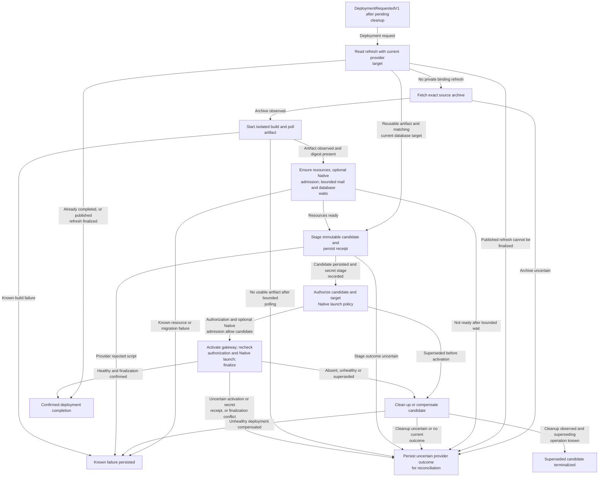

# Customer deployment — bounded orchestration and outcomes

Generated by Mermaider. View: **implemented**. Basis: **agent-reviewed semantic model**.

## Sources

- [apps/control-store/src/catalog/identity/native-auth-resource-operations.ts · resolveNativeAuthDatabaseClaim:161](../../../apps/control-store/src/catalog/identity/native-auth-resource-operations.ts#L161)
- [apps/control-store/src/catalog/provisioning/binding-refresh-proof.ts · bindingRefreshStatements:71](../../../apps/control-store/src/catalog/provisioning/binding-refresh-proof.ts#L71)
- [apps/control-store/src/catalog/provisioning/deployment-authorization.ts · authorize:25](../../../apps/control-store/src/catalog/provisioning/deployment-authorization.ts#L25)
- [apps/control-store/src/catalog/provisioning/deployment-finalization.ts · finalizeProductCandidate:160](../../../apps/control-store/src/catalog/provisioning/deployment-finalization.ts#L160)
- [apps/orchestrator/src/deployment-workflow.ts · runProductCommandWorkflow:619](../../../apps/orchestrator/src/deployment-workflow.ts#L619)
- [apps/orchestrator/src/deployment-workflow.ts · runDeployment:814](../../../apps/orchestrator/src/deployment-workflow.ts#L814)
- [apps/orchestrator/src/deployment-workflow.ts · failDeployment:965](../../../apps/orchestrator/src/deployment-workflow.ts#L965)
- [apps/orchestrator/src/deployment-workflow.ts · activateWfpCandidate:1230](../../../apps/orchestrator/src/deployment-workflow.ts#L1230)
- [apps/orchestrator/src/deployment-workflow.ts · finishBindingRefresh:1491](../../../apps/orchestrator/src/deployment-workflow.ts#L1491)
- [apps/orchestrator/src/deployment-workflow.ts · compensateSupersededCandidate:1507](../../../apps/orchestrator/src/deployment-workflow.ts#L1507)
- [apps/orchestrator/src/deployment-workflow.ts · cleanupCandidateForReconciliation:1560](../../../apps/orchestrator/src/deployment-workflow.ts#L1560)
- [apps/orchestrator/src/deployment-workflow.ts · reconcile:1936](../../../apps/orchestrator/src/deployment-workflow.ts#L1936)

Freshness checks confirm the recorded source evidence and generated output. They do not establish live deployment or prove every semantic interpretation.
