# Production deployment worker — declared resource topology

Generated by Mermaider. View: **implemented**. Basis: **declared source structure**.

## Coverage notes

- **wrangler-worker-ambiguous**: Multiple configurations declare Worker ohmyho-neon-management-production; deployment identity is unresolved.
- **wrangler-worker-ambiguous**: Multiple configurations declare Worker ohmyho-cloudflare-domain-management-production; deployment identity is unresolved.

```mermaid
flowchart LR
    n_2ef3e4761c37["ohmyho-native-auth-production-us<br/>Worker reference"]
    n_f931eb855de0["Workflow<br/>DEPLOYMENT_WORKFLOW<br/>name:<br/>ohmyho-deployment-workflow-v1-production<br/>class_name: DeploymentWorkflow"]
    n_f8e34805420e["Workflow<br/>PROVIDER_RECONCILIATION_WORKFLOW<br/>name:<br/>ohmyho-provider-reconciliation-v1-production<br/>class_name:<br/>ProviderReconciliationWorkflow"]
    n_596a5076bf6a["Worker service<br/>SOURCE_FETCHER<br/>service:<br/>ohmyho-source-fetcher-production<br/>entrypoint: SourceFetcherService"]
    n_c259a72a089d["ohmyho-recovery-container-production<br/>Worker reference"]
    n_ecc00dc06d7e["Workflow<br/>PROJECT_PROVISIONING_WORKFLOW<br/>name:<br/>ohmyho-project-provisioning-v1-production<br/>class_name:<br/>ProjectProvisioningWorkflow<br/>script_name:<br/>ohmyho-project-provisioning-workflow-production"]
    n_4fc1a5d14e90["ohmyho-next-cache-production<br/>Worker reference"]
    n_e2c44edd8b30["ohmyho-project-provisioning-workflow-production<br/>Worker reference"]
    n_d2c85638a995["Worker service<br/>CLOUDFLARE_DOMAIN_MANAGEMENT<br/>service:<br/>ohmyho-cloudflare-domain-management-production<br/>entrypoint:<br/>CloudflareDomainManagementService"]
    n_1d400b51e756["Worker service<br/>R2_MANAGEMENT<br/>service:<br/>ohmyho-r2-management-production<br/>entrypoint: R2ManagementService"]
    n_ab4b6143a63f["Worker service<br/>SES_MANAGEMENT<br/>service:<br/>ohmyho-ses-management-production<br/>entrypoint:<br/>ResendMailManagementService"]
    n_8249f1009921["ohmyho-native-auth-production-eu<br/>Worker reference"]
    n_b40abe0d7d5d["ohmyho-wfp-management-production<br/>Worker reference"]
    n_9319f6094498["Worker service<br/>BUILD_RUNNER<br/>service:<br/>ohmyho-build-runner-production<br/>entrypoint: BuildRunnerService"]
    n_0f7ac8e62803["Worker service<br/>NEXT_CACHE_RETIREMENT<br/>service:<br/>ohmyho-next-cache-production<br/>entrypoint:<br/>NextCacheRetirementRuntime"]
    n_612022a2cda2["ohmyho-build-runner-production<br/>Worker reference"]
    n_b55b99cc90a2["Worker service<br/>RUNTIME_SECRET_DELIVERY<br/>service:<br/>ohmyho-runtime-secret-delivery-production<br/>entrypoint:<br/>RuntimeSecretDeliveryService"]
    n_cb9d2d6e836f["Worker service<br/>WFP_MANAGEMENT<br/>service:<br/>ohmyho-wfp-management-production<br/>entrypoint: WfpManagementService"]
    n_81598debece8["ohmyho-cloudflare-domain-management-production<br/>Worker reference"]
    n_2af84d61499a["Worker service<br/>NATIVE_AUTH_ADMIN_US<br/>service:<br/>ohmyho-native-auth-production-us<br/>entrypoint: NativePolicyService"]
    n_8b5ce5fe4d5f["Worker service<br/>DEPLOYMENT_WORKFLOW_RUNTIME<br/>service:<br/>ohmyho-control-store-production<br/>entrypoint:<br/>DeploymentWorkflowRuntime"]
    n_a99bfb225581["Worker service<br/>NEON_MANAGEMENT<br/>service:<br/>ohmyho-neon-management-production<br/>entrypoint: NeonManagementService"]
    n_d258bcc84836["ohmyho-runtime-secret-delivery-production<br/>Worker reference"]
    n_4a8ab344f253["ohmyho-source-fetcher-production<br/>Worker reference"]
    n_f31d1c9ffe17["ohmyho-r2-management-production<br/>Worker reference"]
    n_00ce779eac4a["ohmyho-control-store-production<br/>Worker reference"]
    n_da34485fc2d1["Worker service<br/>STORAGE_DATA_MANAGEMENT<br/>service:<br/>ohmyho-storage-gateway-production<br/>entrypoint:<br/>StorageDataManagementEntrypoint"]
    n_061894b6a34e["Worker service<br/>RECOVERY_INVOKER<br/>service:<br/>ohmyho-recovery-container-production<br/>entrypoint: RecoveryContainerService"]
    n_1fa7070e9d40["ohmyho-deployment-workflow-production<br/>declared configuration"]
    n_b45313dcf10d["ohmyho-ses-management-production<br/>Worker reference"]
    n_fe5fac7b1e5a["Worker service<br/>NATIVE_AUTH_RESOURCE_RUNTIME<br/>service:<br/>ohmyho-control-store-production<br/>entrypoint:<br/>NativeAuthResourceRuntime"]
    n_e9d813e090cf["Worker service<br/>NATIVE_AUTH_ADMIN_EU<br/>service:<br/>ohmyho-native-auth-production-eu<br/>entrypoint: NativePolicyService"]
    n_abbd825475bf["ohmyho-neon-management-production<br/>Worker reference"]
    n_661aa3dbb8ba["ohmyho-storage-gateway-production<br/>Worker reference"]
    n_1fa7070e9d40 --> n_cb9d2d6e836f
    n_1fa7070e9d40 --> n_d2c85638a995
    n_fe5fac7b1e5a -->|"references worker"| n_00ce779eac4a
    n_1fa7070e9d40 --> n_596a5076bf6a
    n_596a5076bf6a -->|"references worker"| n_4a8ab344f253
    n_da34485fc2d1 -->|"references worker"| n_661aa3dbb8ba
    n_cb9d2d6e836f -->|"references worker"| n_b40abe0d7d5d
    n_1fa7070e9d40 --> n_8b5ce5fe4d5f
    n_1fa7070e9d40 --> n_f931eb855de0
    n_1fa7070e9d40 --> n_fe5fac7b1e5a
    n_1d400b51e756 -->|"references worker"| n_f31d1c9ffe17
    n_1fa7070e9d40 --> n_da34485fc2d1
    n_1fa7070e9d40 --> n_f8e34805420e
    n_b55b99cc90a2 -->|"references worker"| n_d258bcc84836
    n_9319f6094498 -->|"references worker"| n_612022a2cda2
    n_1fa7070e9d40 --> n_061894b6a34e
    n_1fa7070e9d40 --> n_9319f6094498
    n_ab4b6143a63f -->|"references worker"| n_b45313dcf10d
    n_e9d813e090cf -->|"references worker"| n_8249f1009921
    n_a99bfb225581 -->|"references worker"| n_abbd825475bf
    n_1fa7070e9d40 --> n_ab4b6143a63f
    n_1fa7070e9d40 --> n_b55b99cc90a2
    n_0f7ac8e62803 -->|"references worker"| n_4fc1a5d14e90
    n_1fa7070e9d40 --> n_0f7ac8e62803
    n_2af84d61499a -->|"references worker"| n_2ef3e4761c37
    n_1fa7070e9d40 --> n_ecc00dc06d7e
    n_1fa7070e9d40 --> n_2af84d61499a
    n_1fa7070e9d40 --> n_1d400b51e756
    n_1fa7070e9d40 --> n_a99bfb225581
    n_8b5ce5fe4d5f -->|"references worker"| n_00ce779eac4a
    n_d2c85638a995 -->|"references worker"| n_81598debece8
    n_1fa7070e9d40 --> n_e9d813e090cf
    n_061894b6a34e -->|"references worker"| n_c259a72a089d
    n_ecc00dc06d7e -->|"references worker"| n_e2c44edd8b30
```

## Sources

- [apps/build-runner/wrangler.production.jsonc:3](../../../apps/build-runner/wrangler.production.jsonc#L3)
- [apps/cloudflare-domain-management/wrangler.keyring.production.jsonc:3](../../../apps/cloudflare-domain-management/wrangler.keyring.production.jsonc#L3)
- [apps/cloudflare-domain-management/wrangler.production.jsonc:3](../../../apps/cloudflare-domain-management/wrangler.production.jsonc#L3)
- [apps/native-auth-runtime/wrangler.production.eu.jsonc:3](../../../apps/native-auth-runtime/wrangler.production.eu.jsonc#L3)
- [apps/native-auth-runtime/wrangler.production.us.jsonc:3](../../../apps/native-auth-runtime/wrangler.production.us.jsonc#L3)
- [apps/neon-management/wrangler.pgcf.production.jsonc:3](../../../apps/neon-management/wrangler.pgcf.production.jsonc#L3)
- [apps/neon-management/wrangler.production.jsonc:3](../../../apps/neon-management/wrangler.production.jsonc#L3)
- [apps/next-cache/wrangler.production.jsonc:3](../../../apps/next-cache/wrangler.production.jsonc#L3)
- [apps/project-provisioning-worker/wrangler.production.deployment-workflow.jsonc:3](../../../apps/project-provisioning-worker/wrangler.production.deployment-workflow.jsonc#L3)
- [apps/project-provisioning-worker/wrangler.production.deployment-workflow.jsonc:15](../../../apps/project-provisioning-worker/wrangler.production.deployment-workflow.jsonc#L15)
- [apps/project-provisioning-worker/wrangler.production.deployment-workflow.jsonc:20](../../../apps/project-provisioning-worker/wrangler.production.deployment-workflow.jsonc#L20)
- [apps/project-provisioning-worker/wrangler.production.deployment-workflow.jsonc:25](../../../apps/project-provisioning-worker/wrangler.production.deployment-workflow.jsonc#L25)
- [apps/project-provisioning-worker/wrangler.production.deployment-workflow.jsonc:30](../../../apps/project-provisioning-worker/wrangler.production.deployment-workflow.jsonc#L30)
- [apps/project-provisioning-worker/wrangler.production.deployment-workflow.jsonc:35](../../../apps/project-provisioning-worker/wrangler.production.deployment-workflow.jsonc#L35)
- [apps/project-provisioning-worker/wrangler.production.deployment-workflow.jsonc:40](../../../apps/project-provisioning-worker/wrangler.production.deployment-workflow.jsonc#L40)
- [apps/project-provisioning-worker/wrangler.production.deployment-workflow.jsonc:45](../../../apps/project-provisioning-worker/wrangler.production.deployment-workflow.jsonc#L45)
- [apps/project-provisioning-worker/wrangler.production.deployment-workflow.jsonc:50](../../../apps/project-provisioning-worker/wrangler.production.deployment-workflow.jsonc#L50)
- [apps/project-provisioning-worker/wrangler.production.deployment-workflow.jsonc:55](../../../apps/project-provisioning-worker/wrangler.production.deployment-workflow.jsonc#L55)
- [apps/project-provisioning-worker/wrangler.production.deployment-workflow.jsonc:60](../../../apps/project-provisioning-worker/wrangler.production.deployment-workflow.jsonc#L60)
- [apps/project-provisioning-worker/wrangler.production.deployment-workflow.jsonc:65](../../../apps/project-provisioning-worker/wrangler.production.deployment-workflow.jsonc#L65)
- [apps/project-provisioning-worker/wrangler.production.deployment-workflow.jsonc:70](../../../apps/project-provisioning-worker/wrangler.production.deployment-workflow.jsonc#L70)
- [apps/project-provisioning-worker/wrangler.production.deployment-workflow.jsonc:75](../../../apps/project-provisioning-worker/wrangler.production.deployment-workflow.jsonc#L75)
- [apps/project-provisioning-worker/wrangler.production.deployment-workflow.jsonc:80](../../../apps/project-provisioning-worker/wrangler.production.deployment-workflow.jsonc#L80)
- [apps/project-provisioning-worker/wrangler.production.deployment-workflow.jsonc:85](../../../apps/project-provisioning-worker/wrangler.production.deployment-workflow.jsonc#L85)
- [apps/project-provisioning-worker/wrangler.production.deployment-workflow.jsonc:92](../../../apps/project-provisioning-worker/wrangler.production.deployment-workflow.jsonc#L92)
- [apps/project-provisioning-worker/wrangler.production.deployment-workflow.jsonc:97](../../../apps/project-provisioning-worker/wrangler.production.deployment-workflow.jsonc#L97)
- [apps/project-provisioning-worker/wrangler.production.deployment-workflow.jsonc:102](../../../apps/project-provisioning-worker/wrangler.production.deployment-workflow.jsonc#L102)
- [apps/project-provisioning-worker/wrangler.production.workflow.jsonc:3](../../../apps/project-provisioning-worker/wrangler.production.workflow.jsonc#L3)
- [apps/r2-management/wrangler.production.jsonc:3](../../../apps/r2-management/wrangler.production.jsonc#L3)
- [apps/recovery-container/wrangler.production.jsonc:3](../../../apps/recovery-container/wrangler.production.jsonc#L3)
- [apps/runtime-secret-delivery/wrangler.production.jsonc:3](../../../apps/runtime-secret-delivery/wrangler.production.jsonc#L3)
- [apps/ses-management/wrangler.production.jsonc:3](../../../apps/ses-management/wrangler.production.jsonc#L3)
- [apps/source-fetcher/wrangler.production.jsonc:3](../../../apps/source-fetcher/wrangler.production.jsonc#L3)
- [apps/storage-gateway/wrangler.production.jsonc:3](../../../apps/storage-gateway/wrangler.production.jsonc#L3)
- [apps/wfp-management/wrangler.production.jsonc:3](../../../apps/wfp-management/wrangler.production.jsonc#L3)

Freshness checks confirm the recorded source evidence and generated output. They do not establish live deployment or prove every semantic interpretation.
