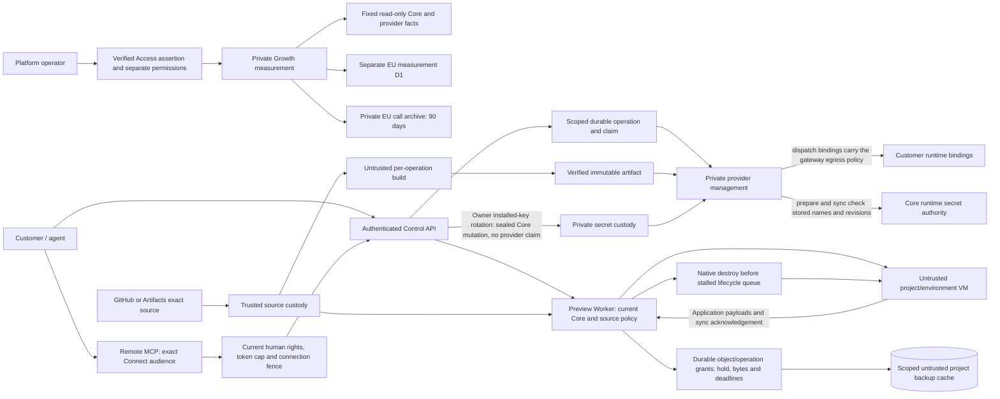

# Security architecture

Security is documented as implemented boundaries and their verification limits. This directory is the canonical current security explanation; retained governance baselines and incident receipts are historical evidence rather than an alternative current design.

- [Data classification](data-classification.md) assigns handling rules and owners.
- [Provider credentials](provider-credentials.md) identifies workload custody and customer separation.
- [Threat model](threat-model.md) connects concrete threats to implemented controls, failure paths and evidence gaps.
- [Operator access](operator-access.md) preserves exact identity/environment selection and authorized receipt-read rules.
- [Authentication and secret custody](../auth-and-secrets.md) owns platform login, customer runtime secrets, database credentials and recovery password storage.
- [Database architecture](../database.md) owns data placement, restricted roles, application RLS and deletion/recovery.

The primary security distinction is authority: customer requests have exact product scope; internal service bindings confer narrowly composed workload authority; provider-management credentials stay in their private deployables. A package boundary, secret-name prefix or encryption-at-rest claim does not alone establish privilege isolation. Code/configuration review, unit/integration checks, retained release evidence and fresh provider observation prove different things and must be labelled separately.

The implemented managed/remote slice adds two authority checks: source generation and expected Git head for file publication, and current canonical client/user/resource rights, optional accepted token restrictions and terminal connection fences for remote requests. Private Git/R2 calls remain behind SourceFetcher; model clients and customer builds receive no Artifacts binding or reusable Git/provider token. Local snapshot reads are data capture, and remote MCP cannot read a local directory. [Source custody](../build-and-deploy.md#managed-source-publication), [remote authorization](../api-and-mcp.md#remote-product-mcp).

The Artifacts acceptance receipt proves disposable Dev provider operations only. OAuth consumer acceptance, customer-build acceptance and exact-release gates remain separate; source diagrams include the working implementation without asserting a deployed new public path.

The approved W25 sender-sharing boundary requires both selected workspace-domain authority and target-project authority, with a current verified application identity on the same PSL registrable main domain. Workspace membership and remote project-edit consent alone are insufficient. Send bindings preserve project keys/billing/content separation and never grant receiving or DNS administration. Proof is independently verifiable before deployment and cannot route web traffic. [Mail contract](../mail-and-recovery.md#same-domain-shared-sender-contract), [identity proof](../storage-and-domains.md#application-identity-before-mail-gated-deployment), [public authorization](../api-and-mcp.md#shared-sender-management). Source, release and live acceptance remain separately tracked in W25.

The W37 Native candidate adds an application-user boundary beside platform identity: private regional runtime and isolated Auth storage, current Core policy/revocation authority, Owner-only management and private mail/provider custody. Its detailed policy lives in [application auth](../auth-and-secrets.md#customer-application-auth); [threats](threat-model.md), [classification](data-classification.md), [credential custody](provider-credentials.md) and [operator restore access](operator-access.md#native-restore-operator-candidate) describe their respective controls. Source/local proof, pending restore integration, final Astra review, hosted qualification and release remain distinct. The general security diagram above retains product/build authority scope; it is not an exhaustive graph of the new application-user protocol.

Controls added in November 2026 separate tenants and clients inside shared services: a read database credential that cannot reach authentication data or execute definer functions, per-tenant shares in the shared sweeps and schedulers, limit keys by IPv6 prefix and per realm, replay-safe database mutations, and redaction of stored feedback. [Threat model](threat-model.md) rows state each control with its limit; [data](../decisions/data.md#d520), [clients and public content](../decisions/clients-and-public-content.md#d534), [project and feedback](../decisions/project-and-feedback.md#d544) and [files, schedules and recovery](../decisions/files-functions-recovery.md#d546) hold the decisions. Source and local verification are separate from release and live acceptance, which remain open for these changes.

The W49 private measurement and operator boundary, including explicit identity reveal, is described in [Growth](../growth.md); hosted policy remains to be verified.

The Live Preview candidate uses the dedicated project/environment VM as the untrusted principal. Its source selection, private capability credentials, data targets, funding and Native Auth authority remain in Workers and Core. Backup data grants bind fixed objects and durable budgets; expiry and cancellation bound streams and prevent late success. Native VM destruction runs before joining a stalled lifecycle queue. Guest files and source/cache acknowledgements do not attest executing code or global quiescence. [Threat model](threat-model.md#live-preview-source-boundary), [runtime and resource limits](../services-and-workers.md#product-live-preview-source-candidate), [D608](../decisions/runtime-and-lifecycle.md#d608).
