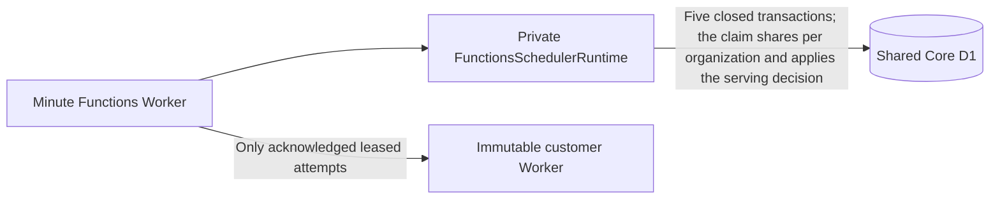
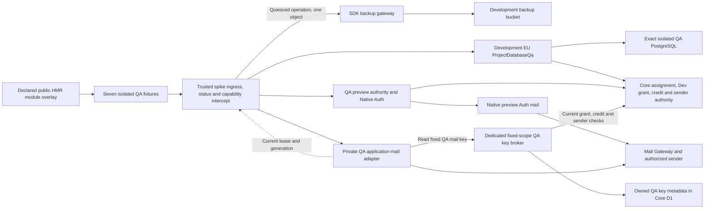

# Services and Workers

ohmyho.st is a TypeScript monorepo with a public Control API, private provider services, isolated build and recovery Containers, and customer Workers in Workers for Platforms (WFP). This page describes the checked-in implementation and deployment declarations. [Delivery status](../index.md) and release receipts establish what a particular source revision delivered; this source audit does not read back today's Cloudflare configuration.

## Environments and accounts

The last accepted serving lane is Auth-only. The per-commit preview runtime was removed on 13 November 2026; its Core tables remain as [leftovers](database.md#leftovers-of-the-removed-commit-previews). The W41 product Live Preview source candidate below replaces that per-commit lifecycle; checked-in source does not establish a deployed service.

The selected Auth release is a bounded cohort, not a claim that every deployed service now runs the same candidate. Existing AI, database and storage named exports remain external dependencies under their independently observed deployed heads. Development Gateway/Scheduler retain the existing `ohmyho-wfp-egress-v3-poc-private-fullstack` target without an Egress update, creation, profile or RPC rollout; Production retains its existing canonical Egress target. Auth-only source declarations do not prove byte equivalence to either live Egress head. Root must verify the required default-fetch ABI and bound service identities.

Platform Development and Production are separate service graphs. They have separate Core D1 Control databases, authentication applications, queues, WFP namespaces, credentials and object buckets. A project's `dev` and `prod` application environments exist **inside** one selected platform. Project environment names do not select platform Development or Production.

Disabled default build profiles do not establish a serving capability. Named environment profiles bind only their declared environment's Core, with the same exported-capability and isolation checks as the other Core consumers.

The explicit Dev and Prod Worker configurations that declare `account_id` use the same Cloudflare account. The declarations do not establish a second deployed Cloudflare account for customer code. Isolation comes from WFP namespaces, exact scoped bindings, private service entrypoints, credentials and database authorization. The historical proposal for a separate system account must not be mistaken for the current declarations. See [Control Prod configuration](../../apps/control-api/wrangler.production.jsonc#L3), [Control Dev configuration](../../apps/control-api/wrangler.jsonc#L3), and [WFP Prod namespace](../../apps/wfp-management/wrangler.production.jsonc#L10).

The source inventory contains 96 `apps/*/wrangler*.jsonc` files. They are configurations rather than 96 independently active services. Many families have a disabled default, sandbox, Dev and Prod variant; provisioning also has separate publisher, consumer and Workflow configurations. Some older Dev names retain `poc-private-fullstack`. Names alone do not imply a current POC or an extra environment. A file without `account_id` depends on the release operator's verified account. Disabled configurations and the sandbox MCP Worker are not evidence of public Production services.

## Overview

Solid arrows describe implemented calls, bindings or declared transport; dotted arrows are legacy bindings that stay attached but are unsupported. Provider capabilities are grouped to keep the overview readable; the following inventory gives the concrete deployables.

```mermaid
flowchart TB
  Client["Browser, CLI, local and remote MCP"] --> Control["Control API /v1, portal and /mcp"]
  Control --> Auth["Private WorkOS management"]
  Control -->|"Consent, discovery and bound action execution"| ConnectionBroker["Private Connection Broker"]
  App["Application server"] -->|"Action bearer, intent key and input"| Control
  Control -->|"Explicit project import reference"| DB
  ConnectionBroker -->|"Current actor observation"| Control
  ConnectionBroker -->|"Sealed grant custody"| DB
  ConnectionBroker -->|"OAuth, discovery and pinned action"| Make["Make"]
  Control -->|"Best-effort events"| GrowthQueue["EU Growth Queue / DLQ"]
  GrowthQueue --> Growth["Private Growth Worker and verified operator view"]
  Growth --> GrowthDB[("Separate EU Growth D1")]
  Growth -->|"24-hour call-log rotation"| GrowthArchive[("Private EU call archive: 90 days")]
  Growth -->|"Fixed read-only source capabilities"| DB
  Growth --> Auth
  Growth --> Billing
  Control -->|"Typed service capabilities"| DB[("Core D1 behind the private control-store Worker")]
  Control -->|"Usage report"| Credit["Private Credit Service"]
  Credit -->|"CreditRuntime: charges, cursors, credit log"| DB
  Credit -->|"NeonUsageService: PGCF collectUsage and stopSchedules; R2 collectUsage"| Collectors["PGCF and R2 usage collectors"]
  Credit -->|"Rotate the finished day at 00:00 UTC"| CreditLog[("EU credit-log bucket: 14 days")]
  Control --> Billing["Private Billing / Stripe"]
  Control --> Webhooks["Private signed webhook ingress"]
  Webhooks --> DB
  Control --> Publisher["Operation publisher"]
  Publisher --> Queue["Provisioning Queue / DLQ"]
  Queue --> Consumer["Provisioning consumer"]
  Consumer --> Workflow["Provisioning and deployment Workflows"]
  Consumer --> ManagedProcessor["Private Control ManagedSourceProcessor"]
  ManagedProcessor --> Source
  Workflow --> Providers["Private database, R2, domain, mail and WFP management"]
  Workflow --> Source["Private SourceFetcher / GitHub and managed source"]
  Control --> Source
  Control --> Preview["Private Live Preview Worker and per-environment actor"]
  Source -->|"Inspected accepted source and policy"| Preview
  Preview -->|"Current scope, source and funding"| DB
  Preview --> PreviewVM["Untrusted project/environment VM"]
  PreviewVM -->|"Declared application requests"| Preview
  Preview --> BackupGrant["Expiring, budgeted backup gateway"]
  BackupGrant --> PreviewCache[("Private per-environment cache")]
  Preview -->|"Native kill outside stalled lifecycle queue"| PreviewVM
  Source --> Git[("Regional Artifacts repositories")]
  Source --> Builder["Build Runner / US and EU Containers"]
  Builder --> Objects[("Regional private build objects")]
  Workflow --> Secrets["Runtime Secret Delivery"]
  Secrets --> Wfp["WFP management"]
  Wfp -->|"Manifest check before secret writes"| DB
  Visitors["Application visitors"] --> Gateway["Shared customer gateway"]
  Gateway --> Routing["Control routing, Dev access and credits"]
  Gateway --> Customer["Immutable customer WFP Worker"]
  Wfp -->|"Publish immutable candidate and bindings; health probe under gateway limits and egress context"| Customer
  Scheduler["Minute functions scheduler"] --> Customer
  Customer --> Database["Private regional database service / DO"]
  Customer -->|"global fetch to the injected gateway URLs"| Egress["Functions Egress: default policy"]
  Egress --> External["Declared HTTPS origins"]
  Egress -->|"permit(projectId), before either gateway"| GatewayAdmission["StorageGatewayRelayEntrypoint: private admission RPC"]
  GatewayAdmission -->|"shared project key"| GatewayLimit["Storage native rate-limit binding"]
  Egress -->|"MailEgressEntrypoint: send or attachment POST; project stamp"| Mail["Private Mail Gateway / Resend"]
  Database -->|"stamped send only"| DatabaseMail["Private DatabaseMailEntrypoint"]
  DatabaseMail --> Mail
  Egress -->|"six fixed POST routes, project header"| Storage["Private storage gateway"]
  Customer -.->|"unsupported legacy service bindings: 503 under the policy, removed in W29"| Storage
  Customer -.-> Mail
  Egress -->|"OpenAI-compatible calls with the project AI key, public HTTPS"| AiGateway["Public AI gateway: ai.ohmyho.st"]
  AiGateway -->|"AiGatewayRuntime: scoped hold, recorded cost or marked LLM fallback, settle once"| DB
  AiGateway -->|"Selected calls and canonical EU metadata paths"| Orq["orq.ai model gateway"]
  Egress -->|"Scoped runtime key, HTML to PDF"| BrowserGateway["Browser PDF gateway: source candidate"]
  BrowserGateway -->|"BrowserGatewayRuntime: authority, pinned price, hold and settle once"| DB
  BrowserGateway -->|"Content-free measured receipt and alarm"| BrowserJournal[("SQLite settlement journal")]
  BrowserJournal -->|"Idempotent settlement retry; clear storage after acknowledgment"| DB
  BrowserGateway -->|"Fixed no-script/no-network PDF options, no result cache"| BrowserRun["Cloudflare Browser Run: global processing"]
  Customer -->|"Deployment-fixed private RPC props"| NextCache["Next cache: source candidate"]
  NextCache --> CacheObject[("Jurisdiction-scoped SQLite DO: bounded cache and tags")]
  Workflow -->|"Core-authorized irreversible retirement"| NextCache
  Control --> Recovery["Recovery Worker / Container DO"]
  Recovery --> Archives[("Password-encrypted SQL export archives")]
  Gateway --> Tail["Diagnostic Tail Worker"]
  Tail --> DiagnosticQueue["Diagnostics Queue / DLQ"]
  DiagnosticQueue --> Diagnostic["Diagnostic consumer"]
  Diagnostic -->|"Marker projection, purge"| DB
  Customer --> UsageLogpush["Cloudflare WFP usage Logpush"]
  UsageLogpush --> UsageObjects[("Private EU usage objects: seven-day retention")]
  UsageObjects -->|"Read the hourly objects"| Credit
  UsageObjects -->|Seven days from creation| UsageExpiry["R2 lifecycle expiry; asynchronous deletion"]
```

## Deployable inventory

| Source directory / configuration                                                                                                                                           | Responsibility and explicit deployment boundary                                                                                                                                                                                                                                                                                                                                                                                                                                                                                                                                                                    |
| -------------------------------------------------------------------------------------------------------------------------------------------------------------------------- | ------------------------------------------------------------------------------------------------------------------------------------------------------------------------------------------------------------------------------------------------------------------------------------------------------------------------------------------------------------------------------------------------------------------------------------------------------------------------------------------------------------------------------------------------------------------------------------------------------------------ |
| [control-api](../../apps/control-api/wrangler.production.jsonc#L21)                                                                                                        | Public REST, portal/login/callbacks and optional remote product MCP; private source processor, routing, Dev access, credit and build-receipt entrypoints; Core capability bindings and minute maintenance.                                                                                                                                                                                                                                                                                                                                                                                                         |
| [workos-management](../../apps/workos-management/wrangler.production.jsonc#L3)                                                                                             | Private platform identity and key management; minute maintenance. Customer application authentication remains customer-owned.                                                                                                                                                                                                                                                                                                                                                                                                                                                                                      |
| [webhook-ingress](../../apps/webhook-ingress/wrangler.production.jsonc#L3)                                                                                                 | Private signature-verifying WorkOS, GitHub, Stripe and Resend intake reached through Control; durable inbox processing rather than provider authority in the browser.                                                                                                                                                                                                                                                                                                                                                                                                                                              |
| [credit-service](../../apps/credit-service/wrangler.production.jsonc)                                                                                                      | Private Worker with hourly and daily crons and no secret: bills WFP, PGCF, R2 and resource usage through the Core `CreditRuntime` and rotates the credit log to R2; see [Credit Service](#credit-service).                                                                                                                                                                                                                                                                                                                                                                                                         |
| [billing](../../apps/billing/wrangler.production.jsonc#L3)                                                                                                                 | Private Stripe Live boundary in Prod and Test boundary in Dev; configured cron list is empty and Control supplies maintenance calls.                                                                                                                                                                                                                                                                                                                                                                                                                                                                               |
| [project-provisioning publisher](../../apps/project-provisioning-worker/wrangler.production.publisher.jsonc#L3)                                                            | Outbox publication to the provisioning Queue; minute reconciliation.                                                                                                                                                                                                                                                                                                                                                                                                                                                                                                                                               |
| [project-provisioning consumer](../../apps/project-provisioning-worker/wrangler.production.consumer.jsonc#L11)                                                             | Queue delivery to provisioning/deployment Workflows and managed-source initialization/publication processing, with 30 retries and a DLQ.                                                                                                                                                                                                                                                                                                                                                                                                                                                                           |
| [project-provisioning Workflow](../../apps/project-provisioning-worker/wrangler.production.workflow.jsonc#L13)                                                             | `ProjectProvisioningWorkflow`; scoped durable orchestration.                                                                                                                                                                                                                                                                                                                                                                                                                                                                                                                                                       |
| [deployment Workflow](../../apps/project-provisioning-worker/wrangler.production.deployment-workflow.jsonc#L11)                                                            | `DeploymentWorkflow`, `ProviderReconciliationWorkflow`, provider-service calls and the provisioning-Workflow binding.                                                                                                                                                                                                                                                                                                                                                                                                                                                                                              |
| [source-fetcher](../../apps/source-fetcher/wrangler.production.jsonc#L3)                                                                                                   | Authorized GitHub and Artifacts source/inspection, private managed-Git/blob RPC and exact archive transfer to BuildRunner; provider bindings stay outside customer builds.                                                                                                                                                                                                                                                                                                                                                                                                                                         |
| [build-runner](../../apps/build-runner/wrangler.production.jsonc#L35)                                                                                                      | `BuildSandbox` and `BuildSandboxEu` Durable Objects with Containers; private regional objects and scoped receipt persistence.                                                                                                                                                                                                                                                                                                                                                                                                                                                                                      |
| [wfp-management](../../apps/wfp-management/wrangler.production.jsonc#L23)                                                                                                  | Artifact verification, immutable WFP candidate upload, secret writes, binding publication, Control gateway registry and the private deploy health probe, which runs the candidate under the gateway limits and egress context of its project ([D467](decisions/source-and-build.md#d467)).                                                                                                                                                                                                                                                                                                                         |
| [runtime-secret-delivery](../../apps/runtime-secret-delivery/wrangler.production.jsonc#L3)                                                                                 | Private leased delivery of encrypted Control environment secrets to exact WFP scripts; minute maintenance.                                                                                                                                                                                                                                                                                                                                                                                                                                                                                                         |
| [shared gateway](../../apps/wfp-dispatch/wrangler.production.shared.jsonc#L13)                                                                                             | Public customer routing to WFP; private Control routing, Dev-access and credit decisions.                                                                                                                                                                                                                                                                                                                                                                                                                                                                                                                          |
| [outbound Worker](../../apps/wfp-dispatch/wrangler.production.outbound.jsonc#L3)                                                                                           | Ordinary WFP outbound policy with the canonical Auth-only Mail/Storage service bindings; source names and exact live readback remain separate release evidence.                                                                                                                                                                                                                                                                                                                                                                                                                                                    |
| [project-database-runtime US/EU](../../apps/project-database-runtime/wrangler.production.us.jsonc#L28)                                                                     | `ProjectDatabaseEnvironment` Durable Object namespace per region; scoped database RPC and current private registration. Registry credentials are sealed under a versioned key ring: the current key seals every credential, and an optional previous key only opens older ones, which are re-sealed under the current key when read ([D515](decisions/runtime-and-lifecycle.md#d515)).                                                                                                                                                                                                                             |
| [neon-management](../../apps/neon-management/wrangler.production.jsonc#L12)                                                                                                | Private PGCF database management and registration in both regional runtime services, the final hourly memory rollups returned by `collectUsage`, the `stopSchedules` sweep for Stop-budget and credit-denied projects, which the credit service reaches only through the narrow `NeonUsageService` entrypoint, and the 15-minute compute-entitlement and access maintenance. The Worker name `neon-management`, its `NeonManagementService` entrypoint class and the `NEON_MANAGEMENT` binding are historical names of deployed identities; the Worker hosts only PGCF.                                            |
| [control-store](../../apps/control-store/wrangler.jsonc#L3)                                                                                                                | Private Control persistence on ONE shared `CONTROL_CORE` D1 per environment (layout `shared-core-v1`), held only by this Worker; migrations live in `apps/control-store/migrations/core`. Ordinary `ControlRuntime` has exact-scope commands, `MaintenanceRuntime` has scheduled drains, `WorkosRuntime` has only WorkOS key/session, poller, onboarding and read-only warning prerequisites and `CreditRuntime` serves only the Credit Service. Consumers receive private typed service capabilities, no SQL or D1 binding.                                                                                       |
| [r2-management](../../apps/r2-management/wrangler.production.jsonc#L3)                                                                                                     | Private per-application-environment bucket management and the finished-day storage and operation usage returned by `collectUsage`; no cron, and data-generation namespaces are recorded separately.                                                                                                                                                                                                                                                                                                                                                                                                                |
| [storage-gateway](../../apps/storage-gateway/wrangler.production.jsonc#L3)                                                                                                 | Private tenant-scoped file transfer, batched reads and durable erasure; no public Dev/Prod `workers.dev` endpoint. An hourly sweep (`37 * * * *`) erases unconfirmed upload claims a day old, and the legacy props path is limited per project before the Core is reached ([billing](billing-and-pricing.md#storage-upload-claims)). The egress policy Worker reaches it through the intrinsic named `StorageGatewayRelayEntrypoint`; the strict legacy entrypoint remains for bounded rollback.                                                                                                                   |
| [cloudflare-domain-management](../../apps/cloudflare-domain-management/wrangler.production.jsonc#L3)                                                                       | Private platform hostnames, customer DNS consent, SaaS hostnames, exact routes, reconciliation and deletion.                                                                                                                                                                                                                                                                                                                                                                                                                                                                                                       |
| [ses-management](../../apps/ses-management/wrangler.production.jsonc#L5)                                                                                                   | Historical directory/script name; the selected entrypoint is `resend-worker.ts` and the service is `ResendMailManagementService`, with minute checks and private DNS management.                                                                                                                                                                                                                                                                                                                                                                                                                                   |
| [mail-gateway](../../apps/mail-gateway/wrangler.production.jsonc#L5)                                                                                                       | Resend delivery, the mail credit charges taken in the Core and the credit-exhaustion warnings; minute maintenance.                                                                                                                                                                                                                                                                                                                                                                                                                                                                                                 |
| [ai-gateway](../../apps/ai-gateway/wrangler.production.jsonc#L4)                                                                                                           | Public OpenAI-compatible gateway to orq.ai: Custom Domains `ai.ohmyho.st` (Development `ai.dev.ohmyho.st`), `AI_RUNTIME` to the Core `AiGatewayRuntime` entrypoint, the `AUTH_LIMITER` and `PROJECT_LIMITER` rate limits, the `*/10` sweep cron, the Worker secret `ORQ_API_KEY` and no tail consumer. It holds no customer data and no database credential. Created once outside the train, then released in trains ([D451](decisions/delivery-and-operations.md#d451)); see [AI gateway](#ai-gateway).                                                                                                           |
| [functions-scheduler](../../apps/functions-scheduler/wrangler.production.jsonc#L10)                                                                                        | Minute dispatcher to active immutable customer Workers in the same namespace, using the same policy outbound Worker. No separate customer functions Queue or Workflow product is declared.                                                                                                                                                                                                                                                                                                                                                                                                                         |
| [recovery-container](../../apps/recovery-container/wrangler.production.jsonc#L3)                                                                                           | `RecoverySandbox` DO and trusted SQL-export Container, used through `RecoveryContainerService`. The Node executor lives in `project-recovery-worker`; legacy AWS executor rationale does not describe this binding.                                                                                                                                                                                                                                                                                                                                                                                                |
| [diagnostic Tail](../../apps/diagnostic-ingestion/wrangler.production.tail.jsonc#L3) and [consumer](../../apps/diagnostic-ingestion/wrangler.production.consumer.jsonc#L3) | Closed diagnostic records through a Queue/DLQ and hourly purge.                                                                                                                                                                                                                                                                                                                                                                                                                                                                                                                                                    |
| [tofu-state-backend](../../apps/tofu-state-backend/wrangler.production.jsonc#L13)                                                                                          | Authenticated OpenTofu state/lock Worker; `TofuStateObject` DO owns serial state and US-jurisdiction R2 snapshots.                                                                                                                                                                                                                                                                                                                                                                                                                                                                                                 |
| [public-site](../../apps/public-site/wrangler.jsonc#L10)                                                                                                                   | Owns public platform hostnames, client-download assets, the installer and the agent instruction documents of its release (`/llms.txt`, `/AGENTS.md`, `/auth.md`, `/mcp.json`, `/mcp-tools.json` and the skill indexes and `/skills/*`, never forwarded); forwards other website pages through `WEBSITE` to the separately maintained website Worker; without the binding, the legal, pricing and content pages answer 503. [Platform-owned paths](https://github.com/amerged-org/ohmyhost/blob/main/apps/public-site/src/worker-main.ts#L63); [API chapter](api-and-mcp.md#documentation-and-public-distribution). |
| [mcp sandbox](../../apps/mcp/wrangler.jsonc#L3)                                                                                                                            | Retained sandbox HTTP configuration; installed local MCP is a client process, not proof of a released remote MCP service.                                                                                                                                                                                                                                                                                                                                                                                                                                                                                          |

`apps/orchestrator` supplies use cases and persistence composition to trusted Workers; its package directory is not a separate declared Cloudflare deployment. Pure domain ports and shared identifiers live in `packages/platform`; `packages/testkit` contains deterministic local/test adapters rather than Production providers.

SourceFetcher (archive inspection and framework adapters), Control (its re-check of refused framework versions) and BuildRunner with its US/EU build Container applications (the installed-version check in the image) enforce the same [shared admission policy](build-and-deploy.md#source-admission); the public CLI applies it offline. These deployables form one release cohort per platform environment: a release train refuses to leave a consumer on other policy bytes. [Policy consumers](../../scripts/release-policy-cohort.mjs#L26), [D429](decisions/delivery-and-operations.md#d429).

## Native Auth source candidate

[D454](decisions/identity.md#d454) and W37 declare four regional Native Workers: `ohmyho-native-auth-development-us`, `ohmyho-native-auth-development-eu`, `ohmyho-native-auth-production-us` and `ohmyho-native-auth-production-eu`. They keep private ingress, a SQLite-backed `NativeAuthEnvironment` namespace and the declared rate limits. The disabled default is a dry-build profile. The active Auth-only candidate and fresh Dev/Prod qualification remain separate from older source-specific Native observations; GA remains held under the existing allowlist. Current progress, historical Native progress.

The entrypoints are distinct capabilities: `NativePublicService` is private to the Shared Gateway; `NativeSessionService` is bound to a customer's exact deployed realm and validates sessions read-only; `NativeAdminService` serves current-Owner management; `NativePolicyService` applies authority transitions; and `NativeRegistryAdminService` receives or erases private runtime registration. The DO holds one bounded realm pool and the encrypted registry. Regional DO jurisdictions constrain the realm; they do not establish region-local processing for every platform service or external provider. [Entrypoints](../../apps/native-auth-runtime/src/worker-main.ts), [DO/public/registry implementation](../../apps/native-auth-runtime/src/realm-worker.ts), [Auth boundaries](auth-and-secrets.md#omh-native-auth-source-candidate).

Native session cookies carry the `__Host-` prefix (`__Host-omh_native.session_token`), are `Secure` with `Path=/` and never carry a `Domain`. The realm refuses any other cookie before authority or limiter work ([D516](decisions/runtime-and-lifecycle.md#d516)).

Native calls the dedicated Core Native authority, administration, registry and mail entrypoints. Mail delivery uses `NativeAuthMailService` in the existing Mail Gateway. Each of the four regional source profiles binds `NATIVE_AUTH_PROVIDER_SECRETS` to the existing same-platform-environment Control API `NativeAuthProviderSecretService`. The binding is private to the Native runtime and the OAuth flow fails closed if it is absent. The release order assumes the target Control Worker already exports that entrypoint. The Native custody key protects its own registry/outboxes; Control's environment-secret master key stays in its existing custodians. Neon Management, deployment Workflow, Cloudflare domain management, WFP Management and the Shared Gateway receive only their corresponding private Native capabilities. Core and Mail Gateway precede Native's new named exports, which precede their new consumers; unrelated existing cycles still require live targets. The source defaults that use disabled Core identities confer no current customer authority. [Native profiles](../../apps/native-auth-runtime/wrangler.production.us.jsonc), [Control bindings](../../apps/control-api/wrangler.production.jsonc), [Neon bindings](../../apps/neon-management/wrangler.production.jsonc), [Workflow bindings](../../apps/project-provisioning-worker/wrangler.production.deployment-workflow.jsonc), [domain bindings](../../apps/cloudflare-domain-management/wrangler.production.jsonc).

The first-configuration source correction adds the private Core `proveNativeAuthUnprovisionedPolicy` method for an atomic, per-logical-realm pending proof. It does not replace `NativeAdminService` or the PostgreSQL fence for a provisioned realm. Its source and entrypoint inventory are implemented and independently reviewed; the method is not part of the released Development candidate. [Proof and distinction](auth-and-secrets.md#omh-native-auth-source-candidate).

All four regional Native profiles explicitly pin the verified amerged Cloudflare account. The closed train refuses an omitted, placeholder or foreign account before upload; a local bundle alone is not preparation approval. The real-profile regression exercises this guard for Development/Production and US/EU without changing any existing service, ingress, schedule or credential declaration.

The Shared Gateway source disables invocation logs and Logpush for the entire gateway so query-bearing verification/OAuth requests cannot enter those automatic records. Its existing diagnostic tail still projects only authenticated fixed diagnostic-channel markers; it does not persist the incoming request URL or ordinary log event. Native profiles disable invocation logs and traces, and the auth engine disables its default logger. These declarations require actual release/readback; they are not an audit of live logging settings. [Gateway profile](../../apps/wfp-dispatch/wrangler.production.shared.jsonc), [tail projection](../../apps/diagnostic-ingestion/src/tail-main.ts), [Native engine](../../apps/native-auth-runtime/src/engine.ts).

## Credit Service

`apps/credit-service` is a private Worker with `workers_dev` and preview URLs disabled, no public route and no secret: its Development and Production files declare only plain variables, three service bindings and two EU R2 buckets. `CREDIT_RUNTIME` is the Core `CreditRuntime` entrypoint, `NEON_USAGE` is `NeonUsageService`, the narrow PGCF entrypoint of the neon-management Worker with only `collectUsage` and `stopSchedules` (the Stop-budget and credit-denied sweep), so the full management entrypoint, which also serves database access, is not bound ([D500](decisions/billing-and-usage.md#d500)), `R2_USAGE` is the `collectUsage` entrypoint of the R2 management Worker, `USAGE_LOGS` is the Logpush usage bucket (read only) and `CREDIT_LOG` is the bucket of the rotated credit log. The cron `27,57 * * * *` runs the four usage sources, `wfp`, `pgcf`, `r2` and `resources`, twice an hour (the second run repeats what the first one held), each isolated from the failure of the others, and then attempts a rotation; the cron `0 0 * * *` rotates the credit log of the finished UTC day. Every step is idempotent through the Core's credit-log keys and usage cursors, so the next pass repeats a failed one. The second entrypoint, `CreditServiceRuntime.readUsage`, is the Control API's `CREDIT_SERVICE` binding for the customer usage report. Mail and builds charge synchronously in the Core and never pass through this Worker.

The release train creates the Worker as a private Worker creation step after the Core step; its name, schedules, service and bucket targets come from the checked-in profile, and nothing in a manifest can widen them. Development is named `ohmyho-credit-service-poc-private-fullstack` and Production `ohmyho-credit-service-production`. The rules for sources, prices and windows are in [Usage billing](billing-and-pricing.md#usage-billing), those for the log, its 14-day lifecycle and the report in [Credit log rotation and the usage report](billing-and-pricing.md#credit-log-rotation-and-the-usage-report). [Worker](../../apps/credit-service/src/worker-main.ts), [Production](../../apps/credit-service/wrangler.production.jsonc), [Development](../../apps/credit-service/wrangler.development.jsonc), [local](../../apps/credit-service/wrangler.jsonc), [release profile](../../scripts/release-private-worker.mjs).

## Database events and execution usage

The existing `neon-management` Worker, whose deployed name and `NEON_MANAGEMENT` binding are unchanged, gains two public methods on `NeonManagementService`: `databaseEvents` serves the webhook, delivery, schedule, watch and usage operations of the [database chapter](database.md#database-events-schedules-and-execution-billing) for one project environment, and `stopSchedules` disables the enabled schedules of a project environment for the credit service's Stop-budget and credit-denied sweep, through the narrow `NeonUsageService` entrypoint only. It adds no Worker, binding, queue, schedule or Cloudflare resource, so the resource and diagram declarations below are unchanged.

## Resource declarations

The active profile declarations contain three kinds of Durable Object-backed execution: US/EU build Containers, the recovery Container, and regional database environment sessions; OpenTofu separately uses its state object. Workflow bindings live only in trusted provisioning/deployment deployables. Customer runtime bindings are validated independently and do not include Control Workflow authority. See [build resources](../../apps/build-runner/wrangler.production.jsonc#L35), [recovery resources](../../apps/recovery-container/wrangler.production.jsonc#L13), [database resources](../../apps/project-database-runtime/wrangler.production.eu.jsonc#L31), and [Workflow resources](../../apps/project-provisioning-worker/wrangler.production.deployment-workflow.jsonc#L72).

Provisioning and diagnostics each have their own Queue and DLQ. There is no currently declared customer-function Queue and no Queue for usage. The publisher, Control, mail, Resend management, WorkOS management, functions and secret maintenance declare minute schedules; the Credit Service runs at minutes 27 and 57 of each hour and at 00:00 UTC; the `neon-management` schedule (compute entitlements and access sweep) runs every 15 minutes and diagnostics at minute 17. R2 management declares no schedule: its old `15 * * * *` cron is stale and is deleted at the rollout. Empty/default disabled profiles are separate declarations. [Provisioning consumer](../../apps/project-provisioning-worker/wrangler.production.consumer.jsonc#L44), [diagnostic consumer](../../apps/diagnostic-ingestion/wrangler.production.consumer.jsonc#L16), [functions](../../apps/functions-scheduler/wrangler.production.jsonc#L10), [Credit Service crons](../../apps/credit-service/wrangler.production.jsonc#L15).

Build Runner and WFP management bind the platform's private US/EU build buckets. The Credit Service binds the EU-jurisdiction usage and credit-log buckets independently of project compute region; OpenTofu binds a US-jurisdiction state bucket. Customer data buckets are provisioned dynamically and do not appear as a list of per-customer Wrangler bindings. Their flow is documented in [Storage and domains](storage-and-domains.md#customer-file-flow).

The Logpush usage files in the EU usage buckets are read directly by the Credit Service, with no Queue and no importer; the existing seven-day lifecycle rule stays. [WFP usage files](billing-and-pricing.md#wfp-usage-files).

### Diagnostic consumer on Core — W32 source candidate

The DiagnosticIngestion consumer reaches Control only through the private `DIAGNOSTIC_CONSUMER_RUNTIME` capability. Its two fixed methods record the verified marker projection and purge one bounded diagnostic page. Direct Core/Directory/shard bindings and nonenumerable authority properties are refused.

The Tail producer and HMAC keys remain in their existing Workers. The consumer verifies the exact signed envelope before persistence, acknowledges only after a known committed result, drops invalid signatures, and retries failed or unknown persistence; a message that is no signed diagnostic envelope is acknowledged without a write. Core receives the closed marker projection with nullable detail fields fixed to NULL and reuses the existing diagnostic identity and per-environment 10,000-item cap. The hourly cron purges at most ten 1,000-record pages older than seven days by occurrence and recording time; a lost purge reply raises an unknown outcome without internally deleting a second page. [Consumer](../../apps/diagnostic-ingestion/src/consumer-main.ts), [Core commands](../../apps/control-store/src/catalog/diagnostics/consumer.ts), Progress.

## Managed-source and remote-MCP declarations

The new paths reuse Control, SourceFetcher and the existing provisioning publisher/consumer instead of adding a public Git server or a second customer execution boundary. `ManagedSourceProcessor` performs durable initialization/publication from the existing queue and, after sealing a snapshot, wakes the operation publisher with a direct `OPERATION_PUBLISHER.wake()` RPC call; public source handlers stage/seal manifests and return operation state. SourceFetcher owns `ARTIFACTS_US` / `ARTIFACTS_EU`, pinned account/namespace metadata and `MANAGED_SOURCE_STAGING_US` / `MANAGED_SOURCE_STAGING_EU` R2 bindings to the existing regional build buckets. Customers and untrusted build Containers receive none of those bindings. [Private processor](../../apps/control-api/src/worker-main.ts), [job dispatch](../../apps/project-provisioning-worker/src/managed-source-jobs.ts), [source bindings](../../apps/source-fetcher/src/managed-git-rpc.ts).

Dev profiles name `ohmyhost-development-us` / `ohmyhost-development-eu`; Production profiles name the corresponding `ohmyhost-production-*` namespaces. SourceFetcher pins the exact returned Git HTTPS remote to its configured Cloudflare account/namespace/repository. Region labels and Wrangler bindings do not by themselves establish namespace jurisdiction or deployed Worker behavior; the provider receipt records disposable Dev US/EU operations, and all remaining rollout/region checks retain their own scope. [Dev declarations](../../apps/source-fetcher/wrangler.development.jsonc), [Production declarations](../../apps/source-fetcher/wrangler.production.jsonc), provider receipt.

Control profiles declare the separate WorkOS Connect issuer/JWKS and managed namespaces. `/mcp` and its portal/resource-metadata routes fail unavailable when the corresponding composition is absent or discovery cannot be verified. The configured issuer is discovered through OAuth/OIDC metadata, cached per isolate: a verified result is reused for ten minutes, concurrent requests share one fill, a failed fill is remembered for fifteen seconds, and a result under an hour old serves while refresh fails ([cache](../../apps/control-api/src/worker-main.ts#L359)). An issuer string is not proof that native-client registration, refresh, portal consent or publication works. Those public/provider gates remain pending. [Control Dev profile](../../apps/control-api/wrangler.jsonc), [Control Production profile](../../apps/control-api/wrangler.production.jsonc), [Connect discovery](../../apps/control-api/src/remote-mcp-composition.ts).

## Customer gateway and outbound policy

The shared gateway resolves an exact hostname through Control and dispatches the returned immutable script. Its bounded isolate caches expire routing after 30 seconds and credits after five minutes; Dev authorization is rechecked per request and is not cached. It strips the platform Dev cookie before invoking customer code, enforces browser mutation/CSP/CORS rules, excludes private Next cache paths, applies runtime limits and signs closed diagnostic markers, sampled to 6 per environment per 60 seconds by the optional `DIAGNOSTIC_LIMITER` binding (approximate per location; absent or failing, every marker is published and the customer response is unchanged). Current limits are [defined once](../../packages/contracts/src/wfp-dispatch.ts#L7) for the gateway, the functions scheduler and the deploy health probe, which also build their `EGRESS_CONTEXT` with one shared builder; target resolution and dispatch are in [shared-gateway](../../apps/wfp-dispatch/src/shared-gateway.ts#L213).

Server egress and browser resource policy are distinct. Every declared egress origin passes one DNS rule in [`egress-origin.ts`](../../packages/contracts/src/egress-origin.ts): `https://` with no port, path or credentials, and a hostname of at most 253 characters with at least one dot whose labels are 1 to 63 lowercase letters, digits or hyphens that start and end with a letter or digit; local names (`localhost`, `.local`, `.localdomain`, `.internal`, `.lan`, `.home.arpa`, `.corp`) and IPv4 literals are refused. A customer-authored origin also names no platform gateway, because the platform injects its own mail, storage, AI and browser origins into the activated list. Each stage that accepts origins uses that rule, so `ohmyhost.yaml`, the framework plan, the build runtime, activation, the runtime secret delivery, the shared gateway, the WFP runtime policy and the outbound Worker's egress context refuse the same origins before a candidate is staged. The shared gateway, the legacy per-project gateway, the functions scheduler and the deploy health probe of `wfp-management` pass a trusted `EGRESS_CONTEXT` to WFP's configured outbound service: version 1, the project and the sorted allowed HTTPS origins, nothing else (the per-project gateway always passes an empty list). The outbound Worker denies undeclared origins, localhost/private-address forms and every redirect except a non-redirecting 304; those customer-origin denials stay plain text, and an origin allowlist authorizes only the target. Each allowed public fetch is made with `cache: "no-store"` and without the tenant's own `cf` options (workerd refuses `no-store` next to a `cacheTtl`, so the options are dropped), which asks the runtime not to store or serve it from a cache shared through the one egress Worker across tenants. The outbound Worker enforces a 30-second timeout for the two exact Browser gateway origins (see [Browser PDF gateway](#browser-pdf-gateway)). [Outbound enforcement](../../apps/wfp-dispatch/src/outbound.ts#L75), [browser policy](../../apps/wfp-dispatch/src/browser-security.ts#L13).

The same Worker relays the Mail and Storage gateway families through private named capabilities. It validates capability, fixed POST route and clean URL before the exact bound origin, then calls `STORAGE_GATEWAY.permit(projectId)` directly on `StorageGatewayRelayEntrypoint` exactly once for either family. Admission has no body/database I/O. Strict `true` continues, `false` returns 429 `gateway_rate_limited` with `Retry-After: 60`, and missing/malformed/throwing admission returns HTTP 503 with `x-ohmyhost-egress-outcome: limiter_unavailable`; its JSON code remains `mail_gateway_unavailable` or `storage_gateway_unavailable` for the selected gateway. Storage owns native namespaces 2101/2102 with one project key shared across Mail and Storage, approximate 1,200 calls/minute/location; scope-log namespaces 2103/2104 are independent. Neither gateway performs a second forwarded admission. [Admission](../../apps/storage-gateway/src/egress-entrypoint.ts), [Egress](../../apps/wfp-dispatch/src/outbound.ts).

Egress removes caller-supplied `x-ohmyhost-egress-*` headers and stamps the dispatcher's canonical project for both families. Mail accepts only `POST /v1/send` and `POST /v1/attachments/download` at intrinsic `MailEgressEntrypoint`; regional database runtime reaches a distinct send-only `DatabaseMailEntrypoint`. Storage reaches `StorageGatewayRelayEntrypoint` at six fixed POST routes. Intrinsic classes do not authorize from `ctx.props`; the retained C1 `StorageEgressEntrypoint` continues its exact props guard. Native Cloudflare readbacks omit props, so that original criterion is superseded rather than considered passed. Readable service/entrypoint identity plus the exact bundle attest the new role, while generic declared props still compare strictly. [D438](decisions/domains-and-mail.md#d438), [bounded attachment flow](mail-and-recovery.md#inbound-content-and-delivery-lifetime).

Ordinary send 503s have a private, content-free operational reason under the [Mail failure boundary](mail-and-recovery.md#mail-services-and-authorization).

The [local workerd wiring test](../../tests/gateway-forward.node-test.mjs) leaves `node:crypto` to the Mail Worker only when its checked-in configuration enables `nodejs_compat`; the customer and egress bundles retain their existing boundaries.

New Storage candidates receive the canonical organization/environment/data pin and an allow-list containing only its exact origin. The full prefixed gateway family, including malformed pins, never goes to public fetch. A temporary base-origin branch serves existing callers only until C4. Gateway-name denials apply consistently in contracts, framework planning, build runtime and Management; those independent policy sources are included in the cohort fingerprint. Relay responses stay unbuffered, including attachment cancellation. Missing/invalid origin configuration fails without a URL-bearing log; denied caller routes are unlogged, and persisted platform-fault records retain clean fixed-route URLs. [Pin codec](../../packages/contracts/src/storage-gateway-origin.ts), [Storage flow](storage-and-domains.md#customer-file-flow), [policy cohort](../../scripts/release-policy-cohort.mjs).

Scheduler dispatch validates canonical project/deployment IDs and the exact immutable `p-<project>-<dev|prod>-<deployment>` name before `dispatch.get`. Invalid persisted targets become rejected runs, without invoking a script; this does not implement missing-run catch-up. These are C3 source contracts with separate hosted/release gates. [Scheduler dispatch](../../apps/functions-scheduler/src/dispatch.ts), C3 progress.

AI-enabled candidates receive the secret `OHMYHOST_AI_KEY` and the plain text `OHMYHOST_AI_BASE_URL`, which is the public gateway origin plus `/v1` (`https://ai.ohmyho.st`, Development `https://ai.dev.ohmyho.st`, [D449](decisions/source-and-build.md#d449)). The activation egress list gains that origin. There is no service binding and no project-ID binding: the key identifies the project, and the gateway is a public Custom Domain Worker reached through the policy's ordinary public fetch ([D450](decisions/source-and-build.md#d450)). Runtime Secret Delivery gains `ensureAiGatewayKey`, which creates the environment key through the Core's `ensureAiGateway`. Mail-enabled candidates receive `OHMYHOST_MAIL_GATEWAY_URL`, project ID and the environment mail key. Storage-enabled candidates receive the pinned `OHMYHOST_STORAGE_GATEWAY_URL`, project/environment IDs and the environment storage key; Management also permits the exact R2 transfer origin. The customer gateway service bindings remain attached but unsupported until C4. The private health probe used to run the candidate on a dispatch binding with no outbound service and default limits, so candidate code could open sockets or fetch any origin while it ran. Its `WFP_DISPATCH` binding now declares the same outbound service as the gateway in every `wfp-management` profile (the sandbox profile borrows Development's), and each `dispatch.get` passes the gateway's limits and an `EGRESS_CONTEXT` built from the activation's project and the same sorted origin list that the gateway receives for the route ([D467](decisions/source-and-build.md#d467)). A health check that calls a declared origin or an injected gateway therefore sees what live traffic sees, and a test feeds the probe's recorded context to the real outbound parser. The probe also gives a deterministic CPU-limit exception the verdict `unhealthy` with status 429 and the gateway's sentence, instead of an unknown that needs reconciliation; the subrequest limit surfaces inside customer code, not as a distinguishable error, so it is not mapped. This is implemented source and unit-tested at the `dispatch.get` call; it is not proven on a real namespace, and the probe does not establish customer gateway transport until Development acceptance records it. Historical W26 relay measurements remain in [D437](decisions/domains-and-mail.md#d437); current C3 gates are separate.

Control resolves only the active published environment head and exact candidate, owner and hostname. Route revisions are append-only: staging a newer route does not itself replace the served head. Compensation restores only its recorded predecessor; cleanup uses its own current claim, and a removal tombstone closes subsequent resolution. Completed Dev reset/share operations provide an authoritative empty-head baseline for the next deployment. [Route resolution](../../apps/control-store/src/catalog/gateway/reads.ts), [predecessor authority](../../apps/control-store/src/catalog/gateway/mutations.ts), [cleanup settlement](../../apps/control-store/src/catalog/gateway/removal.ts).

WFP candidates bind organization, project, logical environment and physical data generation in immutable service properties. C3 candidate metadata carries the current layout marker, artifact, cron and database/storage binding digests; uncertain provider writes must reconcile exact identities. Runtime secrets use `secret_text`; the provider returns names and types rather than values. Publication, deletion and secret synchronization are reviewed in [the WFP provider](../../packages/provider-cloudflare/src/wfp-provider.ts#L341) and [its negative/replay tests](../../packages/provider-cloudflare/src/wfp-provider.test.ts#L252), with build orchestration described in [Build and deployments](build-and-deploy.md).

## AI gateway

The AI gateway (`apps/ai-gateway`) lets customer applications call orq.ai through one OpenAI-compatible HTTPS origin per environment: `https://ai.ohmyho.st` in Production and `https://ai.dev.ohmyho.st` in Development. It is a public Custom Domain Worker. It is not a relay and has no service binding from customer code ([D450](decisions/source-and-build.md#d450)). The gateway is a one-to-one proxy: it holds no price table, no model catalog, no prompt or answer storage and no database credential. The Core (`AiGatewayRuntime`, a closed entrypoint of the environment's Core Worker) owns keys, money and reservations ([D447](decisions/source-and-build.md#d447) to [D449](decisions/source-and-build.md#d449)).

A request whose key is malformed is refused before either limiter or the Core. Each other request is limited by client address before the Core checks the key (3,000 per minute), then by verified project (600 per minute). Cloudflare cross-zone Worker calls can share one source IP, so the address guard is aggregate abuse protection, not a project allowance ([provider semantics](https://developers.cloudflare.com/fundamentals/reference/http-headers/#cf-connecting-ip-in-worker-subrequests)). The key embeds a project id only to locate its digest: the Core verifies the whole key, active ownership, the concrete environment and the active revision's AI declaration. The environment's plan decides the jurisdiction at every authorization, including after promotion or rollback. Admission checks current Paid status, credit and the project Stop budget, and atomically reserves the cost hold with an organization-wide cap of eight unresolved calls. The hold is USD 0.50 for multipart and realtime calls; a chat-completions or Responses JSON call holds its requested output tokens at USD 0.0001 each (16,384 at most, 16,384 when it names none), never less than USD 0.50 ([D494](decisions/billing-and-usage.md#d494)).

The supported routes are eight POST routes: `/v1/chat/completions`, `/v1/responses`, `/v1/images/generations`, `/v1/images/edits`, `/v1/audio/transcriptions`, `/v1/audio/speech`, `/v1/ocr` and `/v1/decisions`; `GET /v1/models`; and the server-side WebSocket route `GET /v1/realtime?model=<id>`. Other routes, and query strings outside realtime, answer 404. Every model orq serves on the selected routes is available to `any` projects; there is no platform model catalog. For `eu`, the gateway reads orq's exact current model metadata and permits only a matching id with a nonempty `location` list entirely equal to `eu`. Provider names and apparent region tokens are not evidence. Mixed, global and non-EU entries are refused; missing or invalid metadata fails with 503 before a credit hold. The EU model list is the intersection of enabled upstream ids and the complete exclusively-EU upstream metadata listing. These are bounded per-request reads, with no platform catalog, cache or stored copy. Metadata requests have a five-second deadline (64 KiB single entry, 4 MiB EU listing, 1 MiB enabled models). Single-model metadata addresses encode each nonempty model path segment while retaining canonical slash separators. Dot segments are rejected before fetch; provider redirects remain refused, including cross-origin redirects, and the returned model id must still match exactly.

JSON requests are limited to 16 MiB, with at most 100,000 lexical values/container/separator tokens outside strings a 30-second body-read deadline and a 10-second idle limit (a body that sends no byte for 10 seconds is refused 400 and frees its memory). Multipart parsing is bounded to 1,000 parts. One isolate-wide 104 MiB memory pool covers customer bodies and provider JSON. Forwarding weights are six times JSON bytes and four times multipart bytes. Completed parsing scratch is released during metadata lookup; the upload copy is reserved again before admission. Metadata reserves its weighted response cap before fetch and stays held through derived values, nested lookups and serialization. Overload returns 503 without queuing, while a single maximum-size EU request remains usable. The gateway preserves the original JSON text and rejects duplicate top-level keys. Edits and transcriptions also accept rebuilt multipart forms up to 26 MiB. It reads the model, and refuses the top-level orq routing, retry, fallback, cache, timeout, plugin and identity override controls in every jurisdiction. These controls could change the checked model, customer identity or cost. Other model parameters pass through. The upstream request replaces authentication and supplies the verified project id in `x-orq-identity-id`; customer headers are not forwarded. Successful answer bodies stream unchanged. The upstream header deadline is 120 seconds; a response body ends after 60 seconds idle or ten minutes overall.

After an answer, the gateway queries the trace's `cost.total` in orq telemetry, at most five attempts. The Core turns that recorded nano-USD cost into credit using the active `ai.cost` rate card (the approved factor is 1.390895). Recorded zero is charged zero, even if later telemetry attempts are unavailable. Under [D452](decisions/billing-and-usage.md#d452), only answered chat-completions and Responses calls with no usable recorded cost use a USD 0.01 cost fallback (10,000,000 nano-USD) before the unchanged card factor. This is not a floor on measured costs. Those settlements carry the existing numeric usage counter `fallback_nano_usd: 10000000` and a content-free `llm_cost_fallback` outcome. Other routes still settle unavailable cost at zero and log `cost_unmeasured`; no guessed speech or duration tariff applies. No later automatic correction or debit occurs. Realtime sessions end after five minutes or sixty seconds idle. Each upgrade carries a gateway-generated W3C `traceparent`, because orq records the session cost under the trace id it receives and its upgrade answer carries none; the session settles at that recorded cost, and a cost not readable within the polling window settles at zero and is logged as `cost_unmeasured`. There is no realtime duration tariff. Close codes are sent only from the sendable set: a peer's 1005 becomes 1000, refused or out-of-range codes become 1011, and close reasons are fixed strings, so a peer's reason is never passed on. Binary messages are relayed as bytes; close/error races settle once even when a socket close fails. An upstream refusal releases the hold. A hold older than fifteen minutes is released by the ten-minute sweep; a late measured settlement after that sweep remains idempotent. The same sweep releases first and then removes the markers of resolved calls in batches of the sweep limit, until a batch comes back short or twenty-five batches have run in one pass, so a failing marker cleanup never holds back a release; the open-call count reads one organization's markers through an index added by migration `0800`. See [pricing](pricing-contract.md#ai-usage).

Errors have the OpenAI shape and a closed code. Client-input errors may include a bounded, redacted upstream message; provider credentials and account/billing state are redacted from HTTP error messages. Socket-close reasons are never logged or stored. Prompts and answers are never stored or logged by the platform gateway. Requests retain the jurisdiction snapshot read when the key is authorized; an already authenticated call may finish after the active revision changes. The separate orq/provider processing terms and retention settings remain the operator's responsibility.

The Worker, Core capability, migrations 0605–0607 and 0800, configuration, key delivery and release guards are implemented in source. Targeted tests include real local D1/RPC and workerd binary-frame checks. Exact-source CI, hosted Development acceptance, rate-card activation, Production readback and public client publication remain separate release gates. Realtime passed gateway-level live qualification against the real orq service on 15 November 2026: the harness runs the real Worker code in workerd with a fake Core, and one text turn ran from session creation through response completion to a clean close with one settlement and no release, while an abrupt client drop settled once with no release. The deployed hosts with a real customer key, the idle and session-limit timers against the real service and binary audio remain open. Evidence. Specification, task plan, continuation progress.

## Connection broker

The W44 candidate uses a private Broker and owner-authorized Control portal. The public Broker host serves only `/oauth/start` and `/oauth/callback`; Control uses its private management entrypoint for consent, confirmation of the returning browser’s handoff, read-only Make discovery and disconnect. Core stores sealed grants and project import references. Control proves a selected Make connection through the Broker and then records the reference with an atomic destination authority check in Core. The Broker owns provider calls and its separate environment key. A five-minute private sweep reconciles orphan and disconnect custody.

The private Make discovery registry includes the explicit `https://we.make.com` origin alongside the other fixed zones; the authenticated organization listing observed this hostname, and no wildcard or arbitrary provider hostname is admitted. Zone routing stays private and does not add a public API field or geographic processing guarantee.

The only issuer is `https://www.make.com`; both callbacks are pinned. The v3 registration requests nineteen registered scopes and records returned scope metadata (or the requested set when omitted at initial exchange); refresh preserves prior metadata when omitted. Legacy v1 and v2 grants retain discovery and require renewed consent for execution. OAuth, discovery and execution flags are enabled in the checked-in Development and Production profiles and are not qualification claims. The bootstrap profile has actual Core and Control bindings but no secret or public route, so it fails closed until credentials and domain are provisioned. Final Control binds the Broker only after the observer-first Control and Broker exist. The execution source candidate adds pinned confidential Endpoint dispatch and the connection-matched, method- and path-pinned API Shell scenario fallback; the inherited W41 Preview baseline remains intact. Execution hosted acceptance and release remain pending evidence. [D609](decisions/identity.md#d609).

## Placement and proof limits

US is the default project region; EU is an immutable project choice. Database-enabled customer Worker metadata places execution by the selected database host. Build Containers use ENAM/WNAM constraints for US and EU jurisdiction for EU, with the same reviewed image; the declared Production maximum is 25 Containers per regional class and Dev is 10. The Recovery Container uses ENAM/WNAM constraints. [Customer placement](../../apps/wfp-management/src/management.ts#L2674), [regional build constraints](../../apps/build-runner/wrangler.production.jsonc#L45).

The Build Runner, Preview and Recovery images copy their bundled runtime modules as root-owned `0644` files under traversable `0755` directories. The build and Preview UID `10001` and the Recovery `postgres` user can read these files even when the private release checkout creates files with more restrictive modes. [Container release decision](decisions/delivery-and-operations.md#d429-follow-up--authoritative-container-application-readback)

Database compute choices target the currently assigned physical database and use durable provider-operation evidence. The exact Free/Paid/Performance recipes, entitlement reconciliation and observation after uncertain updates are documented in [Database lifecycle and compute](database.md#provider-lifecycle-and-compute).

Tests verify configuration contracts, tenant isolation, replay, closed failures and provider adapters. Their presence establishes executable checks, not that this audit ran them. Checked-in configuration establishes intended bindings and schedules, not the current deployed version, DNS state, credentials or successful provider rollout. Those require an exact release receipt and, when requested, a fresh scoped provider readback.

The PGCF usage collector `NeonManagementService.collectUsage({from, to})` in the management Worker reads only the provider with its configured application-project API credential and returns the final hourly memory rollups and the list of rows the provider has not finalized yet; it has no Core binding for usage and writes nothing. The [Credit Service](#credit-service) bills the rollups and decides which pending rows hold an hour back. Scoped provisioning, app migration, runtime binding, reauthorization and deletion use the dedicated `DatabaseManagementRuntime` port; compute, product-database entitlements and temporary access use the separate `DatabaseProductRuntime` capability, which the 15-minute schedule also drives for entitlement maintenance and the access sweep. [Collector](../../apps/neon-management/src/pgcf-rollups.ts), [PGCF memory rules](billing-and-pricing.md#pgcf-memory).

The PGCF implementation keeps the existing service names and trust boundaries. `neon-management` owns the private PGCF management credentials and API calls; customer Workers still bind only the scoped database service. No Worker holds a Control database credential: the Core is reachable only through service bindings.

WorkOS keeps its existing provider sandbox boundary. Its private `CONTROL_RUNTIME` binding is a service binding to `WorkosRuntime`. The dedicated entrypoint carries the eight user-key/session operations and seven WorkOS poller operations; global WorkOS claims are not exposed to ordinary Control consumers. The scheduled poller drains a bounded batch per run: it claims events one after another, each with its own lease, until the queue is idle, 50 events are done, 25 seconds are spent or three events in a row fail ([D461](decisions/identity.md#d461)). Each claimed event applies its snapshot or organization deletion with the exact inbox acknowledgement in one atomic D1 batch, including local authorization and legacy-key revocation. Source tests use the actual WorkOS Worker and a real workerd binding. Onboarding/profile and credit-warning recipients use their closed D1 ports as well: final signup/referral/Paid effects share one Core batch and contact reads are repeatedly authorized. [Store and qualification boundaries](database.md#schema-and-control-state), [WorkOS composition](../../apps/workos-management/src/worker-runtime.ts).

The publisher, queue consumer, provisioning Workflow and deployment Workflow keep their no-fetch bundle boundary. They reach Control only through the closed Core capabilities (`ProjectDispatchRuntime`, `ProjectWorkflowRuntime` and `DeploymentWorkflowRuntime`), and application PGCF management goes through the existing private service binding. No verifier exception or HTTP authority is added. [Core capabilities](build-and-deploy.md#project-dispatch-on-the-shared-core--w32-source-checkpoint), [Core composition](../../apps/project-provisioning-worker/src/core-composition.ts).

Customer egress policy: the outbound Worker refuses `neon.tech`/`neon.com` roots and subdomains before the allow-list or any customer fetch, even when an older origin grant remains, and emits a redacted target/caller/outcome event for each refusal; blocked decisions remain closed if logging fails. The decision depends on the host alone, so customers cannot influence it through `EGRESS_CONTEXT` or request headers. [Outbound fence](../../apps/wfp-dispatch/src/outbound.ts).

## Supporting implementation and review coverage

The resource review also covers Workflow/use-case libraries, shared project identities/regions/credit arithmetic, provider ports, project-handle generation, local fixtures and test-only adapters. Their roles are recorded per file in the documentation audit ledger. Import-boundary tests distinguish local adapters from deployable providers; schema and Core suites verify durable ownership, resource generation and receipt authority. No local test double is documented as a live provider.

Orchestration messages carry strict locators rather than credentials or provider recipes. Publishers claim durable outbox work, acknowledge the exact leased attempt only after a successful send, and preserve uncertainty for reconciliation. Consumers derive deterministic Workflow identities and persist terminal outcomes atomically. Deployment and reconciliation Workflows load current accepted authority, observe uncertain provider state, and apply scoped compensation or retain pending cleanup. [Command boundary](../../apps/orchestrator/src/product-command.ts), [provisioning delivery deadline and atomic outcomes](../../apps/orchestrator/src/project-provisioning.ts), [Workflow steps](../../apps/orchestrator/src/deployment-workflow.ts), [provider reconciliation](../../apps/orchestrator/src/provider-reconciliation-workflow.ts).

The WorkOS artifact declares its two closed storage capabilities in a version-2 runtime contract. Deployment preparation pins the qualified Core version and the named `WorkosRuntime` binding. Actual Cloudflare settings and 100% consumer/Core traffic are combined with a read-only profile call through the existing private localhost remote-binding probe; metadata alone cannot establish activation. The receipt is redacted and private. [Deployment capability](database.md#schema-and-control-state).

WebhookIngress reaches Control only through the dedicated `WebhookIngressRuntime`, which receives
only verified WorkOS/GitHub/Stripe facts, never signature secrets or raw bodies; Resend mail events use the
separate `MailResendIngressRuntime` capability. Recording is global with nullable routing metadata. WorkOS
authentication state and its inbox fact share one guarded batch; the global poller handles NULL routing
for held replay, historical failures and final expiry without inventing an owner.
Ordinary Control has no generic recording RPC or global inbox drain. See
[the inbox boundary](database.md#global-webhook-inbox-on-the-shared-core).

Webhook ingress authenticates the original bounded body before storing minimized durable metadata. The GitHub route bounds it at 25 MiB (`GITHUB_MAXIMUM_BODY_BYTES`), the 25 MB size GitHub sends for a large push, because the former 1 MiB bound refused such pushes with 413 before any inbox row or deployment existed; the WorkOS route keeps 1 MiB. The reader holds the streamed chunks and one joined copy at the same time, so a delivery at the GitHub bound occupies about 50 MiB of body buffers while it is read; the owner accepted that 2x figure on 15 November 2026 ([D615](decisions/delivery-and-operations.md#d615)). Decoding and JSON parsing make further transient copies that this figure does not count, and concurrent large deliveries in one isolate share its memory with no joint bound. A source candidate permits a narrowly shaped nonsecret rotation query only on the WorkOS path; signature verification and inbox handling are unchanged, and release is not implied. GitHub installation notifications grant no repository consent; WorkOS role/status fields are triggers for authoritative management refresh rather than permissions. Terminal identity revocations and membership barriers commit with their signed inbox event. GitHub secret resolution and inbox work share a nine-second deadline; a late commit does not change an already failed response into success. Provider webhook signature keys live in Worker secrets; injected `infisical://` test references are not evidence of an active Infisical integration. [Composition](../../apps/webhook-ingress/src/worker-main.ts#L41), [GitHub deadline](../../apps/webhook-ingress/src/github-app.ts#L39), [atomic WorkOS projection](../../apps/webhook-ingress/src/d1-inbox.ts).

Control tests run the Core on a real local D1 through workerd bindings. The local Fake Provider exercises operation-scoped replay, concurrency and uncertain outcomes without provider credentials. [Test-only provider store](../../packages/testkit/src/provider/fake-provider-store.ts#L91), [shared mutation scope](../../packages/platform/src/ports/providers.ts#L43).

BuildReceiptPersistenceService reaches its four scoped receipt commands through ControlRuntime, including the immutable build usage record and its credit settlement in one batch. BuildRunner itself keeps its provider/container protocol. [Boundary](database.md#build-receipts-on-d1-w32-source).

Provider keys and app WSS stay in `neon-management`; Core receives only closed semantic DTOs. The separate `DatabaseManagementRuntime` holds accepted provider/registry authority and a closed qualified-Core metadata read, with no import/activation or SQL command. Completed Neon-to-PGCF cutovers replay their recorded metadata under a D1 authority descriptor; pending or new Neon actions are refused. [Provisioning and authority boundary](database.md#pgcf-provisioning-and-registry-on-the-shared-core--w32-source-checkpoint).

The private Billing Worker binds `CONTROL_RUNTIME` to the separate named `BillingRuntime`. Its closed 20-command capability (Stripe customer, deleted-organization closure, inbox, payment grant and reversal, Paid read and recharge policy) backs both persistence ports together. Raw D1 bindings are refused; a missing capability never falls back. The ordinary `ControlRuntime` receives no additional financial or global Stripe authority. Real workerd tests exercise the actual default Worker, named binding, one Core and signed ingress. [Billing boundary](billing-and-pricing.md#stripe), [Billing Worker](../../apps/billing/src/worker-main.ts).

## Function scheduling on shared Core

The minute Functions Worker reaches Control through its dedicated private `FunctionsSchedulerRuntime` capability, which keeps five transaction boundaries: read schedules, materialize due-minute identities, claim leased runs, finish an exact attempt, and purge terminal runs. Schedule changes remain part of the deployment finalizer’s transaction.

The four mutation groups refuse an operator bucket quarantine. Local clock suppliers become plain inputs before Core RPC. D1 claims validate stored origins before any write; selected-row guards, expired-attempt finalization and new leases share one batch. A lost reply reports an unknown outcome before dispatch and cannot decide another lease. The minute dispatcher claims at most fifty runs per tick, calls five at a time, leases each run for the batches before it (135 seconds per batch of five plus 15 seconds of slack for the outcome), makes three attempts and keeps deterministic run IDs and seven-day retention.

The claim ranks the open runs of every organization by age and orders by that rank before age, so one organization's backlog or retries never hold back another organization's crons. It reads a window of five times the limit (100: five times the tick's limit of fifty, capped at 100) and passes every environment in it through the shared gateway's serving decision (`readRuntimeDecision`, [credit decision](billing-and-pricing.md)), one read batch per distinct environment from the organization's route: at most 100 per claim. A cron pauses exactly where HTTP does: credit used up past the grace, a reached Stop budget, or an organization, project or environment that is not active, a security freeze included. Only the first fifty allowed runs are leased, so a paused run never takes the slot of a live one. A paused environment dispatches nothing: every open `due`, `retry` or expired-lease run of it, inside the window or not, ends in the claim batch as `failed` with `status_code` 402 (credit or budget) or 404 (not active), `finished_at` set, no lease and its attempt count unchanged (0 for a run that never started), so no backlog runs when credit or budget returns. Paused environments beyond the window are cleared by later claims, each draining the window it sees. The schedule row stays and the cron fires again at its next occurrence (PGCF schedules differ: their re-enabling is manual, [D446](decisions/data.md#d446)). A failed decision read fails the claim and dispatches nothing. The scheduler Worker holds no credit authority. [D460](decisions/files-functions-recovery.md#d460).

[Actual entrypoint](../../apps/functions-scheduler/src/worker-main.ts), [closed persistence port](../../apps/functions-scheduler/src/persistence.ts), [Core commands](../../apps/control-store/src/catalog/functions-scheduler.ts), and source qualification.

A separate `ProductProviderAuthorizationRuntime` carries the five-field void authorization check. R2 creation/observation must await this exact capability rather than deriving permission from metadata. Full deletion and cleanup use their own accepted parent authority.
Dependency record.

### Complete R2 Management on Core — W32 source

The actual R2 Management service reaches Control through `R2ManagementRuntime`: its seven ordinary methods are six bucket commands (claim, authorize, put, read, an absence proof and the supersession of a reservation) that preserve durable jurisdiction, started reservation, exact receipt and one-shot unknown behavior, and one confirmed-storage read. Provider keys and HTTP remain in Management. The genuine five-field void check plus the same source/consent/current-claim guards inside the native write batch protect creation rather than a metadata flag. Full deletion parent permission remains distinct. Own-property inventory rejects direct raw D1 bindings; a metadata UUID alone grants nothing. Management has no schedule and writes no usage or charge: its `collectUsage({day, buckets})` returns one finished UTC day of storage peak and class A/B operations to the [Credit Service](#credit-service). [Collector](../../apps/r2-management/src/usage.ts), [Core commands](../../apps/control-store/src/catalog/r2-management/confirmed-storage.ts), Focused caller proof.

## Storage Gateway Core persistence

The default HTTP Gateway and the distinct private retired-data management entrypoint persist through `STORAGE_GATEWAY_RUNTIME`, which exposes twelve fixed methods, and `STORAGE_DATA_RUNTIME`, which exposes three; neither accepts SQL, callbacks or provider credentials. Hidden raw Core/Global/Directory/Shard bindings are rejected. Metadata UUIDs grant no authority. [Atomic data and erasure boundary](database.md#storage-gateway-producer-and-retired-data-purger--w32-source).

`StorageGatewayRuntime` and `StorageDataRuntime` expose only their
fixed ten Gateway and three retired-data methods; `PublicCreditRuntime` exposes the original five public
credit/budget methods. `GatewayCreditRuntime.read` uses the actual read-only serving decision rather than
exposing the entitlement maintenance helper. Each delegates through its existing store layout/routing
fence. Registration record.

ProductApiRuntime exposes 22 named public planning/acceptance/data-change
methods; ManagedSourceRuntime exposes the original 14 journal/blob/read methods plus 7 private processor
methods. PublicEntryRuntime (4), PublicEntryRetentionRuntime (1) and CustomerFeedbackRuntime (2) are separate
intake, retention and authenticated-feedback capabilities. DeploymentWorkflowRuntime delegates all 23
original provider/replay/queue/lost-command methods to their owning implementations; claim creation remains
the original, and initial-terminal reconciliation reuses the fixed local outcome compound. No
generic terminal/SQL or callback capability exists. W47 adds a separate private `FeedbackOperatorRuntime` with exact receipt preview and guarded append-only status/audit writes; it is not part of the customer feedback capability and has no public HTTP route. Composition evidence, W47.

## Browser PDF gateway

W47 implements `apps/browser-gateway` as one central productive service at `browser.ohmyho.st`, usable from both logical customer environments. A separate `browser.dev.ohmyho.st` profile qualifies platform Development. `browser.enabled` injects an independently scoped `OHMYHOST_BROWSER_KEY` and `OHMYHOST_BROWSER_BASE_URL`; the customer never receives the provider Browser binding. Only the gateway has that binding, a narrow `BrowserGatewayRuntime` Core binding and rate limiters. The gateway owns no D1 binding or provider API credential.

`POST /v1/pdf` accepts JSON `{html}` and returns PDF. Fixed provider options prefer CSS `@page` sizing and disable scripts, external browser requests and result caching; only embedded data resources are permitted. A conservative linear-time input check rejects resource-hint and nested browsing-context tag families before admission, while preserving text/anchors and inline data assets; it supplements rather than proves provider interception. HTML is limited to 1 MiB, PDF to 10 MiB and 50 pages; oversized documents are rejected, never truncated. One 30-second client deadline covers authorization, body, admission, rendering and output. The gateway starts its clock when its handler receives the request. In a protected Production QA run on 18 November 2026, admission began after a 32-second streamed upload completed and the caller received a PDF after 34.4 seconds. The [WFP outbound Worker](../../apps/wfp-dispatch/src/outbound.ts) enforces a 30-second timeout when it receives a fetch to either Browser gateway origin. If the timeout expires before the response headers arrive, the outbound Worker aborts the fetch and returns `504 browser_timeout`. The 32-second streamed upload returned that response on Development and Production in US and EU, and none of the four calls left a Browser reservation. Hosted evidence. A disconnected or expired request cannot start provider work. Already-dispatched provider work can finish after that deadline; the gateway keeps its identity for one measured settlement, rather than promising remote cancellation. HTML, PDF and provider error bodies are not persisted or logged. Cloudflare processing is global, independent of project region.

The Core rechecks the exact key/revision, active deployment, ownership, enabled plan, Paid coverage and budget in the reservation batch. Price identity and rate are pinned for settlement, including after an orphan sweep. Provider duration is preserved as an exact bounded decimal, including fractional milliseconds. A content-free SQLite Durable Object journal records an observed measurement and alarm before treating settlement as complete, retries Core outages under the same identity and clears its storage after acknowledgment. Its bounded alarm resets cancel hung RPC work while preserving the scheduled retry. A header never observed before invocation termination is genuinely unmeasured and charged zero at platform expense. If neither journal nor Core can acknowledge an observed measurement, the gateway returns unavailable without the PDF, records only a best-effort reservation/duration hint, and absorbs any unrecovered provider cost; this is not a lossless provider-billing guarantee. Existing Stop policy governs admission; already admitted measured work may overrun a hold. [Pricing](pricing-contract.md#browser-pdf), [decision D602](decisions/source-and-build.md#d602).

Source/local qualification is not provider proof: actual Cloudflare script/network blocking, PDF fidelity, deadlines and measured usage must pass the W47 hosted matrices before the capability is described as live.

## Next cache

The opt-in `build.next_revalidate_path` mode binds `NextCacheRuntime` to an immutable organization/project/environment/deployment scope through provider-injected props. The Worker has no public fetch handler. A jurisdiction-scoped SQLite Durable Object stores bounded values and tags with monotonic invalidation generations; stale post-invalidation writes are refused. Registration pins the actual project region in the Core before a candidate is uploaded. An unsuccessful health probe therefore still has a cleanup inventory.

Only lifecycle management receives `NextCacheRetirementRuntime`. A separate Core authority checks the exact retained deletion/tombstone, establishes an irreversible project fence and authorizes one recorded scope. Retirement clears content and leaves a small retired fence; delayed calls cannot recreate it. The deletion Workflow pages the inventory, records each completion and reconciles a failed/uncertain call. Rollback-eligible caches are preserved. Platform-owned backing is not billed as customer file storage. [D601](decisions/source-and-build.md#d601) and [build path](build-and-deploy.md) describe the overlay and its v1 buffered-response limit. Source/RPC/SQLite checks do not replace hosted jurisdiction and Next.js acceptance.

## Development-only live-preview QA source candidate

The W41 spike has private integration source for its seven isolated Development EU fixtures. It creates no product Preview API or new product Core schema. The trusted spike lifecycle chooses the fixture, lease and generation; `SpikeCapabilities` checks that scope before and after forwarding database or Native session calls. The guest receives no provider, database, Native signing or real mail credential. Exact live fixture ownership, registrations, authority and bindings still require hosted readback. [Spike lifecycle and intercept](../../scripts/preview-spike/worker/index.mjs), [QA scope](../../scripts/preview-spike/worker/qa.mjs).

The database path binds the private `ProjectDatabaseQa` entrypoint to the regional database Durable Object. Its independently configured seven-project manifest must match the caller's exact scope. Core's Development-only `PreviewQaDatabaseAuthority` supplies only current assignment and runtime-registration reads; the existing Dev access and credit entrypoints check the grant, epoch, origin and funding. The database runtime compares the active local registry to the Core PGCF receipt and checks isolated Dev/Prod assignment before executing a server-owned transaction, immediately before commit and after commit, under one 30-second executor deadline. A failed pre-commit check rolls back; a failed post-commit check suppresses the result but cannot undo a commit. These independent checks are not an atomic fence across Core and PostgreSQL, and an unknown outcome must be reconciled, not automatically replayed. [Database QA authority](../../apps/project-database-runtime/src/qa-database.ts), [executor](../../apps/project-database-runtime/src/worker-service.ts), [Core surface](../../apps/control-store/src/worker-main.ts).

The graph shows the source candidate, except that its mail-key edge reflects the current temporary hosted QA repair. The dedicated private `ohmyho-preview-spike-mail-key-development` Worker exposes only zero-argument `QaPreviewMailKey.read` to the QA mail Worker. It holds a copy of the existing scoped Development mail key, not the master cipher key, and checks the fixed project/environment key metadata, current Dev grant, Paid credit and Mail sender authority with stable metadata before returning it. Its HTTP handler returns 404 and workers.dev and preview URLs are disabled; the real key never reaches the guest. This operator helper is not a product Core change or production API. The Runtime Secret Delivery and Core QA overlays remain historical source candidates, not the active hosted key path. Fresh read-only checks support this wiring and authority snapshot, not a send, inbox delivery, G1 or G2. Mail repair checkpoint.

The disposable React/Vite, Vanilla/Vite and Astro workspaces receive a deterministic self-accepting module and script tag before their first backup. The original fixture archive remains unchanged; image metadata, runtime readback and the schema 6 measurement journal bind the overlay descriptor hash. This probes real module HMR, without claiming React Fast Refresh or Astro page refresh. The three Next fixtures edit an existing Client Component; TanStack edits its existing route. [Overlay](../../scripts/preview-spike/worker/container/hmr-probe.mjs), [measurement contract](../../scripts/preview-spike/benchmark/README.md).

For the offline React/Vite and Vanilla/Vite QA multi-worker fixtures, only the Wrangler child receives `CLOUDFLARE_CF_FETCH_ENABLED=false`. Miniflare then uses its built-in `request.cf` placeholder even if a cached value exists; the Vite child does not inherit the flag. The local regression exercises the pinned Wrangler and workerd service binding without external metadata access. This changes no capability or authority boundary. The implemented candidate passed the focused local regression; the next CI and Development deployment remain pending, and earlier hosted observations do not qualify it. [Container driver](../../scripts/preview-spike/worker/container/driver.mjs), [offline regression](../../scripts/preview-spike/worker/test/cf-fetch.test.mjs).

The SDK backup gateway grants only one fixed object key and method through trusted props; HTTP cannot select a bucket, prefix or another backup. SDK cleanup can suppress a failed denial, so the spike explicitly confirms a bounded deny reset before every guest server launch. Rejected or unconfirmed reset destroys the VM through the existing failure path and retains the known backup for reconciliation. [Lifecycle gate](../../scripts/preview-spike/worker/index.mjs), pinned SDK review and regression.

Authenticated control status additionally reports the actual 64-hex Durable Object actor ID as `containerInstanceId`, allowing exact Containers usage correlation without guessing from the session name. Public and unauthenticated requests do not receive it. [Control route](../../scripts/preview-spike/worker/router.mjs).

For the mail fixture, the source ingress gate now permits GET or HEAD for a single JavaScript filename under `/_next/static/chunks/` when the only percent escapes encode `@`, `[` or `]`. It preserves the original URL and query and removes caller Authorization; encoded API paths, separators, dots, backslashes, double encodings and malformed escapes remain denied. The correction is locally tested and was not deployed when the checkpoint was recorded. [Ingress gate](../../scripts/preview-spike/mail/adapter.mjs), [caller](../../scripts/preview-spike/worker/index.mjs), checkpoint.

The Auth and mail paths use separately scoped private Workers and real authority interfaces, described in [Auth](auth-and-secrets.md#development-only-preview-auth-qa-source-candidate) and [Mail](mail-and-recovery.md#development-only-preview-mail-qa-source-candidate). Local tests exercise the narrow adapters and include local workerd/PostgreSQL paths; they do not prove hosted provider wiring, an adversarial container boundary, G1, G2 or a product Preview service. [D607](decisions/runtime-and-lifecycle.md#d607) records this boundary.

The W49 Growth Worker, private fact readers, queue and independent Control telemetry-health object are source candidates. See [Growth](growth.md) for their boundaries and release status.

## Product Live Preview

The combined W41 release retains the Connection Broker and Preview Control bindings in both environments. Development and Production completed their exact-source trains at `983ac35d5bfe57ad53421026767dd52cd5b5b000`; the release receipt separates train readback from the bounded hosted cases and public publications.

[D608](decisions/runtime-and-lifecycle.md#d608) implements the owner-selected Cloudflare path. The authenticated Control API owns four per-project operations (`preview_get`, `preview_open`, `preview_stop`, `preview_rotate`) with an explicit project environment; generated SDK, CLI and both MCP surfaces use this API. Core migration `0758_project_previews.sql` stores one identity per project environment, encrypted capability custody, source versions/outbox, generations, backup metadata and usage intervals. A Free project has Prod only; Paid has Dev and Prod, each pinned to its own current data assignment.

The shared gateway routes the exact 52-character base32 capability hostname to `apps/preview-runtime`. That Worker hashes the label and resolves current Core authority before selecting its durable actor. Unknown/rotated labels fail closed. The actor owns one awake VM, source synchronization, connection closure, idle alarms and thirty-day backup cleanup. The status page is served by the Worker while the VM starts; heartbeats and HMR reconnects cannot wake or indefinitely retain an idle VM.

After an accepted wake, the status page keeps its existing bounded polling through an initial `cold` or `sleeping` response while admission and startup are pending. An inactive sleeping page starts neither polling nor a wake. Failures and a return to sleep after startup has been observed stop the checks.

The application listener on port 3001 and the Vite-edge API companion on port 3003 bind to `0.0.0.0` inside that VM. Cloudflare's private [`getTcpPort()` forwarding cannot reach a listener bound only to loopback](https://developers.cloudflare.com/sandbox/previews/). The internal binding service on port 3002 uses `127.0.0.1`. Public requests enter through the capability-checking Worker, which selects the application or companion port and preserves the preview's browser-origin policy.

The private native entry wrapper reconstructs the Worker-selected HTTPS URL before Functions, Vite-edge and Astro-edge application handlers run. It restores the exact browser `Origin` and `Referer` from markers set after ingress filtering; an absent or foreign origin remains absent or foreign. Astro also strips `Forwarded` and `X-Forwarded-*` before its request handling, so customer proxy settings cannot replace that URL. Application CSRF checks therefore compare the original public request context rather than the internal HTTP transport. The bounded Astro data and visible-update observations are in the release receipt. [Pinned Astro request handling](https://raw.githubusercontent.com/withastro/astro/astro%407.4.0/packages/astro/src/core/fetch/fetch-state.ts), [pinned Cloudflare adapter entrypoint selection](https://raw.githubusercontent.com/withastro/astro/%40astrojs/cloudflare%4014.4.0/packages/integrations/cloudflare/src/wrangler.ts).

The generated application `wrangler.jsonc` and private `application.jsonc` share the same merged runtime variables. This also supplies the options-less OpenNext Node-worker fallback with the selected project ID, capability endpoints, scoped placeholder keys and customer variables. Worker-selected values keep precedence in both files; this adds no provider credentials to the guest.

Each HTML response carries the runtime generation selected before forwarding into the preview's lifecycle script. Non-overlapping passive status checks run every ten seconds with a five-second request bound. A code-only source update keeps that generation and uses the framework's HMR; a new running generation refreshes the open page. Automatic navigation carries a reserved passive query suffix, removed before guest forwarding and from the ready page's browser address. This preserves the original path, query and fragment while preventing the navigation from waking or retaining a sleeping VM. A transient in-memory restart marker presents the existing stop-to-wake transition as starting; it adds no durable counter or authority. Genuine sleep displays the existing wake screen. Status reads may remember the capability origin in memory, but cannot synchronize source, record activity or start compute.

The bidirectional WebSocket relay selects `binaryType = "arraybuffer"` on both receiving sockets before accepting them, then forwards text and binary bytes synchronously. This avoids coercing the compatibility-date Blob delivery into the text `[object Blob]`, which was observed in the public Next React-debug channel and prevents the client from consuming those frames correctly. Origin, generation and connection-closure fences remain in force. Hosted Next browser hydration and live-update observations are recorded in the release receipt.

Accepted source publication atomically records the newest preview target and pending notification. A best-effort immediate notification accelerates the update; failure does not turn a successful save into an error, and durable recovery delivers it later. SourceFetcher supplies only exact inspected commit files/deltas, verified hashes and framework plans, never GitHub/Git credentials. A code-only save delivers validated changes to the selected VM through defensive no-follow/atomic file operations and triggers the running framework's real HMR. Its acknowledgement is synchronization status, not executing-code attestation. A dependency change fences the old runtime, destroys its VM, restores the same environment's untrusted dependency cache, overlays authoritative saved source, performs a frozen script-free install and checkpoints before framework startup. VM lock, hash and completion messages cannot prove trusted contents or adversarial process quiescence.

Preview configuration loads the shared build runtime before the framework starts. The Preview image's Dockerfile and build-context allowlist both include the runtime's customer egress origin classifier. The release recipe pins those module bytes alongside the other shared build inputs.

The VM is the customer trust domain. Platform/provider credentials, SQL connection strings and Auth signing keys stay in private Workers. Regional `ProjectDatabasePreview` binds only `PreviewDatabaseAuthorityRuntime`; SQL dispatch, pre-commit and result fences recheck the current assignment and preview generations. `RuntimeSecretDeliveryPreview` decrypts only scoped ciphertext and injects gateway keys outside the guest. Customer-owned environment values use the same reserved-name rule as the normal product. Native Auth has a separate product Preview entrypoint and stable preview/Auth identity, while its private mail service verifies the current capability origin and real sender. Ordinary Dev/Prod deployment, explicit migrations, Growth and MCP usage archiving retain their existing paths.

The hosted `landlock_abi` failure identified an unavailable prerequisite of the earlier in-VM launcher. The replacement explicitly treats every process, helper and file in the dedicated project/environment VM as untrusted; Linux UID is operational hygiene. Fixed admitted SDK commands, bounded environments and cancellation remain, while all scope and funding authority stays outside the VM. There is no automatic less-restricted retry after a guard failure. The old containment display is retained only for previously persisted failed state.

`PreviewBackupGateway` is the actual exported SDK gateway subclass. Its durable per-operation ledger binds Worker-generated object/upload identities, current run/fence and funding, expiry, request/part counts and byte budgets before forwarding data. Request and response streams have byte/time bounds. Late completion and unknown multipart effects retain their original identities and settlement guards; absence is never invented. A cancellation token fences late source, backup and ready commits. Funding denial, retirement and operation timeout revoke grants and destroy the VM before joining a potentially stalled lifecycle queue. Explicit deny-reset must succeed before runtime launch.

The initial backup ceilings are 2 GiB per compressed object, 128 MiB per part or range, 512 distinct upload parts with part numbers at most 1,024, 4 GiB reserved upload attempts/2,048 upload requests and 4 GiB reserved downloads/8,192 read requests. At most 128 transfers may be concurrent. A grant lasts at most 120 seconds; each transfer ends within 30 seconds or the remaining grant lifetime. Attempts consume budgets even when a reply is lost. These are enforced resource ceilings, rather than measured performance or guaranteed project capacity. Known stopped-scope abort/delete cleanup retains its existing exact object/upload authority without requiring a new compute hold.

Before multipart completion is dispatched, recorded non-final parts must meet [R2's 5 MiB minimum and equal-size rule](https://developers.cloudflare.com/r2/objects/upload-objects/#part-size-limits); a small final or single part remains valid. A generic rejected provider call or elapsed deadline does not prove that an external effect ended. Lost part/completion replies therefore retain their original unknown state and can block preview recovery until the original effect is confirmed.

Source declarations, local verification and hosted acceptance are distinct. The release receipt records seven bounded Development fixture cases and a Production EU visible save, along with actual release and publication identities. React's dependency change restarted the runtime and automatically refreshed the page; Native Auth's backend journey and browser hydration were separately observed; application mail was accepted and independently observed in the inbox before and after an accepted replay. The original Next restore and US backup failures remain unexplained despite successful single retries. Full-save timing observations do not establish a one-second guarantee or percentile, and a US project region does not establish container compute placement.
