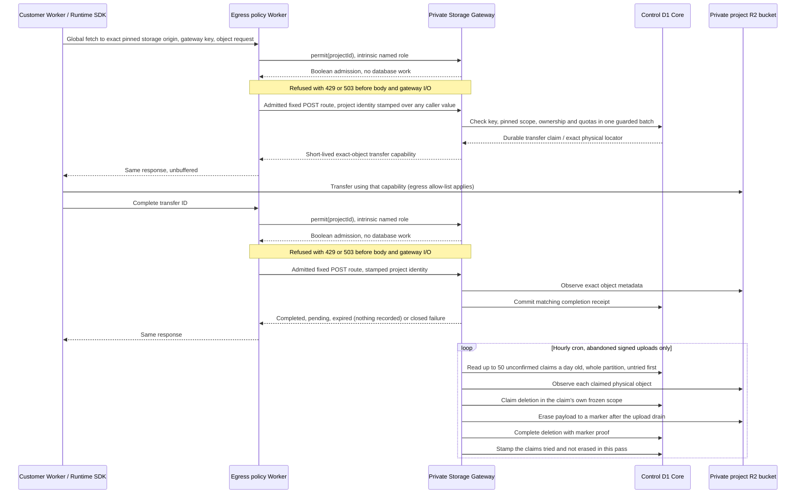
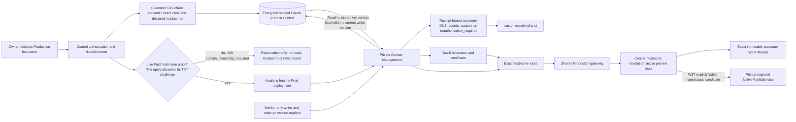
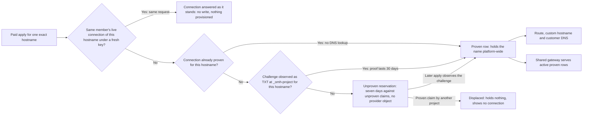
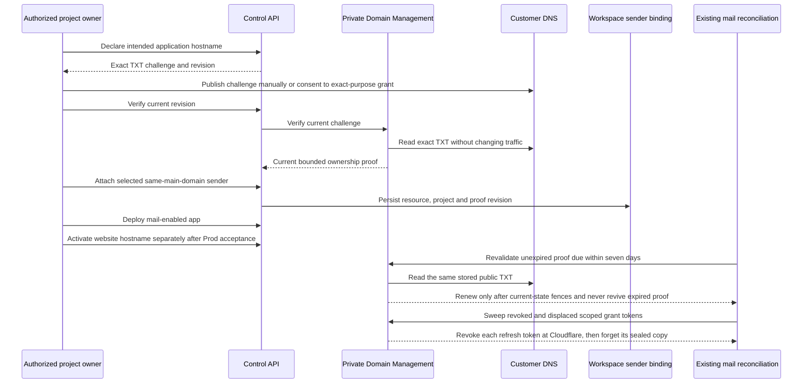
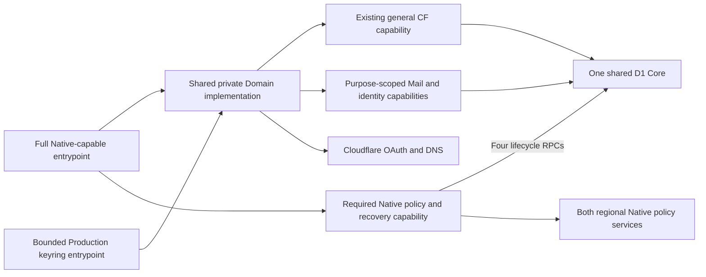
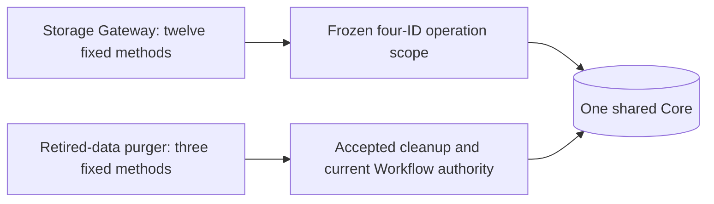

# Storage and domains

The Core holds paid-domain rows under their native constraints: migration
`0480` enforces the exact DNS/gateway grammar, external-host exclusions, live-hostname key, chronology and nullable
receipt/hash state rules, without principal or gateway length caps. See
the native source qualification.

Customer files use private Cloudflare R2 buckets reached through a scoped storage gateway. Application hostnames route through a shared WFP gateway; a custom domain adds customer DNS consent, a Cloudflare SaaS hostname/certificate and an exact Worker route. The Core owns the durable assignments and receipts. These are implemented source contracts; this audit does not query customer records, credential values or live DNS.

## Storage ownership

`projectR2BucketTarget` derives `ohmyho-<project-id>-<application-environment-id>`, Standard storage and disabled public access, in `us` or `eu` jurisdiction. Deployment provisions the bucket for its logical application environment. File keys use a separate `d/<dataEnvironmentId>/<objectKey>` namespace. Shared Dev/Prod data points both logical environments at the same data identity, while files retain the original uploader's bucket environment; isolated mode gives them separate data authorities. Reads resolve that original physical locator, including historical files in different Dev/Prod buckets. Runtime access is scoped by the active key row for the exact project, logical environment and key digest; the row supplies the organization and `dataEnvironmentId`, so the caller cannot choose another project's bucket. The legacy service binding, unsupported under the egress policy until W29, also pins organization, project, logical environment and `dataEnvironmentId` in immutable service properties, so an old Worker cannot be retargeted to a replacement generation; the C3 forwarded path pins that same scope in its injected HTTPS origin and freezes it for each request ([customer file flow](#customer-file-flow)). [Bucket target](../../packages/provider-cloudflare/src/r2-bucket-provider.ts#L101), [deployment bucket scope](../../apps/project-provisioning-worker/src/product-workflow-composition.ts#L881), [durable namespace and original locator](../../apps/control-store/src/catalog/storage-gateway/uploads.ts), [storage binding validation](../../packages/provider-cloudflare/src/wfp-provider.ts#L889).

Storage jurisdiction is separate from the current compute region. Planning and bucket claims resolve the current owner's existing project bucket receipts and pending reservations first; their one consistent jurisdiction remains authoritative for Dev/Prod artifact reuse after the US compute transition. Only a project without recorded storage custody defaults to its current project region. Conflicting stored jurisdictions fail closed, and neither admission nor a new deployment rewrites an existing bucket identity. [Storage authority](../../apps/control-store/src/catalog/r2-management/buckets.ts), [deployment admission](../../apps/control-api/src/product-surface.ts).

R2 Management claims the scope durably, observes ambiguous prior creates, authorizes the current mutation and persists only a matching provider receipt. A changed jurisdiction conflicts rather than silently moving files. Deletion compares the full recorded bucket identity, purges through bounded provider rounds and confirms absence. Each round lists the first page of up to 100 objects and deletes them. A call starts no round and no delete batch once 100 seconds have passed since it began (the observation before the first round counts toward that time box). It runs at most eight rounds: a round costs 101 Cloudflare API requests, and the call's budget of 900 requests leaves 92 for the bucket reads and the bucket delete. The limit holds even if the clock does not advance, so a call purges at most 800 objects. A request already in flight may finish after the box: at most one 15-second listing or one batch of 25 concurrent 15-second deletions. A rate-limited deletion leaves its object for the next listing, and a rate-limited listing ends the call as uncertain without waiting out Retry-After. Only an empty listing reaches the bucket delete, which has its own 15-second request timeout and at most three readback observations. The bucket's total object count is not bounded, so a bucket of more than 800 objects needs more than one call. A bucket that still holds objects when a call ends is uncertain and enters reconciliation; a reconciliation replay of the deletion starts a new call from the first page, and only an empty listing lets the bucket itself be deleted. The purge totals, `objectCount` and `bytes`, count the objects of the completing call only, so a deletion resumed after an uncertain call reports that call's objects. Each listing reads one page answer of up to 2 MiB, because a platform object lists with 650 to 750 bytes of key and metadata and a full page passes the 64 KiB bound that every other provider answer keeps; a larger answer is a contract violation, the purge stops there and reconciliation retries it. A timeout or incomplete observation remains reconciliation work. [Management state machine](../../apps/r2-management/src/runtime.ts#L106), [bucket persistence](../../apps/control-store/src/catalog/r2-management/buckets.ts), [bounded provider cleanup](../../packages/provider-cloudflare/src/r2-bucket-provider.ts#L220).

Platform build objects, Logpush usage logs, the rotated credit log, infrastructure-state snapshots and password-encrypted SQL-export archives are separate resource classes. Customer file storage is not a runtime-secret vault. Customer SQL exports contain SQL dumps rather than customer R2 files; [Authentication and secrets](auth-and-secrets.md#customer-runtime-secrets) owns credential custody and [Mail and recovery](mail-and-recovery.md#customer-export-passwords) owns the export contract.

## Managed-source staging and repository history

Managed Git is a separate storage class from application files. Cloudflare Artifacts holds private versioned source and history; Control owns the tenant/source binding and publication journal. The private SourceFetcher stages bounded file bytes in the existing regional build bucket under `managed-staging/<operation>/<organization>/<project>/<sha256>`. Keys are create-only and content-addressed within the exact operation scope. The persisted receipt binds bucket/key, R2 version, ETag, byte length, content hash and executable mode; subsequent reads refuse a different scope/version/body. Shared content may serve several manifest paths, without turning a staging key into a public download capability. [Private staging RPC](../../apps/source-fetcher/src/managed-git-rpc.ts), [blob/manifest custody](../../apps/control-store/src/catalog/product-api/managed-source-blobs.ts).

Publication consumes a sealed full manifest and writes one Git version. A source-generation switch does not erase prior repositories or historical deployments. Exact committed code is exported into the existing `runs/<project>/<environment>/<operation>/input/source.tar.gz` archive, with credentials/Git metadata excluded; ordinary BuildRunner and WFP receipts continue to pin the archive and artifact version. These objects are not the customer `d/<dataEnvironmentId>/...` file namespace. [Source/build integration](build-and-deploy.md#managed-source-publication).

Private cleanup takes only a database-authorized project-deletion inventory or named operation receipts. Git deletion pins the configured namespace and exact project repository, calls `delete` on SourceFetcher's Artifacts RPC binding itself and requires absence readback. The adapter used to call a bound copy, which the RPC binding sent as the remote method `delete.bind`, so no managed-source project deletion removed its repository and each ended in cleanup failure and reconciliation (observed on Development on 9 and 10 October 2026); a real workerd RPC test now pins the direct call. Staging cleanup validates each scoped key, version/ETag and metadata before deleting it, then verifies absence; an observed newer object is refused. R2 does not supply atomic conditional-version deletion here, so the running deletion/retention claim must exclude source writes through the read/delete interval. Missing objects are idempotent; an unknown provider outcome is not completion. [Deletion inventory fence](../../apps/control-store/src/catalog/provisioning/lifecycle-inventory.ts), [private cleanup](../../apps/source-fetcher/src/managed-git-rpc.ts), [repository deletion](../../apps/source-fetcher/src/managed-git.ts#L805), [RPC deletion regression](../../apps/source-fetcher/test/worker-main.test.ts#L249).

A source upload's one-hour journal expiry denies further staging/finalization; it does not itself erase R2 bytes. Actual Dev US/EU readback confirms a seven-day expiry rule restricted to `managed-staging/`, including objects created before their receipt could be recorded. Dev lifecycle receipt, [scoped operator preparation](../../scripts/managed-source-staging-lifecycle.mjs). Production policy application and age-triggered deletion acceptance remain separate gates. Provider lifecycle rules, when applied and read back, can expire only the temporary `managed-staging/` prefix. They must not target Artifacts history or durable source/build archives. Configuration, lifecycle readback and customer deletion acceptance are separate evidence. Provider/build proof scope.

The authorized PGCF US metadata cutover does not relocate existing buckets, managed repositories or immutable artifacts. Managed source uses its persisted namespace grant even when the current project's compute region differs. Cleanup selects the exact configured regional bucket named in each frozen staging receipt and verifies object identity before deletion. A current region label never substitutes for that historical receipt. [Repository location](../../apps/source-fetcher/src/managed-source-runtime.ts), [receipt-based cleanup](../../apps/source-fetcher/src/managed-git-rpc.ts), [region cutover](database.md#pgcf-implementation-and-cutover).

## Customer file flow

The C3 source candidate uses the intrinsic private `StorageGatewayRelayEntrypoint` for both `permit(projectId)` and forwarded file requests. Before either a mail or storage fetch, Egress calls admission exactly once on that binding, using the dispatcher's canonical project ULID. The method returns only a strict native limiter Boolean without Core access, initializing HTTP/file services or reading a body. Missing, throwing or malformed admission fails closed with 503; exhaustion returns 429 before gateway I/O. Storage owns namespaces 2101/2102 (approximate 1,200 calls per 60 seconds per location); scope-log namespaces 2103/2104 remain separate. The retained `StorageEgressEntrypoint` still requires exact legacy caller props for the limited C1 rollback boundary; its guard is not relaxed. [Intrinsic and legacy entrypoints](../../apps/storage-gateway/src/egress-entrypoint.ts), [relay](../../apps/wfp-dispatch/src/outbound.ts), [D438](decisions/domains-and-mail.md#d438).

The gateway accepts only six fixed POST routes and bounded JSON. Egress overwrites `x-ohmyhost-egress-project-id`; the intrinsic relay validates the canonical header, bearer/media type, route, body project match and environment before any Core access. Bodies are bounded to 8 KiB, or 4 MiB on read/delete batches, with a five-second read deadline. Management injects a canonical scope origin of the form `https://s1-<organization>.<environment>-<dataEnvironment>.<storage-base-host>`, using lowercase ULIDs and DNS labels of 29 and 53 characters. The codec rejects malformed scope labels, noncanonical IDs, non-HTTPS origins, credentials, ports, paths, queries and fragments. The full gateway hostname family is private: malformed prefixed names never fall back to public fetch, and the immutable allow-list admits only the exact injected origin. [Scope codec](../../packages/contracts/src/storage-gateway-origin.ts), [Management projection](../../apps/wfp-management/src/management.ts), [relay](../../apps/wfp-dispatch/src/outbound.ts).

On pinned requests, the body environment must match the URL before any Core access. The key is checked against the pinned organization, stamped project, environment and data identity by a frozen-scope guard in the same batch as each operation, including each batch page. Stale pins return 409 `storage_binding_data_changed` rather than adopting the current assignment; an assignment change in progress returns 409 `data_change_in_progress`. Authorization also refuses a key digest found for another environment of the same project in the same SQL query; the same digest in another project is not conflated. No schema uniqueness constraint or key rotation is implied. The temporary C3 unpinned base-origin path still freezes its first authorized key-row scope per request for existing callers. Removing that branch is the separate C4 gate. A key-lookup 401 carries `x-ohmyhost-gateway-stage: key_lookup`; pre-database rejections do not. Scope-denial logs retain their independent rate limit and exclude keys, headers and bodies. [Scope checks](../../apps/storage-gateway/src/worker-main.ts), [key custody](../../apps/control-store/src/catalog/storage-gateway/auth.ts), assignment races.

Native Cloudflare version/binding readbacks omit service props. The earlier props-readback acceptance criterion is **superseded, not passed**. C3's readable service/entrypoint identity and exact reviewed bundle establish the intrinsic role; generic bindings that declare props still require strict equality. Customer legacy bindings/default entrypoints remain attached until C4 and are not a supported transport. [D438](decisions/domains-and-mail.md#d438).

The gateway signs R2 requests using its own provider credential outside customer code. The customer receives only a signed URL scoped to the exact bucket/object/operation and at most 300 seconds, with create-only upload headers and fixed content length/type; this is an expiring request capability rather than a newly minted provider credential. Customer runtime never receives the reusable parent R2 administration credential. Upload reservation, completion and quota usage remain durable in Control. A new claim of an object key that another reservation or a claimed deletion already names is refused as a conflict (409), since that state never changes for the retry. Completion verifies the expected object rather than trusting the client to report success. [Signed capability](../../packages/provider-cloudflare/src/r2-object-transfer-provider.ts#L126), [durable gateway persistence](../../apps/control-store/src/catalog/storage-gateway/uploads.ts).

Multi-file reads return a bounded framed stream with object bytes, missing entries and terminal metadata; the producer coalesces metadata blocks up to 16 KiB and forwards file chunks unchanged. A found object's body is bounded by a ten-second idle limit between chunks, not by its total duration, and a body that stays silent longer is cancelled. Batch consumers must require complete frames and terminal EOF. Batch deletion rechecks authority between bounded acknowledgement pages, retains individual pending/failed outcomes and never converts a partial result into complete success. [Batch protocol producer](../../apps/storage-gateway/src/batch.ts#L1), [batch runtime](../../apps/storage-gateway/src/runtime.ts).

## Erasure and retired generations

Deleting a file waits until accepted upload capabilities plus the drain interval cannot restore a payload. It replaces the original physical key with a permanent zero-byte marker bound to the exact organization/project/original bucket environment/data environment/transfer and verifies marker metadata before the append-only Control erasure proof acknowledges completion. The marker prevents a late conditional upload from restoring old file bytes. A bounded proof vector validates every accepted deletion and original bucket before inserting any acknowledgements; historical absence receipts retain their original timestamps. [Provider erasure](../../packages/provider-cloudflare/src/r2-object-transfer-provider.ts#L370), [durable proof](../../apps/control-store/src/catalog/storage-gateway/deletes.ts), [erasure schema](../../apps/control-store/migrations/core/0497_storage_erasure_native.sql), [race regression](../../apps/storage-gateway/test/erasure.test.ts).

Changing a data generation does not authorize a stale deployment to use the replacement. A pinned forwarded request checks the immutable deployment scope before every operation and transaction page; redeployment or binding refresh produces a fresh candidate and pin. The C3 migration-only unpinned branch retains the older per-request behavior until C4. Retired-data purge uses a frozen inventory, waits capability drain, claims current deletion authority and acknowledges bounded pages from verified erasure proofs. Unknown provider results remain incomplete; whole-project cleanup needs the reviewed bucket receipt and final absence. [Retired purge](../../apps/storage-gateway/src/management.ts), race regressions, [persistence](../../apps/control-store/src/catalog/storage-gateway/retired.ts).

The retained strict legacy entrypoint supports C1 Egress rollback only while active callers use unpinned origins. After the first pinned head, rollback requires a pin-aware Egress build: C1's anchored host classifier cannot safely route the new prefixed origin. Management has a separate boundary after its first C3-layout publication; both are recorded in [D439](decisions/delivery-and-operations.md#d439). C3 source/local checks do not establish hosted acceptance, the remaining W28 items or C4 completion. Completion progress.

## Storage and hostname billing

Customer file storage, R2 operations and the lifetime of scripts and custom hostnames are billed by the credit service per finished UTC day ([usage billing](billing-and-pricing.md#usage-billing)). For each day the Core lists the project file buckets created before the day closed whose project was not deleted before it began. `R2ManagementService.collectUsage` returns, for each bucket, the Core's confirmed peak payload bytes of the day and the sums of the exact hourly class A and class B records; sampled hours are counted and charged by their sampled count. The credit service prices them with the `r2.storage.standard`, `r2.class_a` and `r2.class_b` cards and posts one charge per organization and day. The collector only reads: no collection cursor, claim or usage row of R2 lives in the Core, and the `r2` cursor passes a day only after it was posted. [R2 source](../../apps/credit-service/src/r2.ts), [collector](../../apps/r2-management/src/usage.ts), [bucket attribution](../../apps/control-store/src/catalog/credit/attribution.ts).

Active WFP scripts (staged before the day closed and not cleaned up by then) and custom hostnames (provisioned and not deleted by then) are billed the same way: the `resources` source multiplies each by 86,400 seconds at the per-second price of its card, with no waiver for the powered-by flag. Platform buckets (build objects, usage logs, credit log, backups) have no customer meter. Attaching a paid domain first reads the credit account: its refusal (credit exhausted past the grace, a spent `stop` budget) comes before the Paid-or-flag requirement (`paid_plan_required`), and the domain write that follows is a separate command that fences no balance. [Resources source](../../apps/credit-service/src/resources.ts), [paid-domain admission](../../apps/control-store/src/catalog/billing/paid-domain-admission.ts).

## Hostname ownership and DNS

Platform Development customer addresses use `dev.check.omh.st`; platform Production uses `check.omh.st`. Project application Dev has the `dev-` prefix in either platform. For example, a Production-platform project handle `calm-river-studio` has `dev-calm-river-studio.check.omh.st` for application Dev and `calm-river-studio.check.omh.st` for application Prod. Handles are presentation identities; stable project/environment IDs own resources. [Address derivation](../../packages/project-handles/src/project-handle.ts), [origin tests](../../packages/provider-cloudflare/src/wfp-provider.test.ts#L270).

The public-site configuration owns `ohmyho.st`, `www.ohmyho.st`, the check-host roots and `omh.st/*`, while Control owns `app.ohmyho.st` and `dev.app.ohmyho.st`. Customer wildcard/individual routes and SaaS resources are managed through domain/WFP services rather than enumerated in the shared gateway's Wrangler routes. Legal, pricing and content pages are served through the separately maintained website Worker and answer 503 from the public-site Worker without that binding, because this repository serves no copy of them; client-download assets remain in the public-site Worker. [Public-site routes/assets](../../apps/public-site/wrangler.jsonc#L10), [Control hostname](../../apps/control-api/wrangler.production.jsonc#L171), [gateway declaration](../../apps/wfp-dispatch/wrangler.production.shared.jsonc#L13).

Free platform addresses use the existing wildcard DNS and shared wildcard Worker route. Deployment reconciliation observes both exact wildcard identities and probes a separate operation-bound hostname before any old exact route switches; it does not create a DNS record, route or SaaS hostname for each new project. The preflight requires an HTTPS `404` carrying `x-ohmyhost-gateway: shared-v1`, which proves arrival at shared ingress. Customer application health is checked separately; this ingress result is not a successful application response. [Wildcard reconciliation](../../apps/cloudflare-domain-management/src/reconciliation.ts#L136), [real probe contract](../../apps/cloudflare-domain-management/src/worker-main.ts), [negative and cutover checks](../../apps/cloudflare-domain-management/test/reconciliation.test.ts#L26).

Custom Production domains use `customers.ohmyho.st` as the SaaS CNAME target; platform Dev uses `customers.omh.st`. Domain management validates that target against the exact platform callback origin. Customer DNS authorization is bound to an actor, organization, project, zone, one-time signed state and ten-minute lifetime. The callback observes the exact zone, encrypts access/refresh tokens and persists the scoped grant. Expired access tokens use the retained grant's refresh path; a provider outage remains unavailable. [Exact binding contract](../../apps/cloudflare-domain-management/src/bindings.ts#L77), [authorization/callback](../../apps/cloudflare-domain-management/src/runtime.ts#L140), [cipher](../../apps/cloudflare-domain-management/src/secrets.ts).

A project's general Cloudflare DNS grant reaches only the exact hostnames its declaration froze, inside its zone, and only while its consenting user still holds `projects:write` on the project. Otherwise the grant reads as `reauthorization_required`: no token is opened and the owner authorizes the zone again. While the project is not active or a re-authorization of the grant is pending, a use is closed: the grant still exists, so a Paid connection's records wait as `reconciliation_required` and are neither treated as gone nor removed. A zone-wide reach is refused. [D471](decisions/domains-and-mail.md#d471), [D472](decisions/domains-and-mail.md#d472).

### OAuth token version readers — source candidate, 6 November 2026

The private Domain Management cipher accepts an optional Worker secret
`CLOUDFLARE_OAUTH_TOKEN_CIPHER_ADDITIONAL_KEYS_JSON`: at most eight canonical version-to-32-byte-base64
reader keys. The primary key and `CLOUDFLARE_OAUTH_TOKEN_CIPHER_KEY_VERSION` select the sole writer;
opening an envelope selects its stored version exactly. Missing configuration preserves the existing
single-key behavior. Invalid maps, writer-version collisions and unknown stored versions fail closed.
The AES-GCM nonce, HKDF purpose separation and actor/project/purpose associated data remain unchanged.
Both the general and purpose-scoped grant paths use this same composed cipher. No grant is rewritten
by adding readers, and an old invocation's late old-version write remains readable.

The prepared Development and Production profiles declare writer `20261106` and explicitly require
the primary and additional-reader secrets. They contain no inline reader-map override. This is a
source candidate, not a deployed rotation. Append the new primary and retained historical keys to
private local custody first. The existing qualified platform release accepts a selected external
0600 JSON `--secrets-file` in a 0700 private directory, copies it to its own private release directory,
and uploads one version containing the new code, dated writer profile, new primary and historical
reader map together. Activate only that exact qualified staged version after its readbacks and
old/new grant and recovery checks. The first successor write therefore already has its old readers
in the same Worker version. Development and Production are separate Worker/key transitions; the
general/scoped cipher readers are composed inside each one.

Do not activate an additional-map-only update on the old binary: its closed binding inventory
rejects the new name. Its serving version keeps its original code/bindings until the atomic switch.
No configuration override, additional writer binding or separate CI profile variant is needed.
Retain every required Production backup reader. Rolling back a writer must keep readers for any
successor ciphertext already written; an old single-key binary is not a safe rollback after
successor writes. [Existing private secret upload boundary](../../scripts/platform-release.mjs).

OAuth state signatures still use the primary key. A previously issued consent callback remains valid
because consumption checks the persisted state digest; it does not recompute that signature. Replaying
a previous begin-authorization request across a primary-key change can conflict while reconstructing
its old state URL. Complete the existing consent URL or begin with a new request identity. This
bounded replay interruption does not erase grants, state records or backups. There is no finite-wait
or zero-pending-state claim that rules out late old invocations. [Decision and rollout boundary](decisions/domains-and-mail.md#oauth-token-version-readers-source-candidate).

## Custom-domain flow

An apply before a healthy Production deployment records `awaiting_deployment` and creates no route or SaaS hostname. Repeating the same authorized apply after deployment creates or observes the exact Worker route and SaaS hostname, persists their identities, reconciles customer DNS through the scoped grant, and reports active only when the certificate/hostname is ready. Gateway retargeting preserves existing customer DNS and moves a receipt-bound route in place. [Apply](../../apps/cloudflare-domain-management/src/paid-domains.ts#L208), [observation](../../apps/cloudflare-domain-management/src/paid-domains.ts#L261).

The shared Production gateway resolves the domain through Control and selects the current immutable application Worker. Routing never lets a hostname/query parameter select another project's script. Custom-domain access follows the credit account's serving decision: a credit exhausted past its seven-day grace or a spent `stop` budget refuses first, otherwise the project needs effective Paid access or the powered-by flag. Browser resource/CORS declarations and server egress remain separately enforced. [Gateway checks](../../apps/wfp-dispatch/src/shared-gateway.ts#L177), [serving decision](../../apps/control-store/src/catalog/credit/decision.ts#L57), [browser security](../../apps/wfp-dispatch/src/browser-security.ts#L45), [services](services-and-workers.md#customer-gateway-and-outbound-policy).

The flag counts only for the organization that enabled it and still owns the active project; transfer closes the prior owner's period. A Free organization cannot disable it while its exact project has an awaiting, pending or active custom-domain connection and no effective Paid access. This preserves the domain's current admission dependency rather than granting an organization-wide Paid entitlement. [Flag ownership and disable guard](../../apps/control-store/src/catalog/projects/api-metadata.ts).

## Paid hostname ownership

A Paid custom hostname is platform-exclusive only once the project proves control of that exact name. The proof is the project's Paid hostname proof, a record of its own (`paid_hostname_proofs`, [migration 0710](../../apps/control-store/migrations/core/0710_paid_hostname_proofs.sql)), and the apply stores it in `hostname_proven_at` ([migration 0640](../../apps/control-store/migrations/core/0640_paid_domain_hostname_proof.sql)). Without a live proof the apply still stores an unproven reservation, but it answers `domain_ownership_required` (409, not retryable) before any route, custom hostname or customer DNS record is made. Migration 0640 grandfathers only connections that already route, as proven; new reservations are not. A project holds one Paid connection. Apply and delete answer a fresh key that meets another hostname's connection, or a connection another member configured, with `domain_already_configured` (409, not retryable: delete the current connection only to replace it), and a fresh key that meets a connection being deleted with `domain_deleting` (409, not retryable: wait until the deletion finishes). The same member's fresh key for this hostname's live connection is the same request: apply answers that connection as it stands (200) and writes and provisions nothing; only the original key activates an `awaiting_deployment` connection. A reused key answers `idempotency_key_reused`: on apply, a key of this connection whose request changed or whose connection has since ended; on delete, a changed request under the key. A repeated delete of an already deleted connection answers the deleted state (200), under its own key or a fresh one, and opens no native-auth policy operation: the first delete's operation is the only one, and its completion settles it once.

An unproven reservation holds its name against other unproven claims for seven days and against nothing once a proven claim arrives. A proven claim displaces the unproven reservations of other projects for that name, in the same batch, to the terminal state `displaced` ([migration 0642](../../apps/control-store/migrations/core/0642_paid_domain_displaced.sql)). A displaced connection holds nothing, has no provider object, reads as an empty connection and can be deleted. Its owner can apply again: the connection is held while a proven owner keeps the name and otherwise completes only with its own proof. The shared gateway answers only active, proven rows, so an unproven or displaced name never routes. [D468](decisions/domains-and-mail.md#d468), [D469](decisions/domains-and-mail.md#d469), [D470](decisions/domains-and-mail.md#d470).

When the hostname has no live proof, the apply issues its challenge: the Worker creates one random `omh-domain-v1=` value per hostname, the owner publishes it as a TXT record at `_omh-project.<hostname>`, and the apply observes that record with the same observer as the application identity. A verified proof lasts 30 days; a later apply after that window observes the same challenge again and renews the proof. A project holds at most ten pending challenges, and a pending challenge older than seven days is pruned unless it belongs to the connection's hostname. A connection already proven for its hostname makes no lookup on apply. The Paid status reads the proof without verifying it and shows an unproven hostname's pending challenge as a `TXT` record with purpose `ownership`. Deleting the Paid connection deletes its hostname's proof, and a project whose owner or lifecycle leaves active loses all of its proofs ([D555](decisions/domains-and-mail.md#d555) to [D557](decisions/domains-and-mail.md#d557)). The mail identity and this proof are independent: a mail declaration never suspends or refuses a Paid connection, and a Paid write never suspends mail ([D558](decisions/domains-and-mail.md#d558)).

## Application identity before mail-gated deployment

The public TXT observer uses a fixed DoH origin and native Workers `redirect: "manual"`; every non-2xx response, including a redirect, is rejected without following its target. Workers supports `manual` and `follow`, while the Node-supported `error` mode throws during native request construction before any HTTP request. The existing W25 regression pack bundles the exact observer into workerd under the declared service compatibility date/flags and uses a controlled outbound DNS fixture to verify both a matching answer and redirect rejection without internet-dependent CI.

The W25 application-domain identity is independent of website routing. A reserved `awaiting_deployment` custom hostname is a declaration, not proof. A fresh mail-dependent project declares its intended Production hostname, receives an unguessable project/hostname/revision-bound TXT challenge at `_omh-project.<hostname>`, publishes that exact challenge manually or through a separately consented Cloudflare grant, and explicitly verifies current DNS. The grant's reconciliation runs first and never decides on its own: a provider or persistence refusal of it (for example a foreign record at the name) leaves the public TXT observation as the verdict, so a published challenge verifies and a missing one stays pending; any other reconciliation error is logged and fails the verification. A pending challenge lasts 24 hours; verified identity lasts 30 days. Renewal verifies the same current TXT and revision; an expired pending challenge requires a new declaration. Re-declaration advances revision and suspends dependent bindings, so ordinary renewal uses verify. Reads expose revision and expiry. The existing mail reconciliation schedule checks at most 20 verified, still-unexpired proofs due within seven days, at most once per project per day. A private Domain service reads the stored public TXT without DNS changes and renews for 30 days only if ownership/lifecycle, current proof, binding and resource identities remain unchanged after that read. Failure leaves the original expiry in place; expired proofs require a currently authorized manual verification. Expiry, revocation, a changed declaration or ownership fences deny dependent shared-sender admission. Technical `check.omh.st` names cannot qualify. The Paid custom-hostname proof is a separate record that this identity does not supply ([Paid hostname ownership](#paid-hostname-ownership)). [Identity service](../../apps/cloudflare-domain-management/src/application-domain-identity.ts), [same-domain mail rule](mail-and-recovery.md#same-domain-shared-sender-contract).

A proof DNS grant freezes purpose, exact resource/revision, project, actor and zone with the existing one-time ten-minute handoff. Its encrypted custody is separate from website DNS authorization and workspace sender DNS authorization. A callback that exchanges a code but stores no grant (zone not the requested one, sealing or persistence failure) revokes that exchanged refresh token at Cloudflare, best-effort, and keeps its status. Consent or zone visibility alone does not verify application ownership. Challenge automation must not change A/AAAA/CNAME traffic, certificate resources or mailbox MX. Manual DNS remains supported. Stale callbacks cannot validate or restore replaced/revoked declarations. Project deletion that meets a grant whose refresh token Cloudflare already revoked (the customer removed the application) writes nothing to that customer zone: its delegation and mail records stay in the zone, while the platform routes, hostnames and the revoked grant are still removed. A Paid connection whose grant expired is removed the same way. Each customer-zone record that deletion cannot remove keeps an `absent` receipt, which the deletion inventory records as `not_found`; the owner accepts that the customer's own DNS records that still point at ohmyho.st stay in place. Revoking a scoped DNS grant revokes its stored refresh token at Cloudflare and wipes its sealed tokens; the sweep is described in [mail and recovery](mail-and-recovery.md#mail-deletion-and-historical-records). A refresh-token pair that a re-authorization displaces is revoked by the same sweep before its record is deleted ([D476](decisions/domains-and-mail.md#d476)). W25 source implementation and rollout evidence are tracked in its progress record; this diagram is not live acceptance.

## Domain and mail cleanup

DNS, Worker routes and SaaS hostnames retain provider-ID receipts. Deletion checks current scope and frozen resource identity, removes only matching resources, and observes absence before completing. Project deletion removes live domain connections before revoking the customer grant. Historical successful receipts do not authorize deleting an unrelated current record. Token refresh/revocation uncertainty must reconcile before a deletion reports success. [Project deletion](../../apps/cloudflare-domain-management/src/project-deletion.ts), [Paid-domain deletion](../../apps/cloudflare-domain-management/src/paid-domains.ts#L302), [route adapter](../../packages/provider-cloudflare/src/worker-route-provider.ts), [SaaS adapter](../../packages/provider-cloudflare/src/custom-hostname-provider.ts).

Resend's required domain records use the same scoped DNS authority and current project/mail-domain receipts. The historical `ses-management` directory name does not make SES the selected delivery provider. One project mail domain is separate from application Dev/Prod addresses and does not imply a separate mail service per hostname. [Resend DNS](../../apps/cloudflare-domain-management/src/resend-dns.ts), [selected Resend entrypoint](../../apps/ses-management/wrangler.production.jsonc#L5).

## Review and verification boundaries

The associated source/tests cover exact authorization inventories, encrypted grant AAD and key versions, canceled/replayed declarations, foreign DNS conflicts, uncertain provider responses, immutable bucket jurisdiction, storage quotas/generations, late PUT races and cleanup receipts. Configuration and deterministic adapter checks establish local contracts; real D1 and provider contract suites add boundary coverage when run. This documentation audit reads source and tests without accessing secrets or claiming a fresh execution or live DNS/provider verification. Per-file review coverage is retained in the audit ledger.

## Bounded Production Domain keyring composition — source candidate

The original Production service was captured from source `d87ca9a3` with 19 bindings and no Native
admin services. Its current compiled module was byte-equal to that first immutable capture. The
bounded keyring profile `wrangler.keyring.production.jsonc` preserves the same Worker/account,
existing six service identities, provider fields, the 25 original RPC methods plus `sweepRevokedGrants` ([D464](decisions/domains-and-mail.md#d464)) and private no-store 404. Its only
additional custody binding is the historical OAuth reader map. This is one current implementation,
not copied historical source or a patched deployed bundle.

The full factory still requires the complete Native capability: four Core lifecycle methods and
both regional policy services. The closed bounded Production factory omits that capability. It
uses the original delete input/Core wire (including omission of Native principal/delegation and
mark-delete idempotency additions), unchanged `classifyMailDomain` declaration semantics and no
new stored-host classification. Its purpose-bound delegation parser rejects Native auth actions
both as an explicit action and inside a restriction, including stored/signed Core delegation
records. Full composition retains its current stricter classifier, complete vocabulary and Native
policy/recovery behavior. No customer request, environment flag or exception fallback selects the
bounded composition.

One shared handler and RPC wrapper provide both compositions. The only RPC added is `sweepRevokedGrants` ([D464](decisions/domains-and-mail.md#d464)); there is no new health probe,
handler retry or event replay. The OAuth cipher bytes and old-v1/dated-writer contract stay exactly
as qualified in the prior keyring change. New code, saved primary, retained reader map and dated
profile still upload atomically through the private secret-file release path; no live grant or
cipher rewrite is authorized through a staged version.

The bounded profile stays discoverable for resource inventory but cannot enter a full Core train,
including through `--also` or `--exclude`. Full trains select the ordinary Native-capable profile.
Only the exact same-Worker/account profile with its six unchanged existing service facts has this
manual exception; unrelated duplicate profiles still fail closed. The package builds and reviews
both entrypoint bundles. Source preparation does not establish canonical final CI, provider binding
readback or activation. [Decision](decisions/domains-and-mail.md#bounded-production-domain-keyring),
progress and check scopes.

## Domain Management on the Core

The Domain Management Worker's default composition supplies general OAuth/domain configuration, customer DNS, Paid domains, deployment reconciliation and operation-bound deletion through `CloudflareDomainRuntime`; the actual Mail composer supplies `ScopedDnsRuntime`, `ApplicationIdentityRuntime` and `MailDnsRuntime`. None of these callers receives raw Core SQL authority. Fixed wire records strip legitimate extra local fields without loosening the Core command schema.

General grant refresh claims a renewable technical exclusion before token exchange; every bounded provider request renews it. The sealed pair and release commit together, and an uncertain claim never supplies permission. Grant versions keep microseconds for exact write comparison. The original declaration prerequisite, Paid key/hostname conflicts and latest deletion receipt ordering remain public contracts.

The Core holds the eight general/scoped CF families, including all thirty physical receipt fields. Migration `0498` carries the original fields alongside the derived runtime body and preserves global authorization/receipt identities with unique indexes; new observations write both representations. Receipt replay compares the complete outer identity/time and canonical body semantics; JSONB key order never changes receipt identity. Only the two named scoped current-resource INSERT checks recognize the unserved `0335` historical context. Static consent/FK/shape guards and runtime update checks remain active. Paid facts belong to the credit account ([credit-account tables](database.md#credit-account-tables)) and application-proof facts belong to Mail; neither is duplicated here.

## Storage capabilities on the Core

The qualified Storage catalog is composed through two separate fixed factories. `StorageGatewayRuntime` carries the original ten upload/read/delete methods plus two platform-wide methods for the hourly sweep, the read of unconfirmed upload claims and the attempt stamp of the claims it did not erase; every effect retains its frozen organization/project/environment/data-environment scope, and the sweep's read and stamp are the only ones without a caller scope (each erasure it leads to runs in that claim's own frozen scope). `StorageDataRuntime` carries only the three retired-generation inventory/claim/completion methods, whose authority remains the accepted data-change and current claim/lifecycle/source/delegation. A customer operation cannot gain retired-data cleanup authority from the factory. Existing native transactions and erasure evidence remain unchanged.

The factory modules add the store-owned layout and route fence to the qualified commands. Composition progress.

## Single-OAuth connection evidence in scoped DNS

The D453 candidate uses automatic immutable connection proofs, accepted token restrictions and the current canonical action for scoped DNS work. The one-time cutover preserves exact original authorization JSON separately from converted current authority. Original delegation bytes are used only to verify already-issued signed state; the current proof is always used for permission and provider-use checks. New state signs a bounded authority digest while Core retains the full accepted cap. Token encryption AAD is unchanged. Populated pre-cutover fixtures and a fixed old HMAC/AES-GCM regression qualify this distinction; ambiguous historical ownership aborts conversion rather than repinning authority. A deployment still requires the real data census and drain/recovery boundary. [Current parser and signing](../../apps/cloudflare-domain-management/src/scoped-dns-authorization.ts), [Core conversion](../../apps/control-store/migrations/core/0608_mcp_connection_revocations.sql), implementation limits.

## Native Auth origin withdrawal candidate

W37 makes an approved canonical origin part of current Native authority. A handle change or Paid-domain withdrawal clears that origin, advances configuration and revocation generations and retains an exact per-realm policy-sync snapshot before it can finish. Domain Management and the handle Workflow apply the private regional policy and acknowledge it under the same pending identity. A realm with no logical provisioning history can acknowledge `unprovisioned`; partial role, preparation, restore or registry history blocks that shortcut. The independent project's physical Auth database alone does not prove a logical realm exists. [Origin fence](../../apps/control-store/migrations/core/0614_native_auth_origin_fence.sql), [withdrawal snapshot](../../apps/control-store/src/catalog/identity/native-auth-domain-snapshot.ts), [acknowledgement](../../apps/control-store/src/catalog/identity/native-auth-domain-sync.ts).

Pending snapshots prohibit competing policy/head/registration changes and insertion of new affected-realm role, preparation and restore records, so a withdrawal cannot race logical bootstrap. Policy application requires current private registry and Core registration proof; the directory and Owner pause survive origin loss. These are source-candidate lifecycle edges in addition to the existing routing/DNS flow above. [Pending guards](../../apps/control-store/migrations/core/0618_native_auth_domain_sync.sql), [Domain caller](../../apps/cloudflare-domain-management/src/paid-domains.ts), [handle caller](../../apps/project-provisioning-worker/src/product-workflow-composition.ts), [Auth policy](auth-and-secrets.md#customer-application-auth). Local D1 race evidence is separate from pending final integration, Astra review, hosted acceptance and release.
